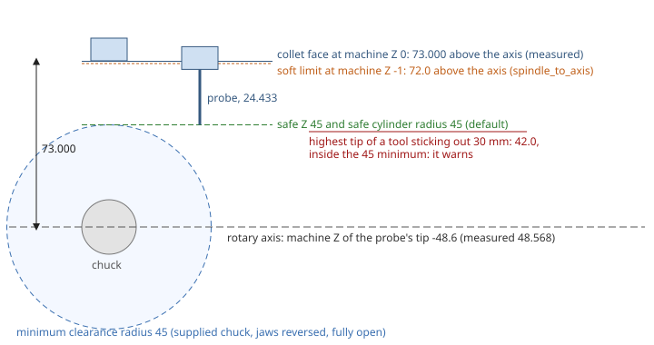
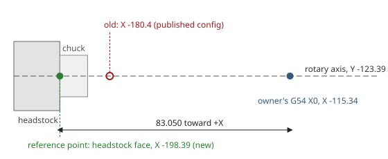

# 0649: The built-in Makera Z1 takes the owner's firmware 1.1.3 measurements (SET-01, SET-06, SET-10, UI-13, GC-14, NFR-12; issues #586 and #793; lane PROFILE-1.1.3)

- **Status:** Proposed by lane PROFILE-1.1.3 on 14 Nov 2026. The owner's decisions 1 to 10 and the confirmations below were relayed by the coordinator the same day (decision 0049); the record itself awaits the owner's acceptance, which the coordinator relays.
- **Date:** 14 Nov 2026.
- **Evidence:** the owner's tests of 0.55.0-rc2 on the Z1, firmware 1.1.3 and ESP32 1.1.3, 11 to 14 Nov 2026, recorded in issue #586 comment 6805176778, and the owner's measurements of 14 Nov 2026 relayed by the coordinator.
- **What it amends:**
  - [Decision 0013](0013-z1-profile-consensus.md) (accepted) items 2 and 3: the travel is the firmware's soft limits, X −207 to −1, Y −160 to −1 and Z −102 to −1, not −200..0, −200..0 and −100..0; the rotary reference point is the headstock face, X −198.39 and Y −123.39, not the published configuration's −180.4 and −108.8.
  - [Decision 0317](0317-z1-measured-axis-height-and-safe-z.md) (accepted): the default safe cylinder radius and safe Z are 45, not 40, and the recommended minimum safe Z is 45, not 30.
  - [Decision 0318](0318-z1-spindle-height-warning-switched-on.md) (accepted): the spindle-to-axis distance is measured, 72.0, not derived, 73.1.
  - [Decision 0495](0495-minimum-clearance-and-clearance-from-stock.md) (accepted) D4: the Z1's minimum clearance radius is no longer blank: 45, confirmed for the supplied chuck with its jaws reversed and fully open.
  - [Decision 0231](0231-machine-spindle-speed-range.md) (accepted) item 3: the Z1's spindle range is 4000 to 13000 rpm, confirmed.
  - No record, but code: the Z1 footer check for Facing (`crates/openchuck-app/src/facing/written.rs`, `verify_footer`) takes the footer's `G28` to machine X −11.6, Y −14.6, Z −3, not machine 0 (decision 6).
- **Builds on:** [0647](0647-the-z1-turns-a-at-most-1800-deg-per-min.md) (the A limit, from the same `M203.1` reading), [0648](0648-the-block-rate-air-cut-runs-one-section-per-file.md) (7 ms on 1.1.3), [0007](0007-sp-12-z1-conventions.md) (the SP-12 conventions).
- **Open items:** OI-60, OI-982, OI-1292 and OI-1780 closed; OI-2146 new (the user guide).

Requirements and architecture are not edited by this record. No project or machine schema changes: every value changed here already has a field (machine profile schema 8). No public API of the library family changes. One code change in `openchuck-app` (decision 6).

## Context

The built-in Z1 profile mixed values the owner had confirmed, values from Makera's published profiles and firmware configuration, and program defaults (decision 0013). The owner's rc2 testing on firmware 1.1.3 checked several of them on the machine.

What was measured or observed (owner, 11 to 14 Nov 2026):

1. **Maximum rates.** `M203.1` prints X 20, Y 20, Z 10 (mm/s) and A 30 (deg/s): X and Y 1200 mm/min and Z 600 mm/min, as the profile has; A is decision 0647's change.
2. **Block time.** The split block-rate air cut (decision 0648): 7 ms smooth in both parts, 5 ms stuttering. The profile's `min_block_ms` 7 holds on 1.1.3.
3. **SP-12 conventions.** The rotary axis along X, the A direction and the continuous A range hold; `G93` is ignored, as on 1.1.2.
4. **Axis height.** 48.568 mm, consistent with the profile's −48.6. With G54 Z0 on the axis, the machine Z was −67.657 with a tool length offset of −19.09 and −68.180 with −19.612: each is the axis height plus the offset.
5. **Travel near home.** A soft limit alert triggers at machine Z −1. The owner then reported that the soft limit minimums are all −1.0, and that a move to −0.9 is refused. At the far ends the soft limit triggers beyond X −207, Y −160 and Z −102 (the owner's measurement). The profile had −200..0, −200..0 and −100..0. The refusal's text is not recorded.
6. **Spindle to axis.** With no tool and the tool length offset calibrated to the collet face (offset −24.433), G54 Z0 on the axis reads machine Z −73.000: the collet face at machine Z 0 is 73.000 mm above the axis. A dummy tool 4.821 mm from the collet face (offset −19.612, machine Z −68.180) gives 73.001. The profile's 73.1 was derived (48.6 + 24.5, the probe's stick-out by caliper, decision 0318); the probe's stick-out on the tool setter is 24.433.
7. **Clearance.** A clearance radius of 45 mm is needed for the supplied Sanou K02-50 chuck with its jaws in the reverse configuration, fully open (60 mm chuck opening). The profile's default was 40 and its minimum blank.
8. **Spindle range.** With `T1 M6` and no tool, the spindle runs when S is 1000 or above, and no slower than 4000 rpm. The owner states that 13000 rpm has been tested.
9. **Tool change.** `M5`, `T1 M6`, `T2 M6`, attended with no material: the tool change is shown, the tool touches off on the measurement switch, and the machine returns to the G28 position; the offsets are as expected (OI-41, closed). `G28` goes to machine Z −3, then X −11.6 Y −14.6.
10. **Clearance at safe Z** (gate 4 step P10): about 13 mm clear.
11. **Rotary reference point.** G54 set in 4-axis mode read X −115.34 and Y −123.39 in machine coordinates (an earlier Y −124.39, possibly not in 4-axis mode, is withdrawn). The owner's X0 is 83.050 mm toward +X from the face of the headstock body next to the chuck, so that face is at machine X −198.39. The profile had −180.4 and −108.8 from the published Z1 configuration (anchor1 plus rotation offset), 17.99 mm and 14.59 mm away.
12. **Tool numbers.** The controller accepts `M6 T1000` and `M6 T1001`. The probe's tool number is not recorded.
13. **G0 rates** (G53, no tool, 100 %): X −10 to −110 (100 mm) took 5.3 s (5.0 s at 1200 mm/min plus acceleration); Z −5 to −55 (50 mm) 5.13 s (5.0 s at 600 mm/min); A 0 to 360 12.22 s (12.0 s at 1800 deg/min). The rapid limits equal the feed limits.
14. **`G28`** goes to machine Z −3, then X −11.6 Y −14.6 (item 9).

## Decision

The owner's decisions of 14 Nov 2026, relayed by the coordinator, one at a time:

1. **The travel is the firmware's soft limits, and the spindle-to-axis distance is 72.0** (owner's decisions 1, option A, and 7).
   - `travel` is X −207 to −1, Y −160 to −1 and Z −102 to −1, *confirmed*: near home a move to −0.9 is refused on all three axes; at the far ends the soft limit triggers beyond those values (the owner's measurements, decision 7). Y −160 matches the firmware's note that Y is held above −160 with the rotary module fitted and soft limits on. The refusal's text is not recorded. OI-1292 closes.
   - `spindle_to_axis = 72.0`, *confirmed* (measured): 73.000 from the collet face at machine Z 0, less 1 mm to the soft limit. The field is defined as the distance from the spindle at the top of the Z travel down to the axis (`MachineProfile::spindle_to_axis`), so the two values move together. The spindle-height check (decision 0318) now warns for a tool 1.1 mm shorter than before.
   - No warning for a project holding an old copy of the Z1: the difference is about 1 mm, and the machine's own soft limit stops it.
2. **The minimum clearance radius is 45, and the default clearance is 45** (owner's decision 2, option B, with the owner's amendment).
   - `min_clearance_radius = 45.0`, *confirmed*, for the supplied Sanou K02-50 chuck with its jaws reversed and fully open (60 mm opening) only. Other chucks, jaw configurations and a tailstock are not covered; the user sets the setup's own minimum for them (decision 0495 item 1). OI-1780 closes with that scope.
   - `clearance.radius = 45.0` and `clearance.safe_z = 45.0`, *confirmed* by the owner: set to the measured minimum. The default then clears the measured worst case and adds no warning of its own. With the probe fitted, its tip is at machine Z −3.6 at safe Z 45, 2.6 mm below the top of the travel.
   - Every tool whose flute length + 5 mm is over 27.0 mm (flute over 22.0 mm) warns that it may be too long to clear the workholding within the Z travel (decision 0495 item 6b); at safe Z 45 the same tools also fail the spindle-height check.
3. **The spindle runs from 4000 to 13000 rpm** (owner's decision 3, option A). `min_spindle_rpm = 4000.0`; both ends *confirmed*: the lowest observed, the highest on the owner's statement (no run details recorded). An operation below 4000 rpm blocks Post and export (decision 0231 item 2); none of the sample projects, example projects or tool libraries is below it. OI-982 closes.
4. **The recommended minimum safe Z is 45** (owner's decision 4): advice, never a limit, from the owner's measurement for one chuck and jaw setup; *confirmed* by the owner.
5. **The rotary reference point is the centre of the headstock face next to the chuck** (owner's decision 5, option A): `rotary_origin` X −198.39 and Y −123.39, both *confirmed*. It is where the controller works from; the chuck's front face is not used, because its distance from the headstock varies with the jaws. OI-60 closes. For a new project, a setup's part offset and work zero are measured from the headstock face: the expected G54 X shown for the same work zero is 17.99 mm lower than before, and the Y shown is −123.39. No G-code word changes: programs are written in work coordinates. Existing projects keep their copy; no old-copy warning.
6. **Confirmed by the owner's statement** (14 Nov 2026): the block window, 32 (its source says that the 32-block queue comes from the firmware source and that decision 0648 found the source model's short-block timing fails below 5 ms); Short moves, Report, as the default from the gate 4 testing. Short moves stays a software policy: the program never counts it as a machine value (`MachineProfile::is_confirmed`), so its confirmed mark is recorded in the source only.
7. **Tool numbers:** `max_tool_number` stays 1000, the program's own limit (OI-62); its comment records that the controller accepts 1000 and 1001. Raising it is not proposed: no user has asked for more than 1000 tools, and the limit catches typing errors.
8. **The tutorial's tool warning** (owner's choice, option A): the values stand; the user guide explains the warning (OI-2146).
9. **The Z1 footer check takes the observed `G28` point** (owner's decision 6, option A; a code change accepted by the owner, 14 Nov 2026, relayed). The check that a Facing program's footer (`M5`, `G53 G0 Z-3`, `G28`, `M2`) clears the setup refused a travel that does not contain machine 0, and a top of Z below 0. With the soft limits at −1 it would refuse every Facing operation posted with the Z1 post on a new project. The `G28` point is now the constant `Z1_G28` = (−11.6, −14.6, −3), citing the owner's observation; the travel must contain it and reach Z −3 (`crates/openchuck-app/src/facing/written.rs`: the constant above `refuse`, and the two conditions in `verify_footer`). Options not chosen: keep the travel's top at 0 (the profile would be wrong); drop the check (loses a guard).
10. **The rapid rates are confirmed** by the owner's timed G0 moves (Context item 13); no value changes.
11. **The sample and example projects follow the built-in Z1** (owner's decision 8, option A). The reference jobs and the command line's end-to-end tests build each sample from the built-in Z1 and must write the same programs as the committed samples, so the 15 committed machine copies (and the blisk example's generator) take the built-in's values for the fields their schema holds, and the golden programs are re-blessed. `docs/archive/0649-z1-firmware-1-1-3/zdiff.py` checks every changed golden against `main` at `90e78107`.
12. **The samples keep their physical place** (owner's decision 9, option A). With the reference point on the headstock face, model X 0 is that face; the samples and reference jobs were laid out with model X 0 at the old reference, 17.99 mm in front of it, and the sphere job's links would have been behind the face and outside the travel. Every sample and example setup, the reference-job builder, the STEP pipeline builder and the command line's end-to-end builders move the part, the stock, the tabs and the work zero by the same `LAYOUT_SHIFT` along X. It is 17.990234375 mm (17 + 507/512), the value nearest 17.99 that is exact in binary; the expected G54 X still prints −180.400. Held regions follow the stock ends. The work zero moves with the part, so the G-code is written from the same place.
13. **Rounding ties of the shift are accepted** (owner's decision 10, option A). A part moved along X and its coordinates moved back cannot be exact to the bit everywhere: where a written X falls exactly on half of the last place, it rounds the other way. Such X words differ by 0.001 mm, an X word left out as modal can be written (or the reverse), and on those short moves the F word, worked out from the written words, changes (up to 8.7 mm/min, 0.8 %). Counts (Z1 / LinuxCNC programs): blisk helical 5 degrees 24 / 45 lines, blisk helical 2 degrees 15 / 17, cone_indexed 8 / 8; none elsewhere. Any other shift moves the ties to other lines. `zdiff.py` classes each as a rounding tie and fails on any other change. Option not chosen: keeping X at −180.4 with its datum stated as 17.99 mm in front of the headstock face, which avoids them but leaves the reference off the face the controller works from.
14. **Provenance only** (no decision needed): the maximum feeds cite the `M203.1` reading for X, Y and Z; `min_block_ms` cites 1.1.3 and decision 0648; the rotary axis, A direction and A range cite the 1.1.3 recheck; the rotary origin cites the axis height of 48.568; the tool length measurement cites the 1.1.3 tool change. Every value still unconfirmed names what is missing.

### What is still open

Every confirmable value of the built-in Z1 is confirmed: the status bar count is 0. Two facts are still not recorded and change no value:

| Item | Missing | Test |
| --- | --- | --- |
| Soft limit refusal | Its exact text | Send `G53 G0 Z-0.9` and copy the message |
| The probe's tool number | Not recorded (the limit of 1000 is the program's, not the controller's) | Read it on the controller |

## Options not chosen

- **Decision 1, option B:** the top at −1 but the spindle-to-axis distance kept at 73.1. The spindle-height check would allow the spindle 1 mm past the soft limit.
- **Decision 1, option C:** no value change. The profile would keep a top the machine does not reach.
- **The owner's formula 100 − 1 − 48.6 = 50.4** for the spindle-to-axis distance (asked and answered, 14 Nov 2026): it uses the bottom of the travel, which the distance does not involve, and is not a distance on the machine. The distance from the axis down to the bottom of the travel is 51.4 (−48.6 to −100, untested), a question for short tools near the axis (OI-1781).
- **Decision 2, option A:** the minimum 45 with the defaults kept at 40. Every new Z1 setup would also warn that its safe cylinder is inside the minimum, with the same long-tool warnings as B.
- **Decision 2, option C:** no value change. Nothing would warn about the jaws.
- **Decision 3, option B:** a lowest speed of 1000. Speeds of 1000 to 3999 would run at 4000, faster than programmed, without a warning.

## Consequences

- **New projects** take the new values. A project made with an earlier build keeps its own copy of the profile (SET-01) and gives the old results; the user chooses the Makera Z1 again in the setup's machine section to take the new ones. No warning is added for an old copy (decision 1).
- **Golden programs change** (decisions 2, 8 and 9). Against `main` at `90e78107` (`zdiff-output.txt`): every Z1 and LinuxCNC golden changes its safe-Z words, Z40 to Z45 (2 per program; 5 in cone_indexed, 7 in swarf, 33 in the axial cones, 64 in blisk axial); first_cut also changes its two estimates (Rough 3352 to 3353 s, Finish 720 to 722 s) and two rapid link heights between roughing layers, Z21.334 to Z21.599 and Z23.355 to Z23.356, which come from the 45 mm safe cylinder (with the clearance at 40 they are unchanged); and the rounding ties of item 13. Cutting positions are otherwise unchanged. The setup-sheet goldens use the example machine and do not change.
- **New projects** on the Z1 lay out from the headstock face: a stock placed at model X 0 starts at the face, so the chuck's length is no longer in front of it. The user guide explains it (OI-2146).
- **The tutorial's tool warns.** *Z1 O-flute 3.175x25* (flute 25 mm, assumed stick-out 30 mm) reaches at most 42.0 mm above the axis, inside the 45 mm minimum. This is what decisions 1 and 2 imply under the flute + 5 mm assumption of decision 0318. The tutorial's wording is with the owner; the guide lane of OI-2146 makes the change.
- **The unconfirmed count** of the built-in Z1 drops from 6 to 0.
- **Program checks with the measured travel.** Y −160 to −1 is narrower than the old −200 to 0: a program that needs Y below −160 is now flagged by the program check (`posting.rs`) and the setup checks. With the axis at Y −123.39, that is a Y offset over 36.6 mm from the axis, which no 4-axis program written with Y0 on the axis reaches.
- **The rotary reference moves to the headstock face.** For a new project the expected G54 X shown (setup checks, setup sheet, the CLI `setup` report) is 17.99 mm lower for the same work zero, and Y is −123.39. The program check converts the X and Y travel to program coordinates with the same point (`posting.rs`), so it now checks against the controller's own frame. The user guide's definition of the rotary reference no longer says "chuck face".
- **The user guide** (OI-2146): this change updates the Z1 tables in `reference/machine-profiles.md` and `how-to/confirm-machine-values.md` and the release notes; the figures, counts, tutorial prose and listings go to one guide lane with OI-2145.
- **`testdata/examples/blisk-start/generate.py`** writes the example's machine text byte for byte as committed (issue #797: it still had the A limit of 3600).
- Generated G-code is still the user's to verify before it runs (NFR-12). None of these values makes a program safe on a machine.

## Verification

- **Environment:** branch `claude/lane-profile-113` from `main` at `90e78107`.
- **Tests (written from the decisions first, watched failing, then passing):**
  - `crates/openchuck-project/src/machines.rs`: `req_set_01_builtin_z1_reads_and_marks_every_value` (every field marked, the minimum included; none unconfirmed; Short moves recorded confirmed but never counted), `req_set_01_req_set_06_the_z1_axis_height_is_measured_and_its_safe_z_is_in_the_travel` (45/45, top −1, safe Z at machine Z −3.6, X −198.39 and Y −123.39 from the headstock face), `req_set_06_req_set_01_the_z1_minimum_clearance_is_measured_for_the_supplied_chuck` (new; also the travel's −1.0 ends near home), `req_set_01_req_ui_13_the_z1_measures_tool_lengths_and_gives_its_spindle_to_axis_distance` (72.0, measured), `req_gc_17_req_set_01_new_z1_uses_measured_report_settings_and_old_profiles_stay_off` (1.1.3 cited), `req_gc_14_req_set_01_the_z1_spindle_range_is_confirmed_and_needs_schema_4` (renamed from `..._is_unconfirmed_...`, which decision 0231 names).
  - `crates/openchuck-app/src/setup.rs`: `req_set_06_req_nfr_12_the_builtin_z1_warns_a_tool_too_long_for_its_measured_minimum` (new: tool 204, flute 22, fits at safe Z 45; tool 104, flute 25, rises to 42.0 and warns). The worked cases of decision 0318 keep their own fixture (D 73.1, safe Z 40, recommended 30, no minimum), since they test the rule, not the built-in values.
  - Tests that read the built-in Z1's values in the machine form, library, view and setup form (`machine_edit.rs`, `machine_library.rs`, `machine_view.rs`, `setup_form.rs`) now expect the new values.
  - Older-schema fixtures in `machines.rs`, `tests/setup.rs`, `tests/z1_block_time.rs` and `openchuck-app/tests/feed_limits.rs` are given a Z1 without the minimum, as those schemas had none.
  - `crates/openchuck-app/src/facing.rs`: `req_op_24_req_gc_09_req_set_01_z1_footer_home_is_the_observed_g28_point` (new, decision 6: the Z1 soft limits accept the footer; a travel without X −11.6, without Y −14.6, or with its top below Z −3 refuses it). Watched failing before the change.
  - `crates/openchuck-app/tests/setup.rs` `req_set_01_z1_warnings_name_unconfirmed_values` uses a copy whose travel is unconfirmed, as the built-in has none; the CLI test `req_gc_17_req_set_01_req_set_03_req_set_05_req_set_06_cli_sets_machine_and_setup` expects 0 of 14 unconfirmed, the 4000 to 13000 rpm range, G55 at machine X −200.390 Y −123.390, and a setup minimum of 50 to show the warning.
  - Golden programs: re-blessed with `OPENCHUCK_BLESS=1` (reference jobs, the command line's end-to-end samples, first_cut, blisk, and the STEP jobs drilling, swarf and face_flow with OpenCASCADE 7.8.1 built locally through `occt-sys`), then checked with `zdiff.py` (exit 0). The first-cut link heights were traced by regenerating the committed project three ways (`openchuck-cli regenerate`).
  - Tests that place parts by model X follow the layout: `facing_approach.rs` and `held_region.rs` (the baluster example, shifted), `golden_audit.rs` (the reference work zero), `walls.rs` (shifted as the reference jobs), `workholding.rs` (its machine copy keeps the old reference, as these tests are about tabs, not the Z1), the first-cut setup sheet test in `e2e.rs`, and the UI's machine library tests.
- **Re-verification on the machine** (owner): the changed programs move higher at the safe Z (45, not 40: the probe's tip at machine Z −3.6, 2.6 mm below the soft limit); spot check one program's safe-Z moves with no tool before the first cut. Gate 3 (the LinuxCNC replay) and the golden audit run on every changed program in CI.
- **Checks run** (container, Linux, 4 cores): `cargo test --workspace --locked --no-fail-fast` (all pass after the last fixes; the three machine-library UI tests re-run on their own), `cargo test -p openchuck-app --features kernel-tests --test step_pipeline` (11 of 11, OpenCASCADE 7.8.1), `cargo clippy --workspace --all-targets` and the same with `--features openchuck-app/kernel-tests -D warnings` (clean), `cargo fmt --all`, `cargo xtask deps`, `licences`, `records` and `trace` (ok). No library-family crate changes, so `cargo-semver-checks` does not apply. Coverage was not measured: `cargo-llvm-cov` is not installed in the container and an instrumented build of `openchuck-app` does not fit its disk; the one product-code change, the `Z1_G28` check in `facing/written.rs`, is run on both its accepted and refused branches by `req_op_24_req_gc_09_req_set_01_z1_footer_home_is_the_observed_g28_point`.
- **Programmed time.** Cut time is unchanged (the sphere's replay: 126.3 s both before and after). The setup-sheet totals grow only by the longer safe-Z rapids, about 0.5 s for each changed safe-Z word at 600 mm/min: about +1 s for sphere (2:12), groove (3:07), cone (3:09), lobed (2:24) and cone_held_tabs (4:31), about +16 s for cone_axial (7:07, 33 safe-Z words), and +3 s for first_cut (Rough 3353 s, Finish 722 s, from its operation comments). These totals are worked out, not read from regenerated setup sheets.
- **Owner's spot check on the Z1** (no tool, no material, 100 % override, stop in reach): the first 20 lines of one changed program (the safe-Z approach `G0 ... Z45.000` and the first plunge), and the rounding-tie lines of `docs/archive/0649-z1-firmware-1-1-3/tie-lines.txt` in blisk helical 5 and cone_indexed.
- **Not verified:** the values on any other Z1, chuck or firmware; the soft limit's message.
