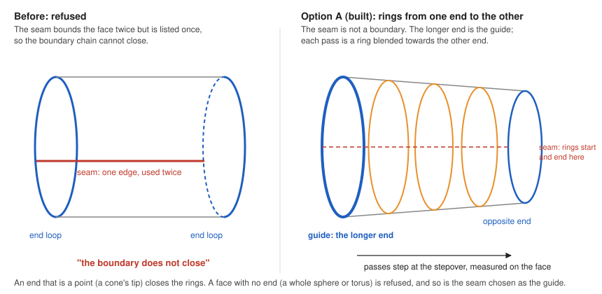

# 0675: Face-flow finishing on a face that closes round on itself, such as a full cylinder (OP-28; issue #791; lane FACEFLOW)

- **Status:** Accepted by the project owner on 23 Nov 2026, relayed by the coordinator (decision 0049). Proposed 23 Nov 2026 by lane FACEFLOW; the owner chose option A the same day (relayed), which closed OI-2189. Built in pull request #854. Written as 0xxx with OI-xxxx; numbered 0675 and OI-2189 at the release of #854 (23 Nov 2026), assigned by the coordinator as the next free numbers above `main`'s highest.
- **Date:** 23 Nov 2026.
- **Issue:** #791 (sev2, user-reported).
- **Requirements:** OP-28 (face-flow finishing: points 1, guide edge and blend; 4, protection and reports; 5, order and linking), OP-05, OP-06, OP-15, GC-07, NFR-06, NFR-07, NFR-12.
- **Builds on:** [decision 0525](0525-face-flow-finishing.md) (accepted), D2 (the outer boundary, its sides, the guide and the opposite boundary) and D3 (the user's guide).
- **Open items:** adds OI-2189 (the owner's choice of option), closed by the owner's choice of A.

Numbering: drafted with provisional numbers under the owner's rule of 23 Nov 2026; 0675 and OI-2189 were assigned by the coordinator when the Merge Manager released #854 (see the Status line). No project schema number: nothing stored changes in any option.

## Context

A STEP face that closes round on itself, such as the side of a full cylinder, is bounded by a **seam**: one edge along which the face meets itself. The STEP kernel lists the seam once among the face's edges, though the face's boundary runs along it twice, once in each direction. A full cylinder's side is bounded by its two end circles and its seam; a cone's by one circle, the seam and its apex (an edge of no length); a full sphere by its seam and two poles; a full torus by two seams and nothing else.

Decision 0525 D2 builds a face's outer boundary by joining its edges end to end, each used once. With the seam used once the boundary cannot close, so face-flow finishing refuses such a face: "the boundary of face N does not close: its edges are not joined end to end" (reproduced by test `face_flow::req_op_28_a_full_cylinder_with_a_seam_edge_is_not_refused` on a hand-built full cylinder; the reporter's project was not opened). D2 did not consider faces that close round on themselves, and what the passes should be there is a design choice: on a full cylinder there is no side "opposite" a guide in the sense of D2, and a pass parallel to an end circle and a pass parallel to the seam are both reasonable.

Turned parts have such faces often: the outside of a hub or rim, a cone between two diameters, a fillet that runs right round. The other strategies that cut them (helical, axial, simultaneous finishing) follow the machine's axes, not the face.

How a seam is recognised (the same in every option but D): an edge of the face along which the face meets itself, that is, the face's surface closes round (cylinder, cone, sphere, torus, or a B-spline closed in one direction), the face spans the whole turn, and the edge lies on the parameter line where the turn starts and ends. This is read from the face and the edge themselves, not from the edge being listed once.

## Options

### A. Rings round the face, from one end to the other (recommended)

The seam is not a boundary to step from or towards: the face's two **end loops** (on a cylinder, its two circles) are the guide and the opposite boundary.

- The guide is the longer end loop, measured along the edges' exact curves, the loop with the lowest edge ID winning a tie (as D2). The user may choose it instead with a Guide edge set holding an end loop's edges.
- Each pass is a **closed ring** round the face, blended from the guide to the opposite loop by arc-length fraction and spaced by the stepover or scallop height, measured on the face (decision 0525 item 2.2, unchanged). The rings start and end on the seam.
- An end that collapses to a point (a cone's apex, a sphere's pole) is an opposite point: the rings close on it, and those nearest it shorter than the tool's diameter are left out with a note, as on a three-sided face (D2).
- A face with no end loop at all (a full torus; a full sphere, whose ends are both points) is refused plainly, naming the face and saying why: "face N closes round on itself with no end edge to cut from; choose a face with an end, or use simultaneous or helical finishing".
- Choosing the seam as the guide is refused naming the edge ("edge E is the seam of face N, where the face meets itself, not one of its ends; choose an end edge, or leave the Guide edge set empty").
- Climb, Conventional and Meander keep their meaning (D1): the rings run the way that puts the material on the side the setting asks for, or alternate.

On a cylinder about the rotary axis the rings are cut by turning A at constant X, which is what a user turning the outside of a part would expect, and the passes follow the face where its ends are not parallel (a cone, a flared rim).

### B. Passes along the face, stepping round from the seam back to it

The seam is both the guide and the opposite boundary: each pass runs from one end loop to the other along the face, the passes stepping round the face by the stepover until they come back to the seam. On a cylinder about the rotary axis the passes are lines along X at fixed A, as axial finishing cuts them. The end loops bound each pass. A cone's apex and a sphere's poles make every pass end at one point; a torus has two seams, and one of them must be chosen. This follows the face's seam, which the user did not draw and may not see in the viewport: its position depends on the CAD tool that wrote the file.

### C. A by default, B when the user chooses the seam as the guide

As A, but a Guide edge set holding the seam gives B's passes instead of the refusal. Both patterns are available without a new setting. It is the most work (both patterns, and tests for each) and asks the user to find and pick the seam edge, which the viewport does not mark.

### D. Keep refusing, with a plainer message

Face-flow finishing refuses a face that closes round on itself, saying so: "face N closes round on itself (edge E is its seam); face-flow finishing needs a face with sides to cut from and towards: split the face in the CAD, or use helical, axial or simultaneous finishing". No toolpath change. The issue stays open as a feature request.

## Recommendation

Option A. It answers the report (the strategy "machines within the bounds" of a closed face), keeps D2's rules for every face that does not close round, needs no new setting or stored kind, and its passes follow the edges the user sees (the ends) rather than a seam whose place depends on the CAD tool. B's pattern is already available from axial and simultaneous finishing on a cylinder; C can be added later if users ask for it.

## Decision

The owner chose **option A** (23 Nov 2026, relayed by the coordinator): face-flow finishing cuts a face that closes round on itself in rings round the face, from one end to the other.

1. **Seams.** A seam is recognised from the face and the edge (*Context*); it is not a boundary.
2. **Guide and opposite.** The face's ends are its loops of edges that go once round the face. The guide is the longer end, by length along the exact edge curves, the end with the lowest edge ID winning a tie within one part in a million, or the end holding the edges of the user's Guide edge set that lie on this face (all of them on that one end; a face with none of them takes its own default end). The opposite boundary is the other end; an end that is a point (a cone's apex, a sphere's pole) is an opposite point that turns with the guide, so every ring still goes once round, and the rings nearest it whose length round is shorter than the tool's diameter are left out with a note, as on a three-sided face (decision 0525 D2). Loops that do not go round the face are holes, cut round by the face's trim test as before.
3. **Passes.** Each pass is a closed ring, blended from the guide to the opposite end by arc-length fraction and spaced by the stepover or scallop height on the face (decision 0525 item 2.2, unchanged); both ends start at the seam and run the same way round. Climb, Conventional and Meander keep their meaning (D1).
4. **Refusals** (NFR-07), each naming the face or edge: a face with no end loop (a full torus; a full sphere, whose ends are both points); the seam chosen as the guide; guide edges that are not all on one end.
5. Every other face is cut as decision 0525 D2 says; this amends D2 for faces that close round on themselves only.

## Consequences

- **Library** (`openchuck-path`, `face_flow.rs`): seams recognised; the outer boundary of a face that closes round is its two end loops; closed rings as passes, with their direction set as D1 says; the plain refusals above. No public type changes; no version bump expected (decision 0048). Decision 0525 D2 is amended for faces that close round on themselves only.
- **Application:** none beyond the notes; a Guide edge set is read as now.
- **Tests**, named by requirement ID and written first: rings on a full cylinder about the rotary axis lie on the face at the stepover, from the longer end; a cone between two diameters blends from the larger end; a cone to its apex closes on it; a full torus and a chosen seam are refused plainly; the STEP cylinder of `testdata/step/valid/cylinder.step` and a cylindrical face of `blisk.step` are cut (kernel tests); byte-identical output at 1, 2 and N threads (GC-07, NFR-06).
- **User guide:** the face-flow finishing page says how a face that closes round is cut.
- **NFR-12:** no wording implies the program is checked; generated G-code remains the user's to verify.

## Verification

Environment: Linux container, Rust toolchain of `rust-toolchain.toml`, OpenCASCADE 7.8.1 built by `openchuck-import`'s kernel feature, from `main` 8f61706.

- Reproduced before any fix: `face_flow::req_op_28_a_full_cylinder_with_a_seam_edge_is_not_refused` (a hand-built full cylinder) failed with "the boundary of face 0 does not close: its edges are not joined end to end". On the public STEP corpus the same refusal met `cylinder.step`, `cone.step` and the blisk's outside cylinder (face 1).
- Option A, built on the lane's branch while the owner decided and kept on the owner's choice. Tests, written first and seen to fail against `main`'s `face_flow.rs` (all eight below, and the kernel test): `face_flow::req_op_28_a_full_cylinder_is_cut_in_rings_from_one_end_to_the_other` (replaces the reproduction), `..._a_cone_between_two_diameters_is_cut_in_rings_from_its_larger_end`, `..._a_cone_to_its_apex_closes_on_it`, `..._req_nfr_07_the_seam_as_guide_and_a_face_with_no_end_are_refused_plainly`, `..._rings_blend_between_ends_that_run_opposite_ways`, `..._the_user_chooses_which_end_of_a_closed_face_is_the_guide`, `..._req_gc_07_rings_are_the_same_at_1_2_and_n_threads`; kernel test `step_strategies::req_op_28_face_flow_cuts_a_step_face_that_closes_round_on_itself_in_rings` (9 s, debug): `cylinder.step` in rings at constant X on its 10 mm radius, `cone.step` in rings at constant X, the blisk's face 1 in 52 rings, a full sphere and torus refused. All 31 face-flow tests pass, and the whole suites of `openchuck-path`, `openchuck-app`, `openchuck-import` and `openchuck-ui` (2578 tests).
- Coverage of `face_flow.rs` from its own tests: 94.0 % of lines. The new lines left uncovered are defensive (NFR-07): a face whose closure has no period, more than two ends, an end with no evaluable point, an edge with no points.
- On the program itself (release build at `e4ac7b31`, public blisk, 1 mm stepover, 3 mm ball): the blisk's outside cylinder (face 1) in 52 rings, broken at the blades, and a blade (face 7) cut along its tip edge as before. Screenshots and what each shows: [docs/archive/0675-face-flow-closed-faces](../archive/0675-face-flow-closed-faces/README.md).
- CodeRabbit's review of the pull request (23 Nov 2026, before the release push) found four faults in the build, fixed in the release push with tests written first and seen to fail: a point end did not turn with the guide, so the rings towards a cone's apex stopped short of a turn; rings were left out by the gap between their ends (zero on a closed ring) instead of their length; and the face had no normal at the apex, so the spacing across a cone to its apex collapsed to one pass (`face_flow::req_op_28_a_cone_to_its_apex_closes_on_it`, now asserting full turns and the rings kept); a Guide edge set on one closed face made every other selected closed face refuse (`face_flow::req_op_28_a_guide_on_one_closed_face_leaves_the_others_their_own`); and guide edges partly on a hole were accepted (`face_flow::req_op_28_req_nfr_07_guide_edges_off_the_chosen_end_are_refused`). Item 2 says so; the owner's choice is unchanged.
- Not verified: closed B-spline faces (none in the public corpus); the reporter's project (not opened).
