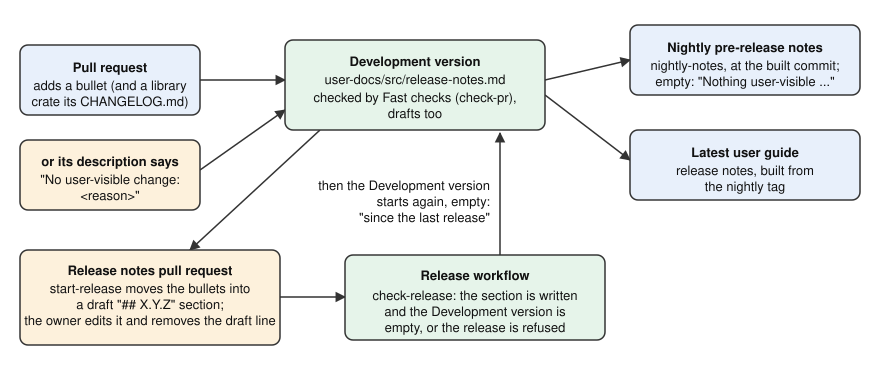

# 0678: A changelog since the last release, checked on each pull request, published with each nightly build and reset by each release (NFR-19, NFR-12, INT-07; lane CHANGELOG-FLOW)

- **Status:** Accepted by the project owner on 23 Nov 2026, relayed by the coordinator (decision 0049), at head `d86d5c5`, including the rules it adds to `AGENTS.md` ("Write repository tools in xtask" and "Record every change users could notice in the changelog") and the text in `CLAUDE.md` and `docs/releasing.md`. Proposed by lane CHANGELOG-FLOW the same day; the coordinator approved the plan and answered its five questions (below). The first version of the tool was Python; the owner then decided, the same day (relayed), that it is an xtask command and set the tooling rule of item 7.
- **Date:** 23 Nov 2026.
- **Requirements:** NFR-19 (the user documentation, with the development version and a version for each release), NFR-12 (generated G-code is the user's to verify; nothing here may suggest otherwise), INT-07 (breaking library changes recorded in a changelog).
- **Builds on:** [decision 0023](0023-nightly-builds.md) (nightly builds), [decision 0091](0091-release-workflow-and-gate.md) (the release workflow and gate), [decision 0400](0400-user-documentation-site.md) section R (the release checks of the user guide), [decision 0052](0052-ci-speed-up.md) (the draft gate: Fast checks run on a draft), [decision 0055](0055-push-discipline-and-draft-pull-requests.md) (one push; drafts), [decision 0516](0516-ci-architecture.md) and [docs/ci-performance.md](../ci-performance.md) (the CI budget), and the owner's rules that release notes carry no decision, open item or requirement numbers and that a lane drafts the release notes (`docs/releasing.md`, 1 Nov 2026).
- **Open items:** adds and closes OI-2193 (the owner's acceptance of this record and its rule text). Issue #833 (the generated release page text) stays a separate follow-up (the coordinator's answer 3).

Numbering: the coordinator assigned record 0678 and OI-2193 when the pull request was released (provisionally CHANGELOG-FLOW-A and OI-9961; numbers in merge order), checked free on `main` `57c873c`. No project schema number and no library API change.

## Context

The owner asked on 23 Nov 2026: "Can we ensure that all changes are contributing to a changelog that is used as part of the nightly publishing flow so that users know what has changed since the last official release?"

On `main` at `445286b`:

- `.github/workflows/nightly-build.yml` wrote the notes of the rolling `nightly` pre-release inline: the commit, the date, "not a release", the G-code notice and the archive contents. It gave no list of changes.
- `user-docs/src/release-notes.md` has a *Development version* section. The guide's *latest* version, built from the `nightly` tag by `docs-site.yml`, shows it, but the pre-release page that users download from did not.
- Lanes added a line there, and to each crate `CHANGELOG.md`, only because their briefs told them to. Nothing checked it.
- `docs/releasing.md` had the release-notes lane draft the new version's section from the crate changelogs, merged pull requests and closed issues. The release check (`check.py --release`) only checked that a `## <version>` heading exists. Nothing moved or emptied *Development version* at a release, so after 0.55.0 it would have kept growing across releases.
- The crate changelogs are written for developers: lane names, decision numbers, a version section on most pull requests. They cannot be shown to users as they are.

## Decision

1. **The changelog is the *Development version* section of `user-docs/src/release-notes.md`.** It holds one top-level bullet for each change users could notice since the last release, in plain words, with no decision, open item or requirement numbers. Issue numbers are allowed because they link to the tracker. The section's introduction and its closing G-code reminder are not entries. Nothing in it may suggest that generated G-code is checked or safe (NFR-12; `check.py` already fails such wording in the guide's source).
2. **One tool, `cargo xtask changelog`** (`xtask/src/changelog.rs`, no new crate; tests in `xtask/src/changelog/tests.rs`), by the tooling rule of item 7. It has four commands:
   - `nightly-notes` writes the pre-release notes from the checked-out commit (item 3).
   - `check-pr` is the pull request check (item 4).
   - `start-release <version>` and `check-release <version>` are the release step (item 5).
3. **The nightly pre-release notes say what has changed.** `nightly-build.yml` runs `cargo xtask changelog nightly-notes` once, in its `changes` job, on the built commit, and hands the file to the `publish` job as an artifact in place of the inline text. The notes are, in order:
   - the build line, "This is not a release", and the program's own G-code notice, read from `notice.rs` as before (NFR-12);
   - *What has changed*: the *Development version* bullets, introduced as the changes since the last release with its version (the highest `## X.Y.Z` heading), and a link to the latest guide's release notes. The guide's relative links are rewritten to `https://openchuck.cam/latest/...`. An empty section gives "Nothing user-visible has changed since the last release, X.Y.Z." Before any release the notes say there has been none;
   - a link to each published library crate's `CHANGELOG.md` at the built commit, for developers. Their entries are not copied, because their wording is internal;
   - the archive contents, as before.

   The notes are at most 60,000 characters (GitHub allows 125,000 in a release body). Past that, whole bullets are left out and one line says how many more are in the guide's release notes. The same text goes to the run summary from the `changes` job, so a manual run on another branch, which publishes nothing, still shows it.
4. **The pull request check.** It is a step of the existing Fast checks job, `Changelog since the last release`, on `pull_request` events only, drafts included (Fast checks run on a draft, decision 0052). It is checked in that job's "every check that was due ran and passed" step. It does not run on a push to `main`, a merge queue run or a scheduled run, which have no pull request description.
   - **Triggered by** a changed file under `apps/*/src/` or `apps/*/assets/`, `crates/*/src/` (not `openchuck-testkit`), `crates/openchuck-post/posts/`, `testdata/examples/` (the examples download) or `user-docs/src/`. Two exceptions: `release-notes.md` itself, and the screenshot records (`*.toml`), which the checks read and users never see.
   - **Not triggered by** anything else: `docs/`, the registers, `AGENTS.md`, `README.md`, workflows, `xtask/`, tests, benches, crate examples, other `testdata/`, a crate's `CHANGELOG.md` or `Cargo.toml` alone, and the guide's tools and theme.
   - **Passes when** the pull request adds or changes a bullet under *Development version*, compared with the merge base. Removing a bullet does not count. When a library-family crate (`openchuck-types`, `-path`, `-post`, `-gcode`, and the built-in posts for `-post`) changes, that crate's `CHANGELOG.md` must also change (INT-07).
   - **Escape hatch (the coordinator's answer 1):** a line of its own in the pull request description, `No user-visible change: <reason>`, with a reason that is not empty. A bullet marker, bold or any case is accepted. It covers both requirements.
   - **Always:** a new or changed bullet that carries a decision, open item or requirement number fails, whether or not the escape hatch is present. A bullet the pull request did not touch is not its problem.
   - **The failure message** names the files that triggered the check, what is missing, how to fix each part, and the escape hatch.
   - **When the description is read.** It comes from the event, so the check reads it when the pull request is opened, on each push, and when it is marked ready for review. The Merge Manager marking a pull request ready is the point at which a corrected description is read again, with no push (the coordinator's addition c). The `edited` event is not added, because it would run the whole workflow again for each edit of the description.
   - The diff is taken from the merge base of the pull request's base commit and its head, so changes that reached `main` after the branch was made are not counted.
5. **The release resets the changelog.**
   - The release-notes pull request starts with `cargo xtask changelog start-release <version>`. It moves the bullets into a new `## <version>` section above the previous release, under *What has changed*, ending with the same G-code reminder and starting with a draft comment that says what else to write. *Development version* keeps only its introduction and reminder.
   - `start-release` refuses a version that is not newer than the last release, and a page without *Development version*.
   - A new step of the release workflow's gate job, `cargo xtask changelog check-release <version>` (an application release only), refuses a release whose section is missing, still has the draft comment, or whose *Development version* still has bullets. The guide's own check (`check.py --release`, that a section headed with the version exists) is unchanged and keeps passing; the guide's CI action stays without the Rust toolchain.
   - On a publishing run a failure of the step stops the release (the archives and the publish job need the gate). On a dry run it is reported and the run goes on, as the guide's release checks are, so a dry run before the release-notes pull request merges reports it, as it already reports the missing section.
   - Nothing here tags, publishes or touches crates.io.
6. **Documents.**
   - `AGENTS.md` gets the rule, and `CLAUDE.md` gets the step before a pull request and the local command.
   - `docs/releasing.md` gets the flow and the stronger release checklist item.
   - The guide's *Install and first run* says where to find what changed, and the release notes' introduction says what the section means.
   - On the coordinator's answer 5, the stale "no stable release yet" sentences in `install.md` and `README.md`, "Signing is not part of the first release" and "before the first release" in `limitations.md` now read as true after the 0.55.0 alpha.
   - This pull request adds its own *Development version* bullet.

7. **Repository tools are xtask (the owner's rule, 23 Nov 2026, relayed).** xtask is for repository checks and release helpers. Python is only for the user-guide site tools in `user-docs/tools/` (the guide's CI action runs without the Rust toolchain, and `capture.py` drives Xvfb, xdotool and ImageMagick). A new repository check or release helper is written in xtask unless a recorded reason says otherwise. The existing guide tools (`check.py`, `build.py`, `assemble.py`, `capture.py`, `capture_example.py`, `manifest.py`, `thumbnails.py` and the example generators) stay in Python by this rule, with no port planned. The rule is in `AGENTS.md`, with a pointer in `CLAUDE.md` and `docs/releasing.md`.

### The owner's decisions (23 Nov 2026, relayed by the coordinator)

1. The changelog tool is `cargo xtask changelog` with all four commands, one Rust implementation and no Python left for it; `check-release` runs in the release gate job; `check.py` keeps only its heading check; the nightly notes are made once in the `changes` job and passed to `publish`; no new crate.
2. The other guide tools stay in Python: no ticket, no port.
3. The tooling rule of item 7.

### The coordinator's answers (23 Nov 2026)

1. The escape hatch is the description line `No user-visible change: <reason>`, with a reason that is not empty.
2. The check runs on drafts too, in Fast checks.
3. #833 stays a separate follow-up. A later `cargo xtask changelog release-page` command can use the same parser for the release page's "Before you use it" text.
4. No manual nightly-build run (runner minutes). The local script run, the unit tests and a dry run of the notes against the real release notes and an empty section are enough.
5. Fix the stale "no stable release yet" wording in this pull request.

The coordinator's additions:

- (a) the failure message names the escape hatch;
- (b) a table of example diffs shows that docs-only and changelog-only pull requests are not caught;
- (c) mark-ready is the re-read point, and it is documented;
- (d) `start-release` is tested on a fixture;
- (e) the in-flight lane pull requests are checked (Verification).

## Alternatives considered

- **Copy the crate changelogs' *Unreleased* entries into the nightly notes.** Not chosen. They carry lane names and decision numbers, which the owner's rule keeps out of user text, and lanes write version sections, not *Unreleased*. The notes link them instead.
- **A file per change (fragments, as towncrier does), merged at release.** No merge conflicts between lanes. Not chosen: the registers already merge as unions (decision 0130), one Markdown section is what the guide shows, and fragments would need a build step before the guide.
- **Generate the changelog from merged pull request titles.** Not chosen. The titles are internal (lane names, decision numbers), and it would need the GitHub API at build time.
- **A Python tool in `user-docs/tools/` (the first version of this lane, pushed to the draft pull request at `42a865c`).** It fitted the guide tools beside it and ran in the guide's CI action and the nightly publish job without the Rust toolchain. Rejected by the owner: repository checks and release helpers live in xtask (records, trace, deps, licences, release-gate, publish), Fast checks already build xtask on every pull request (its conflicts step), and the nightly and release jobs can build it. One Rust implementation serves the check, the notes and the release; the Python version was removed, and its output was compared with the xtask one on the real release notes before removal (identical).
- **Python for `check-release` only, called from `check.py`.** Two parsers of the same section. Not chosen; the release gate job runs the xtask command instead.
- **A commit trailer as the escape hatch.** Not chosen (answer 1). It is harder to see in review and cannot be corrected without a push.
- **Add the `edited` event to re-run the check on a description edit.** Not chosen. It runs the whole CI workflow again. Mark-ready already reads the description.
- **A separate CI job.** Not chosen. A step in Fast checks costs about a second and no job slot (decision 0516 budget).

## Consequences

- Every pull request that changes what users see now needs a *Development version* bullet or a reason. Lanes in flight that touch product code without one fail Fast checks until they add one or the description line (Verification lists the seven in flight).
- The nightly pre-release page shows the changes since the last release. The guide's *latest* release notes show the same section.
- The next application release's notes pull request must run `start-release` (or move the bullets by hand) and finish the section, or the release is refused. This is intended.
- Library releases (`lib-v` tags) are unchanged. Their `CHANGELOG.md` entries are now checked on each pull request that changes a family crate.
- Changed files: `xtask/src/changelog.rs`, `xtask/src/changelog/tests.rs` and its two fixtures (new), `xtask/src/main.rs`, `.github/workflows/ci.yml` (one step), `.github/workflows/nightly-build.yml`, `.github/workflows/release.yml` (one gate step), `AGENTS.md`, `CLAUDE.md`, `README.md`, `docs/releasing.md`, `user-docs/src/release-notes.md`, `user-docs/src/start/install.md`, `user-docs/src/start/limitations.md`, the decision index and `docs/open-items.md`.

### CI performance (docs/ci-performance.md checklist)

- **Runner minutes and critical path.**
  - Pull request: one step in Fast checks, which already runs on every pull request and already builds xtask there (its conflicts step runs on every pull request, docs-only ones too). The new module adds a few seconds of compile time to that build; the check itself runs in well under a second (Verification). No new job, no change to the critical path, because Fast checks finish long before the build.
  - Nightly build: the `changes` job, when a build is due, checks out the commit and runs `cargo xtask changelog nightly-notes`, which installs the toolchain in `rust-toolchain.toml` and builds xtask on a fresh runner: about 1 to 1.5 runner-minutes a night (a cold build of xtask took 12 s on four cores here, with the crates already downloaded). The `publish` job only downloads the notes. No cache is added.
  - Release: one step in the release gate job, which already builds xtask: seconds.
- **New heavy job:** none. The step is checked in Fast checks' own "every check that was due ran and passed" step, with due = `pull_request` event, so a skipped step on a pull request fails the job.
- **Called workflows:** none changed (`build-archives.yml` is untouched). The nightly `publish` job's download of the archives (`openchuckcam-nightly-*`) does not match the new `nightly-notes` artifact, so its count of four files is unchanged.
- **`needs` on a matrix:** unchanged.
- **`tools/ci/main-run-mode.test.sh`:** passes. The light, full, pull request and scheduled cases are unchanged, because the step's condition is the event and the run-mode logic is not touched.
- **Permissions:** unchanged (Fast checks `contents: read`; the nightly `changes` job `actions: read`, `contents: read`, enough to check out and upload an artifact; the release gate job unchanged).
- **Windows first, no check removed:** unchanged.
- **Run once:** the draft pull request's Fast checks run the step on this pull request itself. No manual nightly-build run (answer 4). The notes were generated locally on the real tree (Verification).

## Verification

Environment: the lane's cloud container (four cores), Rust from `rust-toolchain.toml`, at `main` `445286b` plus this change.

- **Tests first.**
  - The first version (Python, `42a865c`): its tests were written before the module and failed first (an import error, then two failures that were fixed).
  - The xtask port: `xtask/src/changelog/tests.rs` was written first, with the rule and the cases of the Python tests and more (an indented paragraph in an entry, a shortened file list, internal numbers with the escape hatch, a version heading that is not X.Y.Z, an unknown base commit, the real release notes). Against a stub module, 33 of the 44 tests failed; the other 11 pass on an empty result by design (for example "nothing is triggered").
  - One test was added after the coverage run pointed at the path of the first release ever (`changelog_flow_the_first_release_takes_the_section_above_the_development_version`). It passed when added.
  - The start-release fixture's expected output (`xtask/src/changelog/release-notes-after-0.60.0.md`) was written by hand from the rule in item 5, not copied from the program's output.
- **Results.**
  - `cargo nextest run -p xtask -E 'test(changelog_flow) | test(req_nfr_12_notes)'`: 45 passed in 0.19 s uninstrumented; the slowest single test took 0.04 s.
  - `cargo nextest run -p xtask`: 202 passed in 1.3 s.
  - `cargo clippy -p xtask --all-targets` and `cargo fmt --all`: clean.
  - `cargo xtask records`, `deps`, `licences`, `conflicts`, `testdata` and `trace`: ok. `tools/ci/main-run-mode.test.sh`: ok. The three changed workflow files parse.
  - The guide tools' own tests (`python3 -m unittest discover -s user-docs/tools/tests`): OK, with `check.py` and `test_check.py` back to `main`.
- **Coverage** (`cargo llvm-cov nextest --profile coverage -p xtask` on these tests, then `cargo llvm-cov report`): `changelog.rs` 96.05% of lines before the last test was added (26 of 658 lines missed). The lines left: the defensive branches that cannot be reached with valid input (a link target with no closing bracket, a `..` above the guide's root, a notes body that grows past the limit after the check before it, a `notice.rs` with the start of the notice but no end, "decision" directly followed by a digit), the error path of writing the notes file, and a command-line wrapper (`entries_in_words`). The first-release path and the plural "entries" were reached by the test added after the run.
- **The table of example diffs** (`changelog_flow_the_table_of_example_diffs`, 27 rows; the coordinator's addition b). These are not triggered:
  - `docs/decisions/...` with `docs/open-items.md`; `AGENTS.md`, `CLAUDE.md`, `README.md`; `docs/releasing.md` with `.github/workflows/ci.yml`;
  - a crate `CHANGELOG.md` alone, or with `Cargo.toml` and `Cargo.lock`;
  - crate tests, benches and examples; the test kit; `xtask`; `testdata/golden`;
  - the release notes alone; the screenshot records; the guide's tools and theme.

  These fail without an entry or the escape hatch:
  - application source and assets, and an application crate;
  - a library-family crate (and passes only with both its entry and its `CHANGELOG.md`);
  - the built-in posts (same as a library crate);
  - the example projects; a guide page; a new screenshot.
- **The port gives the same notes.** Before the Python tool was removed, `cargo xtask changelog nightly-notes` and the Python `nightly-notes` were run on the same tree with the same arguments: the two files were identical.
- **Nightly notes on the real tree.** `cargo xtask changelog nightly-notes` on this branch lists the two *Development version* bullets under "Changes since the last release, 0.55.0". The keyboard bullet's link became `https://openchuck.cam/latest/reference/keyboard.html`.
- **An empty section.** On this tree, `cargo xtask changelog start-release 0.60.0` moved 2 entries; the notes then said "Nothing user-visible has changed since the last release, 0.60.0." and `check-release 0.60.0` failed on the draft comment, as intended. The page was restored from git afterwards. `check-release 0.55.0` on the real page fails because *Development version* has 2 entries, which is what a re-run of that release would now report.
- **Lanes in flight (the coordinator's addition e).** These pull requests were checked with `cargo xtask changelog check-pr` against their own base and description, from their heads on 23 Nov 2026 (the same results as with the Python version):

  | Pull request | Lane | Result today |
  | --- | --- | --- |
  | #845 | STEPPED-CYL | passes (adds a bullet; no triggering file) |
  | #853 | FUZZ-NFR07 | passes (a bullet; the `openchuck-types` and `openchuck-post` changelogs) |
  | #854 | FACEFLOW | passes (three bullets; the `openchuck-path` changelog) |
  | #856 | PENCIL-REST phase 1 | passes (documents only) |
  | #857 | POST-COMMENTS | passes (a bullet; the `openchuck-post` changelog) |
  | #865 | DOCS-SPOT-1 | passes (only screenshot records under `user-docs/src/`). It failed before the `*.toml` exception, and that failure led to the exception. |
  | #866 | SWARF-LEADS | passes (a bullet; the `openchuck-path` changelog) |

- **Not verified:**
  - the workflow steps on GitHub, beyond the draft pull request's Fast checks, which run `check-pr` on this pull request. The nightly step runs only at the next nightly build after merge, because a manual run is not wanted (answer 4); its toolchain install and xtask build on a fresh runner are estimated, not measured;
  - the release gate step on a real or dry-run release;
  - how GitHub renders `<kbd>` in a release body (it renders on github.com, but was not seen on this page).
- **Open items:** OI-2193.
