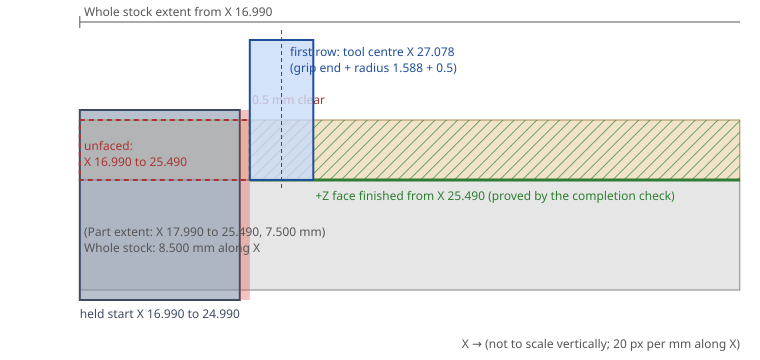

# 0685: Facing beside a held region faces what the tool reaches and says what it leaves (OP-24, SET-09, NFR-07, NFR-12; issue #500; lane FACING-GRIP)

- **Status:** Accepted by the project owner on 24 Nov 2026, relayed by the coordinator (decision 0049); number assigned at release. Proposed by lane FACING-GRIP on 23 Nov 2026, from the project owner's decision on issue #500 the same day ("Facing should cut up to the held start with a stated limit instead of refusing"). The owner answered the lane's four questions the same day, relayed by the coordinator: Q1, edit OP-24 in `docs/requirements.md` with the wording below (an owner-agreed edit; no other requirement or architecture edit); Q2, always, with no setting; Q3, no simulation hatch; Q4, include restricted legacy Flat and Round in this change. The owner also directed that the stated limit is information, not a warning. OI-2204 closed.
- **Date:** 23 Nov 2026.
- **Requirements:** OP-24 (facing), SET-09 (held regions), NFR-07 (a clear message, naming what to change), NFR-12 (generated G-code is the user's to verify), NFR-05, GC-07, NFR-06.
- **Amends:** [decision 0252](0252-facing-ends-sides-and-extents.md) (accepted), for held regions only: section 8 ("Any forbidden removal or unfinished required region beyond tolerance refuses and publishes no usable partial operation"), section 11 (the OP-24 text "refuse without a usable partial path") and the limit in section 13 ("whole-stock Box coverage intersecting held geometry refuses (never cropped silently)"). Tabs, protected geometry and every other unfinished region are unchanged: they still refuse. It supersedes the held-region wording of [decision 0667](0667-facing-completion-at-slab-edges-and-beside-a-grip.md) section 2, which reworded that refusal.
- **Open items:** adds OI-2204 (the owner's acceptance of this record), closed by the acceptance of 24 Nov 2026.

Numbering: proposed as FACING-GRIP-A with OI-9995; renumbered at release on 24 Nov 2026 to 0685 and OI-2204, the next free numbers above `main`'s highest (0684 and OI-2203 at `19de286`). No project schema number: nothing stored changes. The breaking library change takes workspace 0.62.0, the next minor version in merge order (decision 0048).

## Context

On the owner's Baluster set-up (box stock 72.4 x 35 x 35 mm, model scaled 1.15, the start held for 8 mm from X 16.990 to 24.990, a 3.175 mm flat tool), Box facing of +Z was refused for both the Whole stock and the Part extents. The part starts at X 17.990, inside the grip. How the refusal came about, on `main` `445286b`:

1. The application widens each held interval by the tool's largest radius and `HELD_CLEARANCE` (0.5 mm) into `StrategyInput::keep_out`: the tool's centre stays out of X 14.815 to 27.078 (decision 0161).
2. `plan_box_sides` laid its rows across the whole requested extent, the grip included.
3. The shared `keep_clear` dropped every row whose centre was inside `keep_out`. The first row it kept was the next one on the stepover's grid, at about X 27.96.
4. The Box completion check (`flat_raster_gap`) found the strip from the extent's start to X 26.37 unproved and refused. Decision 0667 only reworded that refusal.

Restricted legacy Flat and Round (a Part or Part plus tabs extent, or a margin) were refused the same way by their completion checks. Legacy Flat and Round over the whole stock with no margin already did what the owner asks: `keep_clear` cut them short, warned, and nothing checked completion. End facing is not affected: it faces the end away from the grip.

## Decision

Beside a held region, Facing faces what the tool reaches with its clearance from the grip, leaves the rest of the requested coverage unfaced, and says where along X it stops, why and how much is left, in an information note. Always: there is no setting.

1. **The limit is the host's.** The tool's centre keeps out of each held interval widened by the tool's largest radius (its cutting profile or its shank) and `HELD_CLEARANCE`, exactly as the host's `keep_out` (`openchuck-path` `facing::held::keep_out`, the same measure as the application's `tool_reach`). For Box and restricted legacy Flat and Round, generation refuses if the host's `keep_out` is not that span, because Facing could not then state where it stops. End facing does not read it.
2. **What each mode faces.** The requested coverage along X is cut down at each held end to where the mode's completion check proves the face finished.
   - **Box:** the rows' centres run from the limit, so the first row sits on it and nothing is lost to the stepover's rounding. The face is finished to the tool's edge: the limit less the tool's radius, 0.5 mm from the grip when the shank is no wider than the cut.
   - **Round:** its rings already start on a whole ring at the limit (decision 0550). Its check counts the tool's radius less its 0.001 mm interpolation reserve, so the face is finished from the limit less that.
   - **Legacy Flat:** its passes run along X from the limit. Their round ends are not counted by its check. Its passes are also dropped onto the composite target, the part and the held region with the stock to leave round them, which can lift their ends off the face beside the grip. So where Flat is finished is read from the actual cut: the furthest from the grip at which every line along X is at the face. The note and the overlay (`describe_path`) and the completion check read the same cut. A cut that stops more than the tool's diameter plus the stock to leave beyond the limit is not explained by the grip; it is left to the check, which refuses it.
3. **The completion proof covers the faced region.** Each check (`flat_raster_gap` for Box and Flat, the Round slab check) runs unchanged on the faced region instead of the requested one. Box's removal-domain check uses the faced rectangle too, which is stricter. A gap anywhere in the faced region still refuses. The Box refusal no longer names the grip, since a strip beside the grip is no longer a gap.
4. **What is left is stated, as information.** For each held end, one note (topic Held region) names the faces it applies to, the held interval, the 0.5 mm the whole tool keeps from it, where the face is finished, and the unfaced X range and its length, with what to change. On the Baluster, Box Whole stock: "facing at A 0.000° stops short of the held start (X 16.990 to 24.990): no part of the tool comes within 0.500 mm of it, so the face is finished from X 25.490, and X 16.990 to 25.490 (8.500 mm along X) of the requested extent is left unfaced. To face it, shorten the held length or face it in a setup that holds the other end." The completion note says the faces were covered up to the held region and points at that note. The Facing overlay draws where each face stops and marks it with one short label per held end, "Not faced: held start" (or "Not faced: held far end"): the owner's direction of 23 Nov 2026 (relayed) is that the view's labels stay short and the numbers go in the notes. The existing Facing labels are already long (72 to 74 characters on the Baluster's four Box faces); that is issue #881, not changed here. There is no simulation hatch (the owner's answer Q3): the unfaced stock lies mostly in the grip, not on the part's surface, and the simulation's remaining-stock values still show it.
5. **Nothing left to face refuses.** When the limit leaves no positive span, Facing refuses, naming the grip and the clearance, before anything is generated.
6. **Unchanged:** tabs (still protected and refused, never cropped); End facing; every clearance, protection, shank, stepdown, engagement and footprint check; Flat and Round over the whole stock with no margin; any Facing whose coverage stays clear of the grip by the tool's reach and clearance (its plan is the same, so its G-code is byte-identical).

## OP-24, the owner's agreed edit

`docs/requirements.md` OP-24, in the sentence decision 0252 section 11 added: "Requested faces that cannot be reached completely with supported tool geometry, clearance and machine limits refuse without a usable partial path, except beside a held region: there Facing faces what the tool reaches with its clearance from the grip, leaves the rest of the requested coverage unfaced, and its notes say where along X it stops, why and how much is left; where nothing is left to face, it refuses." The requirement's closing reference names this record. No other requirement and no architecture text changes.

## Alternatives considered

- **Keep refusing** (decision 0667): the owner decided against it on #500.
- **A setting "At a held region: stop short and say so / refuse"** (the lane's Q2 alternative): not chosen. Every other strategy, and whole-stock legacy Facing, already stop short beside a grip (decision 0536 step 2), and a setting would add a parameter and its persistence for no case the owner named.
- **A warning:** the lane first proposed a warning, as `keep_clear`'s note for other strategies is. The owner chose information: the limit is the program doing what was asked within the grip's rule, not a problem with the path.
- **An unreached-area hatch in the simulation** (`Unreached` with `NearHeldRegion`): not chosen (Q3). It marks part-surface points, and most of the unfaced stock is in the grip.
- **Legacy Flat at the keep-out limit:** stating Flat's limit as the keep-out alone would claim a face its check cannot prove where the composite target lifts the pass ends. Reading the cut keeps the statement exact.

## Safety

The change only ever reduces what is cut. Three independent layers keep the tool off the grip. Facing's own limit (item 1). The shared `keep_clear` and `check_clear` with the host's `keep_out`, which still refuse any fed move into it. Facing's protected-clearance check against the held solids. No new motion is added. An extent that would need the tool inside the held region is never cut. Generated G-code remains the user's to verify before it is run on a machine (NFR-12).

## Consequences

- `openchuck-path`: new `facing/held.rs` (`Unfaced`, the crop, the host check, the notes, the Flat measurement); `facing/description.rs` (`FaceDescription::unfaced` and `faced()`, `FacingGeometry::Round::unfaced`, `FacingGeometry::unfaced()`, `describe_path`); `facing/plan.rs` (Box rows from the limit); `facing/validation.rs` and `validation/legacy.rs` (the checks on the faced region; `ROUND_RESERVE`); `facing.rs` (the host check, the notes, the Extent tooltip).
- **Breaking library change:** `FaceDescription` and `FacingGeometry::Round` gain public fields. Workspace minor bump with changelog entries (decision 0048).
- `openchuck-app`: the completion note and the Facing overlay.
- **Documents:** OP-24 (above); the verification plan's OP-24 row; the user guide's Facing reference, known limitations and release notes; the crate changelogs; OI-2204.
- **Determinism (GC-07, NFR-06):** the limit is arithmetic on the setup and, for Flat, on the generated path, so it is the same at any thread count. Tested at 1 and 4 threads on the Baluster.
- **Found, not fixed here:** restricted Round facing (the Part extent) on the Baluster is refused, with or without the grip and on both its box and round-bar stock, by Facing's rapid-clearance check ("rapid move ... has no continuous complete-tool separation"). It predates this change and is ticketed separately (#880). Round's limit is therefore tested on a block in `openchuck-path`, not on the Baluster.

## Verification

Branch `claude/lane-facing-grip` from `main` `445286b`. Linux container, 4 cores, 15 GB, debug build, uninstrumented `cargo nextest` times.

**Tests written first and watched failing** (with today's refusals: "the Box faces cannot be finished from X ...", "restricted legacy Flat has an unfinished or raised composite-target region"):

- `crates/openchuck-path/tests/facing_held_limit.rs` uses a 10 x 4 x 4 block on 20 mm stock and a 3 mm flat tool. The expected numbers are worked by hand from the set-up, never from generator helpers.
  - `req_op_24_req_set_09_box_faces_up_to_the_held_start_and_says_what_it_leaves` (0.012 s): Whole stock and Part. No fed move comes inside the grip widened by the radius and 0.5 mm. The final-depth rows' union starts exactly at X 10.5 and leaves no strip. There is one information note, never a warning, with the held interval, the 0.5 mm, "finished from X 10.500" and the unfaced range and length.
  - `req_op_24_req_set_09_box_faces_up_to_a_held_far_end_and_both_ends` (0.014 s): the far end, both ends (two notes), and a Part extent clear of the grip (no note).
  - `req_op_24_req_nfr_07_box_with_nothing_left_beside_the_grip_refuses` (0.006 s).
  - `req_op_24_req_set_09_a_host_keep_out_that_differs_from_the_grip_refuses` (0.006 s).
  - `req_op_24_req_set_09_restricted_flat_and_round_face_up_to_the_held_start` (0.106 s): Flat is finished from its passes' ends, X 12.000. Round, on a 10 mm bar, is finished from X 10.501.
- `crates/openchuck-app/tests/facing_approach.rs` uses the public Baluster set-up of issue #500 and both posts.
  - `req_op_24_req_set_09_baluster_box_facing_stops_short_of_the_held_start` (43.0 s in the full run): Whole stock and Part each generate and post with Makera Z1 and LinuxCNC. Every fed tip has X at least 27.078. The first final-depth row's edge is at X 25.490, and the rows leave no strip. The note gives "X 16.990 to 25.490 (8.500 mm along X)" for Whole stock and "X 17.990 to 25.490 (7.500 mm along X)" for Part. Without the grip, the rows start inside the old grip and nothing is said.
  - `req_op_24_req_set_09_baluster_flat_part_extent_stops_short_of_the_held_start` (46.6 s): the note's X equals the lowest X of the cutting moves at the face, read independently from the path (28.643; the stock to leave round the grip lifts the pass ends from the keep-out limit at 27.078).
  - `req_op_24_req_gc_07_baluster_box_facing_beside_the_grip_is_deterministic` (41.7 s): the G-code is byte-identical at 1 and 4 threads with both posts.
  - `req_ui_03_req_op_24_baluster_overlay_marks_the_grip_with_one_short_label` (18.2 s): Box with all four sides shows exactly one "Not faced: held start" label, in the draft and in the generated scene, at most 24 characters of its own, and no label carries the stop X.
- **Changed tests:**
  - `facing_box_validation::req_op_24_req_set_09_box_paths_over_a_grip_refuse_and_part_extents_clear_of_it_validate` (renamed from `..._box_held_ends_do_not_crop_requested_coverage_or_disappear_at_part_extents`): a path planned without the grip and checked with it is now refused first by the faced rectangle's removal-domain check ("outside selected Facing coverage"), as well as by the protection check.
  - Decision 0667's `..._baluster_box_facing_names_the_held_start_it_keeps_off` is replaced by the Box test above.
  - The field-literal updates in `facing_box_plan.rs` and the `legacy.rs` unit test.

**CodeRabbit finding answered at release (Minor, real):** with grips at both ends, Flat's spans read from its cut can meet. The faced span is then empty or inverted, and a sweep across the whole face would "prove" it. Flat's completion check now refuses that, naming the held regions (test first, watched failing: `facing::validation::legacy::tests::req_op_24_req_nfr_07_flat_with_its_faced_span_closed_by_both_grips_refuses`, 0.020 s). Box and Round already refused it in the crop (`req_op_24_req_nfr_07_box_with_nothing_left_beside_the_grip_refuses`).

**Suites:**
- `openchuck-path`, `-types`, `-gcode` and `-post`: 1142 run, 1135 passed, and 7 failed on the first full run (1371.5 s): 6 End facing tests that the host keep-out check wrongly reached, and the renamed Box test above. After the fix, the full `openchuck-path` suite passes: 952 of 952 (1350.6 s; 1 skipped).
- `openchuck-app` and `openchuck-cli`: 986 of 986 (1436.8 s; 1 skipped).
- `openchuck-ui`: the label and Facing tests, 39 of 39.
- No new test takes more than a minute alone. The Baluster tests take 18 to 47 s in the full run.

**Checks:** `cargo fmt --all --check`; `cargo clippy --workspace --all-targets` (no warnings); `cargo xtask deps` (with messages and topics), `licences`, `records` and `trace` (105 of 105 P1) all pass. Golden files: none changed. The golden audit tests (`golden_audit::*`) and `reference_jobs::*` pass in the integration binary. `cargo xtask golden` itself fails on this branch and on `main` alike, because it still runs `cargo test --test golden_audit`, a target folded into the integration binary by decision 0516 (reported to the coordinator).

**Coverage** (`openchuck-path`, own Facing and roughing tests only, instrumented, a lower bound; the nightly run counts the application's tests too): `facing/held.rs` 95.5% of lines; `facing.rs` 92.5%; `facing/validation/legacy.rs` 91.2%; `facing/validation.rs` 86.8%; `facing/plan.rs` 87.4%; `facing/description.rs` 83.8%. The changed lines left uncovered in `held.rs` after that run were:
- the refusal of an invalid held interval: a defensive NFR-07 branch, because `validate_setup` and the planners refuse such an interval first;
- the note naming several faces;
- Flat with no at-face lines;
- Flat's limit beside a far-end grip.

Two requirement tests were then added for the second and the fourth (written after the code, so not watched failing): `req_op_24_req_nfr_07_one_note_names_every_face_that_stops_at_the_grip` (0.024 s) and `req_op_24_req_set_09_restricted_flat_faces_up_to_a_held_far_end` (0.012 s). The instrumented build was cleaned with `cargo llvm-cov clean --workspace`.

**Not verified:** anything on a machine; LinuxCNC replay of the new programs; restricted Round on the Baluster (refused there for an unrelated reason, #880). Generated G-code remains the user's to verify before it is run on a machine (NFR-12).
