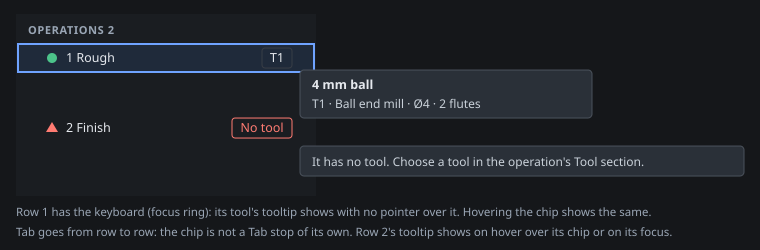

# 0690: The operations list names each operation's tool in a tooltip, and an operation with no tool says so (UI-06, UI-14; issue #790; lane PROJECT-UX-A)

- **Status:** Accepted by the project owner on 25 Nov 2026, relayed by the coordinator (decision 0049). Proposed by lane PROJECT-UX-A on 25 Nov 2026 and built in the lane's first pull request (#897) as the owner answered the lane's questions on 25 Nov 2026, relayed by the coordinator: R1 option A (trace to UI-06 and UI-14, no change to the requirements), T1 option A (the tooltip names the tool and says what it is), T2 option A with the owner's change that the chip takes no Tab stop of its own.
- **Date:** 25 Nov 2026.
- **Requirements:** UI-06 (the project tree lists the operations), UI-14 (anything shown on hover is also shown on keyboard focus), UI-11 (state is not shown by colour alone). No requirement names this tooltip; the owner chose to trace it to UI-06 and UI-14 rather than add one (answer R1 A).
- **Builds on:** [decision 0677](0677-keyboard-focus-tooltips-and-tool-windows.md) (accepted) item 3: tooltips open on focus as well as hover, and information with a tooltip is a Tab stop. This record meets that item through the operation's row instead of a Tab stop on the chip (Decision item 3).
- **Open items:** adds OI-2212 (the owner's acceptance of this record), closed by the acceptance on 25 Nov 2026.

Numbering: the coordinator assigned record 0690 and OI-2212 at release (main e126459), in merge order. No project schema number: nothing stored changes. No library-family API change: `openchuck-app` gains two public constants (`operation::NO_TOOL`, `operation::TOOL_MISSING`) and `openchuck-ui` changes; neither crate is in the library family, so there is no version bump.

## Context

Issue #790 (raised by the owner on 11 Nov 2026 after testing 0.55.0-rc1 and rc2): the operations list in the project panel shows each operation's tool as a chip with its number ("T1"), so finding out which tool that is means opening the tool library or the operation.

What `main` (`361613e`) did, checked with the synthetic cube project of the interface tests (a 4 mm ball end mill with 2 flutes, number 1):

1. The chip "T1" had no tooltip (`shell/tree.rs`).
2. An operation with no tool had no chip at all. Only the red status mark's tooltip said why it cannot be generated ("it has no tool", `openchuck-app` `operation.rs`).
3. An operation whose tool is not in the project's tool list would have had no chip either. A project the program accepts cannot be in that state: a tool that an operation uses cannot be removed (`Project::remove` refuses it as in use), and loading a project checks every reference. Generation still handles it ("its tool is missing", NFR-07), and so does the chip.

## Decision

1. **The tooltip names the tool and says what it is (#790; the owner's answer T1 A).** The first line is the tool's name as saved in the project's tool list, in bold. The second line is its number, type, diameter and flutes in the tool library's own words (`tool_library::summary`): "T1 · Ball end mill · Ø4 · 2 flutes". A tool with a blank name shows the second line only.
2. **An operation with no tool says so (the owner's answer T2 A).** The chip reads "No tool", or "Tool missing" for a tool that is not in the list. Its text and outline are in the error colour, so the words say what is wrong and the colour is not the only sign (UI-11). Its tooltip is the operation's own reason with where to fix it: "It has no tool. Choose a tool in the operation's Tool section." and "Its tool is missing. Choose a tool in the operation's Tool section.". Generation and the chip take the reason from the same constants (`operation::NO_TOOL`, `operation::TOOL_MISSING`), so the two cannot drift apart.
3. **The chip takes no Tab stop of its own (the owner's change to answer T2).** The tooltip opens on hover over the chip, and at once while the operation's row has the keyboard (`focus::tip_through`). The row was already a Tab stop: Enter on it selects the operation. So a keyboard user reads the tool by moving to the row, and every row keeps the Tab stops it had.
   - **How this meets decision 0677 item 3.** Item 3 makes information with a tooltip, such as a status mark, a Tab stop that cannot be clicked, so that its tooltip can be reached from the keyboard (UI-14). The tool chip is part of a row that is already a Tab stop, so its tooltip is reached through the row's focus instead. The chip is not separately focusable. Adding a Tab stop per operation would make the operations list one stop longer for each operation without showing anything more.
   - The test that no tooltip in the application is hover-only still passes: the new helper is in `focus.rs` with `Tip`, which the test exempts, and it shows the tooltip on focus.
4. **Nothing else changes.** This is display only. The project file, the G-code, generation and the checks are unchanged.

## Consequences

- The specification's section 6 (Project panel, Operations) is edited in this pull request to say what the chip and its tooltip show. The user guide's *Operations and strategies* page gains a short *The operations list* section, and the release notes have a bullet.

## Verification

Environment: Linux container, Rust stable, `main` at `361613e`, branch `claude/lane-project-ux-a-tool-tip`. The interface tests draw the real shell with egui 0.37 off screen on the synthetic cube project.

Tests (`apps/openchuck-ui/src/shell/tool_chip_tests.rs`, written from the issue and the owner's answers before the code; 6 tests, about 1.4 s together uninstrumented with `cargo test`):

- `req_ui_06_req_ui_14_the_tool_chip_tooltip_names_the_tool_and_says_what_it_is`: the chip "T1", the name "4 mm ball" and the line "T1 · Ball end mill · Ø4 · 2 flutes".
- `req_ui_06_req_ui_14_an_operation_without_a_tool_has_a_chip_with_its_reason`: "No tool" and "Tool missing" with the operation's own reasons, and that generation's constants are those words.
- `req_ui_14_the_tool_tooltip_opens_on_hover_over_the_chip`.
- `req_ui_14_the_tool_tooltip_opens_while_the_operation_row_has_the_keyboard`: no pointer, the row focused, the tooltip shown. With the focus branch of `tip_through` switched off, this test fails.
- `req_ui_14_the_tool_chip_is_not_a_tab_stop_of_its_own`: 80 Tab presses never focus the chip and do reach the row.
- `req_ui_06_req_ui_11_a_chip_without_a_tool_is_outlined_in_the_error_colour`.

Not verified here: a look at the real window. The owner check in the pull request covers it, and the issue can be closed on these tests alone.

At release (25 Nov 2026), after merging `main` at `e126459` (with #888, #889, #891 and #893):
- `cargo fmt --all --check` and `cargo clippy --workspace --all-targets`: clean.
- `cargo nextest run -p openchuck-ui`: 777 passed, 1 skipped, in 8 min 38 s.
- `cargo xtask deps`, `licences`, `records` and `trace`: ok.
- CodeRabbit's review of the first push: no actionable comments.
