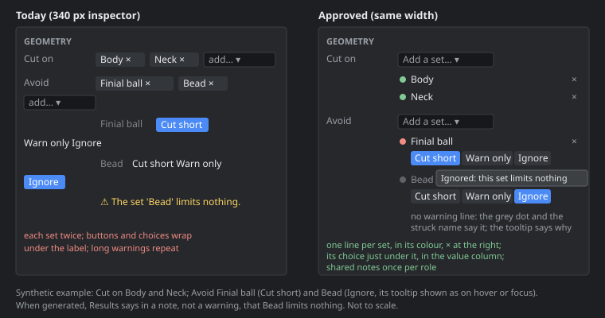

# 0696: The operation's Geometry section shows each selection set once, on its own line, with its choice under it, and a set on Ignore greyed and struck through (UI-07, UI-16, OP-02, OP-21; issue #759; lane UI-BUGS)

- **Status:** Accepted by the project owner, relayed by the coordinator (decision 0049): on 24 Nov 2026, D1 A and D2 A, with his change that a set on Ignore is drawn greyed and struck through instead of warned about (design item 4); on 25 Nov 2026, D3 A, the operation's own message for a set on Ignore becomes information (design item 8). Proposed by lane UI-BUGS on 24 Nov 2026, design first as the owner asked (Q6 option A). The build is the lane's third pull request, #936, after lane FACEFLOW's #854, which changes the same section, merged.
- **Date:** 24 Nov 2026.
- **Requirements:** UI-07 (the inspector's fields and choices), UI-16 (the reference screens: nothing cut off or overlapping at the inspector's widths), OP-02 (selection sets in an operation's roles), OP-21 (Avoid and Check, and what a set limits).
- **Amends:** the layout of the Geometry section that [decision 0215](0215-selection-sets-in-the-inspector-and-direct-set-editing.md) and the specification's section 11.4 describe; the roles, the choices and the other messages stay as they are. The level of the operation's message for a set on Ignore, a warning under [decision 0176](0176-swarf-boundary-avoid-and-check-sets.md) and [decision 0229](0229-avoid-and-check-choices-for-every-region-strategy.md) item 1, becomes information (D3). [Decision 0440](0440-inspector-label-and-entry-widths.md) (the label column) is followed.
- **Open items:** adds OI-2241 (the owner's approval of this design), closed by the approval; adds OI-2242 (D3: what becomes of the operation's own warning for a set on Ignore), closed by the owner's answer A on 25 Nov 2026.

No project schema number and no library change: only how the section is drawn, and the level of one message, change.

## Context

Issue #759 (user report, Windows, 0.54.0): with several selection sets in an operation's roles, the Geometry section is "very messy". On `main` (`aa99eab`), the section draws, for each role (Cut on, Contain within, Avoid, Check):

1. one wrapped row: the role's name in the label column, then a small button per set ("name ×") and an "add…" list. When the buttons do not fit, they wrap to the next line at the pane's left edge, under the label;
2. for each set in Avoid or Check, a second row: the set's name again, muted, then Cut short, Warn only and Ignore. This row wrapped left of the label column too (#609, fixed in the lane's second pull request);
3. under each set, its own warnings: "The set 'X' limits nothing." for Ignore, and the long note on Warn only's sampling, repeated for every set on Warn only;
4. the role's refusals and each set's reach notes, with their links.

So each set in Avoid or Check is named twice, the buttons wrap under the label, and a note shared by every set on Warn only is repeated. The left half of the diagram shows it with a synthetic example at the inspector's 340 px.

## Design (approved by the owner)

1. **Each role on one line:** its name in the label column and an "Add a set… ▾" list in the value column, as the list is today.
2. **One line per set, under its role, in the value column:** the set's colour, its name, and × at the right end to take it out of the role (the button's tooltip as today: "Take it out of this role"). A set that is missing or has elements not found keeps its red border and reason, on its line.
3. **A set's choice under its name:** for Avoid and Check, Cut short, Warn only and Ignore, segmented, just under the set's name, in the value column. For Contain within on swarf, Limits the pass and Limits the tip stay on the role's own line, as they concern the role.
4. **A set on Ignore is greyed and struck through, with no warning line (the owner's change).** Its colour dot is grey and its name struck through and muted, as a disabled operation's name is in the project panel (the specification's D5, decision 0029 item 10). The line's tooltip, on hover and on keyboard focus (decision 0677 item 3), says "Ignored: this set limits nothing". The warning "The set 'X' limits nothing." is no longer drawn. A set's other warnings, a problem and its reach notes, stay once under it with their links.
5. **A note shared by the role once per role:** Warn only's sampling note is shown once under the role when any of its sets is on Warn only.
6. **Nothing wraps left of the value column**, at any inspector width (the lane's second pull request already makes wrapped rows stay in the value column, #609).
7. **Not by colour alone.** An ignored set is told apart by the strike-through and the muted name as well as the grey dot, and the Ignore choice under it shows as selected. The line's name is a Tab stop with its tooltip, as a geometry role's label is (decision 0677 item 3), and it gives its accessible name as "Bead, ignored: this set limits nothing", as the operation eye gives its state with its name (`WidgetInfo::selected`). Screen readers themselves stay with OI-2110 (2027.1); this record only makes sure the line carries its state in words.
8. **The operation's own message for a set on Ignore is information (D3 A).** When the operation is generated, "The avoid set 'Bead' limits nothing, because it is set to Ignore: …" (and the same for a check set) is said once in Results, and on the command line as a `note:` line. It gives no amber mark, and it is not counted in Messages, Results, the project badge or the checks before writing. Its words stay. The swarf boundary with both Limits the pass and Limits the tip off ("The boundary set 'Fence' limits nothing, because both … are off", the same function in `operation.rs` and the library's own warning in `swarf.rs`) stays a warning, as it is.

The roles, the choices, what each does, the other messages' words and the keyboard order (role, its list, then each set's line from left to right) do not change; only where they are drawn does.

## Questions for the owner, and the answers

Asked on 24 Nov 2026 and answered on 24 Nov 2026, relayed by the coordinator.

- **D1.** The layout above (A, recommended), or keep today's layout and only stop the buttons wrapping under the label (B)? **Answer: A.**
- **D2.** Each set's line shows its colour dot (A, recommended: the colour the view draws the set in, decision 0216), or its name only (B)? **Answer: A,** with the change in design item 4: no "Limits nothing." warning; an ignored set's line greyed and struck through.
- **D3 (OI-2242).** The owner's change removes the Geometry section's line. The operation also has its own warning for a set on Ignore, made when it is generated (decision 0176's wording, `operation.rs` `limits_nothing`): "The avoid set 'Bead' limits nothing, because it is set to Ignore: the tool is not kept clear of it. Set it to Cut short or Warn only beside the set in the operation inspector's Geometry section, or take the set out of the operation." It is a warning, so it marks the operation amber, counts in Messages, Results, the project badge, the checks before writing and the command line's `warning:` lines. Should it **(A, recommended)** become information: said once in Results and on the command line as a `note:`, no amber mark and no count, so a forgotten Ignore can still be found after the run; **(B)** go entirely; or **(C)** stay a warning? A boundary set of swarf with both Limits the pass and Limits the tip off ("The boundary set 'Fence' limits nothing, because both … are off") is not a choice of Ignore and is not changed by this record unless the owner says so. **Answer (25 Nov 2026): A;** the swarf boundary with both limits off stays as it is.

## Consequences

What depends on the removed line, and what the build changes with it:

- **The line's message**, "The set '{set}' limits nothing." (`apps/openchuck-ui/src/shell/inspector.rs`), goes. The message review's rows V151 (`docs/message-review/ui-other.md`, KEEP-WARNING) and U62 (`docs/message-review/ui.md`, TO-INFO?) are marked as settled by this record.
- **Ignore's tooltip** (row V135) says "The set limits nothing: the tool is not kept clear of it. The operation warns that it limits nothing."; its second sentence becomes "Results says so in a note." (D3 A).
- **The operation's message** (D3 A): `operation.rs` gives the Ignore case its own information notice instead of `limits_nothing`'s warning, in both places it is made (`operation.rs` for swarf on a STEP part, `selection.rs` for the other strategies); the boundary case keeps the warning. The message review's row S72 (`docs/message-review/setup.md`) is marked as settled by this record for the Ignore case. Decisions 0176 and 0229 item 1 keep their words as history.
- **Tests that read the operation's warning** are rewritten first to expect information: `crates/openchuck-app/src/operation.rs` (the avoid and check cases that look for "The avoid set 'chosen' limits nothing" and "The check set 'chosen' limits nothing"; the boundary case stays a warning) and `crates/openchuck-app/tests/selection.rs` (the Ignore case that reads "The {name} set 'Top' limits nothing, because it is set to Ignore"). A test checks that an operation whose only message is this one shows no amber mark and adds nothing to the badge.
- **Tests that read the line:** `apps/openchuck-ui/src/shell/frame_tests.rs` (the rib and fence cases, which look for "The set 'Rib' limits nothing." and "The set 'Fence' limits nothing.") are rewritten first, to look for the struck-through name, its tooltip and its accessible name, and to find no warning line.
- **Counts and the badge:** the removed line was drawn in the inspector only; it never counted in Messages, Results or the project badge. Through D3 A, the operation's own message stops counting too: an operation whose only message is a set on Ignore shows a green dot, Messages and Results count one warning fewer, the checks before writing no longer list it, and the project badge can read **Nothing to report**.
- **The user guide:** the operations reference says, for Ignore, "The set limits nothing, and the operation warns that it limits nothing." (`user-docs/src/reference/operations.md`); it is reworded with the build to "The set limits nothing, and the operation says so in a note in Results." No guide page quotes the removed line itself; the build checks the pages and screenshots that show an operation with a set on Ignore for its warning count.
- **The specification** (section 11.4's Geometry bullet, `docs/ui-design/ui-specification.md`) is updated with the build to say how a set on Ignore is drawn.
- **A set on Ignore that limits nothing needs no other message beyond the note of D3:** it is the user's own choice, shown on its line, and the path is made as if the set were not there; the set is still checked as any set is (its model, version and contents, decision 0229 item 1), and those problems keep their own messages.

- About seven pages of the user guide show this section (the operations reference, the selection-sets, swarf, face flow and limit-to-a-region examples and how-to); their screenshots are captured again in the build, and their text is checked.
- The inspector's layout tests gain a case with several sets per role at 340 px and at the default width.

## Build notes

Choices the build made within the approved design:

- **The boundary of swarf.** Design item 4 and the first consequence remove the line "The set 'X' limits nothing." for a set on Ignore. A swarf boundary with both Limits the pass and Limits the tip off is not a set on Ignore, and D3 keeps its operation message a warning; its line under the role's options stays, so the inspector still warns before a boundary that limits nothing is generated.
- **A set with a problem.** Its name is drawn in red with "· N not found" on its line, and × has the red border the old button had; the reason is the tooltip of both, as before.
- **The name's tooltip.** Only a set on Ignore or with a problem has one, and only those names are Tab stops; a set's name otherwise needs no tooltip, and × keeps "Take it out of this role", with the accessible name "Take {set} out of this role".
- **The message's words** (D3) are those of decision 0176, as Results and the command line word any note: "Selection set (operation 'Finish'): the avoid set 'Bead' limits nothing, because it is set to Ignore: …".

## Verification

Linux container, 4 cores, uninstrumented `cargo nextest`, on branch `claude/lane-ui-bugs-c` (`main` `e126459` with this record's branch merged), code commit `54a2d6a`.

- **Tests written first from this record, each seen to fail before the change:**
  - `openchuck-ui` `shell::inspector_layout_tests`:
    - `req_ui_07_req_ui_16_each_set_is_named_once_on_its_own_line_with_its_choice_under_it` (items 1 to 3, 5 and 6; four sets at 280, 340 and 520 px);
    - `req_ui_07_req_op_21_a_set_on_ignore_is_struck_through_and_says_so_in_words` (items 4 and 7: the strike-through, the tooltip on hover and on keyboard focus, the accessible name read from the focus event);
  - `openchuck-ui` `shell::frame_tests::req_op_21_req_ui_11_a_set_on_ignore_adds_no_warning_and_no_amber_mark` (item 8). It fails with the notice made a warning again.
  - `openchuck-cli` `req_op_21_cli_says_a_set_on_ignore_as_a_note` (item 8, `note:` on the command line, on a copy of the public baluster project). It fails with the notice made a warning again. 22 s, the longest new test.
  - Added after the first coverage run showed those paths untested, so not seen to fail first: `inspector_layout_tests::req_ui_07_req_set_09_a_sets_line_carries_its_reach_warning_choice_and_remove` (items 2 to 4: the reach warning once under its set, a choice click, ×).
  - From the review of the release head (CodeRabbit, on `inspector.rs`): `inspector_layout_tests::req_ui_14_a_sets_name_comes_before_its_remove_button_in_tab_order` (item 7: a set's line in Tab order from left to right, its name before ×). It failed first, with × added before the name; the fix lays out the name first in a width that leaves room for × at the right end.
  - Rewritten to the owner's answers, as the consequences list:
    - `frame_tests::req_op_02_req_ui_07_the_geometry_section_shows_each_sets_options`;
    - `openchuck-app` `operation::tests::req_op_02_req_op_07_swarf_on_a_step_part_honours_boundary_avoid_and_check_face_sets`;
    - `tests/selection.rs::req_op_02_avoid_and_check_sets_of_other_strategies_take_their_choices`;
    - #609's `req_ui_07_req_ui_16_the_avoid_choice_row_wraps_inside_the_value_column`.
- **Suites:**
  - `openchuck-ui`, `-app` and `-cli`: 1,783 tests pass, before the reach test was added. The inspector and frame modules pass again with it.
  - Clippy (workspace, all targets) and `cargo fmt` are clean.
  - `cargo xtask deps`, `licences`, `records` and `trace` pass.
- **Coverage** (local, the tests of these areas). Every new line runs except:
  - the Show in view and Edit workholding clicks of a reach warning, moved under the set's line unchanged (no test clicks them on `main` either);
  - the guard for a set with no summary.
- **The guide:**
  - **Captured again:** from the release build at 1920 x 1080 (Xvfb, Mesa lavapipe), every page that shows the section: *Limit a path to a region*, and the blisk *Selection sets*, *Swarf* and *Face flow* examples.
  - **How the pages were found:** a template search for the old "add…" list over every guide screenshot found no other page that shows it.
  - **Tutorial:** its screens show neither the section nor a set and are marked reviewed at `54a2d6a`.
  - **Checks:** `check.py --screens strict` reports 0 errors and 0 warnings.
- **Not verified:**
  - Windows and macOS.
  - A screen reader (OI-2110): the accessible name is checked only through egui's focus event.
  - At the default 340 px, the three choices of a set wrap onto two or three short lines under its name, inside the value column (item 6). The design's diagram shows them on one line at a wider pane.
