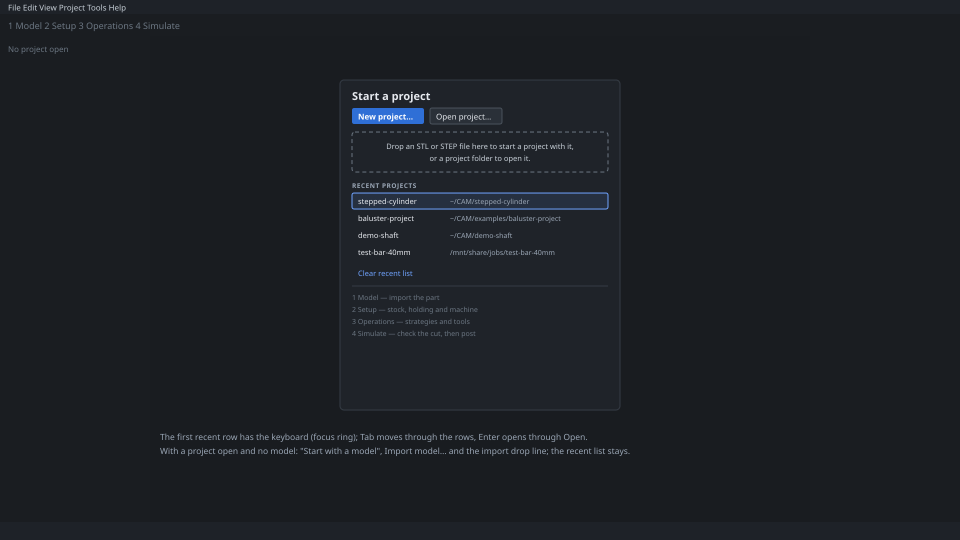
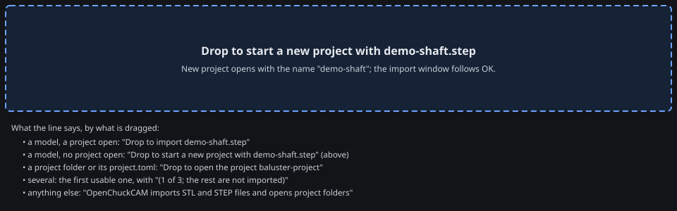

# 0697: A start page with the recent projects, and a file or folder dropped on the window starts, opens or imports what it is (UI-23, IMP-01, IMP-02, UI-14, UI-15; issue #706; lane PROJECT-UX-A)

- **Status:** Accepted by the project owner on 26 Nov 2026, relayed by the coordinator (decision 0049), after reading the record in draft pull request #902. Proposed by lane PROJECT-UX-A on 26 Nov 2026. It records the project owner's answers of 25 Nov 2026 to the lane's questions, relayed by the coordinator (decision 0049):
  - S1 option A: the start card of specification 11.1 grows the drop zone and up to 10 recent projects. The recent list shows with or without a project open.
  - S2 option A: a model dropped with no project open opens New project with the name from the file, then the import window after OK.
  - S3 option A: a dropped project folder opens through Open with the usual guards. With several files, the first usable one is used and the rest are listed as not imported. An unsupported file says so. While something is dragged over the window, the window says what the drop will do.
  - S4 option A: ship. The guide says that dropping on a Wayland desktop needs the X11 session (XWayland), and a sev3 ticket follows egui and winit.

  The owner also directed (25 Nov 2026) that layouts are designed for a 1920 by 1080 window, with 1366 by 768 best effort, until the minimum display requirement (UI-16) is changed by a separate lane. Built in the lane's third pull request, after #891 (the New project and Open dialogs) merged; the record came with it from draft #902, which that pull request replaces.
- **Date:** 26 Nov 2026.
- **Requirements:** UI-23 (P2: a start page with recent projects, and import by dropping a file on the window), IMP-01 and IMP-02 (STL and STEP import), UI-14 (keyboard), UI-15 (recent projects are a per-user setting, never in the project), NFR-07 (a clear message, never a crash), NFR-09 (nothing leaves the computer).
- **Builds on:**
  - specification 11.1, which already lists the drop zone and the recent projects on the centre card;
  - issue 381 (File > Open recent and the per-user recent list, `settings.rs`, `RECENT_KEPT` = 10, gone folders forgotten off the UI thread);
  - [decision 0460](0460-recovery-offered-only-for-the-opened-project.md) (recovery offered for the project being opened);
  - [decision 0246](0246-new-project-buttons-resolve-their-own-fields.md) and #891 (the New project and Open dialogs resolve their own fields);
  - [decision 0677](0677-keyboard-focus-tooltips-and-tool-windows.md) (focus, reading order, tooltips on focus).
- **Open items:** adds OI-2243 (dropping on a Wayland desktop; sev3 ticket #901) and OI-2244 (the owner's acceptance of this record, closed on 26 Nov 2026).

Numbering: assigned by the coordinator at release (26 Nov 2026), in merge order, and checked free on `main` `b2f1550` and every unmerged branch: record 0697 (was PROJUX-A-1), OI-2243 (was OI-9961) and OI-2244 (was OI-9966). No project schema number: the recent list is a per-user setting that already exists. No library-family change (`openchuck-app` and `openchuck-ui` are not in the family), so there is no version bump.

## Context

What `main` (`361613e`) does:

- **The centre card.** With no project open, or a project with no model and no import open, the view shows a card "Start with a model" (`shell/frame.rs` `empty_state`). It has New project… or Import model…, Open project…, and the four steps.
- **No recent projects on the card, and no drop zone.** The recent list exists, but only under File > Open recent. A choice there goes through the ordinary Open command: the Open dialog shows the folder to confirm, then the unsaved-changes question and the recovery rules apply.
- **Dropped files** (`shell.rs` `import_frame`):
  - With a project open, the first dropped file opens the import window on it.
  - With no project open, it is refused: "there is no project open. Open or create a project first".
  - A dropped project folder is treated as a model path.
  - Any extra files are ignored without a word.
  - Nothing shows while a file is dragged over the window.
- **Wayland.** egui 0.37 takes dropped and hovered files from winit 0.30.13. In winit 0.30.13 the file drop and hover events (`DroppedFile`, `HoveredFile`) come only from the X11, Windows and macOS backends; its Wayland backend has no drag-and-drop code. On a Linux desktop running Wayland, the program gets no file drop unless it runs under X11 (XWayland).

## Decision

1. **The start card (the owner's answer S1 A; specification 11.1).**
   - **When it shows.** It shows in the view whenever no project is open, or a project is open with no model and no import window. It is centred and at most 560 points wide, which fits a 1920 by 1080 window's view with room to spare and is best effort at 1366 by 768.
   - **The heading and buttons.** With no project open, the heading is "Start a project", with New project… (primary) and Open project…. With a project open and no model, it is "Start with a model", with Import model… (primary) and Open project…, as today.
   - **The drop zone.** It is a dashed box: "Drop an STL or STEP file here to start a project with it, or a project folder to open it." With a project open, it reads "Drop an STL or STEP file here to import it." It is not a control (the buttons do the same), so it takes no Tab stop. The whole window takes a drop, not only the box.
   - **The recent projects.** Up to 10, newest first, as File > Open recent keeps them. Each row shows the folder's name and, muted, its full path, with any Windows `\\?\` prefix removed. Each row is a button and a Tab stop in reading order (decision 0677); Enter or a click opens it. Choosing one does what File > Open recent does: the Open dialog with the folder filled in, then the unsaved-changes question and the recovery rules.
   - **Gone folders and Clear.** A folder that is gone is forgotten by the same off-thread check the menu uses. "Clear recent list" is under the list.
   - **With nothing recent,** the list is left out, with no empty heading.
   - **Below the card,** the four steps as today.
   - **Height.** The card is as tall as its content. With 10 recent projects the list scrolls inside the card when the view is too short, so the buttons and the drop zone stay in view.
2. **A model dropped with no project open (the owner's answer S2 A).** The New project dialog opens with the project name taken from the file's name ("demo-shaft.step" gives "demo-shaft") and the parent folder its own default.
   - OK creates the project, then the import window opens on the file. Nothing is added until Add to project, as for any import.
   - Cancel abandons both, and nothing is created.
3. **Other drops (the owner's answer S3 A).**
   - **A project folder** (one with a `project.toml`), or that `project.toml` itself, is opened through Open with its guards, as a recent project is, with a project open or not.
   - **A model file with a project open** opens the import window on it, as today, and replaces the file in an import window that is open and not adding.
   - **Several items dropped together.** The first usable one, in the order the system gives them, is used. Messages gets one line naming the rest: "Not imported: b.stl, c.step. Drop or import one file at a time."
   - **A file that cannot be used.** Messages gets "OpenChuckCAM imports STL and STEP files and opens project folders; 'notes.txt' is neither." Nothing else happens.
4. **While something is dragged over the window (S3 A).** The whole window is tinted, with one line in the middle saying what the drop will do:
   - "Drop to import demo-shaft.step", or "Drop to start a new project with demo-shaft.step";
   - "Drop to open the project baluster-project";
   - "OpenChuckCAM imports STL and STEP files and opens project folders" for anything else;
   - and the first of several, with "(1 of 3; the rest are not imported)".

   It is drawn only while the system reports a hovered file (X11, Windows, macOS).
5. **Wayland (the owner's answer S4 A).** Nothing in the program changes for Wayland. The user guide says that on a Linux desktop running Wayland, dropping a file needs the program to run under X11 (XWayland), and that the buttons and the recent list work everywhere. OI-2243 is followed by the sev3 ticket #901 (milestone 2027.1) for Wayland support in egui and winit.
6. **Display only, per user.** The recent list is the existing per-user setting (UI-15). Nothing new is stored, in the project or in the settings. Nothing is sent anywhere (NFR-09).

## Consequences

- The specification's section 11.1 is edited in the pull request to say what the card shows in each case, how a choice opens, what each drop does and what the window shows during a drag.
- The user guide's *Install and first run* and *Create a project* pages describe the start card and dropping files, with the Wayland note. Any screenshot is a true capture.
- The release notes gain a bullet.
- Tests (planned, named by requirement):
  - `req_ui_23_*`: the card's recent rows, their order and Tab stops; a row opens through Open; Clear; a gone folder forgotten.
  - Each drop case, driven by egui's `dropped_files` and `hovered_files` input: a model with and without a project, a project folder and its `project.toml`, several files, an unsupported file, and the drag-over text.
  - The card's layout at 1920 by 1080 and 1366 by 768 views.
- The owner checks real drops on Windows, macOS and Linux (X11 and Wayland) with the pack in the pull request: public and synthetic files only, among them the public baluster example.

## Verification

Built on `main` at `17dcdde` (with #891 and #897), on Linux, in the lane's third pull request.

What was built, and where:
- `openchuck-app` `dropped.rs` (new, pure): what a dropped item is (`Dropped::of`: a model by the import's own extension test, a project folder by its `project.toml`, or a `project.toml` itself), the plan for several items (`plan`: the first usable one, the rest named), the drag line (`hover_text`), the Messages line (`message`) and the project name taken from a model (`project_name`).
- `openchuck-ui`:
  - the start card (`shell/frame.rs` `empty_state`, `drop_zone`, `recent_row`);
  - the drop handling (`shell.rs` `dropped`, in place of the first-file-only import);
  - the drag line (`drag_frame`, on a layer above the window);
  - the model kept for the New project dialog it opened (`start_import`, cleared whenever no New project dialog is open, so Cancel or any other way out abandons it);
  - the Messages line, which outlives only the project open the drop itself made.

Two choices made while building, within the decision:
- **The Messages wording of item 3.** Every message is made in the form `<Topic>: <text>`, and that form lowercases the text's first word (decision 0536 section 3, `lead_in::in_form`), so the line "OpenChuckCAM imports STL and STEP files and opens project folders; 'notes.txt' is neither." cannot be shown as written. It reads "Dropped file: 'notes.txt' is neither a model nor a project. OpenChuckCAM imports STL and STEP files and opens project folders." The drag line (item 4) keeps the record's words, and "Not imported: b.stl, c.step. Drop or import one file at a time." is word for word.
- **The four steps** stay at the bottom inside the card, as on `main` ("as today", item 1) and as in the drawing.

Tests, named by requirement, written from this record before the code:
- `openchuck-app` `dropped::tests`:
  - `req_ui_23_req_imp_01_req_imp_02_each_dropped_item_is_told_by_what_it_is`
  - `req_ui_23_the_first_usable_item_is_used_and_the_rest_named`
  - `req_ui_23_one_usable_item_has_no_message`
  - `req_ui_23_req_nfr_07_an_unusable_drop_says_what_is_taken`
  - `req_ui_23_the_drag_line_says_what_the_drop_will_do`
  - `req_ui_23_a_new_project_is_named_after_the_dropped_model`
- `openchuck-ui` `shell::start_page_tests`. The drops go through egui's `dropped_files` and `hovered_files` input, with the public test cube and generated folders.
  - The card: `req_ui_23_req_ui_15_the_start_card_lists_the_recent_projects_newest_first`, `req_ui_23_with_nothing_recent_the_list_is_left_out`, `req_ui_23_a_project_open_with_no_model_shows_start_with_a_model`, `req_ui_23_req_ui_16_the_start_card_fits_the_view_with_ten_recent_projects`.
  - The rows: `req_ui_23_req_prj_08_a_recent_row_opens_through_the_open_dialog`, `req_ui_23_req_ui_14_each_recent_row_is_a_tab_stop_in_reading_order`, `req_nfr_18_a_recent_row_on_the_card_is_logged_without_its_name`, `req_ui_23_req_ui_15_clear_recent_list_on_the_card_empties_it`, `req_ui_23_a_gone_recent_folder_is_forgotten_from_the_card`.
  - The drops: `req_ui_23_req_imp_01_a_model_dropped_with_no_project_starts_one_named_after_it`, `req_ui_23_cancelling_the_new_project_abandons_the_dropped_model`, `req_ui_23_req_imp_01_a_model_dropped_on_an_open_project_opens_the_import_window`, `req_ui_23_a_dropped_project_folder_or_its_project_file_opens_through_open`, `req_ui_23_req_nfr_07_several_dropped_items_use_the_first_usable_and_name_the_rest`, `req_ui_23_req_nfr_07_a_file_that_cannot_be_used_says_so_and_does_nothing`, `req_ui_23_while_files_are_dragged_over_the_window_it_says_what_the_drop_will_do`, `req_ui_23_a_drag_the_system_does_not_name_says_what_is_taken`, `req_ui_23_a_drops_message_outlives_only_the_project_the_drop_made`.
  - The card's buttons: `req_ui_23_the_cards_buttons_start_open_and_import`.
  - `req_ui_23_cancel_abandons_the_dropped_model_in_the_same_frame`, added at release for CodeRabbit's finding below.
  - `shell::frame_tests::req_ui_10_the_empty_state_offers_a_project_and_dims_the_other_steps` now reads "Start a project" with no project open (item 1).

Results on the branch (Linux, uninstrumented):
- `cargo fmt --all --check` and `cargo clippy --workspace --all-targets`: clean.
- `cargo nextest run -p openchuck-ui`: 793 passed, 1 skipped, in 8 min 58 s. Three start-page tests were added after that run (the Messages line kept through the project the drop made, a drag the system does not name, and the card's own buttons); the 19 start-page tests then passed together (1.5 s).
- `cargo nextest run -p openchuck-app --lib`: 304 passed, 1 skipped.
- `cargo xtask deps`, `licences`, `records` and `trace`: ok.

Coverage of the new tests alone (`cargo llvm-cov nextest --profile coverage -p openchuck-app -p openchuck-ui`, the start-page, dropped-item and empty-state tests): `dropped.rs` 97.8% of lines. The lines no test reaches are the fallbacks for a path with no file name (`item_name`, `project_name`), the empty case of `quoted_list`, and the arm for an unusable item that `plan` never chooses. In the shell and the card, every new line runs except `dropped`'s early return when it is deferred behind an unconfirmed field, and a let-else in `drag_frame` that cannot fail (defensive paths, NFR-07).

Not verified here:
- Real drag and drop from the system's file manager on Windows, macOS, Linux X11 and Linux Wayland. winit delivers those events differently on each, and the tests feed egui's input directly. The owner check in the pull request covers it. On Wayland nothing is expected (OI-2243, #901).
- The look of the card in a real window. The test rig draws no 3D view, but the card is plain egui and is drawn in the tests at 1920×1080 and 1366×768.
- The tutorial's step 1 figures 1 and 2 (`01-new-project.png`, `02-project-created.png`) show the card and still show the old one. They were not retaken here. The guide's screenshots are true captures from a release build (decision 0400), and they are retaken from one.

At release (26 Nov 2026), after merging `main` at `b2f1550` (workspace 0.70.0) and renumbering: CodeRabbit's first review (on `041cf6b`) found one Minor: Cancel in the New project dialog left the dropped model waiting until the next frame's check. The route it described, Ctrl N in that next frame, cannot happen: shortcuts are ignored in the frame after a dialog closes, while egui still reports the dialog's layer. But the model outliving its dialog by a frame breaks the rule that it lives only while that dialog is open, so Cancel now clears it at once. Test: `req_ui_23_cancel_abandons_the_dropped_model_in_the_same_frame`, which failed before the fix. After the merge, the renumbering and the fix: `cargo fmt --all --check` and `cargo clippy --workspace --all-targets` clean; `cargo nextest run -p openchuck-ui` 815 passed, 1 skipped (8 min 57 s); `cargo nextest run -p openchuck-app --lib` 304 passed, 1 skipped; `cargo xtask deps`, `licences`, `records` and `trace` ok.

Open items: OI-2243 (#901) stays open. OI-2244 is closed.
