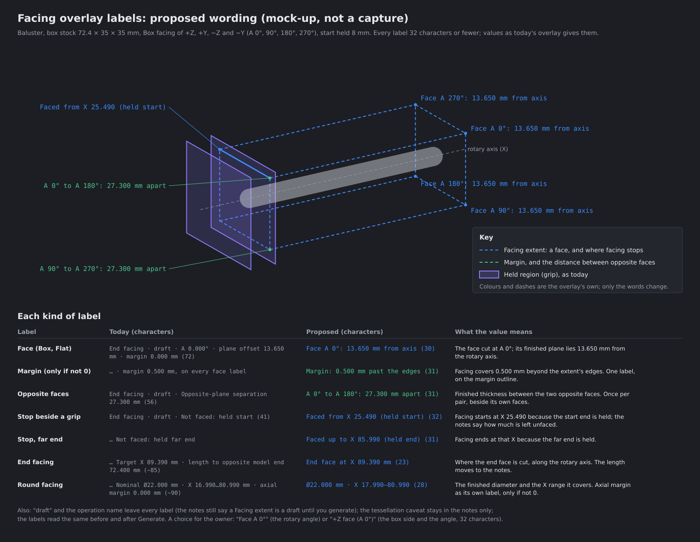
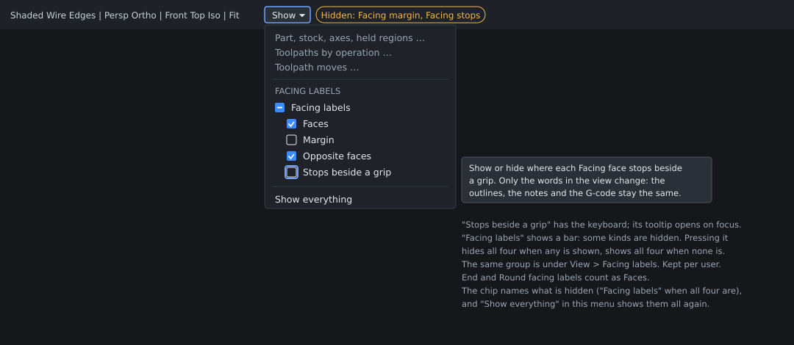
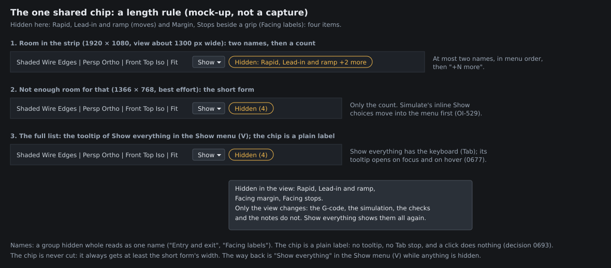

# 0702: The Facing overlay's labels are short and say what they measure, and each kind can be shown or hidden in the view (UI-03, OP-24, UI-14, UI-15, SIM-01; issues #881 and #895 item 1; lane MOPUP-1)

- **Status:** Accepted by the project owner on 26 Nov 2026, relayed by the coordinator (decision 0049), with the answers A to the three notes below (OI-9922 closed). Proposed by lane MOPUP-1 on 26 Nov 2026. It records the project owner's answers of 25 and 26 Nov 2026 to the lane's questions on issue #881, relayed by the coordinator (decision 0049), given on the lane's mock-up page:
  - Face label, option A: "Face A 0°: 13.650 mm from axis".
  - Stop beside a grip, option A: "Faced from X 25.490 (held start)" and "Faced up to X 85.990 (held end)".
  - Several Facing operations in one setup, option A: only the selected Facing operation's labels are shown.
  - Hiding the labels (the owner's addition), options A1 and B1: a "Facing labels" group of four kinds in the Show menu (V) and under View, kept per user; and the one "Hidden: …" chip that already names hidden kinds of move also names hidden Facing labels.
  - The chip's length rule: at most two names, then "+N more"; "Hidden (N)" when the strip has no room for that; never cut; only the hidden names. The chip stays the plain label of decision 0693 as the owner amended it on 25 Nov 2026, so the full list is in the tooltip of "Show everything" in the Show menu.

  The owner's answers of 26 Nov 2026 on the record's three notes, relayed by the coordinator:
  - Q1 (where the draft is said), option A as built: one information line per ungenerated Facing operation in Messages, "Face: the Facing outlines and labels are a draft until you generate", gone once generated; the labels stay short.
  - Q2 (a separate "Show all Facing labels" button), option A as built: none; pressing the "Facing labels" box shows all four (at most two presses), and "Show everything" also brings them back.
  - Q3 (the chip), option A as built: a plain label, with no tooltip and no Tab stop, and a click does nothing; the full list is in Show everything's tooltip, which opens on keyboard focus.

  Layouts are designed for a 1920 by 1080 window, with 1366 by 768 best effort, as the owner directed on 25 Nov 2026 (decision 0693).
- **Date:** 26 Nov 2026.
- **Requirements:** UI-03 (the view shows the setup and its overlays), OP-24 (Facing), UI-14 (every control by keyboard; commands in the menus), UI-15 (per-user settings on the computer, never in the project), SIM-01 (what the view shows and hides). No requirement changes.
- **Builds on:** [decision 0252](0252-facing-ends-sides-and-extents.md) (the Facing extent diagram), [decision 0685](0685-facing-beside-a-grip.md) (where a face stops beside a held region), [decision 0693](0693-show-or-hide-kinds-of-move.md) (the Show menu's kinds of move, the chip and the per-user setting), [decision 0677](0677-keyboard-focus-tooltips-and-tool-windows.md) (tooltips open on keyboard focus).
- **Open items:** adds OI-9922 (the owner's acceptance of this record, closed by the acceptance on 26 Nov 2026). Issue #895 item 1 (the generated stop marker) is settled here.

Numbering: decision 0702, assigned by the coordinator on 27 Nov 2026 in order of acceptance (filed as MOPUP-1-A until then); OI-9922 keeps its number. No project schema number: the choice is a per-user setting (`facing_labels` in the user's `settings.toml`), never in the project. No library-family API change: `openchuck-app` and `openchuck-ui` change, and neither is in the library family.

## Context

Issue #881: the Facing overlay's labels were long and did not say what their numbers were measured from. On the public Baluster example with Box facing of four sides, each face was labelled "End facing · draft · A 0.000° · plane offset 13.650 mm · margin 0.000 mm" (72 characters), the separations "End facing · draft · Opposite-plane separation 27.300 mm", and the stops "End facing · draft · Not faced: held start". The words "End facing" appeared on Box facing too, "draft" on every label, and the margin on every face even when it was zero. The labels overlapped in a small view.

Issue #895 item 1: once a legacy Flat operation was generated, its stop marker stayed where the draft put it, not where the generated cut stops. On the test set-up below the draft marked X 27.078 and the generated path's note said X 28.643.

What `main` (`e2161c3`) did:
- Every Facing label was built in `facing/display.rs` from one long format, with the draft state and the margin in each.
- The view drew every label of every Facing operation in the setup.
- No label could be hidden except by hiding the whole setup's overlays.

## Decision

1. **Short labels that say what they measure** (the owner's answers on the face and the stop). Each label is 32 characters or fewer:
   - a face: "Face A 0°: 13.650 mm from axis";
   - a pair of opposite faces, once per pair: "A 0° to A 180°: 27.300 mm apart";
   - the margin, once, on the margin outline, and only when it is not zero: "Margin: 0.500 mm past the edges" ("ends" for Round);
   - a stop beside a grip: "Faced from X 25.490 (held start)" or "Faced up to X 85.990 (held end)";
   - End: "End face at X 1.000 mm"; Round: "Ø30.000 mm · X 0.000–60.000".

   A value gives up decimals (three, then two, one, none), never words, to stay within 32 characters; a label with angles (a face, a pair of opposite faces) gives up the angles' decimals too, in turn with the distance's, so a face at any angle stays within the limit (issue #965, from CodeRabbit on #950: "A 22.125° to A 202.125°: 27 mm apart" was 36 characters). That the outlines are a draft is said once, in a note of the view that Messages lists as information ("Face: the Facing outlines and labels are a draft until you generate"), not on each label, as the owner's mock-up said ("the notes still say a Facing extent is a draft until you generate"). The note goes once the operation is generated. On `main` the word "draft" was only on the labels, so this note is new.
2. **The generated stop is where the cut stops** (#895 item 1). Once the operation is generated, the draft's stop lines and label for that operation are replaced by those measured from the generated path, so the marker and its X agree with the operation's note.
3. **Only the selected Facing operation's labels** (the owner's answer on several operations). While a Facing operation is selected in the project panel, the view draws only its labels. Every Facing operation's outlines stay. With nothing selected, or another kind of operation selected, every Facing operation's labels are drawn.
4. **Four kinds, shown or hidden in the Show menu and View menu** (A1).

   

   - Under the kinds of move, a "Facing labels" box with Faces, Margin, Opposite faces and Stops beside a grip under it. End and Round facing's labels count as Faces.
   - The box is ticked, partly ticked or empty by its four kinds. A press hides all four while any is shown and shows all four when none is, as Entry and exit's box does (decision 0693).
   - The same group is View > Facing labels.
   - Each tick box is a Tab stop and works with Space; tooltips open on focus (decision 0677).
   - It hides only the words in the view. The outlines, the notes, the checks, the simulation and the G-code do not change.
   - The choice is kept per user (`facing_labels` in the `[interface]` table of `settings.toml`), never in the project. A file without it, or without one of its kinds, shows that kind.
5. **One chip, with a length rule** (B1 and the owner's rule).

   

   - The chip beside Show names the hidden kinds of move, then the hidden kinds of Facing label, in menu order. A group hidden whole reads as one name ("Entry and exit", "Facing labels"). The Facing kinds read "Facing faces", "Facing margin", "Facing separations" and "Facing stops".
   - The long form names at most two, then "+N more": "Hidden: Rapid, Lead-in and ramp +2 more".
   - Where the strip has no room for the long form after Show, the chip reads "Hidden (N)". Simulate's inline Show choices move into the Show menu first (OI-529), so the chip is never cut. At 1920 by 1080 the long form shows; at 1366 by 768 the short one.
   - The chip stays a plain label (decision 0693): no tooltip, no Tab stop, and a click does nothing.
   - While anything is hidden, "Show everything" at the foot of the Show menu shows every kind of move and of Facing label again. Its tooltip, which opens on keyboard focus as well as on hover, lists every hidden name ("Hidden in the view: Rapid, Lead-in and ramp, Facing margin, Facing stops."). This is how a keyboard user reads the full list.

## Consequences

- Specification 7.1 (the Show or hide row) and 13 (the user's settings) are edited, and the Facing extent diagram paragraph gains the label wording. The user guide's Facing section says what the labels mean and how to hide them.
- The Show menu is longer. At 1366 by 768, on Simulate with something hidden, it still fits in the window down to its last line (tested).
- The scene's labels and lines carry an optional Facing tag (`openchuck-app` `scene::SceneLabel::facing`, `ScenePolyline::facing`): the operation and the kind. Other labels and lines carry none.

## Verification

Environment: Linux container, Rust stable, `main` at `e2161c3`, branch `claude/lane-mopup-1-labels`.

Tests were written from the issue and the owner's answers before the code. Times are uninstrumented, from `cargo nextest`.

- `openchuck-app`, `facing_labels` (unit, under 0.1 s each):
  - `req_ui_15_req_sim_01_nothing_hidden_gives_no_chip`
  - `req_ui_14_the_hidden_chip_names_two_and_counts_the_rest`: the long, short and full forms, and the four kinds hidden reading as "Facing labels".
  - `req_ui_14_the_facing_labels_box_sets_all_four`
  - `req_ui_15_a_settings_file_without_a_kind_shows_it`
- `openchuck-app`, `facing::display::tests` (unit):
  - `req_ui_03_a_facing_label_gives_up_decimals_to_stay_within_32_characters`
  - `req_ui_03_req_op_24_a_stop_label_names_the_x_and_the_held_end`: "Faced from X 25.490 (held start)" and "Faced up to X 85.990 (held end)", each drawn at that X.
- `openchuck-app`, `tests/facing_approach.rs`, on a copy of the public Baluster example (box stock 72.4 × 35 × 35 mm, the model scaled 1.15, the start held 8 mm, Box facing of +Z, +Y, −Z and −Y):
  - `req_ui_03_req_op_24_baluster_box_labels_are_short_and_say_what_they_measure`: the four faces at 13.650 mm, two separations of 27.300 mm, the stop "Faced from X 25.490 (held start)"; every label 32 characters or fewer, with no "draft", "End facing", "margin" or "tessellation".
  - `req_ui_03_req_op_24_round_facing_labels_its_face_and_its_stop` (the draft only; Round on this box stock does not generate): "Ø30.000 mm · X 17.990–88.140" and "Faced from X 25.491 (held start)", with the stop ring tagged as a stop.
  - `req_ui_03_req_op_24_a_facing_margin_has_one_label_of_its_own`: a margin of 0.5 mm gives one label, "Margin: 0.500 mm past the edges".
  - `req_ui_03_req_op_24_the_generated_flat_stop_marker_is_where_its_cut_stops`: the draft says X 27.078; the generated scene says X 28.643, as the generated path's note does, with one stop line at that X. With the replacement in `add_generated` removed, this test fails (left 27.078, right 28.643). The draft scene has the one draft note and the generated scene none.
- `openchuck-app`, `facing::integration_tests::req_op_24_req_gc_07_req_ui_03_req_sim_05_all_modes_complete_through_real_application_both_posts` asserted that a valid draft scene has no notes. It now asserts that its only note is the draft note, for Box, End, Flat and Round: the test's intent, no problem to report, is kept.
- `openchuck-ui`, `viewport::tests::req_ui_03_req_ui_14_facing_labels_follow_their_kind_and_the_selected_operation`: labels of two operations and four kinds; a hidden kind is not drawn; another kind of operation selected draws all; a selected Facing operation draws only its own; the guides' labels are never filtered.
- `openchuck-ui`, `shell::facing_labels_tests` (1 to 4 s each):
  - `req_ui_14_the_show_menu_has_a_facing_labels_group_that_sets_each_kind`
  - `req_ui_14_req_sim_01_one_chip_names_moves_and_labels_and_show_everything_clears_it`: the chip reads "Hidden: Rapid, Lead-in and ramp +2 more"; Show everything brings every kind back; the G-code is the one generated.
  - `req_ui_14_the_chip_is_short_when_the_strip_has_no_room_and_never_cut`: on Simulate, the long form at 1920 by 1080 and 1600 by 900, "Hidden (3)" at 1366 by 768, never clipped; and the Show menu at its longest fits at 1366 by 768.
  - `req_ui_14_view_facing_labels_is_in_the_menu`
  - `req_ui_03_the_view_follows_the_selected_operation`
  - `req_ui_15_the_facing_labels_shown_are_kept_for_the_user_across_a_restart`
- `viewport_toolbar::tests::req_ui_03_req_sim_01_menu_and_quick_controls_toggle_every_combination_and_protect_the_last` draws its strip in a window 768 high, not 500: the Show menu is now taller than 500 pixels, and 768 is the smallest height UI-16 supports.
- The test rig has no 3D renderer, so the labels are tested where they are chosen (`guide_labels`) and in the scene, not as pixels.

Results on the branch before the push:
- `cargo fmt --all` and `cargo clippy --workspace --all-targets`: clean.
- `cargo nextest run -p openchuck-app -p openchuck-ui`: 1723 of 1724 passed, 2 skipped (21 min 40 s). The one failure was the all-modes integration test above, before its assertion was changed for the draft note; after the change, and after the draft note was made to go on generating, the 48 Facing tests of `openchuck-app` pass, as do the new unit and Round tests.
- `cargo xtask deps`, `licences`, `records`, `trace` and `changelog check-pr`: ok.
- Coverage, checked locally on the crates' own new and nearby tests (`cargo llvm-cov nextest --profile coverage`): `facing_labels.rs` 100% of lines; every new line of `openchuck-ui` is covered except five `facing: None` fields in scene constructors these tests do not reach. In `facing/display.rs`, the new lines are covered; the uncovered lines there are older error branches.

Rebased on `main` at `12cde6e` (after #918) before the push: `cargo nextest run -p openchuck-app -p openchuck-ui` 1726 passed, 2 skipped (21 min 15 s); `cargo fmt --all --check` and `cargo clippy --workspace --all-targets` clean; `cargo xtask deps`, `licences`, `records`, `trace` and `changelog check-pr` ok.

Not verified here:
- A look at the real window with the new labels, at 1920 by 1080 and 1366 by 768. The owner check in the pull request covers it.
- Generated G-code is unaffected by any of this; it remains the user's to verify before it is run on a machine (NFR-12).
