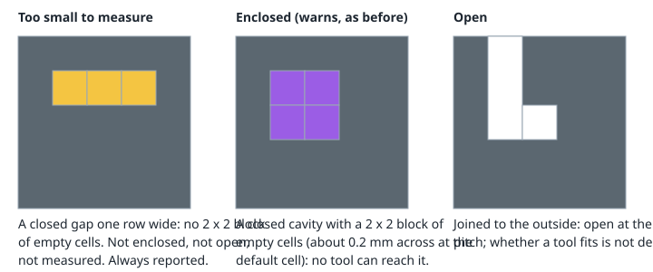

# 0705: Closed pockets too small to measure are neither enclosed nor counted, and are always reported (lane SIMVIS; issue #849)

- **Status:** Proposed. The plan was agreed by the project owner in the coordinator's message of 27 Nov 2026 (relayed: "849 - agree"), which is the basis of this build; the record itself is not accepted until the owner says so (decision 0049).
- **Date:** 27 Nov 2026.
- **Lane:** SIMVIS follow-up, `claude/lane-849-too-small`, from `main` `bfbcac7`.
- **Issue:** #849 (user-reported; the pull request says "Refs #849" only).
- **Requirements:** SIM-05, SIM-15, NFR-06, NFR-07, NFR-12. Generated G-code remains the user's to verify before running it on a machine (NFR-12).
- **Amends:** [decision 0513](0513-material-no-tool-can-reach.md) item 3 (what is never called enclosed).
- **Numbers:** 0705 and OI-2273, the next free across `main` and the unmerged branches on 27 Nov 2026 (0701 to 0704 and OI-2272 are claimed there); the Merge Manager may renumber at release.

## Context

The enclosure test (0513) floods the grid from its border; an empty region that the flood does not reach is a closed pocket, and the material left beside it is called enclosed and warned about. A model with a hairline slit or fold the mesh closes (a gap thinner than the grid can read) gives such pockets by the thousand. They are not cavities a person would drill or bore: they are defects in the model, and the material in them is too thin to say anything about. Today the samples around them are undecided or, where the grid reads a few cells, enclosed, which puts a large share of the surface under a warning that tells the user to bore it.

## Decision (as agreed)

1. **A new class, `ReachClass::TooSmall`.** A closed pocket in which no 2 x 2 block of grid points is empty (a strip under about two pitches thick, 0.2 mm at the default cell) is marked small. A sample whose empty side first reaches such a pocket is `TooSmall`, however far the pocket runs on. A real small cavity (a 2 x 2 block or more, 3 to 5 cells across) is still `Enclosed` and still warns; the tube stand-in's bore is still `Enclosed`.
2. **Kept out of the numbers.** A `TooSmall` sample is not enclosed, not open and not undecided; it is left out of the histogram, the counts, the share within tolerance, the worst material left, and the enclosed and unclassified counts, and its triangles are drawn "Not measured" on the cut part (triangles with other samples take the worst of those, and a strip that holds both is drawn in pieces, as 0514 does).
3. **Always reported.** After a simulation each setup with any gets one note, topic "Mesh check", context "setup 'Setup 1'": how many places (an agreeing noun), the area in readable digits ("about 0.4 mm²", "less than 0.1 mm²", never "0 mm²" or "0.0%"), where (X from the work zero and shares of the part's length) and "fix it in the model". It is **Information**; it is a **Warning** when the left-out share of the counted surface (by area) is 1% or more.
4. **Unchanged:** the enclosed warning, the 2-pitch and shank rules, the cache keys, the project file and the G-code (messages and colours only).

## Limits (stated, not hidden)

- A gap thinner than the grid reads is seen only where a grid point falls inside it: at one alignment of a 0.08 mm slot to the grid the slot holds no point and its samples stay undecided (the Undecided count still reports them). A finer grid is a simulation-cell choice, not part of this decision.
- The place count joins samples within four cells of each other in a chain; a long slit is one place.
- The note prints X from the work zero with a local three-decimal formatter; lane WORK-FRAME (decision 0699, WF-1) introduces the shared formatter, and a later change moves this text to it (OI-2273).
- On the stock surface's probe (the hover value on the cut stock) a `TooSmall` sample gives no value, so the face over it reads "not measured" where nothing else is near.

## Verification

Run here, uninstrumented: `cargo test -p openchuck-sim --test reach` (16, of which `req_sim_05_a_closed_pocket_under_two_pitches_across_is_too_small_to_measure` sweeps a 0.08 mm slot over four offsets across a pitch, `req_sim_05_a_cavity_of_three_to_five_cells_still_counts_as_enclosed`, `req_sim_05_req_nfr_06_the_too_small_class_does_not_depend_on_the_thread_count`), `cargo test -p openchuck-app --test integration -- reach::` (10: `req_sim_05_req_nfr_12_a_hairline_gap_is_a_note_not_enclosed_and_says_where`, `..._many_narrow_gaps_over_one_percent_of_the_surface_are_a_warning`, `req_sim_05_a_hairline_gap_is_drawn_not_measured_and_left_out_of_the_bands_it_covers`, `req_nfr_06_the_too_small_report_is_the_same_at_any_thread_count`), the unit tests of `simulation` (note wording, no "0.0%" with "0 mm²", the 1% threshold, the place count), `stock_surface` and the results panel (`req_sim_05_pockets_too_small_to_measure_are_left_out_of_the_table`). Not run here: the rest of the application and interface suites (CI), `cargo-llvm-cov` (not installed; nightly reports coverage), `cargo-semver-checks` (`openchuck-sim` is outside the library family). Not verified on a real model: the reporter's file is not in the repository.
