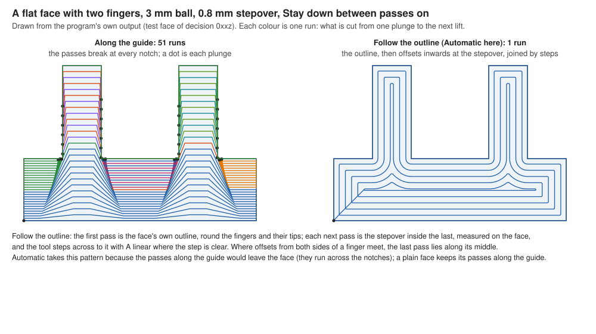
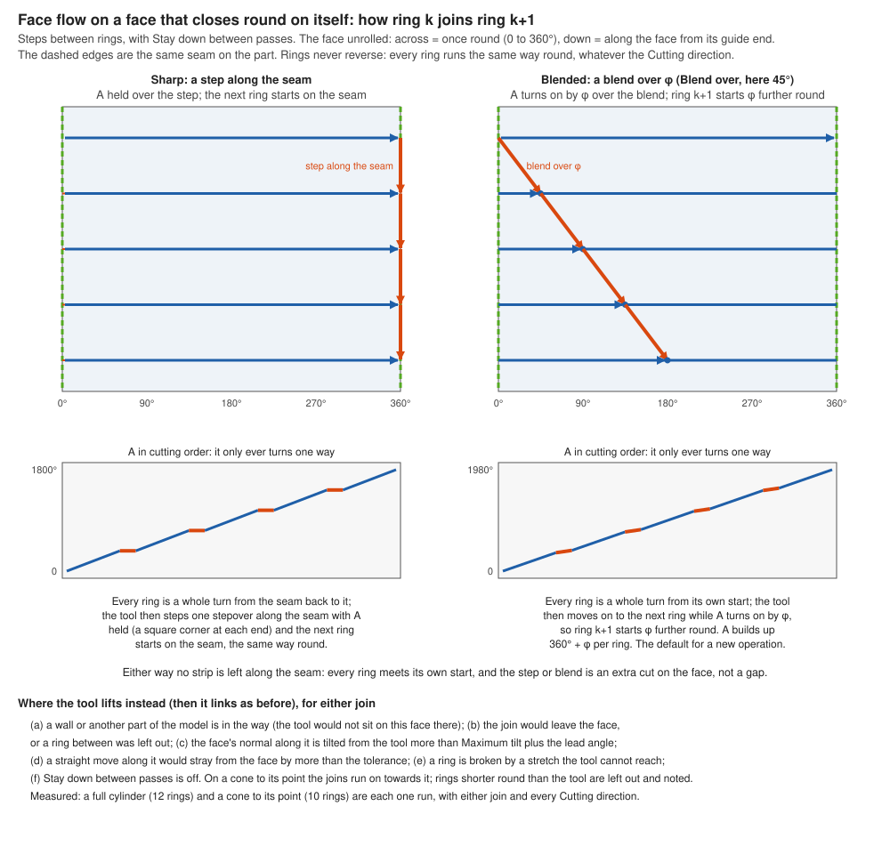

# 0xxz: Face-flow finishing stays down between passes, follows a face's outline where its guide's passes would break, joins rings as the ring strategies do, and leaves out cuts shorter than a set length (OP-28, OP-14, OP-20; issues #854, #791; lane FACEFLOW)

- **Status:** Proposed 23 Nov 2026 by lane FACEFLOW. The design follows the owner's answers of 23 Nov 2026, relayed by the coordinator (session_01CFw3bzew7zizFQ91L5tvT7): Q1, the pattern is automatic (with a setting: Automatic, Along the guide, Follow the outline); Q2, stay down between passes with a square step and A linear over it, no rounding; Q3, Shortest cut applied last to whole runs, default the tool's diameter, 0 off; Q4, all of it in pull request #854; the ring joins as on the ring strategies, a step along the seam or a blend over an angle, and rings never reverse; the defaults in decision 0545 D3's pattern (saved operations keep their programs, new operations get the new behaviour); and the `UnreachedReason::TooShort` API change with a library minor bump. The record itself waits for the owner's acceptance (OI-xxxx). Written as 0xxz with OI-xxxx and OI-xxxy; the numbers are assigned at the release of #854, above `main`'s highest.
- **Date:** 23 Nov 2026.
- **Issues:** #854 (the owner's request in the pull request: "Face flow should follow the edge of that face along the blade. It can be a single run, but it shouldn't just be many rings with retractions doing tiny cuts."), #791.
- **Requirements:** OP-28 (points 1, 4 and 5), OP-14, OP-20 (reporting what is not cut), OP-25, OP-15, GC-07, NFR-06, NFR-07, NFR-12.
- **Builds on and amends:** [decision 0525](0525-face-flow-finishing.md) (accepted): item 2.2 (the passes) gains a second pattern, and D1 (direction) is amended for rings; [decision 0675](0675-face-flow-on-a-face-closed-round-its-axis.md) (accepted), item 3's "Climb, Conventional and Meander keep their meaning (D1)" becomes "rings never reverse" (item 3 below); [decision 0545](0545-blended-steps-between-rings.md) (accepted), whose two parameters, wording, limits and defaults face flow takes for its rings; [decision 0205](0205-roughing-default-stock-to-leave.md) (a new operation's value written from its tool).
- **Open items:** raises OI-xxxx (the owner's acceptance of this record). OI-xxxy (whether Shortest cut should follow a later change of tool) was raised and closed the same day by the owner's decision to add a Tool diameter choice (item 7).

## Context

On the public blisk (`testdata/projects/face_flow`, `blisk.step`, 3 mm ball), face-flow finishing cut each pass as its own run: every pass, and every piece of a pass between the stretches the tool cannot reach, began with a lift, a move across and a plunge. On the outside face of the rim between the blades (face 1, which closes round on itself) and on faces with fingers or notches, passes along the guide break at every notch into short pieces, and the result is "many rings with retractions doing tiny cuts". Measured before this change (Verification): BEFORE_NUMBERS.

## Decision

1. **Stay down between passes** (`stay_down`, a flag). With it on, the tool goes from the end of one pass to the start of the next along the face instead of lifting, where the way is clear:
   - along the guide with Meander, at each end of the passes (the square U: a straight step across the face with a square corner at each end; A linear over the step; no rounding, the owner's answer to Q2);
   - when following the outline, from each offset to the next;
   - on rings, as item 3 says.

   Each step is sampled on the face and checked as a pass is: each point placed by the same drop on the whole part, the tilt within Maximum tilt plus the lead angle, and every move within the tolerance (decisions 0115 and 0133). The tool lifts instead, and the shared linking runs as before (OP-14), where a wall or another part of the model is in the way (the tool would not sit on this face there), where the step would leave the face or be longer than twice the stepover, where the tilt or the tolerance would be broken, or where a pass ends at a stretch the tool cannot reach. Climb and Conventional on faces that are not rings lift between passes as before, since each pass starts from the same side.
2. **Pattern** (`pattern`: `automatic`, `along_guide`, `outline`). **Along the guide** is decision 0525 item 2.2. **Follow the outline** cuts the face in passes that follow its own edges, each the stepover inside the last, measured on the face: the face is gridded in its (u, v) at a quarter of the stepover (0.05 to 0.5 mm), each grid point given its distance on the part to the nearest point of the outline (the face's edges, finely sampled; a seam is not part of it) by passing the nearest outline sample from neighbour to neighbour, and the passes are the outline itself and the grid's level lines at whole stepovers, each taken half a grid spacing short so that where offsets from both sides meet (a ridge between grid points) the last one is not lost. The passes run from the outline inwards, each started at its point nearest where the last ended, the inside of the face on the side Climb or Conventional asks for. **Automatic** follows the outline on a face whose guide's passes would leave it (more than one in fifty of the face's interior blend points off the face: fingers, notches or holes the blend runs across), and the guide everywhere else; a face that closes round on itself keeps its rings. The face's note says which it took: "face N follows its outline, edges ... (L mm long), inwards in K passes up to S mm apart along the face", or the guide note as before.

   
3. **Rings** (a face that closes round on itself, decision 0675). Rings never reverse (the owner's correction of 23 Nov 2026): every ring runs the same way round, Climb and Conventional the way that puts the uncut material on the side they ask for, Meander the guide's way, and the face's note says so ("with Meander every ring still runs the same way round"). With Stay down between passes on, ring k is joined to ring k+1 as **Steps between rings** (`ring_step`) sets, decision 0545's setting with its labels, wording, limits and defaults:
   - **Sharp**: a step one stepover along the seam with A held; the next ring starts on the seam. A builds up 360° per ring.
   - **Blended**: after each whole ring the tool moves on to the next while A turns on by **Blend over** (`ring_blend_angle`, degrees, default 45, more than 0 and at most 180, anything else refused by name): round the face by φ/360 of a turn and across from one ring to the next, both linear, so ring k+1 starts φ further round. A builds up 360° + φ per ring and never reverses. The note gives the blend and its steepest angle off the ring, as decision 0545 item 6 does.

   Either way every ring is a whole turn that meets its own start, so no strip is left along the seam; the step or blend is an extra cut on the face. On a cone to its point the joins run on towards it; rings shorter round than the tool are left out and noted (0675 item 2); the last ring has no join. The join lifts in the cases of item 1, and where a ring was left out between.

   
4. **Shortest cut** (`min_length`, the key of edge following's Shortest chain and of pencil clean-up's Shortest cut, one setting across the three; a length in mm or Tool diameter, item 7), applied last, to whole runs (the owner's answer to Q3): a run, everything cut from one lift to the next after the joins of items 1 to 3, that is shorter than the setting is left out. Nothing inside a longer run is removed. Each run left out is reported as an area left uncut, hatched as the unreached ones are, with its X range, near which A, its length and why, in a warning that names the setting: "face-flow finishing leaves out 2 cuts shorter than the Shortest cut (3.000 mm), which stay uncut: X a to b near A c (n mm2), a cut of 1.8 mm; ...; lower the Shortest cut to keep them (0 keeps every cut), and check them in the simulation before running the program". The report is a new reason, `UnreachedReason::TooShort { length }` (item 6). 0 keeps every run.
5. **Defaults** (the owner's decisions of 23 Nov 2026, in decision 0545 D3's pattern). The schema's defaults keep today's program for an operation saved before these settings: Stay down off, Pattern Along the guide, Steps between rings Sharp (45° Blend over), Shortest cut 0 mm. `Application::add_operation_on` writes into every new face-flow operation Stay down on, Pattern Automatic, Steps between rings Blended (0545's existing rule) and Shortest cut Tool diameter. The tooltips and the user guide say what a saved operation keeps and what a new one gets. The face-flow reference goldens do not change (Verification).
6. **Library** (decision 0048). `openchuck-path` gains the public constants `face_flow::parameter::{STAY_DOWN, PATTERN, AUTOMATIC, ALONG_GUIDE, OUTLINE, SHORTEST_CUT}` (`SHORTEST_CUT` is `"min_length"`, edge following's `MIN_LENGTH`), the variant `assemble::UnreachedReason::TooShort { length: f64 }`, and item 7's `params::ParameterKind::LengthOrTool`, `params::LengthOrTool`, `params::TOOL_DIAMETER` and `Parameters::length_or_tool`. `UnreachedReason` is not `#[non_exhaustive]`, so its new variant is a breaking change for an exhaustive match outside the workspace (`ParameterKind` is `#[non_exhaustive]`, so its variant is not): the workspace takes a minor version bump at release (the coordinator approved, 23 Nov 2026), with changelog entries. `openchuck-app` gains `form::FieldKind::LengthOrTool` (`FieldKind` is `#[non_exhaustive]`) and re-exports `form::TOOL_DIAMETER`. No project schema change (item 7).
7. **A length or the tool's diameter** (the owner's decision of 23 Nov 2026, relayed: "rather than empty, have a true tool diameter option... I think this will likely be used elsewhere"; design approved by the coordinator the same day). A new kind of setting, `ParameterKind::LengthOrTool { min, max, default }`, whose value is a length in millimetres or **Tool diameter**: the operation's tool's cutting diameter, read each time the operation is generated, so it follows a change of tool.
   - **Stored** as a number (`min_length = 2.5`) or as the word `tool_diameter` (`min_length = "tool_diameter"`), in the operation's existing parameter table as a choice's word is; a missing key takes the schema's default. The command line and the TOML file take the same word. Existing numeric values read as before.
   - **Resolved** by the library: `Parameters::length_or_tool(name, tool_diameter)` gives the number, or the diameter it is passed for the word; a word other than `tool_diameter`, a negative number, NaN, or a tool with no usable diameter is refused naming the setting (NFR-07). The strategy passes its tool's diameter (`2 × RevolvedProfile::cutting_radius()`); the application passes it for edge following's chain sources.
   - **Form**: `FieldKind::LengthOrTool { min, max, tool_diameter }`, drawn as a number row with a **Tool diameter** tick box under it. Ticked, the row is read-only and shows the diameter in use ("3.000 mm, the tool's diameter", or "Tool diameter: no tool chosen"); unticking stores the diameter as a number to edit from.
   - **Who uses it**: face flow's Shortest cut (default 0 mm, new operations Tool diameter, item 5); edge following's Shortest chain, converted with its default kept at 0 mm, so saved operations' chains are unchanged; pencil clean-up's Shortest cut adopts it in lane PENCIL-REST's follow-up (default Tool diameter, its output changing anyway).
   - **Project schema**: no number. The precedent is decisions 0390 and 0545, whose new choice words entered operation files as free parameters with no schema change. An older version opens such a project but refuses to generate an operation that holds the word ("expected a number", naming the setting), as it refuses 0545's `ring_step` ("no parameter of that name"); the user guide's known limitations say so.
   - **UI specification** (proposed text for section 8, to be edited only when the owner agrees): "**Length or tool diameter**: a number field in millimetres with a **Tool diameter** tick box under it. Ticked, the field is read-only and shows the diameter in use and its source ('3.000 mm, the tool's diameter'; with no tool, 'Tool diameter: no tool chosen'). Unticked, it is an ordinary number field, starting from the tool's diameter. The tooltip says that Tool diameter follows a change of tool."
8. **NFR-12.** No wording says the program is safe or checked; the warnings say to check what is left uncut in the simulation, and generated G-code remains the user's to verify before running it on a machine.

## Alternatives considered

- **Round the turns at the ends of the passes** (a rounded U instead of the square step). Not built: the owner chose the square step with no rounding and no option for it (Q2).
- **Reverse each ring with Meander** (a square U along the seam). This lane's first proposal; withdrawn by the owner's correction: rings run one way, so A never winds back and forth, as on the helical rings.
- **A spiral round a closed face** (helical-style continuous path). Not wanted by the owner; the Blended join gives a continuous cut while each ring stays a whole turn.
- **Shortest cut applied to pieces of passes before the joins, or splitting runs.** Not built: it could remove part of a run the tool stays down through and leave a gap inside a cut; the owner chose whole runs only, applied last.
- **Report a short run under an existing reason (Blocked, Too narrow) or in a note only.** A wrong reason misleads, and a note alone is not marked on the part; the coordinator approved the new variant.
- **Stay down, Automatic and Shortest cut on for saved operations too.** Would change every saved face-flow program and the reference goldens; the owner chose 0545 D3's pattern.

## Consequences

- **Library** (`openchuck-path`): `face_flow.rs` (the settings, the stay-down joins, the ring joins, Shortest cut, the notes), the new module `face_flow/outline.rs` (the outline pattern), `assemble.rs` (the variant), and the arms for it in `rest/walls.rs`, `simultaneous.rs` and `simultaneous/hidden.rs`.
- **Application** (`openchuck-app`): `opflow.rs` writes the new operation's values (item 5).
- **User guide:** `reference/operations.md`, Face flow finishing and Steps between rings; the release notes.
- **Generated G-code** changes only for operations that set the new values (every new face-flow operation). Saved operations, the face-flow reference job and its goldens are unchanged.

## Verification

VERIFICATION_TEXT
