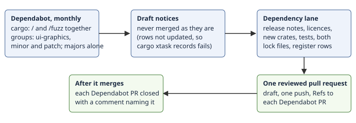

# DEPS-UPDATES-A: Dependabot runs monthly, its pull requests stay drafts, and a dependency lane turns them into one reviewed pull request (lane DEPS-UPDATES)

- **Status:** Accepted by the project owner on 24 Nov 2026, relayed by the coordinator (decision 0049). Proposed by lane DEPS-UPDATES on 23 Nov 2026; the owner chose the policy (items 1 to 5 below) on 23 Nov 2026 ("accept all as recommended", relayed) and accepted the record's text on 24 Nov 2026 (OI-9971, closed).
- **Number:** provisional. Under the owner's rule of 23 Nov 2026, provisional numbers are unique across lanes and real numbers follow `main` in merge order. The record is `DEPS-UPDATES-A`; its open items are OI-9971 and OI-9972, from the numbers the coordinator set aside for this lane. No project schema number. No spike.
- **Date:** 23 Nov 2026.
- **Lane:** DEPS-UPDATES, branch `claude/lane-deps-updates`, from `main` at `445286b` (library family 0.59.0).
- **Requirements:** NFR-14 (dependency justification), NFR-10 (licences), NFR-06 and GC-07 (byte-identical output), NFR-07 (invalid input never crashes). No requirement change. `docs/requirements.md` and `docs/architecture.md` are not edited.
- **Amends:** the *Upgrade cadence* and *Update and activity checks* lines of `docs/dependencies.md` (edited in this pull request), and `.github/dependabot.yml` (weekly to monthly, the cargo groups, the fuzz workspace with the main one).
- **Open items:** adds OI-9971 (the owner accepts this record's text; closed 24 Nov 2026) and OI-9972 (the first monthly run is checked against items 1 and 2). Refers to issue #876 (the fuzz lock file is behind `main` and the fuzz smoke job resolves without `--locked`), which this record does not fix.

## Context

Dependabot was set to weekly Cargo and Actions updates (decision 0004, open item 7; OI-18). Its pull requests were left alone from early November until this lane: by 23 Nov 2026 seven were open (#453, #497, #498, #671, #672, #673, #861), all drafts. None could merge as it stood:

- every pin has a row in `docs/dependencies.md`, and Dependabot does not edit it, so `cargo xtask records` fails each cargo bump (the check exists so that every bump gets an NFR-14 look);
- the fuzz workspace (`fuzz/`) pins `toml` on its own and its lock file carries the product crates' dependencies, while the main and fuzz workspaces were separate Dependabot entries. A `toml` bump in the main workspace alone (#671) leaves two exact pins of one crate, and the fuzz workspace no longer resolves;
- a Dependabot lock file is only as fresh as the day it was opened: #671 proposed `toml` 1.2.0, while 1.2.2 fixes a stack overflow on invalid files.

The earlier dependency lanes (DEP, DEPS: #386) had already taken Dependabot's pull requests as notices and opened their own. This record makes that the rule.

## Decision (the owner's choices of 23 Nov 2026, relayed)

1. **Monthly.** Cargo and GitHub Actions updates are checked on the first day of each month (Dependabot's `monthly`), not weekly. Security advisories are not delayed by this: `cargo deny` and `cargo audit` run on every pull request, and `docs/dependencies.md` keeps the one-week rule for an advisory.
2. **One cargo entry for both workspaces, two groups.** The cargo entry lists `directories: ["/", "/fuzz"]`. The egui, eframe, epaint and wgpu crates stay in their own group (`ui-graphics`, first, so they never fall into the next). Every other crate's minor and patch updates are one group (`cargo-minor-patch`). Majors are not grouped and arrive one pull request each. The Actions updates are one group.
3. **Dependabot's pull requests are notices.** They stay drafts, are never merged as they are, and have no auto-merge. A dependency lane takes them: it reads each bump's release notes, checks licences and new crates (maintainers, build scripts), runs the tests of what the bump touches, regenerates both lock files with cargo (never by hand), and updates the register rows. It opens one reviewed draft pull request that says `Refs #NNN` for each Dependabot pull request it covers. After that pull request merges, each covered Dependabot pull request is closed with a short comment naming it (or Dependabot closes it itself once `main` has the version).
4. **Fast-moving families may share that pull request.** `docs/dependencies.md` asks for egui, wgpu, parry3d, i\_overlay and minijinja to be upgraded one family per pull request with their own tests re-run. A family may share the lane's pull request when its own tests are re-run and its output is shown unchanged (for minijinja: the golden and post tests byte-identical). A family whose output or interface changes still gets its own pull request.
5. **Actions updates go in their own pull request**, because they fall under the workflow checklist of `docs/ci-performance.md`; the cargo updates go in one.

## What Dependabot does and does not do here (read from its documentation, 23 Nov 2026)

- The documentation (the `github/docs` source of the Dependabot options reference) says a dependency in more than one group goes to the first group it matches, and that `monthly` runs on the first day of each month.
- It reads every `x.y.z` version as major, minor, patch, so a pre-1.0 change such as `sha2` 0.10.9 to 0.11.1 counts as *minor* and lands in `cargo-minor-patch`. Under Cargo's rules such a change is breaking. The owner's choice (majors and 0.x minors on their own) cannot be written as a Dependabot rule; the lane reads each 0.x minor's release notes and splits it out when its interface or output changes (item 4). The config says so in a comment.
- The documentation describes one pull request across directories for `group-by: dependency-name` (one pull request per dependency, across all directories). It does not say in so many words whether a pattern group spans the listed directories in one pull request; the Actions group's title (#861, "across 1 directory") suggests it does. OI-9972 checks the first monthly run (1 Dec 2026): one cargo pull request per group covering `/` and `/fuzz`. If it gives one per directory, the lane still regenerates both lock files in its own pull request, so nothing breaks; the config can then add `group-by: dependency-name` or go back to two entries.
- Dependabot has no setting to open its pull requests as drafts. They are set to draft by hand, as now. A ready one would start the heavy CI jobs and fail `records`.

## Alternatives considered

- **Merge Dependabot's pull requests as they are, after a review.** Rejected: each fails `records`, a cargo bump needs both lock files, and a lock file goes stale after it is opened. The rows would have to be edited on Dependabot's branch, one push each.
- **Weekly, as before.** Rejected by the owner: seven pull requests waited a month while weekly runs kept opening more, and each lock-file change starts the full CI.
- **Each risky bump in its own pull request (the coordinator's default).** Not taken for this round: every cargo bump changes `Cargo.lock` and `fuzz/Cargo.lock`, so separate pull requests would conflict with each other and each start the full heavy CI. The risk of each bump was measured instead (Verification).
- **Pin every action by commit SHA in the same pull request (OI-1525).** Out of scope: the Actions pull request keeps each line's existing style.

## Consequences

- `.github/dependabot.yml` changes as in items 1 and 2 (this pull request).
- `docs/dependencies.md`: the *Upgrade cadence* and *Update and activity checks* lines (this pull request).
- The first round under this rule is this pull request (log, cc, toml, minijinja and sha2) and the Actions pull request of lane DEPS-UPDATES.
- No code, test or CI job changes because of this record.

## Verification (of the first round, this pull request)

Environment: the lane's cloud container, Linux x86-64, Rust 1.97.0, from `main` at `445286b`.

- **Lock files.** `cargo update -w` in `/` and in `fuzz/` after the pin edits; the result is the same as the trial run. New crates: `hybrid-array` 0.4.15 and `const-oid` 0.10.3 (RustCrypto, MIT OR Apache-2.0, no build script). Removed: `generic-array` 0.14.7 and `cpufeatures` 0.2.17.
- **Tests.** `openchuck-app`, `openchuck-post`, `openchuck-project` and `openchuck-ui` (1,935 tests, all passed) and `xtask` (157 passed); `cargo clippy --all-targets` on `openchuck-app`, `openchuck-post`, `openchuck-project` and `xtask` with no warning; `cargo xtask deps`, `licences`, `records` and `trace` pass. Times and coverage are in the pull request.
- **sha2.** The known-answer tests (`abc` and the empty input) pass. A throw-away program hashed all 241 tracked files under `testdata/` and the built-in posts with 0.10.9 and with 0.11.1: none differ, and both equal `sha256sum`. No hash on a setup sheet or in a committed file changes. The release manifests (`MANIFEST.sha256`, the archive sums) are made with `sha256sum`, not this crate; the cache keys use BLAKE3.
- **minijinja.** The golden and post tests are byte-identical. A throw-away instrumented build counted the fuel each post-test render used under 3.0.3 and 3.1.0: 1 to 5% more (median 3.4%); the busiest render used 9.9% of its budget (9.8% before), and each step costs about 169 fuel against the 400 the budget allows.
- **Not verified here:** the kernel build with `cc` 1.11.3 (behind the `kernel` feature; the step-kernel jobs on three operating systems are the evidence), the fuzz targets (nightly and `cargo-fuzz`; the fuzz workspace resolves), `cargo deny` and `cargo audit` (CI), the LinuxCNC replay (gate 3; the output is byte-identical), and templates outside the repository.
