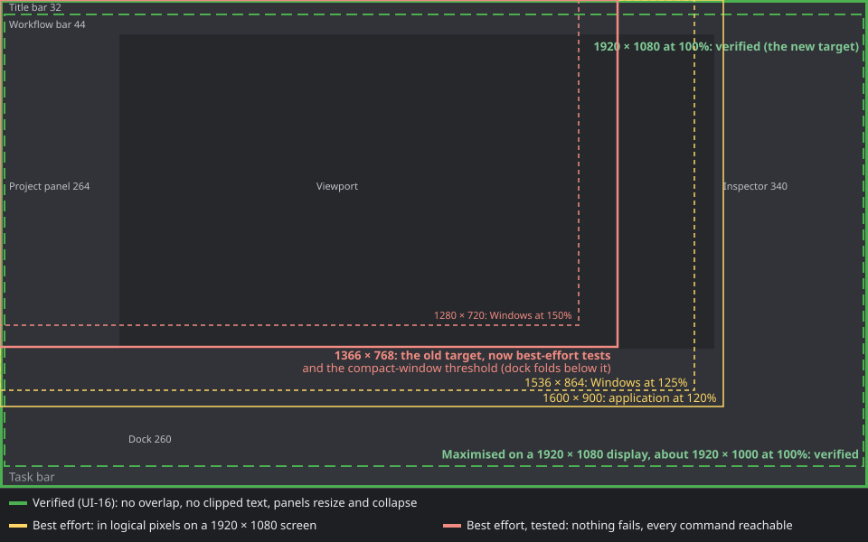

# DISPLAY-TARGET-A: The window's verified size becomes 1920 by 1080, smaller windows are best effort, and the window opens centred or maximised (UI-16, UI-15, UI-14; lane DISPLAY-TARGET)

- **Status:** Accepted by the project owner on 26 Nov 2026, relayed by the coordinator (decision 0049), at head `eba24590`; the acceptance covers the Decision section as written, including the UI-16 wording of item 1. Proposed by lane DISPLAY-TARGET on 25 Nov 2026, recording the owner's decision of 25 Nov 2026 ("I think we can change the 1366x768 requirement … I would expect most displays to be minimum 1920x1080 so we can update to target that") and the owner's answers Q1 B, Q2 B, Q3 C, Q4 A, Q5 A, Q6 A and Q7 A (26 Nov 2026, relayed by the coordinator). The edits of items 1, 3 and 4 are made in this pull request.
- **Date:** 25 Nov 2026.
- **Requirements:** UI-16 (the window's size, resizable and collapsible panels), UI-15 (the window's layout kept per user), UI-14 (Tab never stops on a control out of view), NFR-15 (scale 80% to 200%).
- **Amends:** [decision 0038](0038-ui-specification-and-requirements.md), its amendment of 15 Oct 2026 (UI-16 stated at 1366 by 768 at 100% scale). It replaces the 1366 by 768 reasoning in [decision 0148](0148-menus-and-view-directions.md) item 3 (the default scale stays 100%, unchanged) and leaves the sizes that [decision 0187](0187-default-dock-height.md) (dock 260) and OI-431 (the import dialog's fixed size) chose for 1366 by 768 as they are (Q5 A).
- **Open items:** adds OI-9931 (the owner's agreement to the UI-16 wording and acceptance of this record; closed by the acceptance of 26 Nov 2026), OI-9932 (the owner's check of the window's opening on Windows), OI-9933 (revisit the rules sized for 1366 by 768), OI-9934 (the build of the test move, option C). Re-scopes the open OI-431, OI-623 and OI-2192 to best effort; OI-523 and OI-529 are already closed and stay as history.

Numbering: provisional. The coordinator assigns the record number and the OI numbers at release, in merge order. No project schema number: the per-user settings file gains one additive field (`maximised`), and no project file changes. No library-family change.

## Context

UI-16 (P1) reads today: "The window is usable at 1366 by 768 logical pixels at 100% scale, and its panels can be resized and collapsed." Decision 0038 set it at 100% because the default scale was then 120%. Decision 0148 item 3 made 100% the default for new users (OI-435), so a 1366 by 768 screen now needs no change of scale either way. The owner judged 1366 by 768 too restrictive and expects most displays to be at least 1920 by 1080.

Three facts shape the new wording:

1. **The application's scale multiplies the operating system's.** On a 1920 by 1080 screen the window has 1920 by 1080 logical pixels only when both are 100%. The application at 120% gives 1600 by 900. Windows at 125%, common on 15-inch 1080p laptops, gives 1536 by 864, and Windows at 150%, common on 13- and 14-inch ones, gives 1280 by 720. That is smaller than today's 1366 by 768.
2. **A maximised window is smaller than the screen.** On a 1920 by 1080 Windows screen with the task bar showing, a maximised window has about 1920 by 1000 logical pixels.
3. **The window opened off-centre** (the owner's report, 25 Nov 2026). The application kept only the window's size. After a session in a maximised window, it saved the maximised size as the normal one. The next start opened a screen-sized window at the system's default place, which is a cascade from the top left on Windows, so it was off-centre and ran past the right edge and under the task bar. This broke UI-15, because the maximised state was lost, and the new UI-16 promise of a window maximised on a 1920 by 1080 display. Read from the code and the eframe 0.37 source. It was not reproduced on Windows; OI-9932 is the owner's check.

## The owner's answers (26 Nov 2026, relayed by the coordinator)

| Question | Answer | What it means |
| --- | --- | --- |
| Q1 Which 1920 by 1080 is promised? | B | A 1920 by 1080 window and a window maximised on a 1920 by 1080 display (about 1920 by 1000), at 100% scale |
| Q2 What is promised below that? | B | Best effort: nothing fails and every command stays reachable; no smaller size is promised |
| Q3 The existing 1366 by 768 tests | C | The verified checks move to 1920 by 1080 and 1920 by 1000 at 100%; a smaller 1366 by 768 set stays, at 100% and 120%, named best effort |
| Q4 The automatic collapse below 1366 by 768 | A | Kept at 1366 by 768, as a named "compact window" threshold |
| Q5 Rules sized to fit 1366 by 768 (the import dialog's fixed size, the dock's 260 default) | A | Left as they are; an open item to revisit them (OI-9933) |
| Q6 Where the window opens on later starts | A | Centred at the size it had, or maximised if it was closed maximised; the position is not kept |
| Q7 The first start | A | Maximised, as before |

## Decision

1. **UI-16 is restated.** Wording agreed by the owner with the acceptance (26 Nov 2026), now in `requirements.md`:

   > | UI-16 | The window is usable at 1920 by 1080 logical pixels at 100% scale, and when maximised on a 1920 by 1080 display at 100% scale; its panels can be resized and collapsed. In a smaller window, or at a larger scale, nothing fails and every command stays reachable (by collapsing a panel, scrolling or the menus); no smaller size is promised. | P1 |

   The target is stated at 100% scale, which has been the default for new users since decision 0148. At 120% the same screen gives 1600 by 900, which is best effort.

2. **"Usable" below the target** means three things: nothing crashes or panics (NFR-07); no control is out of reach, because it can be got at by collapsing a panel, by scrolling or from the menus; and the step's primary action stays whole. It does not promise that nothing overlaps or that no text is clipped. Those checks are made at the target. A failure found at a smaller size is still fixed, but it does not define the requirement.

3. **Verification plan, row UI-16** (applied):

   > | UI-16 | P1 | D, T | System | Automated layout tests at 1920 by 1080 and at 1920 by 1000 (maximised with a task bar) logical pixels at 100% scale: no overlay overlaps another, no text is clipped, panels resize and collapse. Best-effort regression tests at 1366 by 768, at 100% and 120% scale, guard small and scaled screens: nothing fails, no control is out of reach, the primary action stays whole; a failure there is fixed but does not define the requirement. The window opens maximised the first time and when it was closed maximised, otherwise centred at its kept size (`req_ui_15_req_ui_16_*` in `openchuck-app` `tests/settings.rs`, `window_start` and `shell::frame_tests`). There is no manual reference-screen check (removed by the owner, 2 Nov 2026). *(The SIMUI and export-dialog clauses of today's row are kept with their sizes.)* |

   **Row UI-14, UI-10, UI-16:** "Tab through the main window, the export dialog and the machine library at 1366 by 768 never stops on a control out of view" becomes "… at 1920 by 1080, and at 1366 by 768 as best effort, never stops on a control out of view".

4. **The UI specification and the work breakdown** (applied):
   - Section 3, "Smallest window" becomes **"Window size."**: "The window is laid out for 1920 × 1080 logical pixels at 100% scale, and for a window maximised on such a display (about 1920 × 1000) (UI-16). There the panels keep their defaults and nothing overlaps or is clipped. A smaller window, or a larger scale, is best effort: nothing fails and every command stays reachable. Below 1366 × 768, the *compact window* threshold, the dock collapses, and the inspector too when the viewport would be narrower than 420 pixels. Neither is kept as the user's choice: the user can open either again, and the rule applies afresh once the window is large again. *(UI-16)*". This also removes the stale sentence "At the default 100% a 1366 × 768 screen gives the full 1366 × 768 logical pixels".
   - Section 3, **"Opening the window"**: added in lane DISPLAY-TARGET's first pull request together with the code (item 6).
   - Section 11.2, the import dialog's size: "…that fits 1366 by 768 at 120% scale…" becomes "…kept from the 1366 by 768 layout (OI-9933)…". The size itself is not changed (Q5 A).
   - The board index (section 1) and the mock-up table: the label "Operations at 1366 × 768" becomes "Operations in a small window (1366 × 768, best effort)". The file names `13-operations-1366x768.png` and `Main1366.dc.html` stay, so links keep working. `screenshots-1366x768/` stays as lane X8's record (decision 0131).
   - The work breakdown's slice 8 item 8: "usable at 1366 by 768 at 100% scale, with 120% as the default scale" becomes "usable at 1920 by 1080 at 100% scale, the default (decision DISPLAY-TARGET-A)". The closed lane rows (X8 and others) are history and stay.

5. **Tests (option C; OI-9934, lane DISPLAY-TARGET's second pull request, after lanes SIM-UX and UI-BUGS have merged).**
   - The verified checks (no overlap, no clipped text, regions open and collapsing) run at 1920 by 1080 and 1920 by 1000 at 100%. Where a test runs only at 1366 by 768 today, the target sizes are added: `shell/smoke_tests.rs`, `shell/frame_tests.rs` (collapse), `shell/focus_tests.rs`, `shell/tool_library_tests.rs` (four tests), `label_layout.rs`, `setup_panes.rs`, `selection_panel.rs` and `floating.rs`.
   - The 1366 by 768 sizes stay at 100% and 120%. The tests named for them are renamed `…_best_effort_at_1366_by_768`, which trace still maps to UI-16.
   - `frame.rs`'s `SMALLEST` becomes `COMPACT_WINDOW`, with the same value (Q4 A).
   - `import_panel.rs`'s `req_ui_16_the_window_fits_a_small_screen_at_120_percent` stays, marked best effort (Q5 A).
   - Every changed test is timed uninstrumented. A test over a minute is listed in `.config/nextest.toml`.

6. **The window's opening (Q6 A, Q7 A; lane DISPLAY-TARGET's first pull request).**
   - The per-user settings keep the window's normal size and a new `maximised` flag, never its position. An older file reads as not maximised.
   - The window opens maximised the first time and when it was closed maximised. Otherwise it opens at its normal size, centred on the primary screen (eframe's `centered`; Wayland places windows itself).
   - A maximised, minimised or full-screen window does not replace the normal size, and a size out of range is not kept.
   - This is a bug fix against UI-15 and UI-16, with no requirement text of its own. The specification gets the section 3 bullet "Opening the window", and section 13 says the position is not kept.

7. **Unchanged:**
   - The default scale (100%, decision 0148) and the scale range (80% to 200%, NFR-15).
   - The compact-window rule and its 1366 by 768 threshold (Q4 A).
   - The dock's 260 default, the import dialog's fixed size, Simulate's Show choices folding into the Show menu on a narrow strip, and the specification's "at most five overlays" (Q5 A; OI-9933).
   - The guide's screenshots, which are already taken at 1920 by 1080 and 100% scale (`user-docs/STYLE.md`). The capture scripts place the window themselves with xdotool, so the opening change does not move their clicks (OI-1220).
   - The benchmark example `path_frames` keeps its default `--size 1366x768`, so its runs stay comparable with those recorded in decision 0166.

## Lanes in flight

Until the wording is agreed and the second pull request merges, lanes treat 1366 by 768 as best effort. They do not delete or weaken a 1366 by 768 test, and they add 1920 by 1080 to any new layout test.

- **PROJECT-UX-A** (the Simulate legend): design and check it at 1920 by 1080 at 100%, keep it clear of other overlays at 1366 by 768 as best effort, and add no size-specific rule.
- **UI-BUGS** (pull requests 1 to 3) and **SIM-UX:** the second pull request of this lane rebases after them, because they touch the same test files.
- **WORDING-DOCS:** leave UI-16, the verification rows UI-16 and UI-14, and the specification's sections 3 and 11.2 to this lane. Keep sizes and requirement numbers out of the guide.

## Consequences

- The verified layout is the one most users see: a 1920 by 1080 screen, maximised.
- Small laptops and scaled screens keep a regression guard at 1366 by 768, but no promise.
- The window no longer opens off-centre or past the screen's edge after a maximised session.
- A user who wants the window in a particular place moves it each start, because its position is not kept (Q6 A).

## Verification

*To be filled in by each pull request:*

- **First pull request** (the window's opening): the tests `req_ui_15_req_ui_16_the_first_start_opens_maximised`, `req_ui_15_req_ui_16_a_normal_window_opens_centred_at_its_size`, `req_ui_15_req_ui_16_a_window_closed_maximised_opens_maximised_and_keeps_its_normal_size`, `req_ui_15_req_nfr_07_a_minimised_window_or_a_size_out_of_range_is_not_kept` and `req_ui_15_an_older_file_without_the_maximised_state_opens_centred` (`openchuck-app`); `window_start::tests::*` and `shell::frame_tests::req_ui_15_req_ui_16_a_maximised_window_keeps_its_normal_size_for_the_next_start` (`openchuck-ui`). The real window on Windows is the owner's check (OI-9932), with a pack from lane OWNERCHECKS-PACKS.
- **Second pull request** (option C): to be filled in.
