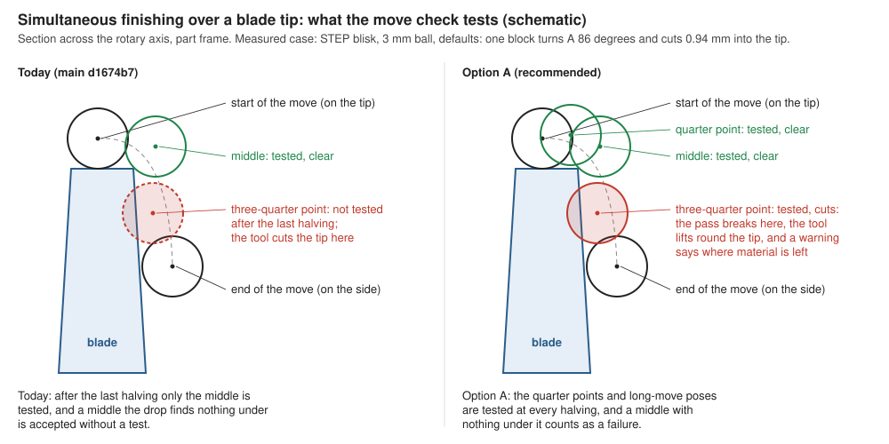
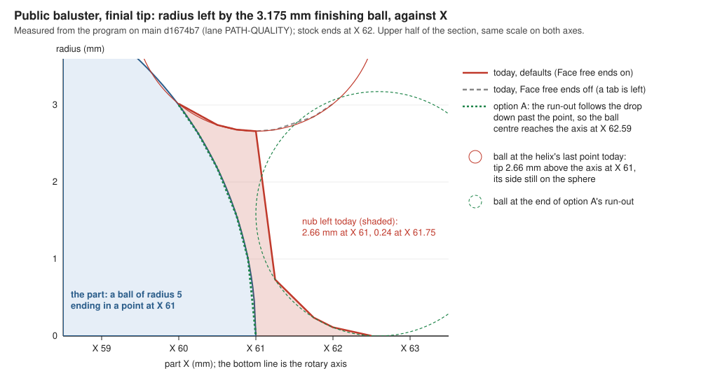

# PATH-QUALITY-1: Simultaneous finishing over sharp edges, a true point at a finial, one rule for ramp entries, and ramps on STEP parts (OP-05, OP-06, OP-11, OP-12, OP-20, OP-21, NFR-07, NFR-12, GC-07; issues #710, #779, #786, #421, #844, #826; lane PATH-QUALITY)

- **Status:** Proposed by lane PATH-QUALITY on 25 Nov 2026 (phase 1, planning only; no code is built until the owner answers). Only the project owner accepts this record (decision 0049). The questions are Q1 to Q7 below, each with options, a recommendation and what follows "if you answer as recommended". **Q1 answered (25 Nov 2026, the owner's answer relayed by the coordinator): option C**, the general continuous seed and a clearance test of the whole tool, taken into its own lane, SIMUL-EDGE; #710 leaves this lane's scope. Q2 to Q7 are still open.
- **Date:** 25 Nov 2026.
- **Issues:** #710 (simultaneous finishing on the blisk: sharp edges and walls facing along the axis; OI-318, OI-337), #779 (a true point at a finial; an adaptive stepover for such curves), #786 (ramping across every strategy), #421 (ramps on STEP parts and a plunge into single-point passes; OI-1270, OI-1271), and the fold-in checks of #844 (a tool engaged along its whole length) and #826's OI-2198 (adaptive spacing on the stepped cylinder with a flat end).
- **Requirements:** OP-05, OP-06, OP-20 (simultaneous finishing, tool axis, hidden surfaces), OP-11 (ramping), OP-12 (gouge protection), OP-14 (linking), OP-21 (tabs), SET-09 (held regions), NFR-07, NFR-12, GC-07 and NFR-06 (determinism).
- **Would amend, if answered as recommended:** accepted [decision 0543](0543-a-ramp-entry-follows-the-toolpath.md) D2 (a spiral is ramped round the axis at its start X) and accepted [decision 0645](0645-a-swarf-ramp-follows-the-pass-along-the-face.md) item 1 (`Strategy::ramps_round_the_part`), by Q3; accepted [decision 0212](0212-roughing-direction-and-extend-past-the-stock.md) part B item 3 and accepted [decision 0546](0546-run-outs-follow-ring-and-spiral-passes.md) item 3 (a run-out keeps the height of the pass's last point), by Q2. It builds on [decision 0363](0363-simultaneous-finishing-off-axis-sections-walls-and-held-ends.md) item 2 (the wall move and the narrow seed fix), [0113](0113-toolpath-choices-rounding-cannot-flip.md) and [0133](0133-simultaneous-fitter-tests-the-quarter-points.md) (the move test), [0344](0344-finishing-stepdown-and-free-ends.md) (free-end turns), [0545](0545-blended-steps-between-rings.md) D3 (defaults that keep saved programs) and [0680](0680-the-gate-5-reference-part-is-a-stepped-cylinder.md) (where OI-2198 was found).
- **Open items:** adds OI-9991 to OI-9997 (provisional numbers; listed under *Open items* below). Adds this lane's findings to OI-318, OI-337 and OI-2198 in place. Depends on no open item for Q1, Q3, Q4 and Q6; Q2 depends on 0344's free-end turn and its cut-free warning (OI-1393 is related).

Numbering: provisional. The record carries the lane's name and the open items OI-9991 to OI-9997 (free on `main` and on every unmerged branch on 25 Nov 2026); the coordinator assigns the real numbers at release, in merge order. No project schema number is needed for any recommended answer: new operation settings are stored in the operation's free parameter map, as decisions 0390, 0543 and 0545 did. No spike.

## For the owner

What this record asks of you, in the order the coordinator will put it:

1. **Q1 (#710), answered C and moved to lane SIMUL-EDGE: the blisk's simultaneous finish cuts into its blade tips today.** It is no longer refused; it generates, and the simulation finds up to 0.94 mm cut into the blade tips with the 3 mm ball on the STEP blisk and 1.7 to 2.5 mm with the 3 mm flat end. This is a gap in gouge protection (OP-12), so it is put first. Recommended: **A**, tighten the move check so these moves are caught, break the pass there with a warning, and document the blisk's limit and its workaround.
2. **Q3 (#786): a ramp that goes round the part cuts into it.** Face flow, pencil, simultaneous finishing on a face set and, with the steeper ramp on, helical and simultaneous on the crankshaft cut 0.26 to 0.68 mm into the part when Entry is Ramp (the same operations with Plunge do not). Recommended: **A**, every ramp follows its own pass, back and forth, as swarf's already does.
3. **Q4 (#786): needless ramp refusals.** Recommended: **A**, a stretch shorter than the shortest ramp is entered as a single point is, the steeper-ramp search is fixed, and new operations get Allow single-point plunge and Steeper ramp near the axis on (saved operations keep theirs).
4. **Q2 (#779): the finial's tip.** Recommended: **A**, a new setting **Finish to a point** (on for new helical, axial and indexed finishing operations; saved operations keep their programs) that carries the finish past a pointed end down to the rotary axis, with the existing "part cut free" warning.
5. **Q6 (OI-2198): adaptive spacing on the stepped cylinder.** Recommended: **A**, fix the three causes found.
6. **Q5 (#844): fold in or not.** Recommended: **A**, keep #844 separate in 2027.1.
7. **Q7 (#421): close it.** Recommended: **A**, close #421 on the evidence below: both its items were settled by decision 0543 and ramps generate on STEP parts.

And what to look at: the two figures below, and the evidence in [docs/archive/PATH-QUALITY-1-phase-1](../archive/PATH-QUALITY-1-phase-1/README.md).

## Context

All of this was reproduced on `main` at `d1674b7` (version 0.63.0) with release builds of `openchuck-cli` and `openchuck-step-worker`, on the repository's public models only: the blisk (`testdata/step/valid/blisk.step` through `testdata/examples/blisk-start`, and `testdata/stl/blisk.stl` with OI-318's setup), the baluster (`testdata/examples/baluster`), the crankshaft (`testdata/examples/crankshaft-simultaneous`) and the stepped first-cut part (`testdata/projects/first_cut`, rebuilt with the command line as `build_first_cut` builds it). The command line cannot add an operation (OI-310), so each run copied a project, wrote an operation file and ran `openchuck-cli regenerate` and then `openchuck-cli simulate` (0.1 mm cells; an overcut deeper than one cell counts as a cut into the part). Exact settings, messages and times are in the archive.

### #710: simultaneous finishing on the blisk

OI-318 recorded that simultaneous finishing refused the blisk at every setting. That is no longer so: since decision 0363 item 2 (the wall move, and the seed moving with the lean on a flat bottom), it generates at every setting tried. But the simulation shows it cutting into the part:

| Run | Generates | Simulation |
| --- | --- | --- |
| STL blisk, 3 mm ball, defaults (5 degree step, 10 degree tilt); also tilt 0, and tilt 0 with a 2 degree step | yes, 83 to 118 s | within one cell (0.058 mm at a blade tip); 2.59 mm left at the root of the shoulder |
| STL blisk, 3 mm flat end, defaults; also no hidden lean | yes, 9 to 18 s | **cuts 1.7 to 2.0 mm** into blade tips |
| STEP blisk, 3 mm ball, defaults; also exact contact off, and tilt 0 | yes, 188 to 369 s | **cuts 0.91 mm** into blade tips; 2.56 mm left at the root |
| STEP blisk, 3 mm flat end, defaults | yes, 197 s | **cuts 2.55 mm** into blade tips |

One example from the STEP ball run: one block turns A by 86 degrees and takes the ball from the top of a blade tip to its side, cutting 0.94 mm into the tip on the way.

What causes it, in `crates/openchuck-path/src/simultaneous.rs`:

1. **A move over an edge is tested only at its middle once it has been halved as far as it can be.** The quarter points and the long-move poses (decision 0133) are tested only above the deepest halving; at it, only the middle is tested, and a middle the drop finds nothing under is accepted without a test (around lines 2438 to 2541).
2. **On hidden-surface passes a flat end's cut is not seen.** The check measures the gap from the tool's profile at the point the tool rests on; a flat end rests on its corner, which reads about zero at any depth (around 2253; `simultaneous/hidden.rs` around 526).
3. **The seed follows the surface normal, which jumps at a sharp edge** (OI-337 item 1; only its narrow form was built). Smoothing falls back to the facet's normal across an edge, so nothing softens the jump.
4. **The corner where the shoulder (facing along X), the hub and the blade roots meet is out of reach** of a 3 mm tool whose axis must lie across the rotary axis: about 2.5 mm stays there, reported as unreached hidden areas. That is a limit of 4-axis access with this tool, not a defect; it is the "recorded limit" #710's *Done when* allows.
5. **The largest-tilt note reads 83 to 86 degrees at the edges**, because it compares against the next face's normal; it is the edge's jump, not the lean used.

Found on the way, not part of #710: with the axial pattern the Makera Z1 post refuses to write the STL blisk's program ("replay does not match the toolpath: … rotary counter reset is not at a reached declared boundary"), while the LinuxCNC post writes it and its replay matches (OI-9994); and the STEP blisk shows off-axis zones in four strips 0.05 mm wide (X 41.2, 43.8, 49.5 and 66.0) that look spurious (OI-9995).

### #786: ramp entries across the strategies

No strategy builds its own entry: every one goes through the shared assembly (`strategy.rs`, `assemble_limited`) to `Entry::enter` (`assemble/entry.rs`). What a ramp does depends only on how the pass starts:

| The pass starts as | The ramp | Checked against |
| --- | --- | --- |
| a line, or a partial ring | back and forth over the pass's own path | the pass's own heights: every ramp position is a pose of the pass raised along the tool axis, so it cannot cut deeper than the pass |
| a whole ring | round the ring itself | the same |
| a spiral (any pass that turns A while moving along X), when the strategy's `ramps_round_the_part` is true (every strategy but swarf) | round the rotary axis at the start X (0543 D2), its floor from a drop sampled at the A step of the tip's radius (`touch_height`) | the operation's surface: on a mesh the whole part with its held regions and tabs; on a STEP part with a face set only the faces of the set (face flow gets the whole part) |
| a single point | refused unless Allow single-point plunge is on (0543 D7) | — |

Edge following and drilling offer Plunge only; facing ramps over its own passes.

What was found:

- **Cuts into the part, all where a ramp goes round the part** (Ramp, then Plunge, on the same operation): blisk face flow on face 20, 0.379 mm against 0.046; blisk pencil, 0.542 against 0.048; blisk simultaneous on face 19, 0.684 against 0.049, and on face 20, 0.492 against 0.046; crankshaft simultaneous spiral and helical with Allow single-point plunge and Steeper ramp near the axis on, 0.423 and 0.261 against 0.044 and 0.046. On face flow and pencil the program shows passes entered by up to 4.4 turns round the part, over the blades. The spiral ramp's floor is sampled, so it cuts between samples where the part has features, and on a face set it does not see the rest of the part. Swarf, which already ramps over its own path (0645), simulates the same with Ramp as with Plunge, and every line and ring ramp was clean.
- **Needless refusals:** a single point refuses Ramp at the defaults in roughing, indexed finishing and Facing, while Lead plunges the same passes with a note; after a plunge roughing on the baluster, helical, axial, rest and simultaneous axial finishing all refuse a ramp of more than 10 turns near the axis at their defaults; a stretch shorter than the shortest ramp (ten path tolerances, 0.1 mm at the default tolerance; 0543 amendment 4) refuses even with Allow single-point plunge on (axial, indexed and helical on the blisk floor).
- **A defect in Steeper ramp near the axis:** on the baluster's simultaneous axial finish it stops at 4.09 degrees, far below the 15 degree maximum, and asks the user to turn on the setting that is already on. `Entry::steepen` assumes the turns fall in proportion to the angle, but the ring ramp adds a whole turn where the pass rises, so its four tries fall short.

### #421: ramps on STEP parts

Both items were settled by accepted decision 0543 (8 Nov 2026): D10 removed the back-and-forth corridor and its certificate, so there is no STEP refusal left (OI-1270 retired), and D7 built **Allow single-point plunge** (OI-1271 closed). Checked on `main`: Ramp entry generates on the STEP blisk for roughing in all four forms, swarf, face flow, pencil and simultaneous finishing; the STEP crankshaft's roughing along the part simulates within one cell (0.043 mm); and Allow single-point plunge acts on STEP parts (off: "pass 1 is a single point …"; on: "10 passes, from pass 1 to pass 1721 … entered by a straight plunge, as Allow single-point plunge asks"). The cuts found above are not particular to STEP (pencil on the blisk and the crankshaft use no face set), so they belong to #786.

### #779: the finial's tip

On the public baluster with the 3.175 mm ball, what the finish leaves near the finial's point at X 61 (the part is a ball of radius 5 centred at X 56):

| Finish settings | X 60 | X 60.5 | X 60.75 | X 61 | X 61.25 | X 61.75 | X 62 | X 62.5 |
| --- | --- | --- | --- | --- | --- | --- | --- | --- |
| The part | 3.00 | 2.18 | 1.56 | 0 | — | — | — | — |
| As saved (adaptive spacing off, Face free ends on); adaptive spacing on gives the same | 3.015 | 2.741 | 2.680 | 2.660 | 0.733 | 0.239 | 0.113 | 0.002 |
| Face free ends off | 3.015 | 2.741 | 2.680 | 2.660 | 2.680 | 2.848 | 3.015 | 3.728 |
| Extend far end, Face free ends off | 3.015 | 2.741 | 2.680 | 2.660 | 2.660 | 2.660 | 2.660 | 2.660 |

Why: the helix spans the part's bounds (`helical.rs` around 371), so its last point is at X 61 with the ball's side still on the sphere and its tip 2.66 mm from the axis; a run-out can only rise where the drop finds nothing (`extend.rs` around 382 and 466, by 0212 part B item 3 and 0546 item 3); and decision 0344's free-end turn, at tip X 61 + R, removes the tab but its round side leaves the cusp between X 61 and 62.6. A true point needs the ball's centre to reach the axis at X 61 + R, which cuts the end free.

Adaptive spacing already follows the curve: it adds passes near the tip (2.6 times the moves between X 58 and 61; 13 s becomes 57 s), but it works only inside the helix's span, so it cannot add any past X 61. This is the owner's idea 2 on #779: the adaptive stepover exists; what is missing is a path past the end for it to work on.

### OI-2198: adaptive spacing on the stepped cylinder

Reproduced exactly (23 places, the first near X 52.900 A 5653.3, 999,940 queries, 44 s; with adaptive spacing off, 21 s and no warning; in rings, no warning). The X is not in a wrong frame: it is setup X, from the helix's start at X 17.99. Two causes:

1. **The helix and its spacing measure span the held regions.** The spiral takes its span from the surface's bounds, which include the held-region and tab solids (`composite.rs` around 43; `helical.rs` around 371); the passes there are removed only afterwards (`keep_clear`, `strategy.rs` around 579). So adaptive spacing spends its queries inside the start's held region (10 of the 23 places, X 52.8 to 54.6) and reports the first place there. Rings (`ring_span`) and simultaneous finishing (`outside_held`) do not have this problem.
2. **At each step wall a flat end's height jumps between wraps**, at X = wall + R: one wrap rides the upper step, the next the lower. Halving the spacing never removes a jump (12 places, at the walls at X 99.6 and 107.6). Decision 0297's shoulder turn cuts that material, but it is added after the helix and the measure does not count it.

The flat end's scallop measure itself is right: on the cylinders nothing is added.

### #844: the tool engaged along its whole length

On the crankshaft example, the guide's Rough then Finish: 163 of 16,751 finishing moves engage 1 mm or more of the flute, at most 11 mm on slivers at the shoulders. Finish alone, with no roughing first: 8,643 moves engage at least one tool diameter and 2,771 engage 16 mm or more, up to 21.5 mm of the 22 mm flute, with no warning (the flute check of decisions 0509 and 0522 warns only past the flute length). Measured on 0.3 mm voxels of the program, outside the product. There is no engagement measure in the product (OI-1373 records the general limit).

## Questions for the owner

### Q1 (#710): what the simultaneous finish does over sharp edges

**The owner's answer (25 Nov 2026, relayed by the coordinator): C**, built in its own lane, SIMUL-EDGE, not in this one. That lane owns #710, OI-9992 and OI-9996, and decides its own design and record; the options below are kept as they were put.

- **A. Catch the move and break the pass (recommended).** Test the quarter points and long-move poses at every halving; count a middle with nothing under it as a failure; measure a flat end's cut on hidden-surface passes from the whole tool, not the point it rests on; correct the largest-tilt note. Where a move still cuts after the last halving, the pass is broken there, the tool lifts round the edge as linking does (OP-14), and a warning says where material is left, as an unreached area marked on the part. The user guide's simultaneous page states the blisk's limit and the workaround: a region on the blades and hub, the shoulder and the root corners by another strategy or a smaller tool, rest machining after. About 3 to 4 days; low risk to other parts (the lobed and cone goldens have no sharp edges; the golden suite confirms). No public API change.
- **B. A, and roll round sharp convex edges.** Find an edge where the drive normals jump, and add poses that pivot the tool about it (contact held on the edge while A turns), so the tip and rim are finished instead of left. About 6 to 9 days; medium risk (a mesh's facet boundaries may read as edges); the STEP crankshaft's and blisk's programs change. No public API change.
- **C. The general continuous seed of OI-337 item 1, and a clearance test of the whole tool at every test point.** About 2 to 3 weeks; every simultaneous program changes (the lobed golden, the end-to-end goldens, the guide's figures); a clearance query added to the public `SurfaceSource` trait is a breaking change (decision 0048: a workspace minor bump and changelog).

*If you answer as recommended:* the blisk's simultaneous finish no longer cuts into its blade tips; it leaves the tips and the root corners uncut, says so in a warning with where, and the guide says how to finish them. #710 closes on its *Done when*: the limit is recorded with a clear message and a workaround. B stays open as OI-9996 for a later milestone. OI-318 and OI-337 close (OI-337's item 1 general form moves to OI-9996).

### Q2 (#779): a true point at a pointed end

Sub-question (a), the pattern:

- **A. A setting "Finish to a point" (recommended).** On helical, axial and indexed finishing: where the part ends in a point within the stock, the finish carries on past the end with the tool following the drop down until its tip reaches the rotary axis (ball centre on the axis at the point's X + R). Stored in the operation's parameter map. In 0545 D3's pattern: an operation saved without it keeps its program (off); a new operation gets it on. It still rises over tabs (OP-21) and keeps out of held regions (SET-09). About 4 to 6 days; medium risk (the parted end, tabs). Adds a public parameter name to `openchuck-path` (additive, no minor bump).
- **B. Only when Extend past the stock is on.** The run-out follows the drop down instead of holding its height (amending 0212 part B item 3 and 0546 item 3). About 3 days; but Extend is off by default, so the default baluster keeps its nub.
- **C. A note only.** A generation note says what is left past a pointed end ("about 2.7 mm stays at the point at X 61; finish to a point is not done"). About 1 day; nothing cut changes.

Sub-question (b), beyond the tool's reach, or where the point is not on the axis:

- **A. Go to the axis with the existing "Part cut free" warning (recommended)** of decision 0344, as Face free ends already does at a free end.
- **B. Hold the reached height** and say what is left in a note.

Sub-question (c), the adaptive stepover over the tip (your idea 2):

- **A. Not now (recommended):** adaptive spacing already follows the curve up to the point; extending it over the new path past the point is recorded as OI-9997. Its query budget is already met on the first-cut part (Q6), so it needs Q6 first.
- **B. Now, with Q2 (a):** about 4 more days; medium risk to generation time.

*If you answer as recommended:* a new finishing operation on the baluster cuts the finial to a point and warns that the end is cut free; saved projects and every golden keep their programs; the guide's Extend and Face free ends lines are corrected. Accepted decisions 0212 part B item 3 and 0546 item 3 are amended for this setting only.

### Q3 (#786): what a ramp follows

- **A. Every ramp follows its own pass (recommended).** A pass that starts as a spiral is ramped back and forth over its own path, as swarf's already is (0645 item 2) and as lines and partial rings are (0543 D3): A reverses during the entry only, and every ramp pose is a pose of the pass raised along the tool axis, so it cuts no deeper than the pass, against the whole part whatever the face set. No ramp goes round the part. `Strategy::ramps_round_the_part` is removed (a breaking change of `openchuck-path`'s public trait: workspace minor bump and changelog, decision 0048). About 3 days; low risk. No golden changes (no reference project uses Ramp entry); saved operations with Ramp entry whose passes start as spirals get a different entry.
- **B. Round the part only where the pass cuts all round, checked against the whole part.** `ramps_round_the_part` true only for roughing, helical, rest and simultaneous without a face set; the spiral ramp, Lead and Helix checked against the whole part (the larger #572 fix) at the tool's largest radius, and refused on a hit. About 6 to 8 days; medium risk (still a sampled check; more refusals). Adds a whole-part surface to `StrategyInput` (breaking, minor bump).
- **C. Each strategy declares its ramp shapes, with a fallback setting.** The form greys out the shapes a strategy does not allow with the reason; B's whole-part check; a per-operation fallback (refuse, plunge or helix) for single points, short stretches and passes over 10 turns. About 2 to 3 weeks; medium to high risk (form, schema, guide and many messages).

*If you answer as recommended:* none of the cuts found above remains; every strategy's ramp behaves as its neighbours'; the guide's Entry text says a ramp goes back and forth over the start of the pass. Accepted decisions 0543 D2 and 0645 item 1 are amended. Lead and Helix stay checked as today; their whole-part check stays in the #572 family (OI-9993 notes it).

### Q4 (#786): the ramp's needless refusals

- **A. Fix and default (recommended).** (i) A stretch shorter than the shortest ramp is treated as a single point, so Allow single-point plunge covers it; (ii) the steeper-ramp search tries angles up to the maximum by the turns it actually plans, not a proportion (a defect, fixed under any answer); (iii) new operations get Allow single-point plunge and Steeper ramp near the axis on, in 0545 D3's pattern (saved operations keep their settings and programs). The single-point plunge still needs a centre-cutting tool, and is refused naming the tool otherwise (0543 D7). About 2 days; low risk.
- **B. (i) and (ii) only**, defaults unchanged. About 1.5 days.
- **C. (ii) only.**

*If you answer as recommended:* at the defaults, the finishing operations after a roughing on the baluster ramp instead of refusing; roughing and Facing plunge single points with a note, as Lead already does.

### Q5 (#844): fold it into this lane?

- **A. Keep #844 separate, in 2027.1 (recommended).** It is a different mechanism (the stock's state and the order of operations, not the edge geometry), it touches different code (simulation, the flute check and notices across all strategies), and it needs its own requirement wording, which the issue asks the planning lane to propose. About 2 to 3 weeks when it is done.
- **B. Fold in a warning only:** when a finishing operation is the first to cut in a setup and its deepest cut exceeds one tool diameter, warn with the figure. About 1 to 2 days; a notice only, no program changes. Needs requirement wording agreed first.
- **C. Fold in the whole of #844.**

*If you answer as recommended:* #844 stays in 2027.1; this record's measurement on the crankshaft is noted on the issue.

### Q6 (OI-2198): adaptive spacing on the stepped cylinder

- **A. Fix the three causes (recommended).** Leave out the spacing measure's stations inside held regions on the spiral, keeping the helix's phase, so programs with adaptive spacing off are unchanged; count the shoulder turns of decision 0297 as passes of the measure (or skip stations within the tool's radius of a turn); name the frame in the message ("setup X") and report no place inside a held region. About 3 to 4 days; low to medium risk. No golden changes (every golden has adaptive spacing off). The first-cut project can then take today's defaults.
- **B. Only the held regions and the message.** About 1 day; the step walls still exhaust the budget.
- **C. Record it as intended** and correct only the message.

*If you answer as recommended:* OI-2198 closes; a new helical finish on a stepped part with a flat end finishes without a partial-path warning.

### Q7 (#421): close it?

- **A. Close #421 (recommended)** on the evidence above: both its items were settled by decision 0543, and Ramp entry and Allow single-point plunge work on STEP parts. What it found that remains is in #786 (Q3, Q4).
- **B. Keep it open** until Q3 and Q4 are built.

## Effort, risk and how the work would be split

| Pull request | Issue, answer | Effort | Risk | Golden changes | `openchuck-path` API | Can go alone |
| --- | --- | --- | --- | --- | --- | --- |
| (PQ-1) | #710, Q1 answered C | moved to lane SIMUL-EDGE | — | every simultaneous program (that lane's record) | breaking if a clearance query is added to `SurfaceSource`: minor bump | that lane |
| PQ-2 | #786 Q3 A and Q4 A | 4 to 5 days | low | none (no reference project uses Ramp) | breaking (`ramps_round_the_part` removed): minor bump | yes |
| PQ-3 | #779 Q2 A | 4 to 6 days | medium | none (saved operations keep theirs) | additive (a parameter name) | yes; after PQ-4 if both touch `helical.rs` at once |
| PQ-4 | OI-2198 Q6 A | 3 to 4 days | low to medium | none | none | yes |
| — | #421 Q7 A | close with this record | — | — | — | — |

Lane SIMUL-EDGE works in `simultaneous.rs` and `simultaneous/hidden.rs`, and in `surface.rs` with the `SurfaceSource` implementations if it adds a clearance query. This lane's PQ-2 is in `assemble/entry.rs`, `strategy.rs` and `swarf.rs`, PQ-3 in `extend.rs` and `helical.rs` (and the finishing schemas), PQ-4 in `helical.rs` (the adaptive measure). PQ-3 and PQ-4 share `helical.rs`, so they are merged one after the other. In this lane only PQ-2 needs the workspace minor bump. Lane SIMUL-EDGE's clearance query, if added to the public `SurfaceSource` trait, is a second breaking change; the two do not collide in what they change (PQ-2 removes `Strategy::ramps_round_the_part` and the spiral ramp's drop on the surface; SIMUL-EDGE adds to `SurfaceSource`), and they meet only in test files that implement `SurfaceSource` (for example `crates/openchuck-path/tests/swarf.rs`), a textual merge. Each takes its own minor bump in merge order (decision 0048), as the coordinator set. Each changes the user guide's text for what it changes, and each adds a *Development version* line to the release notes and an entry to `crates/openchuck-path/CHANGELOG.md`. Total for this lane, without #710: about 11 to 15 days (PQ-2 4 to 5, PQ-3 4 to 6, PQ-4 3 to 4), so about two and a half weeks at the recommended answers; Q2 (c) B would add about 4 days.

Nothing here needs the owner's hand test before it is built. After PQ-3 (and lane SIMUL-EDGE's build), an optional air cut or a cut in wood of the baluster's tip and a blisk region would be routed through lane OWNERCHECKS-PACKS with public example projects.

## Alternatives considered

The options not recommended under each question above are the alternatives, with their reasons. Two more were set aside:

- **Treat the blisk's tip gouge as a simulation artefact.** Not taken: the overcuts are 9 to 50 cells deep, at the blade tips where the moves cross the edge, and the same tips are within one cell with the STL and a ball; the G-code line that crosses the edge was found.
- **Raise the 10-turn limit instead of defaulting Steeper ramp near the axis on.** Not taken: the 10-turn bound of 0543 D4 keeps a ring ramp near the axis from running on for many turns, and the steeper ramp (0543 point 3) already exists for this case.

## Consequences

- **Code** (after the answers): `assemble/entry.rs`, `strategy.rs`, `swarf.rs` (Q3, Q4); `extend.rs`, `helical.rs`, `axial.rs`, `indexed.rs`, `finishing.rs` and the finishing schemas (Q2); `helical.rs` (Q6); `crates/openchuck-app` where new operations get their defaults (Q2, Q4) and in the form (Q2's setting). Tests named by requirement (OP-12, OP-11, OP-20, OP-21) on public or synthetic parts.
- **Documents:** the user guide's simultaneous finishing, Entry, Extend and Face free ends text; `docs/ui-design/ui-specification.md` for the new setting (Q2); the verification plan's OP-11 and OP-12 rows if a new test is named there. `docs/requirements.md` and `docs/architecture.md` do not change.
- **Accepted records amended** (if answered as recommended): 0543 D2, 0645 item 1, 0212 part B item 3, 0546 item 3.
- **NFR-12.** Nothing here says a program is safe. The warnings say what is left or cut free and to check it in the simulation; generated G-code remains the user's to verify before running it on a machine.

## Open items

Added (provisional numbers):

- **OI-9991:** the owner's answers to Q1 to Q7 and acceptance of this record.
- **OI-9992:** simultaneous finishing cuts into sharp convex edges (the blisk's blade tips, up to 2.55 mm with a flat end): the move check and the flat end's hidden-surface check (Q1). Settled by lane SIMUL-EDGE's build of Q1 C (OI-9996).
- **OI-9993:** a ramp that goes round the part cuts into it (face flow, pencil, simultaneous on a face set, crankshaft helical and simultaneous), and the steeper-ramp search stops short (Q3, Q4). Built by PQ-2. Lead and Helix against the whole part stay in the #572 family.
- **OI-9994:** the Makera Z1 post refuses the STL blisk's simultaneous finish in the axial pattern (the replay's rotary counter reset); LinuxCNC writes it. Not in this lane's scope; for the coordinator to route.
- **OI-9995:** spurious off-axis zones in four 0.05 mm strips on the STEP blisk (decision 0363 item 3). Not in this lane's scope.
- **OI-9996:** the build of Q1 C, the owner's answer: the general continuous seed (OI-337 item 1) and a clearance test of the whole tool at every test point, in lane SIMUL-EDGE.
- **OI-9997:** adaptive spacing over the path past a pointed end (#779's idea 2), after Q2 and Q6.

Updated in place: OI-318 and OI-337 (the blisk now generates and cuts its blade tips; this record), OI-2198 (the causes found).

## Verification (phase 1)

- **What was checked, and how:** each issue reproduced on `main` `d1674b7c5ba33e15227dff542814eeff1722a23e` (0.63.0), in a Linux cloud container (4 cores, shared by three investigations, so times are rough), with release builds of `openchuck-cli` and `openchuck-step-worker`; operations written into copies of the public example projects; `openchuck-cli regenerate` (Makera Z1 and LinuxCNC posts) and `openchuck-cli simulate` at 0.1 mm cells. The finial radii were read from the ball's moves in the program; the engagement of #844 from 0.3 mm voxels of the program; OI-2198's places from a throwaway instrumented copy outside the repository, since deleted. The code causes were read from the source at that commit; the cause of the crankshaft helical and simultaneous ramp cuts is inferred from the code, not traced in the program.
- **Results:** the tables above. Raw notes with every command, setting and message: [docs/archive/PATH-QUALITY-1-phase-1](../archive/PATH-QUALITY-1-phase-1/README.md).
- **Not verified:** the STEP blisk's simultaneous finish at a 2 degree step (the run hit the container's time limit); the crankshaft's roughing in rings with Ramp; nothing was cut or air-cut; no owner project was used.
- **The figures** are drawn from the measured numbers (the finial) and as a schematic of the measured case (the blade tip).
