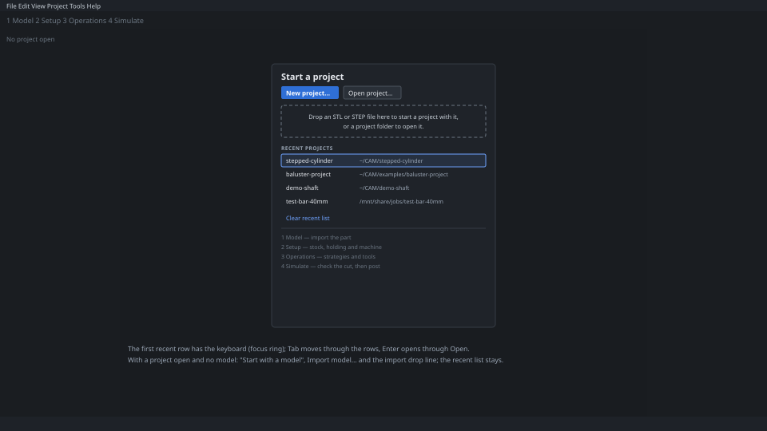
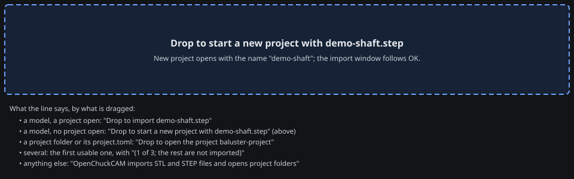

# PROJUX-A-1: A start page with the recent projects, and a file or folder dropped on the window starts, opens or imports what it is (UI-23, IMP-01, IMP-02, UI-14, UI-15; issue #706; lane PROJECT-UX-A)

- **Status:** Proposed by lane PROJECT-UX-A on 26 Nov 2026. It records the project owner's answers of 25 Nov 2026 to the lane's questions, relayed by the coordinator (decision 0049):
  - S1 option A: the start card of specification 11.1 grows the drop zone and up to 10 recent projects. The recent list shows with or without a project open.
  - S2 option A: a model dropped with no project open opens New project with the name from the file, then the import window after OK.
  - S3 option A: a dropped project folder opens through Open with the usual guards. With several files, the first usable one is used and the rest are listed as not imported. An unsupported file says so. While something is dragged over the window, the window says what the drop will do.
  - S4 option A: ship. The guide says that dropping on a Wayland desktop needs the X11 session (XWayland), and a sev3 ticket follows egui and winit.

  The owner also directed (25 Nov 2026) that layouts are designed for a 1920 by 1080 window, with 1366 by 768 best effort, until the minimum display requirement (UI-16) is changed by a separate lane. To be built in the lane's third pull request, after #891 (the New project and Open dialogs) merges. The owner has not yet accepted the record (OI-9966).
- **Date:** 26 Nov 2026.
- **Requirements:** UI-23 (P2: a start page with recent projects, and import by dropping a file on the window), IMP-01 and IMP-02 (STL and STEP import), UI-14 (keyboard), UI-15 (recent projects are a per-user setting, never in the project), NFR-07 (a clear message, never a crash), NFR-09 (nothing leaves the computer).
- **Builds on:**
  - specification 11.1, which already lists the drop zone and the recent projects on the centre card;
  - issue 381 (File > Open recent and the per-user recent list, `settings.rs`, `RECENT_KEPT` = 10, gone folders forgotten off the UI thread);
  - [decision 0460](0460-recovery-offered-only-for-the-opened-project.md) (recovery offered for the project being opened);
  - [decision 0246](0246-new-project-buttons-resolve-their-own-fields.md) and #891 (the New project and Open dialogs resolve their own fields);
  - [decision 0677](0677-keyboard-focus-tooltips-and-tool-windows.md) (focus, reading order, tooltips on focus).
- **Open items:** adds OI-9961 (dropping on a Wayland desktop; a sev3 ticket to follow egui and winit) and OI-9966 (the owner's acceptance of this record).

Numbering: provisional. The coordinator assigns the record number and the OI numbers at release, in merge order. No project schema number: the recent list is a per-user setting that already exists. No library-family API change: only `openchuck-ui` is expected to change (and `openchuck-app` only if a helper is needed), so there is no version bump.

## Context

What `main` (`361613e`) does:

- **The centre card.** With no project open, or a project with no model and no import open, the view shows a card "Start with a model" (`shell/frame.rs` `empty_state`). It has New project… or Import model…, Open project…, and the four steps.
- **No recent projects on the card, and no drop zone.** The recent list exists, but only under File > Open recent. A choice there goes through the ordinary Open command: the Open dialog shows the folder to confirm, then the unsaved-changes question and the recovery rules apply.
- **Dropped files** (`shell.rs` `import_frame`):
  - With a project open, the first dropped file opens the import window on it.
  - With no project open, it is refused: "there is no project open. Open or create a project first".
  - A dropped project folder is treated as a model path.
  - Any extra files are ignored without a word.
  - Nothing shows while a file is dragged over the window.
- **Wayland.** egui 0.37 takes dropped and hovered files from winit 0.30.13. In winit 0.30.13 the file drop and hover events (`DroppedFile`, `HoveredFile`) come only from the X11, Windows and macOS backends; its Wayland backend has no drag-and-drop code. On a Linux desktop running Wayland, the program gets no file drop unless it runs under X11 (XWayland).

## Decision

1. **The start card (the owner's answer S1 A; specification 11.1).**
   - **When it shows.** It shows in the view whenever no project is open, or a project is open with no model and no import window. It is centred and at most 560 points wide, which fits a 1920 by 1080 window's view with room to spare and is best effort at 1366 by 768.
   - **The heading and buttons.** With no project open, the heading is "Start a project", with New project… (primary) and Open project…. With a project open and no model, it is "Start with a model", with Import model… (primary) and Open project…, as today.
   - **The drop zone.** It is a dashed box: "Drop an STL or STEP file here to start a project with it, or a project folder to open it." With a project open, it reads "Drop an STL or STEP file here to import it." It is not a control (the buttons do the same), so it takes no Tab stop. The whole window takes a drop, not only the box.
   - **The recent projects.** Up to 10, newest first, as File > Open recent keeps them. Each row shows the folder's name and, muted, its full path, with any Windows `\\?\` prefix removed. Each row is a button and a Tab stop in reading order (decision 0677); Enter or a click opens it. Choosing one does what File > Open recent does: the Open dialog with the folder filled in, then the unsaved-changes question and the recovery rules.
   - **Gone folders and Clear.** A folder that is gone is forgotten by the same off-thread check the menu uses. "Clear recent list" is under the list.
   - **With nothing recent,** the list is left out, with no empty heading.
   - **Below the card,** the four steps as today.
   - **Height.** The card is as tall as its content. With 10 recent projects the list scrolls inside the card when the view is too short, so the buttons and the drop zone stay in view.
2. **A model dropped with no project open (the owner's answer S2 A).** The New project dialog opens with the project name taken from the file's name ("demo-shaft.step" gives "demo-shaft") and the parent folder its own default.
   - OK creates the project, then the import window opens on the file. Nothing is added until Add to project, as for any import.
   - Cancel abandons both, and nothing is created.
3. **Other drops (the owner's answer S3 A).**
   - **A project folder** (one with a `project.toml`), or that `project.toml` itself, is opened through Open with its guards, as a recent project is, with a project open or not.
   - **A model file with a project open** opens the import window on it, as today, and replaces the file in an import window that is open and not adding.
   - **Several items dropped together.** The first usable one, in the order the system gives them, is used. Messages gets one line naming the rest: "Not imported: b.stl, c.step. Drop or import one file at a time."
   - **A file that cannot be used.** Messages gets "OpenChuckCAM imports STL and STEP files and opens project folders; 'notes.txt' is neither." Nothing else happens.
4. **While something is dragged over the window (S3 A).** The whole window is tinted, with one line in the middle saying what the drop will do:
   - "Drop to import demo-shaft.step", or "Drop to start a new project with demo-shaft.step";
   - "Drop to open the project baluster-project";
   - "OpenChuckCAM imports STL and STEP files and opens project folders" for anything else;
   - and the first of several, with "(1 of 3; the rest are not imported)".

   It is drawn only while the system reports a hovered file (X11, Windows, macOS).
5. **Wayland (the owner's answer S4 A).** Nothing in the program changes for Wayland. The user guide says that on a Linux desktop running Wayland, dropping a file needs the program to run under X11 (XWayland), and that the buttons and the recent list work everywhere. OI-9961 asks for a sev3 ticket to follow egui and winit for Wayland support.
6. **Display only, per user.** The recent list is the existing per-user setting (UI-15). Nothing new is stored, in the project or in the settings. Nothing is sent anywhere (NFR-09).

## Consequences

- The specification's section 11.1 is edited in the pull request to say what the card shows in each case, how a choice opens, what each drop does and what the window shows during a drag.
- The user guide's *Install and first run* and *Create a project* pages describe the start card and dropping files, with the Wayland note. Any screenshot is a true capture.
- The release notes gain a bullet.
- Tests (planned, named by requirement):
  - `req_ui_23_*`: the card's recent rows, their order and Tab stops; a row opens through Open; Clear; a gone folder forgotten.
  - Each drop case, driven by egui's `dropped_files` and `hovered_files` input: a model with and without a project, a project folder and its `project.toml`, several files, an unsupported file, and the drag-over text.
  - The card's layout at 1920 by 1080 and 1366 by 768 views.
- The owner checks real drops on Windows, macOS and Linux (X11 and Wayland) with the pack in the pull request: public and synthetic files only, among them the public baluster example.

## Verification

Not built yet. This record is the design the owner answered. The Verification section is written in the pull request that builds it.
