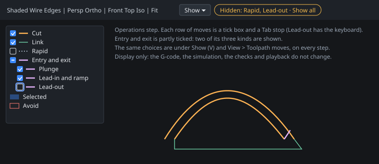
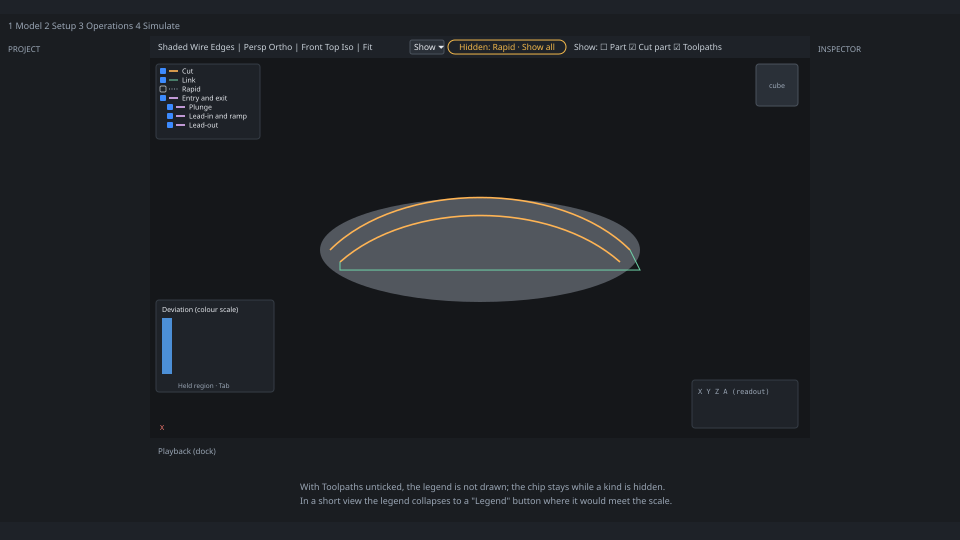

# PROJUX-A-2: Each kind of toolpath move can be shown or hidden in the view, from the path legend, the Show menu and the View menu (SIM-01, UI-14, UI-15; issue #789; lane PROJECT-UX-A)

- **Status:** Proposed by lane PROJECT-UX-A on 25 Nov 2026. It is built in the lane's second pull request as the project owner answered the lane's questions on 25 Nov 2026, relayed by the coordinator (decision 0049):
  - R1 option A: trace to SIM-01, UI-14 and UI-15, with no change to the requirements.
  - P1 option B: six kinds.
  - P2 option A: the legend's rows become tick boxes, with the same choices in View and the Show menu, and a chip.
  - P3 option A: the choice is kept per user; it changes only the view.
  - P2b option B, not the recommendation, with the owner's condition: Simulate shows the path legend with its tick boxes at the top left, only while the toolpaths are shown there.

  With P2b the owner also directed (25 Nov 2026) that the layout is designed for a 1920 by 1080 window, with 1366 by 768 best effort until the minimum display requirement (UI-16) is changed by a separate lane.

  The owner has not yet accepted the record itself (OI-9964).
- **Date:** 25 Nov 2026.
- **Requirements:** SIM-01 (toolpaths in the view, moves told apart, per-operation visibility), UI-14 (every control by keyboard; commands in the menus), UI-15 (per-user settings on the computer, never in the project), NFR-03 (the view stays smooth). No requirement names hiding by kind; the owner chose to trace it to these rather than add one (answer R1 A).
- **Builds on:** [decision 0169](0169-playback-window-and-path-visibility.md) (paths hidden per operation in the view only), [decision 0238](0238-simulate-display-and-operation-navigation.md) (Simulate's Show choices, per user), [decision 0512](0512-playback-layers-on-simulate-only.md) (the toolpath lines on every step, the playback layers on Simulate), [decision 0167](0167-path-detail-follows-the-zoom.md) (the level of detail and the point budget), [decision 0677](0677-keyboard-focus-tooltips-and-tool-windows.md) (focus and tooltips).
- **Open items:** adds OI-9962 (kinds the path does not mark: retracts, run-outs past the stock, turns of A at a fixed position; the owner's answer P1 B sends them to a sev3 ticket) and OI-9964 (the owner's acceptance of this record).

Numbering: provisional. The coordinator assigns the record number and the OI numbers at release, in merge order. No project schema number: the choice is a per-user setting (`path_moves` in the user's `settings.toml`), never in the project. No library-family API change: `openchuck-app` and `openchuck-ui` change, and neither is in the library family, so there is no version bump. The library family's `MoveKind` is unchanged.

## Context

Issue #789, raised by the owner on 11 Nov 2026 after testing 0.55.0-rc1 and rc2: checking an entry or a link on a long path is hard when every other kind of move is drawn over it (#778, #687, #642, #644).

What `main` (`361613e`) did:

- **The path's moves are of six kinds.** `MoveKind` (`openchuck-types`) is Rapid, Linking, Cutting, Plunge, LeadIn and LeadOut. Ramps are emitted as LeadIn (`openchuck-path` `assemble/entry.rs`).
- **The view drew four classes.** `openchuck-app` `pathview::PathClass` is Rapid, Link, Entry and Cut, with plunges, lead-ins and lead-outs together as Entry, in one colour.
- **Runs merged entry kinds.** The display cut the path into runs of one class, so a plunge, a lead-in and a lead-out next to each other were one run.
- **Only operations could be hidden.** Lines could be hidden per operation (the eye, decision 0169), never by kind.
- **The legend was a picture.** The path legend (Cut, Link, Rapid, Entry, Selected, Avoid) was drawn on Operations only. Simulate has no path legend: its only box is the colour scale.
- **Three things the issue names are not marked in the path.** Retracts are rapids or links. Run-outs past the stock and turns of A at a fixed position are not marked at all.
- **The lines are already chosen off the UI thread.** A job picks the drawn lines from the kept runs for the visible operations, at the finest level of detail within the point budget (decision 0167), and runs again when the visible operations change.

## Decision

1. **Six kinds, the path's own (the owner's answer P1 B).** The kinds are Cut, Link and Rapid, and Entry and exit with Plunge, Lead-in and ramp, and Lead-out under it. The names come from one function (`pathview::move_name`) used by the legend, the menus and the chip.
   - The display now cuts the path into runs of one kind, so each kind can be left out. The colour is still by class: the three kinds of entry and exit keep the one lilac (specification 7.4).
   - Retracts, run-outs past the stock and turns of A at a fixed position are not marked in the path. Finding them from the geometry is OI-9962 (sev3, not built).
2. **One choice, three controls (the owner's answer P2 A; UI-14).**
   - **The path legend on Operations.** Each row of moves is a tick box with the row's own swatch and colour, and a Tab stop of its own: Space or Enter while it has the keyboard, or a click anywhere on the row, turns it on or off. Its tooltip says that only the view changes.
   - **Entry and exit is the box of its three kinds.** It is ticked when all three are shown, shows a bar when some are, and is empty when none are. A press hides all three when any is shown, and shows all three when none is. The tick, bar and empty box tell the states apart without colour.
   - **The Show menu (V).** It has a "Toolpath moves" group with the same tick boxes, a box for Entry and exit that can be partly ticked, and "Show all moves" while any kind is hidden.
   - **View > Toolpath moves.** The same group again, so every choice is a menu command.
3. **A hidden kind is never forgotten.** While any kind is hidden, a chip beside the Show button in the view's toolbar strip says which, on every step: "Hidden: Rapid, Lead-out · Show all". Entry and exit hidden whole reads as one name. Pressing the chip shows every kind.
   - On Simulate the chip comes before Simulate's inline Show tick boxes, which move into the Show menu when the strip has no room for both (OI-529's rule, with the chip counted).
4. **Simulate (the owner's answer P2b B, with its condition).**
   - Simulate shows the path legend at the top left, only while Toolpaths is ticked in its Show choices. With the toolpaths off there is no legend, since there are no lines for it to name.
   - It lists the rows of moves only, with the same tick boxes as on Operations, setting the same choice. Held regions, tabs, the shown set and the unreachable areas stay where they were, in the colour scale's box at the bottom left. Selected and Avoid are Operations' picking roles and are not listed.
   - It is the fourth box on Simulate, after the view cube, the readout and the colour scale, within specification 7.2's five.
   - **The chip with the toolpaths off.** The chip keeps its rules on every step. With the toolpaths off on Simulate it still says which kinds are hidden, so the choice is not forgotten. Pressing it shows every kind again; it does not turn the toolpaths on, which stays the Show choice of its own.
   - **Layout, at 1920 by 1080 and best effort at 1366 by 768.** The legend and the colour scale share the left side of the view, the legend at the top and the scale at the bottom. Where they would meet, in a short view, the legend collapses to its button. Opened, it takes the scale's place until it is closed, so no two boxes overlap (specification 7.2).
   - Below 480 pixels of view height the legend is a button, as on Operations.
   - A view of a 1920 by 1080 window (about 1300 by 760) has room for both.
5. **Per user, display only (the owner's answer P3 A; UI-15).**
   - The choice is kept in the user's settings (`path_moves`, in the `[interface]` table) for every project. A settings file without it, or without one of the six kinds, shows that kind.
   - It changes only which lines the view draws: the path lines, the playback window's lines and the faint trace of the path outside the window.
   - The G-code, the simulation, the checks and the play head do not change. In playback the tool still moves along hidden moves, and the cut part is still cut by them.
6. **The view stays smooth (NFR-03).** The lines are still chosen by the existing job, now with the kinds, off the UI thread; a change of kinds starts it as a change of visible operations does.
   - The point budget counts only the moves drawn. Hiding a kind leaves more of the budget, and so finer detail, for the rest.
   - No frame draws more than the budget, as before.

## Consequences

- The specification is edited in this pull request:
  - section 7.1, the Show or hide row: the kinds and the chip;
  - section 7.2, the path legend's rows and tick boxes, and a row for the legend of moves on Simulate;
  - section 13, the per-user setting.
- The user guide's tutorial step 8 (*Generate the toolpaths*) explains the legend's tick boxes, the menus, the chip and that only the view changes. The release notes have a bullet.
- `openchuck-app` `pathview` changes:
  - `PathRun` and `PathLine` gain `kind`.
  - The visibility predicate of `ToolpathDisplay::lines`, `lines_for`, `window_lines` and `trace_lines` takes the group and the kind.
  - The display jobs take a `ShownMoves`.
  - The crate is not in the library family; its callers in `openchuck-ui`, its tests and its `path_runs` example are updated in this pull request.

## Verification

Environment: Linux container, Rust stable, `main` at `361613e`, branch `claude/lane-project-ux-a-path-kinds`.

Tests were written from the issue and the owner's answers before the code. Times are uninstrumented, from `cargo nextest`.

- `openchuck-app`:
  - `playback::req_sim_01_each_kind_of_move_can_be_hidden_and_only_the_view_changes` (about 2 s): for each of the six kinds hidden, no line of it is drawn and the other lines are exactly those drawn with everything shown. The window and the trace follow, the budget counts only what is drawn, and the G-code is unchanged.
  - `settings::req_ui_15_req_sim_01_the_move_kinds_shown_are_personal_and_survive_restart` and `settings::req_sim_01_the_hidden_chip_names_what_is_hidden`.
  - The existing run-count test now counts runs by kind.
- `openchuck-ui`, `viewport_overlays` (each under 1 s):
  - `req_sim_01_a_click_on_a_legend_row_hides_and_shows_its_kind`
  - `req_ui_14_a_legend_tick_box_works_from_the_keyboard`
  - `req_sim_01_entry_and_exit_reads_and_sets_its_three_kinds`
  - `req_sim_01_simulate_shows_the_move_legend_only_with_the_toolpaths_on`
  - `req_ui_16_the_simulate_legend_never_overlaps_another_box`: views of 1300×760 down to 600×330, with a colour scale and the legend open and closed.
  - `req_ui_16_a_legend_that_would_meet_the_scale_collapses_to_its_button`
  - The two legend-name tests are updated for the new rows.
- `openchuck-ui`, `shell::path_moves_tests` (1 to 8 s each):
  - `req_sim_01_a_kind_hidden_in_the_view_is_hidden_from_the_lines_and_named_in_the_chip`
  - `req_sim_01_the_hidden_chip_shows_every_kind_again`
  - `req_ui_14_the_show_menu_lists_the_kinds_of_move`
  - `req_ui_14_req_sim_01_the_show_menu_tick_boxes_set_the_kinds`
  - `req_ui_14_view_toolpath_moves_is_in_the_menu`
  - `req_ui_15_req_sim_01_the_kinds_shown_are_kept_for_the_user_across_a_restart`
- The test rig has no 3D renderer, so the view and its overlays are not drawn there. The legend is tested at the overlay level, drawn with egui off screen.

Results on the branch before the push:
- `cargo fmt` and `cargo clippy --workspace --all-targets`: clean.
- `cargo nextest run -p openchuck-ui`: 765 passed, 1 skipped, in 6 min 41 s. This run was before the Show menu tick-box test was added; that test then passed on its own.
- `openchuck-app` playback, settings and pathview tests: 54 passed.
- `cargo xtask deps`, `licences`, `records` and `trace`: ok.

Coverage was checked locally on the new tests of `openchuck-app` and `openchuck-ui` (`cargo llvm-cov nextest --profile coverage`). The new lines are covered except for:
- the playback window and trace jobs' kind filter in `pathview.rs` and `playback_panel.rs`, which the existing window tests of the full suite reach;
- View > Toolpath moves' three lines in `shell/frame.rs`, whose tick boxes are the shared `move_ticks` that the Show menu test exercises;
- the shown-set row on Simulate's legend, which Simulate does not draw.

Not verified here:
- A look at the real window, on Operations and Simulate, at 1920×1080 and 1366×768. The owner check in the pull request covers it.
- The frame time with kinds hidden on a large path (NFR-03). The kinds only narrow what the existing off-thread job chooses, within the same point budget; no frame-time benchmark was run.
