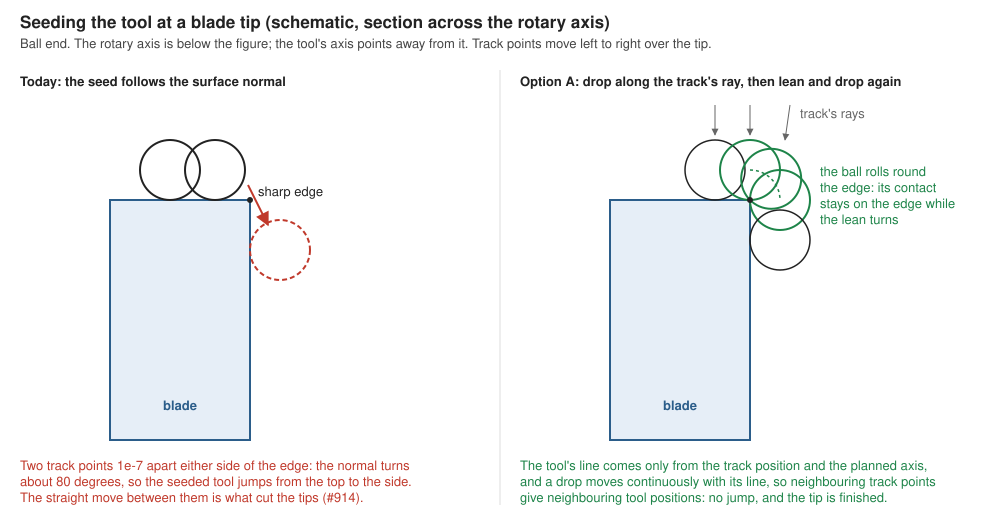
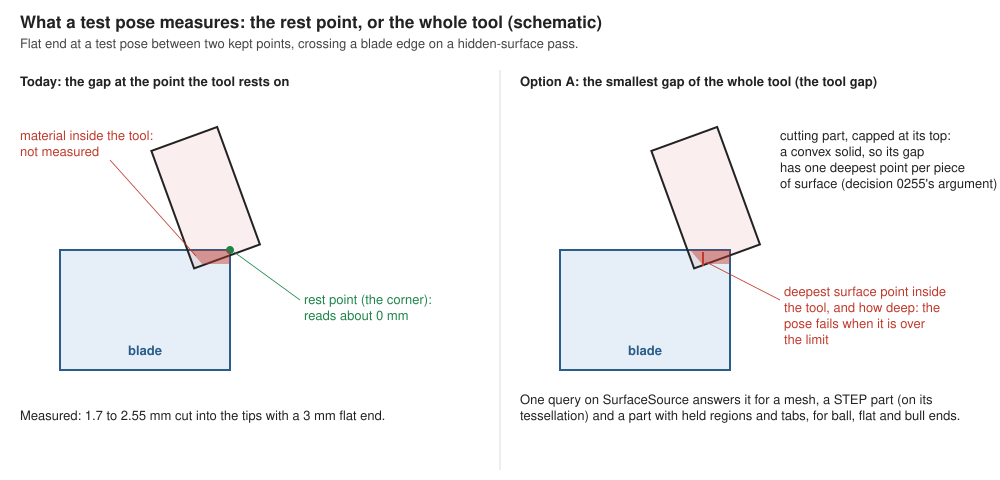
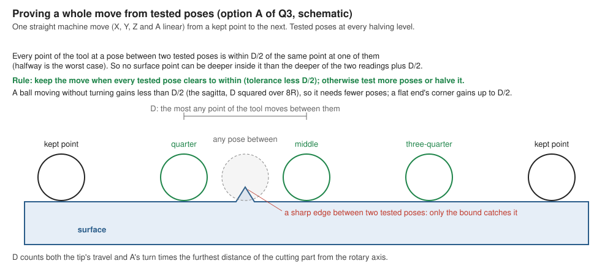

# SIMUL-EDGE-1: Simultaneous finishing that never cuts into a sharp edge: a continuous seed and a gap test of the whole tool (OP-05, OP-06, OP-12, OP-14, OP-20, NFR-04, NFR-06, NFR-07, NFR-12, GC-07; issues #914, #710; lane SIMUL-EDGE)

- **Status:** Accepted by the project owner on 25 Nov 2026, relayed by the coordinator (decision 0049). Proposed by lane SIMUL-EDGE on 25 Nov 2026; the owner answered all seven questions the same day, each as recommended (A), with three additions (see *The owner's answers* below), and accepted the record as updated to them, including the name *tool gap* (`SurfaceSource::tool_gap`, `ToolGap`).
- **Date:** 25 Nov 2026.
- **Starts from:** the owner's answer to Q1 of the proposed record [PATH-QUALITY-1](https://github.com/openchuckcam/openchuckcam/blob/docs/decision-PATH-QUALITY-1-finishing-and-ramps/docs/decisions/PATH-QUALITY-1-finishing-edges-points-and-ramps.md) (draft pull request #913, on branch `docs/decision-PATH-QUALITY-1-finishing-and-ramps`), relayed by the coordinator on 25 Nov 2026: **option C, in its own lane** (this one). Option C is the general continuous seed of OI-337 item 1, and a clearance test of the whole tool at every test point, so that simultaneous finishing never cuts into the part, instead of only catching the cut (option A) or only rolling round edges (option B).
- **Issues:** #914 (simultaneous finishing cuts the public blisk's blade tips; sev2), #710 (simultaneous finishing over sharp edges and walls facing along the axis). Open items OI-318 and OI-337 (`main`); OI-9992 and OI-9996 (provisional, on PATH-QUALITY-1's unmerged branch), which this lane's work takes up.
- **Requirements:** OP-12 (gouge protection; P1), OP-05 and OP-06 (simultaneous finishing and its tool axis), OP-20 (hidden surfaces), OP-14 (linking round a break), NFR-04 (multiple cores, the UI never blocked), NFR-06 and GC-07 (determinism at any thread count), NFR-07 (clear messages, never a crash), NFR-12 (the user verifies the program).
- **Builds on:** accepted [decision 0255](0255-bounded-tool-contact-checker.md) (the convex-tool argument behind a bounded tool-to-surface distance, and the independent checker `openchuck_testkit::contact`), [0363](0363-simultaneous-finishing-off-axis-sections-walls-and-held-ends.md) item 2 (the wall move, the narrow seed fix), [0133](0133-simultaneous-fitter-tests-the-quarter-points.md) and [0113](0113-toolpath-choices-rounding-cannot-flip.md) (the move test), [0368](0368-simultaneous-finishing-of-hidden-surfaces.md) (hidden surfaces, and breaks where the shank meets the part), [0515](0515-unreachable-areas-in-the-viewport.md) (unreached areas on the part), [0048](0048-pre-1-0-api-changes.md) (a breaking library change bumps the workspace minor version) and [0545](0545-blended-steps-between-rings.md) D3 (when saved operations keep their programs).
- **Would amend, if answered as recommended:** decision 0363 item 2's narrow seed (the flat bottom's blend from centre to corner is replaced by Q1's seed), and decision 0133's move test (its quarter points become Q3's proven test). Decision 0545 D3's rule that saved operations keep their programs is not applied here (Q5), with the reason given.
- **Open items:** adds OI-9971 to OI-9973 (provisional; listed under *Open items* below). Depends on no open item. OI-318 and OI-337 are updated in the first build pull request that lands after PATH-QUALITY-1's branch merges, not in this record, because PATH-QUALITY-1's unmerged branch edits the same rows (decision 0130: a row two branches edit is kept twice).

Numbering: provisional. The record carries the lane's name, and the open items OI-9971 to OI-9973 were free on `main` (`aadf3cc8`) and on every fetched branch on 25 Nov 2026 (the branches use OI-9931 to OI-9934, OI-9941 and OI-9942, OI-9951 to OI-9954, OI-9961 to OI-9966, OI-9981 to OI-9985 and OI-9991 to OI-9997). The coordinator assigns the real numbers, and the library version, at release in merge order. No project schema number is needed: nothing stored changes under the recommended answers (Q5 B would store a parameter in the operation's free map, as decision 0545 did). No spike.

## The owner's answers (25 Nov 2026, relayed)

| Question | Answer | What it means |
| --- | --- | --- |
| Q1: the seed at a sharp edge | A | Drop along the track's ray, turn about the tool's centre to the planned axis, drop again; the tool rolls round sharp edges |
| Q2: the gap query | A | A new method on the public `SurfaceSource` trait (breaking, decision 0048); a STEP part answers on its tessellation, whose stated accuracy comes off the tolerance |
| Q3: how rigorous the check is | A | A proof: every halving level, the whole tool, the sweep bound including A's turn |
| Q4: where no move holds | A | Break the pass, link round, mark an unreached area with a new reason, one warning; no longer refused. **Addition 1:** the reason must say plainly that following the surface there would gouge (overcut) the finished surface: final wording under Q4 |
| Q5: saved operations, goldens | A | Saved and new operations alike; the lobed goldens regenerated and the difference explained; the release note says saved operations' programs change |
| Q6: the time budget | A | 2 times on smooth parts, 3 times on the blisk, release builds, uninstrumented. **Addition 2:** a stage over budget is profiled and optimised first; the owner is asked only if it is still over after that (under Q6, and in SE-2 and SE-3) |
| Q7: the order of the work | A | SE-1 to SE-4 as proposed |

**Addition 3 (terms):** the names this work uses must not clash with those of TOOL-LOAD-1 (*cut section*, *engaged length*, *width of cut*, *Limit tool load*) or PATH-QUALITY-1's PQ-2 (*depth per traverse*). See *Terms* below: the query is named the **tool gap**, not "clearance", which the program already uses for the linking distance above the part.

What the record asked, for reference:

1. **Q1: what "continuous" means at a sharp edge.** Recommended: **A**, the tool's line is set from the track position and the planned axis alone (a drop along the track's ray, then a lean about the tool's centre and a second drop), so the tool rolls round a sharp edge instead of jumping across it. See the first figure.
2. **Q2: the gap query.** Recommended: **A**, a new method on the public `SurfaceSource` trait that gives the smallest gap between the whole tool (its cutting part, also swept along a short straight move) and the surface, exact on a mesh and on a STEP part's tessellation. A breaking library change (decision 0048). See the second figure.
3. **Q3: how rigorous the move check is.** Recommended: **A**, a proven test: every halving level is tested with the whole tool, and a move is kept only when the bound in the third figure shows no point of it cuts deeper than the tolerance.
4. **Q4: where no move holds.** Recommended: **A**, the pass breaks there, the tool lifts round it, and the place is marked on the part as an unreached area with its own reason and named in one warning. The operation is no longer refused for it.
5. **Q5: saved operations and the golden programs.** Recommended: **A**, every simultaneous operation, saved or new, gets the new behaviour, because the old one can cut into the part; the golden programs are regenerated with the difference measured and explained.
6. **Q6: the time it may cost.** Recommended: **A**, up to twice today's generation time on smooth parts and three times on the blisk, measured uninstrumented; beyond that the lane stops and reports before going on.
7. **Q7: the order of the work.** Recommended: **A**, four pull requests; the second (the proven check) stops the blade-tip cuts on its own and may merge before the third (the continuous seed), which finishes the tips.

And what to look at: the three figures below. The measured cuts are in PATH-QUALITY-1's evidence ([its archive on that branch](https://github.com/openchuckcam/openchuckcam/tree/docs/decision-PATH-QUALITY-1-finishing-and-ramps/docs/archive/PATH-QUALITY-1-phase-1)); this record measured nothing new (see *Verification*).

## Terms

To keep clear of the words other lanes and the program already use:

> **Changed on 26 Nov 2026, after the record was accepted.** The owner answered C to the question of what the overcut depth measures (relayed by the coordinator on 26 Nov 2026; see *Q2: the measure, answered after acceptance*). The three entries marked **changed** below replace the accepted wording, which is kept after each, struck through, so what moved can be seen. *On an exact curved face* (C extended to the exact faces, approved by the coordinator for the owner to see here), *Layer* and *Thin wall* are new; *Layer*'s depth was changed again the same day, marked in the entry.

- **Tool gap** (`SurfaceSource::tool_gap`, its answer `ToolGap`) **(changed)**: how far the tool's cutting part (revolved and capped at its top) is above the surface, each face measured along its own outward normal and over itself only: the least height above a face of a tool point whose foot on the face's plane lies on the face, over the faces. Negative by the depth the tool cuts below a face. Not "clearance": the program's linking settings already use Clearance for the distance the tool keeps above the part between cuts. ~~The smallest signed distance between the tool's cutting part (revolved and capped at its top) and the surface; negative where the surface lies inside the tool.~~
- **Overcut depth** **(changed)**: how deep the tool cuts below a face, along the face's normal, where the tool gap is negative; the same measure as the program's tolerance. The user-facing word is *gouge* or *overcut*, as the Q4 wording below says. Not "depth of cut" or "depth per traverse" (PQ-2: how deep a ramp's traverse cuts), and not *cut section* or *engaged length* (TOOL-LOAD-1: the tool's load in material). ~~How far the surface lies inside the tool where the tool gap is negative.~~
- **On an exact curved face** **(new)**: the same measure along the face's own local normal, over that face: the depth of a tool point below the face, measured from its foot on the face (the face point it is nearest, on the face's material side), counted where that foot lies on the trimmed face. It is what the re-check against a STEP part's exact faces measures (OI-9974's answer); on a triangle it is the measure above.
- **Layer** **(new; accepted by the owner as part of C, relayed 26 Nov 2026; depth changed the same day, see below)**: the depth below a face down to which the face counts the tool, the query's limit. **In the move check it is 1.25 times the tolerance (changed).** ~~(at most the larger of the tolerance and the check's allowance)~~ A convex tool cutting deeper passes through it and reads the layer; a tool beyond it, on the far side of a wall thicker than the layer, is not in that face's material and counts nothing there. *Why it changed:* a cut deeper than the layer reads as the layer, so with the layer equal to the tolerance a deep gouge read exactly the tolerance and the check accepted it. On a STL part a deep cut could pass; a STEP part was caught only because each triangle's error is taken off. SE-2 found this in its own check before it was pushed; with the layer a quarter deeper than the tolerance every cut deeper than the tolerance reads deeper than it and fails (the margin is well over the query's own accuracy of 0.0001 mm at the smallest tolerance). The coordinator agreed it as a correctness fix and is telling the owner.
- **Thin wall** **(new; the owner's instruction, wording confirmed by the coordinator, 26 Nov 2026)**: a wall thinner than the layer. When the tool finishes one side, it lies within the layer of the far side, which reads the layer, so the move cannot be proven and is left out (the safe side). Such a move is reported as a thin wall, not a gouge. On a failed move, the deepest point found is tested: a ray into the material from it gives the wall's thickness *t* there; if *t* is less than the depth read, the tool is past the far side of a thin wall. The move is then queried again with the wall's triangles left out (a triangle is in the wall when the material behind it, measured along its normal at its corners and centre, is thinner than the layer); if that query fails, the move is a gouge (a real gouge wins). Leaving the wall out cannot hide a gouge inside it: no point of material thinner than the layer is more than 0.63 times the tolerance from its surface. The sampled thickness decides only the label, never which moves are kept. Not covered: a thin wall no move comes within the layer of (no pass finishes beside it); a wall thicker than the layer needs no warning; on a STEP part *t* is measured on the refined tessellation, within a quarter of the tolerance. The wording, its own warning beside the gouge warning:
  - (a) "simultaneous finishing leaves {count} of the part uncut where a wall is thinner than {layer} mm (a quarter more than the tolerance of {tolerance} mm): {list}. A wall this thin is unlikely to survive milling, and the tool cannot be proven clear of its far side, so those moves are left out: check the model there (it may be a modelling error or a detail too fine to cut), and check these areas in the simulation before running the program". Each item: "X {x0} to {x1} mm on face {n} ({area} mm2), a wall about {t} mm thick" (no face on a mesh); after five, "; and N smaller".
  - (b) on the area's marker: "left uncut: the wall here is about {t} mm thick, thinner than {layer} mm, so the tool cannot be proven clear of its far side; a wall this thin is unlikely to survive milling".
  - The guide shows both beside the gouge wording and says, in its own NFR-12 wording, that neither text means the program is safe to run.
- **Swept tool** **(changed)**: the tool moved along a short straight piece of a move, turning about the rotary axis as the machine turns A along it (SE-2 bounds that motion itself); **piece**: the part of a move between two neighbouring tested poses. ~~The tool moved along a short straight piece of a move without turning (a convex shape).~~
- **Seed**: where the tool's line is placed before it is dropped (OI-337's word).

## Context

### What happens today

Measured by lane PATH-QUALITY on `main` at `d1674b7` (0.63.0) on the public blisk (`testdata/stl/blisk.stl` and `testdata/step/valid/blisk.step`, through `testdata/examples/blisk-start`), simulated at 0.1 mm cells: simultaneous finishing generates at every setting tried, but cuts into the blade tips by 0.91 mm with the 3 mm ball on the STEP blisk, and by 1.7 to 2.55 mm with the 3 mm flat end on both forms. The STL blisk with the 3 mm ball stays within one cell. Generation took 83 to 118 s (STL, ball), 9 to 18 s (STL, flat end), 188 to 369 s (STEP, ball) and 197 s (STEP, flat end), on a shared four-core container, so the times are rough.

The code was read for this record at `main` `aadf3cc8` (0.63.0); `crates/openchuck-path/src/simultaneous.rs` is unchanged in the respect described here since `d1674b7`. Three causes in it are the subject of this record:

1. **The seed follows the surface normal** (`Plan::seed_tip`, `Plan::node`). Each point of a pass is placed by dropping the tool along a line that starts where the tool's point with the drive normal would sit on the drive point. The drive normal comes from the ray cast from outside at that point of the track, and it jumps where the ray passes from one face to another: about 80 degrees at a blade tip. So two track points 1e-7 apart can put the tool on the top of a tip and on its side. The tool-axis plan itself (`axis_plan_from`, a taut string through the tilt band) is continuous; the seed is not. Decision 0363 item 2 built a narrow fix for a flat bottom (its seed blends from centre to corner with the lean) and a raised pose for a jump at the last halving; OI-337 item 1's general form was left out because it changes every part's output.
2. **A test pose measures only where the tool rests** (`Plan::deviation`). The error of a move at a test pose is the drop's offset, read along the drive normal, or on a hidden-surface pass the depth inside the tool of the point the drop came to rest on. A flat end rests on its corner, which reads about zero at any depth, and on a visible pass the reading is scaled by the angle to a normal that has jumped.
3. **The last halving is tested only at its middle** (`Plan::refine_from`): the quarter points and the long-move poses (decision 0133, 0363 item 2) are tested only above `MAX_DEPTH`, and a middle the drop finds nothing under is accepted without a test.

### What stays a limit under every answer

The corner where the shoulder (facing along X), the hub and the blade roots meet is out of reach of a 3 mm tool whose axis must lie across the rotary axis: about 2.5 mm of material stays there (2.56 to 2.59 mm measured). It is reported today as unreached hidden areas, and it stays so: a limit of 4-axis access with this tool, not a defect. #710's *Done when* allows a recorded limit with a clear message and a workaround (a smaller tool, or another strategy there, then rest machining).

### What the fix has to give

- No move of a simultaneous finishing program cuts into the part deeper than the operation's tolerance, for a ball, flat or bull end, on a mesh or a STEP part, on visible and hidden-surface passes (OP-12), and this is shown by a proof at each move, not by sampling.
- Where the tool cannot follow the surface without cutting in, the pass breaks and links round (OP-14), and the user is told where material is left (NFR-07).
- The tool follows a sharp convex edge by rolling round it, so the blade tips are finished, not left.
- The same project, post and version give byte-identical G-code at any thread count (GC-07, NFR-06).
- Nothing says the program is safe to run (NFR-12).

## Questions for the owner

### Q1: what "continuous" means at a sharp edge (the seed)

Every option keeps the tool-axis plan as it is (the taut string through the tilt band, whose angle is continuous along the track, decision 0497) and changes only where the tool's line is placed before it is dropped. A drop moves continuously with its line: the height at which a tool first touches a surface changes by no more than the line moves. So a line that moves continuously gives a tool that moves continuously, whatever the surface does.

- **A. Drop along the track's ray, then lean and drop again (recommended).** At each track point the tool is first dropped along the ray the track already casts from outside (its line is that ray, which moves continuously with the track). This places the tool's centre point (a ball's centre, a flat or bull end's bottom centre). The tool is then turned to the planned axis about that point and dropped again along its new axis. Both steps move continuously, so the tool does too. At a sharp convex edge the contact stays on the edge while the lean turns from one face's to the other's: the tool rolls round it (the first figure). Nothing detects an edge, so a mesh's facet boundaries and a STEP part's face boundaries are treated alike, and the flat end's special blend of decision 0363 is no longer needed. Ball end: its contact does not depend on the lean, so on a smooth surface it lands where it does today. Flat end: it rests on its corner wherever the surface is not square to its axis, as today, but its corner no longer flips sides. STEP: the drops use the exact drop where it is on, within its accuracy (1e-4 mm, decision 0277), so continuity holds to that; STL to rounding. On hidden-surface passes (OP-20) the first drop is along the contour's own reach direction in place of the ray. Cost: two drops per point instead of one (the second starts from a known contact, so it is shorter). Every simultaneous program changes a little, also on smooth parts (Q5).
- **B. Keep today's seed, and use A's only near an edge.** Where the drive normal turns more than a set angle between neighbouring samples, the seed switches to A's for a stretch round the edge. Fewer programs change (only parts with sharp edges). But the switch is itself a step in the seed, so it moves the jump to the ends of the stretch instead of removing it; a mesh's facet edges read as edges at a low threshold and real edges are missed at a high one.
- **C. Seed from the normal of the tool's offset surface.** Take the normal from the point the tool's centre would be at, offset from the surface by the tool's radius (by a closest-point query), which is smooth over a convex edge. Exact for a ball, and the result is close to A's for it; but a flat or bull end has no single offset surface, so it would need another rule, and the closest-point query is slower than a drop on a STEP part.

*If you answer as recommended:* the tool rolls round the blade tips, so the tips are finished rather than left; OI-337 item 1 is built in its general form; every simultaneous program changes slightly (Q5); `seed_tip`'s flat-bottom blend is removed.

### Q2: the gap query

The check needs, at a pose, the deepest point of the surface inside the whole tool, and how deep (the second figure). The cutting part, revolved and capped flat at the top of its profile, is a convex solid for every tool the library makes (ball, flat, bull, tapered ball); decision 0255 item 1 uses the same fact. For a convex solid, the depth of a surface point is a distance that a branch-and-bound over the surface's triangles, through the bounding-volume hierarchy the mesh already has, finds exactly. The same holds for the tool swept along a short straight move without turning, since that sweep is also convex: the third figure and Q3 use it.

- **A. A new method on `SurfaceSource`, answered on the triangles (recommended).** `SurfaceSource` gains a method, `tool_gap(profile, line, sweep, limit)`, that returns the smallest signed gap between the tool on `line`, swept along the vector `sweep` (zero for a single pose), and the surface, within `limit`, with the point where it is smallest. A mesh answers it exactly (to rounding) on its own triangles. A STEP part answers it on its tessellation and states how far the tessellation may be from the exact faces through a second method beside `drop_accuracy`; the check subtracts that from the tolerance. A part joined to held regions or tabs (`CompositeSurface`) answers for all of them, as its drop does. The method is written in `openchuck-path`, independently of the test checker `openchuck_testkit::contact`, which stays the independent judge (decision 0255 item 6). **This is a breaking change to the public library API** (decision 0048): the trait's contract grows (every source must answer a gap consistent with its drop) and a new public type carries the answer. The pull request bumps the workspace minor version and adds a changelog entry to `crates/openchuck-path/CHANGELOG.md` saying what broke and how a host adapts; the coordinator assigns the version at release, in merge order (expected 0.65.0 or later). The trait's other implementations in the repository (tests and examples) get the default where one fits.
- **B. As A, but against a STEP part's exact faces.** Port decision 0255's proven hulls of exact faces (Bézier patches, trims) into `openchuck-path`, so a STEP part is judged against its exact faces, not its tessellation. Exact for STEP, but about 1 to 1.5 weeks more, slower at every query, and the product and the independent checker would then rest on the same method, so an error in the method could pass both.
- **C. No trait change: compute it in `simultaneous.rs` from `tessellation()`.** No API break. But the strategy would bypass the surface abstraction the architecture gives every strategy, re-build a search structure per operation, and miss what a `CompositeSurface` or a STEP source knows about itself.

*If you answer as recommended:* `openchuck-path` gains a gap query on every surface source, and a minor version bump with a changelog entry; STEP parts are judged on their tessellation, with its stated accuracy taken off the tolerance, and an exact-face query stays open as OI-9973.

#### Q2: the measure, answered after acceptance (26 Nov 2026)

SE-2's tighter search showed that the accepted measure, the depth of the deepest surface point inside the tool, is less than how far a sharp tool corner cuts below a face: a flat end of radius 1.5 mm tilted 25 degrees with its tip 0.6 mm above a plane reads 0.0255 mm, while its corner is 0.0339 mm below the plane. For a corner of angle γ the accepted measure is at least sin(γ/2) of the cut (0.71 for a flat end's 90 degrees), so a move proven within the tolerance could cut up to about 1.41 times the tolerance below a face. Three options went to the owner: **A**, keep the measure; **B**, keep it and divide the allowance by the tool's sharpest corner factor; **C**, measure the depth below each face along its normal, over the face only. **The owner answered C** (relayed 26 Nov 2026).

As built: a face (a triangle, wound counter-clockwise seen from outside, as the import's mesh checks expect) counts the tool points whose foot lies on it, down to the layer (see *Terms*). The **layer** makes C workable where a thin wall stands between the tool and a far face (a blade's back face would otherwise read a cut through the blade); it errs to the safe side, a wall thinner than the limit with the tool within the limit of its far side failing the check. **The owner accepted it as part of C (relayed 26 Nov 2026), and asked that such a move be reported as a thin wall, not only as a gouge: see *Thin wall* in Terms.** The move check's layer is 1.25 times the tolerance, so that a cut deeper than the tolerance always fails (see *Layer* in Terms for the fault this corrects). ~~reading as a gouge. The coordinator approved it as part of C and has put it to the owner to confirm.~~ The proof: over a face's prism, the least height of the tool is at least the Lagrangian dual's bound for any multipliers on the prism's sides, and the best multipliers give the exact least; over a move, the dual's direction is fixed to the surface and the tool's support along it is bounded over each part of the move. The independent checker (`openchuck_testkit::contact`, `Geometry::face_gap`) bounds the same measure its own way (tangent and leaning supporting planes of its own tool model, real values from columns along the face's normal), with no code shared.

### Q3: how rigorous the move check is

A machine move is straight in X, Y, Z and A. In the machine's frame the tool does not turn: it only moves in a straight line, and the part turns under it. So over a piece of a move, the tool sweeps exactly the convex shape Q2's query measures, and the only thing the query does not see is the part turning through that piece's share of A, which moves no point of the part further than that angle times the point's distance from the rotary axis.

- **A. A proven test (recommended).** Every move is tested at the quarter, middle and three-quarter points at every halving level, the last included, and a pose with nothing under it counts as tested (the gap query answers everywhere; there is no "nothing under it"). A move is kept only when, for each piece between neighbouring tested poses, the gap of the tool swept along that piece, less half the furthest any part point moves as A turns over it, is no deeper than the limit (the third figure). The limit is the operation's tolerance, less the path fitter's chord share (decision 0018 item 12) and the source's stated accuracy (Q2). Where a piece fails only because A turns too far over it, the piece is cut in two and tested again; where it fails because the sweep itself cuts in, the move is halved as today. That is a proof, up to rounding, that no point of the kept move cuts deeper than the tolerance into the surface the source answers for. Tests are made in a fixed order and the query visits its triangles in a fixed order, so the answer is the same at any thread count (GC-07, NFR-06); work is shared across passes, in order, as today. The cost is the number of pieces where A turns quickly (at an edge the tool rolls round, Q1); Q6 bounds it.
- **B. Every halving level and the whole tool, without the proof between poses.** As A, but a move is kept when every tested pose clears; between poses nothing is shown. Cheaper (no extra pieces where A turns quickly), and it would have caught every cut PATH-QUALITY-1 measured; but a sharp edge between two tested poses can still be cut by up to half the distance the tool moves between them, so "never cuts" would be a sampling claim.
- **C. An exact test of the continuous motion.** Solve, for each triangle, the tool's first touch along the combined straight-and-turning motion. Exact, with no pieces, but each test is a root search on a curved motion of a revolved profile for every tool shape; weeks more and the hardest to make deterministic.

*If you answer as recommended:* the move check proves each kept move against the tolerance (the meaning of "never gouges" in this record), the quarter-point test of decision 0133 becomes this test, and the cost is measured against Q6's budget before the work goes on.

> **As built in SE-2 (26 Nov 2026), within answer A.** The query bounds the move's own motion, a straight shift in the machine's frame while that frame turns about the rotary axis, rather than the straight sweep less an allowance for A's turn (the third figure). Seen from the tool, each surface point then moves on an exact curve, and the bound along any direction over a part of the move has a closed-form least, so no share of the tolerance goes to the turn. The proof is the same claim, now for the motion itself; the third figure shows the plan as accepted.

### Q4: what happens where no move holds

With Q1 A the tool rolls round convex edges, so most edges hold. Some places still do not: a concave corner narrower than the tool, a wall the axis cannot lean to (the shoulder), a lean the tilt band forbids.

- **A. Break the pass, link round, mark the place on the part (recommended).** After the last halving and the raised pose (decision 0363), a move that still fails breaks the pass there on every kind of pass (today only hidden-surface passes break; visible passes refuse the whole operation). The tool lifts and links round it (OP-14). The place is marked on the part as an unreached area (decision 0515) with a new reason, in plain words "the tool cannot follow the surface here without cutting into it", and one warning names how many places and the X and A of the first, and points to the simulation. The largest-tilt note is corrected to report the lean used against the faces the tool touches, not against the next face's normal (PATH-QUALITY-1 cause 5). The new reason is a new variant of the public `UnreachedReason` enum, `UnreachedReason::WouldGouge { depth }` (the overcut depth the move would have made, in millimetres): a breaking change, covered by the same bump as Q2.
- **B. As A, but refuse the operation on visible passes, as today.** Stricter, and no enum change; but one bad place refuses the whole operation, and the advice can only be to limit the operation by a region, which is what users found unhelpful on the blisk (OI-318).
- **C. As A, but the warning only, with no marking on the part.** No enum change; the user has to find the places in the simulation.

**Wording (the owner's addition 1; plain words, as the message rules ask: no decision, open item or requirement numbers).** In the list of unreached areas, after the area's place and size, the reason reads:

> left uncut: following the surface here would gouge the finished surface, cutting about {depth} mm into it, more than the tolerance of {tolerance} mm

and the warning that lists such areas reads:

> simultaneous finishing leaves {n} area(s) of the part uncut, because following the surface there would gouge (overcut) the finished surface by more than the tolerance: {list}; finish them with another strategy or a smaller tool, then check them in the simulation before running the program

The existing warning for unreached hidden areas keeps its wording; an area of either kind is listed with its own reason, and the messages reference (`user-docs/src/reference/messages.md`) explains both. The depth is the overcut the move that was left out would have made, so the user sees what the program avoided, not material removed.

*If you answer as recommended:* simultaneous finishing no longer refuses for a cut it cannot avoid; it leaves the place, marks it on the part and says so. The guide's simultaneous finishing pages and the messages reference say what the new warning means and how to finish such a place (another strategy or a smaller tool, then rest machining). The 2.5 mm at the blisk's root corner is reported as today.

### Q5: saved operations and the golden programs

Q1 A and Q3 A change every simultaneous program a little, also on smooth parts: the lobed reference job's golden programs (`testdata/golden/reference/lobed_linuxcnc.ngc`, `lobed_makera-z1.nc`, used by `crates/openchuck-app/tests/reference_jobs.rs` and `apps/openchuck-cli/tests/e2e.rs`) and the guide's simultaneous finishing figures. No other golden program uses simultaneous finishing.

- **A. Every operation, saved or new, gets the new behaviour (recommended).** The goldens are regenerated in the pull request that changes them, and the pull request states the largest difference between the old and new tool positions on the lobed part and why. Decision 0545 D3 keeps saved programs where the old behaviour is sound; here the old behaviour can cut into the part, so keeping it for saved operations would keep a known cut (OP-12). GC-07 asks for the same output from the same version; a new version may change it, and the release notes say so.
- **B. Saved operations keep the old seed and check; new ones get the new.** A stored flag in the operation's parameters (as decision 0545 did) keeps saved programs byte-identical, but keeps the cut in every saved blisk-like operation and doubles the code to maintain and test.
- **C. A user setting for the new behaviour, on by default.** The user can turn off the safer behaviour; nothing would justify that.

*If you answer as recommended:* opening a saved project and regenerating gives a slightly different simultaneous program; the release notes say that simultaneous finishing now rolls round sharp edges and leaves, instead of cutting, places it cannot follow, so programs differ from earlier versions.

### Q6: the time it may cost (NFR-04)

The proven check adds gap queries at every halving level, and pieces where A turns quickly; the continuous seed adds a second drop per point. This record has no measurement of the new code (none is built). Estimate: 1.3 to 2 times today's generation time on smooth parts (the lobed job, the crankshaft example), 1.5 to 3 times on the blisk, where the tool rolls round many edges. Everything stays on the existing parallel map across passes, so all cores are used and the UI is not blocked.

- **A. A budget of 2 times on smooth parts and 3 times on the blisk (recommended).** Measured in release builds, uninstrumented, at four threads, before and after, on the public STL and STEP blisk (3 mm ball and flat end, defaults), the lobed reference job, and the crankshaft example (`testdata/examples/crankshaft-simultaneous`, a simultaneous operation added as the guide's worked example does). If a stage goes over, the lane first profiles it (release build with debug symbols, uninstrumented, `perf` or an equivalent sampling profiler, on the public part that is over) and looks for optimisations that keep the proof: for example a cheaper bound on A's turn from the part's radius near the tool rather than its largest, reusing the gap at shared poses between neighbouring pieces, a tighter search margin for the gap query, or the second drop of Q1 started from the first's contact. Only if the stage is still over budget after that does it come to the owner with the figures, the profile and what was tried (Q3 B stays the fallback the owner can pick then). This is the owner's addition 2.
- **B. A tight budget (1.3 times).** It would in practice force Q3 B.
- **C. No budget; report the figures.** Simplest, but leaves a slow-down to be found by users.

*If you answer as recommended:* each pull request carries a before-and-after timing table; no test longer than about a minute is added to the default test run (long cases go to the nightly profile, `.config/nextest.toml`), and any over 10 minutes is brought to you first.

### Q7: the order of the work

- **A. Four pull requests, the proven check before the seed (recommended).** See the table below. After SE-2 the blade tips are no longer cut (they are left and marked, as PATH-QUALITY-1's option A would have done, but by a proven check); after SE-3 they are finished. SE-2 may merge and be released alone, so #914's cut is closed early even if SE-3 takes longer.
- **B. One pull request.** One review, but a long one, and the cut stays in releases until all of it is done.
- **C. The seed first, then the check.** The seed alone removes most cuts but proves nothing, so a release between the two would still cut where the seed does not roll (concave corners).

*If you answer as recommended:* #914 closes with SE-2 (the cut is gone; the tips are left and marked); #710 closes with SE-3 and SE-4 (the tips are finished; the root corner's limit is recorded with its message and workaround).

## Effort, risk and how the work would be split

| Pull request | What | Effort | Risk | Golden changes | `openchuck-path` API | Can go alone |
| --- | --- | --- | --- | --- | --- | --- |
| SE-1 | Q2: the gap query on `SurfaceSource` (mesh, STEP tessellation with its stated accuracy, composite surfaces; single pose and swept), tested against closed forms and against the independent `openchuck_testkit::contact`; the baseline timings of Q6 | 5 to 7 days | medium (the query's speed) | none | breaking: minor bump, changelog | yes; first |
| SE-2 | Q3 and Q4: the proven move check at every halving level with the whole tool; break, link and mark on every pass; the new unreached reason and warning (Q4's wording); the largest-tilt note; the guide's text; the time against Q6's budget, profiled and optimised first if over | 5 to 7 days | medium (time; breaks on STEP parts from the tessellation's accuracy) | the lobed goldens may change (more halving) | breaking (the new `UnreachedReason` variant): one bump with SE-1 if released together | after SE-1; closes #914 |
| SE-3 | Q1: the continuous seed; the flat-bottom blend removed; the goldens and the guide's figures regenerated, the release note saying saved operations' programs change; the time against Q6's budget, profiled and optimised first if over | 6 to 9 days | high (every simultaneous program changes; hidden-surface passes, rings and held plans, decisions 0497 and 0545, are touched) | the lobed goldens change | none expected | after SE-2 |
| SE-4 | The verification sweep below: the property test over generated parts, the simulations of the public blisk at 0.1 mm and finer, the timings, the evidence in `docs/archive/`, the guide's blisk limit and workaround | 3 to 4 days | low | none | none | after SE-3; closes #710 |

Total about 4 to 5 weeks of lane time at the recommended answers (Q2 B adds 1 to 1.5 weeks; Q3 C adds weeks). All four touch `crates/openchuck-path/src/simultaneous.rs` and `simultaneous/hidden.rs`, so they merge one after the other; SE-1 also touches `surface.rs`, `brep.rs`, `composite.rs` and `assemble.rs`. PATH-QUALITY-1's PQ-2 (ramps, `assemble/entry.rs`) and PQ-3 and PQ-4 (`helical.rs`, `extend.rs`) do not touch these files; PQ-1 is not built, since its Q1 was answered C. Each pull request adds its *Development version* line to `user-docs/src/release-notes.md` (no decision, open item or requirement numbers there) and, where it changes the library, its entry to `crates/openchuck-path/CHANGELOG.md`.

Nothing here needs the owner's hand test before it is built. After SE-3, an optional air cut, or a cut in wood, of a blisk region (blades and hub, away from the root corner) with the public `testdata/examples/blisk-start` project would be routed through lane OWNERCHECKS-PACKS with clear instructions.

## Verification plan (for the build)

Tests are named by requirement and written from the requirement first (AGENTS.md). In `crates/openchuck-path/tests/` unless named; new files join the crate's single integration test binary (decision 0516).

1. **The gap query (SE-1).** `req_op_12_tool_gap_*`: a ball, flat, bull and tapered ball against a plane, a sharp edge and a concave corner at gouge, touch and gap, with closed-form answers; the swept form against the closed form of a ball moving past an edge; a STEP part's answer within its stated accuracy of `openchuck_testkit::contact`'s proven interval on the exact faces; a composite surface with a tab; a proptest of random convex tools and poses on random meshes whose answer lies inside `openchuck_testkit::contact`'s proven interval (the independent judge); bit-identical answers at 1 and 4 threads.
2. **The proven check (SE-2).** `req_op_12_simultaneous_*`: a move over a synthetic sharp edge (a prism with a knife edge, built with `openchuck_testkit::parts::prism`) that today's check keeps and the new one breaks; a middle with nothing under it is tested; a flat end on a hidden-surface pass is measured with the whole tool; a move whose piece fails only by A's turn is split, not broken; the warning and the new unreached reason name the place (`crates/openchuck-app/tests/unreached.rs`).
3. **The continuous seed (SE-3).** `req_op_05_seed_is_continuous_*`: along a track over a sharp edge, the tool's tip moves no further than a bound proportional to the track step, at tilt 0 and 10 degrees, ball and flat end, STL and STEP; the tool's contact stays on the edge while the lean turns.
4. **Never cuts beyond the tolerance, over generated parts (SE-4).** `req_op_12_simultaneous_never_cuts_beyond_the_tolerance`: a proptest over generated parts with sharp convex and concave edges (prisms with random sections, discs with random blades, built from `openchuck_testkit::parts`), random ball, flat and bull ends, tilts and steps. Every fed pose, and the quarter, middle and three-quarter points of every fed move, placed on the machine's straight move (the stations of decisions 0255 and 0133), is checked with `openchuck_testkit::contact`, and the proven deepest cut must not exceed the tolerance. A short case count stays in the default run (under a minute); a larger one runs in the nightly `long` profile.
5. **Simulation of the public blisk (SE-4).** STL and STEP, 3 mm ball and 3 mm flat end, defaults and tilt 0, through `openchuck-cli regenerate` and `simulate` at 0.1 mm and 0.05 mm cells, and at 0.025 mm over a region round two blade tips: no overcut deeper than one cell anywhere; the material left at the tips (expected under one cell after SE-3) and at the root corner (about 2.5 mm, reported) is stated. The evidence goes in `docs/archive/SIMUL-EDGE-1-<stage>/`.
6. **The existing suites.** The golden suite (reference jobs gates 1 and 2, regenerated goldens explained), `req_gc_07_*` determinism at 1 and N threads, the simultaneous, rings and hidden-surface tests, and `cargo-semver-checks` with the bump.
7. **Time (Q6).** The before-and-after table in each pull request's record section, release builds, uninstrumented, four threads.
8. **Coverage.** At least 95% of lines per changed crate on a local run of its own tests; the defensive branches left uncovered are named in the pull request.

## Alternatives considered

The options not recommended under each question are the alternatives, with their reasons. Two more were set aside:

- **PATH-QUALITY-1's option A alone (catch the cut, break the pass).** It is what SE-2 delivers on the way, but by sampling, not by proof, and it leaves the tips unfinished; the owner chose C.
- **Judge a move by the simulation instead of a check in the strategy.** The simulation's cells (0.1 mm) are ten times the tolerance, and it runs after generation; it stays a verification, not the check.

## Consequences

- **Code** (after the answers): `crates/openchuck-path/src/surface.rs`, `brep.rs`, `composite.rs` (the query, SE-1); `simultaneous.rs` and `simultaneous/hidden.rs` (SE-2, SE-3); `assemble.rs` (the unreached reason, SE-2); `crates/openchuck-app` where the warning and the unreached reason are shown and named; the trait's implementations in tests and examples.
- **Library API:** breaking (Q2, Q4): the workspace minor bump and changelog entries under decision 0048; the version is the coordinator's to assign.
- **Documents:** the user guide's simultaneous finishing pages (`user-docs/src/examples/simultaneous-finishing.md`, `concepts/finishing-strategies.md`), `reference/messages.md` and `start/limitations.md` (the blisk's limit and workaround); the verification plan's OP-12 row if the new property test is named there. `docs/requirements.md` and `docs/architecture.md` do not change: OP-12 already asks for no cut beyond the tolerance, and architecture section 4's surface abstraction is where Q2 A puts the query.
- **Accepted records amended** (if answered as recommended): 0363 item 2 (the narrow seed) and 0133 (the move test).
- **NFR-12.** Nothing here says a program is safe. The check is a proof against the surface the program was made from, within the tolerance, not a promise about the machine, the stock or the holder; the warnings say what is left and to check it in the simulation. Generated G-code remains the user's to verify before running it on a machine.

## Open items

Added (provisional numbers):

- **OI-9971:** the owner's answers to Q1 to Q7 of this record and its acceptance: closed 25 Nov 2026 (all A, with three additions; accepted).
- **OI-9972:** simultaneous finishing never cuts into a sharp edge: the build of this record in pull requests SE-1 to SE-4 (#914, #710). It takes up PATH-QUALITY-1's OI-9992 and OI-9996 (on that unmerged branch); the coordinator reconciles the three at merge.
- **OI-9973:** a STEP part's tool gap against its exact faces rather than its tessellation (Q2 B), deferred if Q2 is answered A. **Updated 26 Nov 2026:** in part taken up by SE-2 under the owner's answer to OI-9974 (poses near the limit on a face whose measured error is over half the tolerance are re-checked against the exact faces); a full exact-face query stays deferred.
- **OI-9974** (found in SE-1, 25 Nov 2026): the stated accuracy of a STEP part's tessellation. Q2 A takes it off the tolerance, but the only figure the source had was the import's linear deflection, 0.01 mm by default, the same as the default tolerance, and not a bound on the deviation (decision 0003). **Answered and closed 26 Nov 2026** (the owner, relayed): **A with B on the half tolerance**. Each face's tessellation error is measured once, when the source is built: exact on analytic faces (plane, cylinder, cone, sphere, torus: closed-form bounds of the chord error), measured with a safety factor on freeform (B-spline) faces. Where a face's measured error is more than half the tolerance, poses whose gap is within that error of the limit are re-checked against the exact faces. SE-2 plans it as follows, as the owner asked:
  - *The proof per face kind:* analytic faces proven (closed-form bounds); freeform faces measured, not proven, except the poses B re-checks, which are proven against the exact faces; trims are the B-rep's polylines, as everywhere in the program.
  - *Independence kept:* the mesh poses are judged on the tessellation, which the independent checker evaluates by its own code. B's re-check uses the product's own exact-face evaluators (`brep.rs`: closed forms and de Boor subdivision), while the checker keeps its own rational Bézier hulls (decision 0255); the two share no crate, only the mathematics of the B-spline hull property. New tests compare the two on the public STEP blisk.
  - *Determinism of the trigger:* the trigger is a pure function of the face's measured error, the tolerance and the pose's interval; faces are measured in face order, ties are broken in index order, and pieces have fixed budgets with no time limits, so the same answer comes at any thread count (GC-07, NFR-06). A STEP case joins the thread tests.
  - *Not yet answered:* three recommendations sent with the answers on 25 Nov 2026 (a proven freeform bound by convex-hull subdivision at load; refining a face's triangles at load until its bound is at most a quarter of the tolerance, since at the defaults the blades' error is about half the tolerance and B would run on nearly every blade move; and shipping SE-2 only with the refinement or B). They wait for the owner.

To update in the first build pull request after PATH-QUALITY-1 merges: OI-318 and OI-337 (the owner's choice and this record).

## Verification (phase 1)

- **What was checked, and how:** the code that causes #914 was read at `main` `aadf3cc8` (0.63.0): `crates/openchuck-path/src/simultaneous.rs` (`seed_tip`, `node`, `deviation`, `straight_pose`, `refine_from`, `axis_plan_from`), `surface.rs` (the `SurfaceSource` trait and its fourteen implementations in the repository: `MeshSurface`, `BrepSurface`, `CompositeSurface` and test and example wrappers), `brep.rs` (`drop_tool`, `drop_accuracy`), `assemble.rs` (`UnreachedReason`, not marked non-exhaustive), and decision 0255 with `openchuck_testkit::contact` and `gouge`. Which goldens use simultaneous finishing was found by searching the tests and `testdata/golden/` (only the lobed reference job's two programs).
- **Measurements:** none new. The figures of *What happens today* are lane PATH-QUALITY's, on `main` `d1674b7`, from its archive (linked above). The generation-time budget of Q6 is an estimate; the baseline on the lobed job and the crankshaft example is taken in SE-1, before any code changes.
- **Terms (the owner's addition 3):** the names under *Terms* were checked against TOOL-LOAD-1 (branch `docs/decision-TOOL-LOAD-1-managing-tool-load` at `0792f7fb`: *cut section*, *engaged length*, *width of cut*, *Limit tool load*), PATH-QUALITY-1's PQ-2 (branch `claude/lane-path-quality-pq2-ramps` at `8db9f4cd`: *depth per traverse*), and `main`, where "clearance" is already the linking distance; none is reused with another meaning.
- **Not verified:** that the continuous seed gives the finish on the blade tips in simulation (SE-3 shows it); the cost of the proven check (SE-1 and SE-2 measure it); no owner project was used.
- **The figures** are schematics drawn from the code and the measured case.
