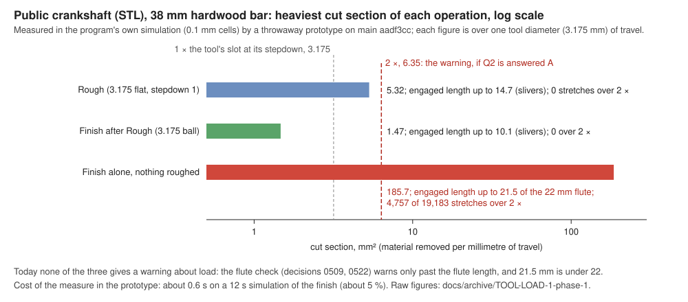
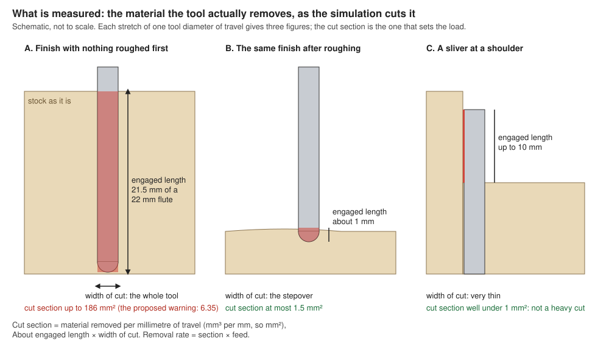
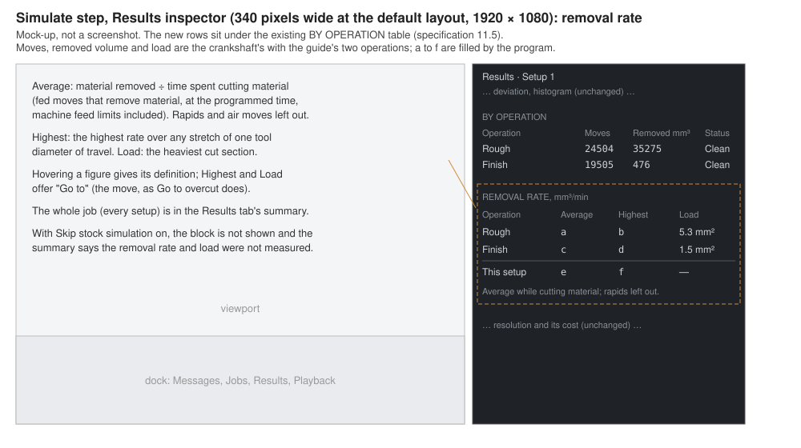
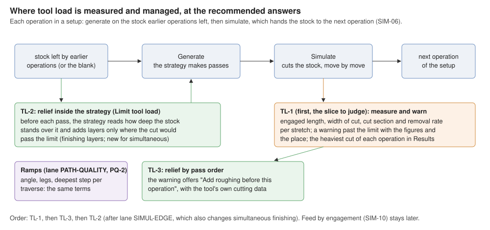

# TOOL-LOAD-1: Managing the load on the tool: measure the engagement in the simulation, warn past a limit, and let the strategies keep within it (SIM-03, SIM-06, OP-03 to OP-11, OP-17, TL-04, TL-05, NFR-04, NFR-06, NFR-12; issue #844; lane TOOL-LOAD)

- **Status:** Proposed by lane TOOL-LOAD on 25 Nov 2026 (phase 1, planning only; no product code is built until the owner answers). Only the project owner accepts this record (decision 0049). The questions are Q1 to Q7 below, each with options, a recommendation and what follows "if you answer as recommended". It proposes requirement wording (Q1) for the owner's agreement; `docs/requirements.md` and `docs/architecture.md` are not edited until the owner agrees. **Answered so far (25 Nov 2026, the owner's answers relayed by the coordinator): Q1 B**, SIM-16 and OP-29 both P1, with the wording as written, the requirements edited only in the build pull requests after the record is accepted; **Q2 A**, measured in the simulation on the stock at each move, **with an addition: the average and highest removal rate (mm³/min) shown as statistics in the Simulate step's inspector**, per operation and for the whole job (Q2, *The owner's addition*). Q3 to Q7 are still open.
- **Date:** 25 Nov 2026.
- **Issue:** [#844](https://github.com/OpenChuckCAM/OpenChuckCAM/issues/844) (a strategy can put a large amount of material along the whole cutting edge at once, with nothing said). The owner took it into its own lane on 25 Nov 2026 (decision [PATH-QUALITY-1](PATH-QUALITY-1-finishing-edges-points-and-ramps.md), Q5, relayed by the coordinator), with the guiding point: **the goal of ramping, and more widely of toolpath strategy, is to manage the tool's load, so it must be designed in, not only gouge safety.**
- **Requirements:** none covers this yet (the issue says so). Related: SIM-03 and SIM-06 (the simulation and its carried stock), OP-11 (stepdown, stepover, ramping), OP-17 (adaptive roughing, P2), TL-04 and TL-05 (flute length, cutting data), SIM-10 (feed by engagement, P3), NFR-04 (never block, use the cores), NFR-06 (determinism), NFR-12 (the user verifies the program).
- **Builds on:** accepted decisions [0509](0509-flute-length-against-the-deepest-cut.md) and [0522](0522-the-flute-check-warns.md) (the flute check, which warns only past the flute length), [0345](0345-finishing-layers.md) (Finishing layers, with "no engagement promise", OI-1373), [0545](0545-blended-steps-between-rings.md) D3 (new operations get a new default, saved ones keep their programs), [0536](0536-message-levels-operation-reference-and-setting-links.md) (message levels), [0168](0168-simulate-controls-and-stock-simulation.md) (the stock is simulated by default), [0661](0661-a-rapid-that-removes-less-than-the-simulation-resolves.md) (the simulation's per-column depth), and [PATH-QUALITY-1](PATH-QUALITY-1-finishing-edges-points-and-ramps.md) (accepted 25 Nov 2026, relayed) Q3's tool-load requirement for ramps (PQ-2), whose terms this record shares (Q6).
- **Would amend, if answered as recommended:** nothing accepted. It adds two requirements (Q1) and their verification-plan rows, once the owner agrees the wording. It answers OI-1373 in part (Q2 to Q4).
- **Open items:** adds OI-9911 to OI-9916 (provisional numbers; listed under *Open items* below). Updates OI-1373 in place. Depends on no open item for TL-1. TL-2's simultaneous-finishing part waits for lane SIMUL-EDGE's build (OI-9996), which changes the same code.

Numbering: provisional. The record carries the lane's name, and its open items are OI-9911 to OI-9916 (free on `main` and on every unmerged branch on 25 Nov 2026; the records check takes numbers only, so the block is numeric, not lettered); the coordinator assigns the real numbers at release, in merge order. The requirement IDs proposed in Q1, SIM-16 and OP-29, are the next free ones on `main` and every unmerged branch on 25 Nov 2026, and are provisional too. No project schema number is needed for any recommended answer: a new operation setting is stored in the operation's free parameter map, as decisions 0390, 0543 and 0545 did. No spike: the measurement below was made with a throwaway change to the simulator, kept only as a patch in the archive.

## For the owner

What this record asks of you, in the order the coordinator will put it:

1. **Q1: the requirement wording. Answered B:** both requirements P1, with the wording as written. SIM-16, the simulation measures the load on the tool and warns past a limit; OP-29, an operation can limit the load, and the strategies keep within it.
2. **Q2: what "engagement" is and where it is measured. Answered A, with the average and highest removal rate added to the Simulate inspector.** As recommended: in the simulation, on the stock as it is at each move, over each stretch of one tool diameter of travel: the length of flute in the material, the width of cut, and the **cut section** (material removed per millimetre of travel), which sets the load.
3. **Q3: what counts as too much.** Recommended: **A**, twice a full-width slot at the tool's own stepdown from its cutting data (for the crankshaft's tools in hardwood, 2 × 1.0 mm × 3.175 mm = 6.35 mm²).
4. **Q4: what the program does about it.** Recommended: **C**, built in stages: TL-1 measures and warns (the first slice, about a week, for you to judge); TL-3 lets the warning add a roughing operation before the heavy one; TL-2 adds **Limit tool load** to the strategies, which cut in layers only where the stock is deep.
5. **Q5: the flute check.** Recommended: **A**, keep it as it is, beside the new measure, and record the later narrowing.
6. **Q6: ramps (PATH-QUALITY's PQ-2).** Recommended: **A**, one set of terms; ramp moves are measured like any other, and a heavy stretch inside a ramp names the entry.
7. **Q7: saved projects.** Recommended: **A**, the measure and its warning apply to every project at once (they change no program); Limit tool load is on for new operations and off for saved ones, so saved programs and every golden are unchanged.

And what to look at: the three figures below, and the measurement in [docs/archive/TOOL-LOAD-1-phase-1](../archive/TOOL-LOAD-1-phase-1/README.md).

## Context

### What happens today

On the public crankshaft (38 mm hardwood bar, the guide's two tools, the guide's setup; measured on the STL model, as the container had no STEP reader built), the simulation now measures what each move removes ([archive](../archive/TOOL-LOAD-1-phase-1/README.md); a throwaway change to the simulator, on `main` `aadf3cc`):

| Operation | Removes | Moves with one tool diameter (3.175 mm) or more of flute in the material | Largest length of flute in the material | Largest cut section (over one diameter of travel) |
| --- | --- | --- | --- | --- |
| Simultaneous finishing alone, nothing roughed first | 34,661 mm³ | 10,699 | 21.5 mm of the 22 mm flute | **185.7 mm²** |
| Rotary roughing (3.175 mm flat, stepdown 1 mm) | 35,275 mm³ | 24 (slivers) | 14.7 mm (a sliver) | 5.3 mm² |
| The same finish after that roughing | 476 mm³ | 22 (slivers) | 10.1 mm (a sliver) | 1.5 mm² |

None of the three gives any warning about the load on the tool. The flute check of decisions 0509 and 0522 warns only where the stock stands deeper over the tip than the flute length, and 21.5 mm is under 22 mm. So a finishing operation run first on the bar, as a user may well do, buries the ball in the wood along its whole flute, more than a hundred times as heavy as the guide's own finish, and the program says nothing (#844).

Lane PATH-QUALITY's estimate on the STEP example, made outside the program, found the same largest figure (21.5 mm) and the same pattern ([PATH-QUALITY-1](PATH-QUALITY-1-finishing-edges-points-and-ramps.md), *#844*).

### Why the length of flute in the material is not enough

The rough and the finish after it each have moves with 10 to 15 mm of flute in the material, yet they are light: those are slivers: each of the longest removes well under a cubic millimetre in its move, a thin skin at a shoulder where the tool's side brushes a tall wall. A warning on the engaged length alone would warn on the guide's own example every time. What loads the tool is the material it removes per millimetre it travels, the **cut section**: about the engaged length times the width of cut. The finish alone takes up to 186 mm² per millimetre; the rough at most 5.3; the finish after it at most 1.5. That separates the three cleanly.

### What exists in the code

- **The flute check** (`openchuck_path::flutes`, decisions 0509 and 0522): the stock's depth over the tip along the tool axis, exact for the setup's own box or round stock and a conservative bound on stock earlier operations left (OI-2025). It reads the stock before the operation, not as the operation's own passes leave it, and warns only past the flute length.
- **Finishing layers** (decision 0345): helical, axial and indexed finishing can cut layers above the final pass, at the operation's Stepdown along the tool axis. Off by default, everywhere at once, and with "no engagement promise" (OI-1373).
- **The simulation** (`openchuck-sim`, dexels, decision 0022): cuts the stock pose by pose and already returns the volume removed per batch and, for rapids, the most removed from one column (decision 0661). It runs after each operation by default in the program (decision 0168), and in the pipeline whenever a later operation of the setup needs its stock. The architecture already gives it "tool engagement" (section 5.5, and section 6, the operation pipeline: "Simulate ... produces deviation and engagement"); nothing measures it yet.
- **Facing** checks its own engagement for its box passes (decision 0547), and the test kit has an independent width-of-cut check used only in tests (decision 0545).
- **The tool's cutting data** (TL-05) already holds, per tool and stock material, a stepover and a stepdown: the user's own statement of the cut the tool should take.
- **Requirements that touch it:** OP-17 (adaptive, constant-engagement roughing, P2) and SIM-10 (feed adjusted by the engagement measured in the simulation, P3) both need the measure this record proposes, and neither is scheduled.

### The prototype's cost

For each pose, the change adds up the material removed and the highest and lowest removed point along the tool axis, over the columns the pose cuts, then sums each move. On the finish alone (19,506 moves, 258,370 poses, about 12 s to simulate), it added about 0.6 s, **about 5 % of the simulation**; on the rough and finish together, about 2 s on a 49 s run. It reads the stock the simulation already cuts, so it needs no extra pass over the path.

## Questions for the owner

### Q1: the requirement wording

**The owner's answer (25 Nov 2026, relayed by the coordinator): B.** SIM-16 and OP-29 are both P1, with the wording as written below. The requirements and the verification plan are edited only in the build pull requests, after this record is accepted: SIM-16 in TL-1's, OP-29 in TL-2's, each with its tests in the same pull request, so `cargo xtask trace` never sees a P1 requirement without a test. As P1, OP-29 is needed for the first usable release; the verification-plan row below is changed to P1 accordingly. The Q2 addition (the removal-rate statistics) is covered by SIM-16's "removal rate" and its "show"; the one clause it adds to SIM-16 is marked in Q2 for confirmation at acceptance. The options are kept as they were put.

Proposed text, for `docs/requirements.md` once agreed (section 3.6 for SIM-16, section 3.5 for OP-29):

> **SIM-16** (P1). Measure the load each operation puts on the tool from the stock as the simulation leaves it at each move (SIM-06): for each stretch of path, the length of the cutting edge in the material along the tool axis, the width of cut, the material removed per millimetre of travel (the cut section) and the removal rate at the programmed feed. Show the heaviest cut of each operation, with where it is, and warn, with the figures and the place, where the cut section passes a limit set from the tool and its cutting data. A warning, or none, does not say that a cut is safe for the tool or the machine (NFR-12).
>
> **OP-29** (P1 by the owner's answer B; first proposed as P2). Tool load in the strategies: an operation can limit the load on its tool, using the measure of SIM-16 and the same terms as ramp entries (OP-11). Where the stock an operation is given stands deeper over a pass than the limit allows, the strategy cuts it in layers, or by another way it names, so that the cut section stays within the limit, and where it cannot, it says so and where. An operation saved before the setting existed keeps its program.

And their rows in `docs/verification-plan.md`:

| ID | Priority | Method | Level | Criterion |
| --- | --- | --- | --- | --- |
| SIM-16 | P1 | T | System | On analytic cases (a flat end slotting a box at a known depth; a ball stepping over a cylinder) the reported cut section and engaged length equal the hand-computed values within one cell; the public crankshaft's finish alone is warned and the guide's rough then finish is not; the figures are the same at any thread count |
| OP-29 | P1 (answered B; P2 as first proposed) | T | System | With the limit on, the simulation of each strategy that offers it on synthetic parts and on the public crankshaft finds no stretch past the limit, or the operation says where it could not keep within it; with it off, the path is byte-identical to before |

- **A. As written (recommended).** SIM-16 is P1 because the measure and the warning are what stop the crankshaft case being silent, and they are cheap (TL-1). OP-29 is P2: relief inside the strategies is the larger build (TL-2) and follows the core.
- **B. Both P1.** OP-29 is then needed for the first usable release, and every strategy that cuts in passes needs a test of it before its slice closes.
- **C. Both P2.** The warning is then not required for the first release; the crankshaft case stays silent until it is built.

*If you answer as recommended:* the two requirements and their rows are added in TL-1's pull request (SIM-16) and TL-2's (OP-29), each with the tests named by ID (`req_sim_16_...`, `req_op_29_...`), so `cargo xtask trace` holds them. The architecture needs no change: section 5.5 already gives `openchuck-sim` the engagement, and the strategies read stock through the existing `StockModel` port.

### Q2: what "engagement" means, and where it is measured

**The owner's answer (25 Nov 2026, relayed by the coordinator): A**, with an addition: the average and highest removal rate (mm³/min) as statistics in the Simulate step's inspector, per operation and for the whole job. How that is defined, shown and built is under *The owner's addition* below. The options are kept as they were put.

- **A. In the simulation, on the stock as it is at each move (recommended).** As the simulation cuts each pose, it notes the material removed and where it was along the tool axis. Over each stretch of one tool diameter of travel it gives:
  - the **engaged length**: how much of the cutting edge is in the material, along the tool axis (the highest removed point less the lowest);
  - the **cut section**: the material removed per millimetre of travel, in mm² (the stretch is a tool diameter long because most finishing moves are shorter than a millimetre, and one move's volume would count the tool's own footprint where it starts);
  - the **width of cut**: the cut section divided by the engaged length (the mean width across the travel);
  - the **removal rate**: the cut section times the programmed feed, in mm³/min.

  It sees the stock as earlier operations left it and as this operation's own earlier passes leave it, which is what the tool meets. It is exact to the simulation's cell. It costs about 5 % of the simulation (measured above), and nothing where the project skips the stock simulation (decision 0168); there a note says the load was not measured. About 5 to 7 days with the warning (TL-1); 6 to 8 with the owner's removal-rate addition below.
- **B. From the path and the stock before the operation.** Extend the flute check's measure (`flutes::deepest`) to give the depth of stock over the tool for every move, during generation. No simulation needed, so it works with the simulation off; but it does not see what the operation's own earlier passes removed, it gives no width of cut, and on stock earlier operations left it is the conservative bound of OI-2025, which would warn on the guide's finish after roughing. About 3 days.
- **C. Both.** B during generation as a quick early warning, and A in the simulation for the figures shown. About 8 to 10 days; two figures for one thing, which can disagree.

*If you answer as recommended:* the measure lives in `openchuck-sim` (not in the library family, so no semver check applies); the program and the command line's `simulate` show it; every figure is deterministic (each column is cut by the poses in order, and the tallies are reduced in a fixed order, as decision 0661's per-column depth already is; NFR-06). Feeding the measure back into generation for relief is Q4's TL-2, which reads the stock through the `StockModel` port before each pass instead.

#### The owner's addition: the average and highest removal rate in the Simulate inspector

- **Where it goes (designed for 1920 × 1080).** In the Simulate step's Results inspector (specification 11.5, 340 pixels wide at the default layout, 280 to 520), a block **REMOVAL RATE, mm³/min** directly under the existing **BY OPERATION** table, one row per operation with **Average**, **Highest** and **Load** (the heaviest cut section of Q2 A, in mm²), and a last row **This setup**. The existing table keeps its four columns (Operation, Moves, Removed mm³, Status): three more columns would not fit the narrowest inspector, so the new figures are a block of their own with the same operation names, in the same order. Numbers are whole mm³/min, in the monospace of the table. Hovering a figure gives its definition (below); on Highest and Load the tooltip offers **Go to**, which moves playback to the start of that stretch, as Go to overcut does (SIM-11). **The whole job** (every setup) is one information line in the Results tab's summary, since the inspector shows one setup at a time: "Removal rate over the job: average N mm³/min while cutting, highest N mm³/min (operation 'Finish', setup 'Setup 1')." The command line's `simulate` prints the same per operation and for the job. No issue #707 work (SIM-13's per-operation summary) is on `main` or on any unmerged branch on 25 Nov 2026, and no record SIM-UX-A was found; if SIM-13's summary lands first in the same table, these figures join it as rows of the same block rather than a second table, and the specification edit in TL-1 says so.
- **How "average" is defined.** **Material removed ÷ time spent cutting material**: the sum of the volume removed by the operation's fed moves (cuts, ramps, leads, plunges and fed links), divided by the programmed time of the fed moves that remove material. The programmed time is the program's own time estimate of each move (SIM-08), with the machine's feed limits applied (on the crankshaft finish, 14,796 moves are slowed by the machine's limits, so the programmed feed alone would overstate the rate). It is the rate the tool works at while it is in the material, which is what bears on its load. Two other averages were considered and not taken as the figure shown: over all fed time (air cutting included), which falls as the path wanders in air without the tool working any less hard; and over the whole program's time (rapids and tool changes included), which is the job's throughput, a figure for SIM-08's time estimate rather than for the tool. The tooltip gives the over-the-whole-time figure beside it, labelled as such, so both are available. **This setup** and **the job** are the total removed ÷ the total time cutting material, not the mean of the operations' averages.
- **How "highest" is defined.** The highest rate over any stretch of one tool diameter of travel (the same stretches as the cut section): the volume removed over the stretch ÷ its programmed time. A stretch, not a single move, because one short move's volume includes the tool's footprint where it starts, which would make a 0.1 mm move read as a very high rate.
- **Rapids and air moves.** Rapids are left out of both figures, volume and time. A rapid that removes material is already reported on its own as a rapid cut (decision 0661, the Status column) and is not a rate the tool is meant to work at. Fed moves that remove nothing (air cutting) add nothing to the volume and are left out of the average's time; they still count in the over-the-whole-time figure of the tooltip.
- **When the stock simulation is skipped (decision 0168).** Nothing is measured, and no figure is guessed: the inspector has no simulated results to show, so the block is not drawn, and the Results tab's summary says "Removal rate and tool load were not measured: the stock simulation is skipped (Skip stock simulation in Playback)." The command line says the same.
- **Stale results.** Dimmed with the rest under "Results of the out-of-date simulation:", as the specification already does for every figure there.
- **Cost.** Next to nothing on top of TL-1: the volume per move is TL-1's tally, and the time per move is already computed for playback and the time estimate; the figures are two sums and a running maximum over the stretches, linear in the number of moves, with two numbers kept per operation. No change to the measured 5 %.
- **Which pull request.** TL-1 carries it, with the warning and the Results line: about one more day (TL-1 becomes 6 to 8 days). It changes the specification's section 11.5 (the new block and the summary line) in the same pull request. Tests: `req_sim_16_...` on an analytic slot (a flat end slotting a box at a known depth and feed: the average equals depth × diameter × feed within one cell's share), the crankshaft's two operations (the setup's figure is the total ÷ the total time, not a mean of means), rapids and air moves left out, and the skipped-simulation summary line.
- **The one clause it adds to SIM-16** (for confirmation when the record is accepted, since the wording was answered "as written"): after "Show the heaviest cut of each operation, with where it is," add "**and the average and highest removal rate of each operation and of the whole job,**".

### Q3: what counts as too much

The measure needs a limit to warn against. The tool's cutting data (TL-05) already says, per stock material, the stepdown and stepover the user wants for this tool. A full-width slot at that stepdown, stepdown × diameter, is the heaviest cut that data describes.

- **A. Twice the tool's slot at its own stepdown (recommended).** Warn where a stretch's cut section passes 2 × stepdown × diameter, from the cutting data for the setup's material; where the tool has no cutting data for it, a stepdown of half the diameter (so the limit is the diameter squared). No new setting in TL-1; TL-2 adds the operation's own limit (Q4). On the crankshaft this limit is 6.35 mm²: the finish alone is warned (4,757 stretches past it, up to 185.7 mm²), the guide's rough (largest 5.3) and the finish after it (1.5) are not. The factor of two leaves room for rotary roughing, which reaches up to 1.7 times its slot on the crankshaft; a cut past it is outside anything the cutting data describes.
- **B. Once the tool's slot (1 × stepdown × diameter).** Stricter: the guide's own roughing is warned (1,388 stretches between 1 and 1.7 times), so the warning would be noise on the example a new user follows.
- **C. A value of its own in the tool library**, "largest cut section" per tool and material, which the user sets. The most precise, but a new tool field (a project schema number and a tool-library change), and one more value to set for every tool before the warning means anything.

Under any answer the engaged length is shown beside the cut section but is not warned on by itself: slivers make it large on light cuts (the table in *Context*). Past the flute length the existing flute warning still applies (Q5).

*If you answer as recommended:* a warning reads, for example (the place and move are filled in by the program):

> Tool load (operation 'Finish', tool 'Z1 ball 3.175x22'): 4,757 stretches of the path remove more than 6.35 mm² per millimetre of travel, twice a full-width slot at this tool's 1.0 mm stepdown in Hardwood. The heaviest removes 185.7 mm² per millimetre at X …, A … (move …), with 21.5 mm of the 22 mm flute in the material. A cut like this can be far heavier than the tool and the machine are meant to take. Rough the setup first, use Finishing layers where the operation has them, or lower the cut, and check the cut in the simulation. Generated G-code must be checked before it is run on a machine.

It is a warning that does not need acknowledging at export, like the flute warning (decision 0522 item 1), shown in Messages and Results with its operation, and listed in the export checks. The Results tab shows, for every simulated operation, an information line: "Tool load (operation 'Rough'): the heaviest cut removes 5.3 mm² per millimetre of travel (limit 6.35), with up to 14.7 mm of flute in the material." The program's own words never call a cut safe (NFR-12).

### Q4: what the program does about it

The owner's point is that tool load is designed in, not only reported. The choices, from least to most:

- **A. Measure and warn only** (TL-1). The user relieves the cut: roughing first, Finishing layers, a smaller Stepdown or Stepover. About 6 to 8 days with the removal-rate statistics (Q2's addition). Low risk. No program changes.
- **B. A, and relief by pass order** (TL-1 and TL-3). Where the warned operation is the first to cut in its setup, the warning in Messages offers "Add roughing before this operation": a rotary roughing operation in the same setup, placed before it, with a tool from the project that has cutting data for the material (the warned tool where it is a flat end) and that data's stepdown and stepover, leaving the finish's own allowance. The user sees and can change it before generating. On the crankshaft this is exactly the guide's order, which takes the finish from 185.7 mm² to 1.5. About 2 to 3 days more. Low risk; an undoable edit (UI-08).
- **C. B, and relief inside the strategies: Limit tool load (recommended)** (TL-1, TL-3, then TL-2). A new operation setting, **Limit tool load**, with the limit of Q3 shown and editable:
  - helical, axial and indexed finishing use Finishing layers (decision 0345), but only where the stock over a pass would pass the limit, read from the stock through the `StockModel` port before the pass; elsewhere one pass, as today;
  - simultaneous finishing gains layers of the same kind (offsets of the final pass along the tool axis, clipped to the stock) where they are needed; it has none today. This part follows lane SIMUL-EDGE's build in `simultaneous.rs`;
  - rotary roughing already holds its Stepdown to the flutes (OI-153); with the setting on, a pass whose stretch would still pass the limit (the first pass on box stock, a shoulder) is split at half the Stepdown there;
  - the other strategies (swarf, face flow, pencil, rest, edge following, Facing) are measured and warned under A, and say in their notes that they do not limit the load themselves. Drilling is measured but not warned: a drill cuts on its end by design, and its own pecking manages that (OP-10).

  Where a strategy cannot keep within the limit, the stretch is warned as in A. The relief reads the stock before the pass; the simulation's measure afterwards is the check that it worked (the verification of OP-29). About 3 weeks for TL-2. Medium risk: the stock read must be exact on the simulated stock, so TL-2 adds a defaulted `StockModel` query for the depth of the simulated stock over the tool's disc (`openchuck-sim` implements it), which also gives the flute check its exact answer (Q5, OI-2025).
- **D. Lower the feed where the cut is heavy** (SIM-10, P3). Keeps the chip load per tooth where the section is high. It does not reduce the depth of the cut and changes cycle time; it needs the measure first. Not proposed now (OI-9915).

*If you answer as recommended:* TL-1 first, as the slice you judge (about a week); then TL-3; then TL-2 after lane SIMUL-EDGE merges. A new finishing operation run first on the crankshaft bar is cut in layers where the stock is deep and once elsewhere; the warning disappears, or names the stretches still past the limit. Saved operations keep their programs (Q7).

| Strategy | TL-1 measure and warning | TL-2 relief with Limit tool load |
| --- | --- | --- |
| Rotary roughing (all forms) | yes | Stepdown halved over a stretch past the limit |
| Helical, axial, indexed finishing | yes | Finishing layers where needed |
| Simultaneous finishing | yes | new layers where needed, after SIMUL-EDGE |
| Swarf, face flow, pencil, rest, edge following | yes | no; said in notes (OI-9914 lists them for later) |
| Facing | yes (beside its own engagement check, decision 0547) | no; its own Stepdown already holds |
| Radial drilling | figures shown, not warned | no |

### Q5: the flute check

The flute check of decisions 0509 and 0522 warns where the stock stands over the tip further than the flute length. It reads the stock before the operation, and on stock earlier operations left it is a conservative bound (OI-2025, issue #540), which can warn where the real stock would not.

- **A. Keep it as it is, beside the new measure (recommended).** Two separate warnings: the flute check says the shank may meet the stock; the tool-load warning says the cut is heavy. Nothing that warns today stops warning. When TL-2 adds the exact `StockModel` depth query, the flute check uses it on simulated stock, which narrows the bound for #540 (OI-9916); that is a separate small change.
- **B. Where the operation was simulated, replace the flute check's bound by the measured engaged length.** Fewer false flute warnings at once, but the flute warning is made during generation and the measure only after the simulation, so a warning would appear and then be withdrawn; and with the simulation off it still needs the bound.
- **C. Merge both into one "Tool load" warning.** One message, but two different risks (the shank meeting the stock, and a heavy cut) in one, and decision 0522's accepted wording changes.

*If you answer as recommended:* the flute warning, its tests and decision 0522 are unchanged; the tool-load warning names the flute length beside the engaged length, so the two read together.

### Q6: ramps, and PATH-QUALITY's PQ-2

The owner's answer to PATH-QUALITY-1 Q3 makes the ramp manage the tool's load, with its own figures: the angle along the tip's real path, the number of legs and the deepest step per traverse, in the ramp's path note, and in PQ-2's verification "the material removed per millimetre of ramp". The two lanes are to agree the terms before PQ-2's notes are written.

- **A. One set of terms (recommended).** "Cut section" is the material removed per millimetre of travel, which is PQ-2's "material removed per millimetre of ramp"; "engaged length" is along the tool axis; "depth per traverse" and the ramp's angle stay PQ-2's, as the ramp's own figures known before cutting. The TL-1 measure covers ramp and lead moves like any other, so a ramp too steep for the stock is warned; where the heaviest stretch of a warned operation is inside an entry, the warning says so and names the Ramp angle setting. PQ-2's notes and TL-1's warning use the same words. No change to PQ-2's design or effort.
- **B. Ramps measured separately.** Entry moves are left out of TL-1's measure, since PQ-2 bounds them by geometry. Simpler, but a ramp into deep stock (a first operation on the bar) is then not measured at all.

*If you answer as recommended:* this record's glossary (*Terms*, below) is the one PQ-2's path notes use; lane PATH-QUALITY is told before it writes them.

#### The ramp's settings and the load limit (the owner's question of 25 Nov 2026, relayed)

The owner asked whether the ramp's settings, angle-based today, should change now that a ramp's purpose is the tool's load. Lane PATH-QUALITY is writing the options for the ramp's own settings in PQ-2 (pull request #930); this note is how this record's limit relates to them, so the two lanes give one answer.

- **On a ramp, the load is set by the depth per traverse, not the angle.** Where a leg passes over a place the tool has already cut, it cuts the full width of the tool, as deep as the step since that last traverse. So a ramp's cut section is about the tool's diameter times its depth per traverse (less with a ball end). A cut-section limit `L` therefore means a depth per traverse of at most `L ÷ diameter`: with Q3 A, twice the tool's stepdown (2 mm for the crankshaft's tools in hardwood).
- **The angle stays, beside the limit, not replaced by it.** The angle sets how steeply the tool's end cuts into fresh material and how long the ramp is; that is about the tool's end (whether and how steeply it can cut downwards), which the cut section does not capture. Saved operations store an angle, and the tool makers state a ramp angle.
- **The limit adds a second bound on PQ-2's legs.** PQ-2 already bounds the depth per traverse by one turn of the spiral ramp at the same radius and by the tool's radius. With Limit tool load on (TL-2), it is also bounded by `L ÷ diameter`, by shortening the legs (more legs; time, not load), as PQ-2 does for its own bound. With it off, the ramp is as PQ-2 builds it, and TL-1's measure checks it after the fact like any other stretch (Q6 A).
- **Who owns what.** Lane PATH-QUALITY owns the ramp's geometry and its settings (Ramp angle, Maximum ramp angle, Steeper ramp near the axis, the legs and their bounds). This lane owns the measure, the limit and where its value comes from (Q3), and Limit tool load (Q4). TL-2 passes the limit into PQ-2's leg bound and adds no ramp setting of its own.
- **If the owner wants a load-based ramp setting instead of the angle** (for example, a target depth per traverse that sets the legs), that is a change to the ramp's settings and belongs in PQ-2's options; this record's limit would then feed it as the default, and nothing here changes.

### Q7: saved projects and the goldens

- **A. The measure for every project; Limit tool load for new operations (recommended).** The measure and its warning change no program, so they apply at once to every project that is simulated: a saved project with a heavy cut gains a warning, which is the point of #844. Limit tool load follows decision 0545 D3: on for a new operation of a strategy that has it, off for an operation saved without it, so saved programs, the reference projects and every golden G-code file stay byte-identical.
- **B. Limit tool load on for every operation.** Saved programs change wherever the stock is deep; the goldens are re-blessed where they cut deep (none of the reference projects' finishes run first on a bar, so few or none would change, but each must be checked).
- **C. Off for every operation; the user turns it on.** No program changes anywhere; the relief is not designed in by default, against the owner's guiding point.

*If you answer as recommended:* no golden G-code changes in any of the three pull requests. Tests that list a reference project's messages gain the tool-load information line where they list Results information; that is the only test churn expected in TL-1.

## Terms

The words the program, the guide and PATH-QUALITY's PQ-2 use (Q6 A):

| Term | Meaning | Unit |
| --- | --- | --- |
| Engaged length | How much of the cutting edge is in the material, along the tool axis | mm |
| Width of cut | The mean width of material the tool removes across its travel (cut section ÷ engaged length) | mm |
| Cut section | The material removed per millimetre of travel, over a stretch of one tool diameter | mm² |
| Removal rate | Material removed ÷ the programmed time of the moves that remove it (the program's time estimate, machine feed limits included); where the feed is not limited, cut section × feed | mm³/min |
| Average removal rate | Over an operation, a setup or the job: material removed ÷ time spent cutting material (rapids and air moves left out) | mm³/min |
| Highest removal rate | The highest removal rate over any stretch of one tool diameter of travel | mm³/min |
| Limit | The largest cut section allowed before a warning (Q3), or before Limit tool load adds layers (Q4) | mm² |
| Depth per traverse | A ramp's or plunge's step down in one pass over the same place (PQ-2) | mm |
| Ramp angle | The ramp's slope along the tip's real path (PQ-2, decision 0543 D4) | degrees |

## Effort, risk and how the work would be split

| Pull request | What | Effort | Risk | Program and golden changes | Library API | Can go alone |
| --- | --- | --- | --- | --- | --- | --- |
| TL-1 | The measure in `openchuck-sim` (per-pose tally, stretches of one diameter, per-operation summary); the warning and the Results line in `openchuck-app`; the `simulate` line in `openchuck-cli`; the average and highest removal rate in the Simulate inspector and the job's summary line (Q2's addition); the guide's simulation and Messages pages; SIM-16 added to the requirements and the verification plan | 6 to 8 days | low to medium (the simulation's inner loop; budget: no more than 10 % added to the crankshaft finish's simulation, measured in the pull request) | none; warnings and information only | none in the library family (`openchuck-sim`, `openchuck-app` only) | yes; first |
| TL-3 | "Add roughing before this operation" from the warning | 2 to 3 days | low | none (an edit the user makes) | none | after TL-1 |
| TL-2 | Limit tool load: the `StockModel` depth query (defaulted, implemented in `openchuck-sim`); layers where needed in helical, axial and indexed finishing, and new layers in simultaneous finishing; roughing's split; the form and the guide; OP-29 added | 13 to 19 days | medium (simultaneous finishing's layers are new; they follow SIMUL-EDGE in `simultaneous.rs`) | none for saved operations (Q7 A); new operations differ where the stock is deep | additive: a defaulted `StockModel` method and new parameter names in `openchuck-path`, as decision 0509 added its methods; no minor bump expected. If the build finds a breaking change is the better design, it bumps the workspace minor (decision 0048) and the coordinator assigns the version in merge order | after TL-1, and after SIMUL-EDGE for its simultaneous part |

Total at the recommended answers: about 21 to 30 working days, 4 to 6 weeks (TL-1 about a week and a half, TL-3 about half, TL-2 about three to four). The cheap first slice is TL-1 alone: about a week, no program changes, and on the crankshaft it turns a silent 185.7 mm² cut into a warning with its figures.

Each pull request changes the user guide's text for what it adds, adds a *Development version* line to the release notes (no decision, open item or requirement numbers there), and, for TL-2, an entry to `crates/openchuck-path/CHANGELOG.md`.

Where the lanes meet: lane SIMUL-EDGE works in `simultaneous.rs` and `simultaneous/hidden.rs`, so TL-2's simultaneous layers wait for it; lane PATH-QUALITY's PQ-2 works in `assemble/entry.rs` and shares only the terms (Q6). TL-1 touches `openchuck-sim` (`dexel.rs`, `simulation.rs`), which no other lane in flight changes as far as the unmerged branches show on 25 Nov 2026.

**The owner's hand check.** Nothing needs it before TL-1 is built. After TL-1, an optional look in the program on the public crankshaft example would show the warning: open `testdata/examples/crankshaft-simultaneous`, add Simultaneous finishing with the ball and generate (the warning, with its figures); then add Rotary roughing with the flat end before it and generate again (no warning; the Results line shows the heaviest cut). The coordinator routes it to lane OWNERCHECKS-PACKS with that public project. Nothing is cut on a machine for this.

## Alternatives considered

The options not recommended under each question are the alternatives, with their reasons. Two more were set aside:

- **Warn on the engaged length alone** (for example, past one tool diameter), the measure #844 first named and PATH-QUALITY's Q5 B. Not taken: on the crankshaft it warns on the guide's own rough (24 moves) and finish after rough (22 moves), all slivers, and says nothing about a full-width slot at a shallow depth.
- **Constant-engagement (adaptive) roughing now** (OP-17, P2). It is the strategy-level answer for roughing, but a new strategy of its own; it needs this measure to be checked, so it comes after. Recorded under OI-9915.

## Consequences

- **Code** (after the answers): `openchuck-sim` (`dexel.rs`, `simulation.rs`) and `openchuck-app` (the pipeline's simulation step, Messages and Results, the export checks) for TL-1; `apps/openchuck-cli` (`simulate`); `openchuck-app` and the operation form for TL-3; `openchuck-path` (`finishing.rs`, `helical.rs`, `axial.rs`, `indexed.rs`, `simultaneous.rs`, `roughing.rs` and `rotary.rs`, the `StockModel` port) and `openchuck-sim` for TL-2. Tests named by requirement (SIM-16, OP-29, OP-11, NFR-06) on synthetic parts and the public crankshaft.
- **Documents:** `docs/requirements.md` and `docs/verification-plan.md` (SIM-16, OP-29, once agreed); `docs/ui-design/ui-specification.md` for the Results line, the warning's action (TL-3) and the Limit tool load setting (TL-2); the user guide's simulation, Messages, finishing and Entry pages. `docs/architecture.md` does not change.
- **Performance (NFR-04):** the measure runs inside the simulation's existing jobs on its worker pool, about 5 % of the simulation on the crankshaft; TL-2's stock reads run in generation, on the same pool, and are part of its effort estimate.
- **Determinism (NFR-06, GC-07):** the measure changes no G-code; its figures are reduced in a fixed order. TL-2's layers depend only on the stock and the settings.
- **NFR-12.** Nothing here says a cut or a program is safe. The warning says the cut is heavy and how to relieve it; no warning is not a statement that the load is acceptable; generated G-code remains the user's to verify before running it on a machine.

## Open items

Added (provisional numbers):

- **OI-9911:** the owner's answers to Q1 to Q7 and acceptance of this record, with agreement of the requirement wording (SIM-16, OP-29). Q1 answered B and Q2 answered A with the removal-rate addition (25 Nov 2026, relayed); Q3 to Q7 open.
- **OI-9912:** build TL-1: the tool-load measure in the simulation, its warning and Results line, and the average and highest removal rate in the Simulate inspector (SIM-16).
- **OI-9913:** build TL-3: "Add roughing before this operation" from the tool-load warning.
- **OI-9914:** build TL-2: Limit tool load in rotary roughing and helical, axial, indexed and simultaneous finishing (OP-29), after lane SIMUL-EDGE; and whether swarf, face flow, pencil, rest and edge following should relieve the load themselves later.
- **OI-9915:** later uses of the measure, not proposed now: feed adjusted by engagement (SIM-10, P3; SUG-09), the path coloured by load in the viewport, and constant-engagement roughing (OP-17, P2).
- **OI-9916:** the flute check reads the exact depth of the simulated stock once TL-2's `StockModel` query exists, narrowing the bound of OI-2025 (issue #540).

Updated in place: OI-1373 (material-engagement limits off the centreline): this record proposes the measure (Q2), the limit (Q3) and the relief (Q4); it stays open until TL-2 is built.

## Verification (phase 1)

- **What was checked, and how:** on `main` `aadf3cc` (0.63.0), in a Linux cloud container (4 cores, nothing else running during the timed runs), with a release build of `openchuck-cli`. Two projects were built with the command line from the public STL crankshaft (`testdata/stl/crankshaft.stl`) with the setup of `testdata/examples/crankshaft-simultaneous` (38 mm hardwood bar, held 6 mm, the Makera Z1 library's tools 104 and 204): the finish alone (simultaneous finishing, defaults) and rough (rotary roughing, Stepdown 1 mm) then finish. Each was regenerated with the Makera Z1 post and simulated at 0.1 mm cells. A throwaway change to `openchuck-sim` (kept as a patch in the archive; applied, built, run and reverted; never on a branch) wrote, per move, the volume removed, the highest and lowest removed point along the tool axis and the tip's travel; the cut section was taken over sliding stretches of one tool diameter of travel. The run with and without the change was timed.
- **Results:** the tables in *Context* and Q3. Raw notes with every command, setting and time: [docs/archive/TOOL-LOAD-1-phase-1](../archive/TOOL-LOAD-1-phase-1/README.md).
- **Not verified:** the STEP example itself (no STEP reader in the container; lane PATH-QUALITY's estimate on it agrees on the largest engaged length); the width of cut as a separate measurement; other parts and strategies; the cost of TL-2's stock reads; nothing was cut or air-cut; no owner project was used.
