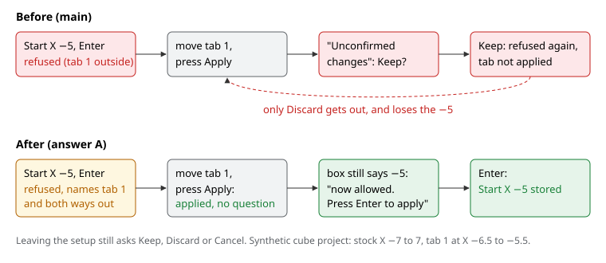
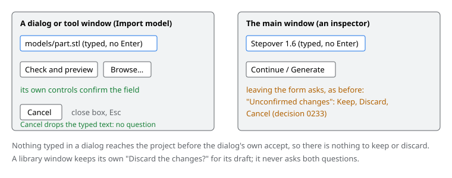

# UI-BUGS-A: A refused setup value never blocks the edit that fixes it, a dialog's own buttons never ask about unconfirmed changes, and Post and export closes with Close (UI-07, UI-08, UI-10, UI-14, SET-09, NFR-07; issues #870, #871, #872; lane UI-BUGS)

- **Status:** Proposed by lane UI-BUGS on 24 Nov 2026, built in the lane's first pull request as the project owner answered the lane's questions on 24 Nov 2026, relayed by the coordinator (decision 0049): Q1 option A (#870), Q2 option A (#871), Q3 option A (#872, the dialog is Post and export), Q8 option A (#870, values kept together are one undoable step). The owner has not yet accepted the record itself (OI-9981).
- **Date:** 24 Nov 2026.
- **Requirements:** UI-07 (validated fields), UI-08 (one undoable command per change), UI-10 (workflow navigation), UI-14 (keyboard), SET-09 (held regions and tabs), NFR-07 (a clear refusal that says what to change), NFR-12 (generated G-code is the user's to verify).
- **Amends:** [decision 0233](0233-unconfirmed-edits-before-leaving-a-form.md) (accepted) items 3 and 4, and the specification's section 8 sentences "This applies to navigation, item or selection changes, generation, opening dialogs, save and close, in inspectors and dialogs alike" and "Each applied project value is one undoable command"; extends [decision 0246](0246-new-project-buttons-resolve-their-own-fields.md) (accepted) from the New project dialog to every dialog and tool window; amends the specification's section 11.6 footer ("Cancel, and Write G-code"). The specification is not edited here: the wording proposed below waits for the owner (OI-9982).
- **Open items:** adds OI-9981 (the owner's acceptance of this record) and OI-9982 (the specification's section 8 and 11.6 wording).

Numbering: provisional. The coordinator assigns the record number and the OI numbers at release, in merge order. No project schema number: nothing stored changes. No library-family API change: `openchuck-project` gains a public function, `openchuck-app` and `openchuck-ui` change, and neither is in the library family.

## Context

Three owner-ordered issues of 23 Nov 2026, each reproduced on `main` with the synthetic cube project of the interface tests (stock a Ø20 cylinder from X -7 to 7, part from X 0 to 10, a 4 mm ball tool), never with a private project.

**#870, sev2: a setup value that conflicts with the tabs soft-locks the setup inspector.** With one tab placed by hand at X -6.5 to -5.5:

1. Start X -5, Enter: refused, rightly (the tab would be outside the stock). The box kept -5 and said "Invalid setup 2cfa3d37-….workholding.tabs[0].x_start: the tab (X -6.500 to -5.500) is not inside the stock (X -5.000 to 9.000). Not applied.": the setup's ID and a field path, and nothing about what to change.
2. Moving the tab in Workholding and pressing Apply raised "Unconfirmed changes" about Start X. Keep checked Start X again, refused it again and returned to the box: the tab was not applied. Only Discard let the Apply through, and Discard threw away the -5, so the value had to be typed again afterwards: the lock the owner reported. Selecting another item or step locked the same way.
3. The check that refused the value on commit was not the one Keep ran first. Keep's preflight applied the typed value to the setup and stopped there; storing the setup also checked the tabs and held regions against the stock (`Project::replace`, `validate_workholding`). So Keep could apply one value and then be refused at the next: with Diameter 18 and Start X -5 both typed, Diameter was applied and Start X refused, against decision 0233 item 4 ("Check all pending entries before applying any").
4. Two values valid only together were refused at the first. Length 1 alone (X -7 to -6) leaves the tab out; with Start X -6.5 the stock is X -6.5 to -5.5, the tab's span. Keep applied the values one at a time, one command each, so the pair could not be kept.

The values and rules that can conflict: a cylinder's Diameter, Length and Start X, and a box's corners, against a tab placed by hand outside the stock, a tab overlapping a held region (the held regions follow the stock's ends), a tab reaching past the stock's radius, a held region longer or wider than the stock, and held regions that overlap. A tab placed automatically follows the stock and is never held against it (decision 0202).

**#871, sev3: dialogs raise Keep or Discard unexpectedly.** A test walked every dialog with a text field: type without Enter, then leave by each of the dialog's own ways out. These asked "Unconfirmed changes", although nothing in the project was unconfirmed: Import model (Cancel, the close box, Check and preview), New operation (Cancel, the close box), Rename (Cancel, and the Rename button itself), and Post and export (Cancel, the close box). Esc never asked (the first Esc ends the edit). The cause: any press other than on another field of the same form counted as leaving the form (decision 0233), and a dialog's buttons are not fields. Decision 0246 had already made an exception for the New project dialog's OK and Cancel.

**#872, sev3: the Post and export dialog's Cancel only closes.** The post, output folder and file names chosen are kept for the next opening, tool numbers already applied stay applied, and the G-code shown was a preview: nothing is cancelled.

## Decision

1. **The setup's check and the change's check are one check (#870).** The checks storing a setup makes of its own values (the material, the frame, the stock and clearance, the clearance rules, and the workholding against the stock) are one public function, `openchuck_project::check_setup_values`, used by `Project::replace` and by the setup inspector. Keep checks the setup with every pending value in it, once, before applying any (decision 0233 item 4). The Enter path checks the setup with the one value.
2. **The refusal names the conflict and both ways out (#870).** In the one form (decision 0536 section 3), for example: "Workholding (setup 'Setup 1'): tab 1 (X -6.500 to -5.500) is not inside the stock (X -5.000 to 9.000). Change Start X, or move or remove tab 1 under Workholding and tabs and press Apply. Not applied." A held region is named "the held region at the start" or "at the end". No ID or field path is shown.
3. **A refused value never blocks the edit that fixes it (#870, the owner's answer A).** A value already refused, shown with its reason and not applied, is not an unconfirmed change for an action of its own form: the Workholding Apply, and any other action a form asks the guard about, goes ahead. The value stays in its box. It is checked again against the setup as it is; once the tabs and held regions allow it, the box says "The tabs and held regions now allow this value. Press Enter to apply it.", and Enter (or Keep) applies it. Nothing is applied without Enter or Keep. Leaving the setup altogether (another item, another step) still asks Keep, Discard or Cancel: Keep is refused with the reason, and Discard restores the stored value.
4. **Setup values kept together are one undoable step (Q8, the owner's answer A).** The values of one setup that Keep confirms together are confirmed in the same frame and stored as one command, "Edit setup 'Setup 1'", which one Undo reverses. A value confirmed with Enter, or by moving to another field, is still its own step.
5. **A dialog's own controls never ask about unconfirmed changes (#871, the owner's answer A; decision 0246 for every dialog).** In every dialog and tool window, a press on any of its own controls (Check and preview, Browse…, Add, Rename, OK, Choose…, its close box) confirms the typed field as moving to another field does; Cancel, the close box and Esc then drop the dialog's input without a question. Nothing typed in a dialog reaches the project before the dialog's own accept, so there is nothing to keep or discard. One window holds fields that do write to the project: the tool library's form for a tool of the project, which applies each value as an inspector does (one undoable command). There Close, like moving to another field, applies the typed value; Esc in the field still puts back the last applied value first. A press outside the dialog, in the main window, leaves its typed field as it was, and a departure from there asks as before. The question stays where it belongs: leaving an inspector with an unconfirmed value (decision 0233, unchanged), and a library window's own "Discard the changes?" for its draft (decision 0127), which a library never asks together with this one.
6. **A question about nothing is not asked.** If every field a request for the question named has been confirmed by the time the question would be shown (a press on a dialog's own control confirms its field in the same frame as that control may ask), the action goes ahead as Keep would let it.
7. **A new dialog joins the walk.** A test walks every dialog with a field; a source scan lists every dialog, tool window and question by file, and the shell's dialogs are placed by an exhaustive match, so a dialog added later is walked or listed with why not.
8. **Post and export closes with Close (#872, the owner's answer A).** The footer reads Close and Write G-code. Close, Esc and the close box keep the choices for the next opening, as before. Every other Cancel in the program cancels something and stays: an import, a new operation, a rename, opening or creating a project, the Replace files question, a library draft, Locate moved project, Turn on adaptive spacing, the selection-clear question and a running job.

### Proposed specification wording (OI-9982; not edited here)

- Section 8, *Committing*: replace "This applies to navigation, item or selection changes, generation, opening dialogs, save and close, in inspectors and dialogs alike. The New project dialog's enabled OK and Cancel buttons themselves accept or discard that dialog's input without this additional question (decision 0246); other departures retain the guard." with "This applies to navigation, item or selection changes, generation, opening dialogs, save and close from an inspector. In a dialog or tool window, its own controls confirm a typed field as moving to another field does, and its Cancel, close box and Esc drop the dialog's input, without this question (decisions 0246 and UI-BUGS-A)."
- Section 8, *Committing*: after "Each applied project value is one undoable command." add "Values of one setup kept together by Keep are one command (decision UI-BUGS-A)."
- Section 8: add "A value refused because it conflicts with another part of the form (a setup value and the tabs) stays in its box with the reason, names the conflict and both ways out, and does not block an action of the form that would resolve it; once resolved, the box says Enter applies it."
- Section 11.6, *Footer*: "Close, and Write G-code (primary) on the right."

## Questions for the owner, and the answers

Asked on 23 Nov 2026 and answered on 24 Nov 2026, relayed by the coordinator.

- **Q1 (#870).** A: a value refused for a conflict never blocks another edit or Apply of its setup, says Enter applies it once the conflict is gone, and leaving the setup still asks. B: store the value and show the conflict as a setup error blocking Generate and Post and export (a change of rule and of the core library). C: offer "Apply and move tab 1 inside the stock" in one step. **Answer: A.**
- **Q2 (#871).** A: every dialog's own controls confirm its field; Cancel, the close box and Esc drop it. B: only the accept and cancel buttons, as decision 0246 did. **Answer: A.**
- **Q3 (#872).** A: only Post and export's Cancel becomes Close. B: keep Cancel and make it put the choices back. **Answer: A**, and Post and export is the dialog meant.
- **Q8 (#870).** A: setup values kept together are one undoable step. B: one step per value in an order that works where one exists. C: leave it. **Answer: A.**

## Consequences

- The lock is gone, and the order of fixing the value and the tab does not matter within the setup, at the cost of one Enter after the tab is applied.
- The setup inspector stores a frame's committed values as one command; before, a frame with several commits from one section kept only the last (a latent loss that Keep's one-field-per-frame order hid).
- A refused value in any form no longer stops that form's own guarded actions (the workholding Apply, a selection set's save, Facing's rows, a dialog's buttons); departures from the form still ask, as decision 0233 says.
- The user guide's pages on unconfirmed changes and on Post and export say the new behaviour; the screens of the Post and export dialog are captured again with Close.

## Verification

Linux container, 4 cores, uninstrumented `cargo nextest`, on branch `claude/lane-ui-bugs-a` rebased on `main` `aa99eab`. Reproduction on `main` with the synthetic cube project of the interface tests (never a private project).

**Tests written first** from the issues, the owner's answers and decisions 0233 and 0246, each seen to fail on `main` first (what failed in brackets), with their times:

- `openchuck-project` `req_set_09_req_nfr_07_the_setup_check_refuses_what_replace_refuses` (0.02 s; the function did not exist).
- `openchuck-app` `setup_form::tests::req_set_09_req_nfr_07_a_value_refused_for_the_tabs_names_the_tab_and_both_ways_out` (0.02 s; did not exist; on `main` the message was "Invalid setup <id>.workholding.tabs[0].x_start: …").
- `openchuck-ui` `shell::setup_conflict_tests`:
  - `req_ui_07_req_set_09_keep_checks_a_setup_value_against_the_tabs_before_applying_any` (1.8 s; on `main` Diameter 18 was applied and Start X -5 refused);
  - `req_set_09_req_ui_07_a_value_refused_for_the_tabs_never_blocks_the_edit_that_fixes_it` (1.8 s; on `main` the Apply asked and Keep was refused);
  - `req_ui_07_req_ui_08_setup_values_kept_together_are_one_undoable_step` (1.2 s; on `main` the pair was refused, and with item 1 alone it was applied as two steps).
- `openchuck-ui` `shell::dialog_walk_tests`:
  - `req_ui_07_req_ui_14_a_dialogs_own_ways_out_never_ask_about_unconfirmed_changes` (4.7 s; on `main` nine ways out in four dialogs asked);
  - the guards `req_ui_07_every_dialog_with_a_field_is_walked` (0.1 s) and `req_ui_07_the_shells_dialogs_with_a_field_are_walked` (0.01 s), which pass on `main` and fail when a dialog is added without being walked or listed.
- `openchuck-ui` `export_panel::layout_tests` (`req_ui_16_export_errors_…` and `req_ui_16_export_files_…`) expect Close (failed on `main`'s Cancel). `shell::import_layout_tests::req_ui_16_the_export_dialog_lays_out_inside_the_window` was updated to the new label.

**Existing tests changed to the owner's rule** (they encoded a dialog's own buttons asking):
- `pending_edit_tests`:
  - `req_ui_07_req_ui_12_req_gc_15_export_writes_and_history_use_the_departure_guard`;
  - `req_ui_07_req_ui_10_req_nfr_07_keep_of_a_hidden_field_preserves_drafts_and_allows_recovery`, now a field hidden without a press in the dialog, which still asks and still finds the field not shown;
  - `req_ui_07_req_ui_08_req_tl_07_project_tool_close_keeps_through_a_command`;
  - `req_ui_07_req_nfr_07_keep_checks_tool_constraints_before_applying_any_field`, which now leaves the window through the main window;
  - `req_ui_07_discard_uses_this_dialogs_original_after_an_earlier_edit_was_reverted`, now through Esc;
  - `req_ui_07_project_folder_browse_takes_the_typed_text_into_the_native_dialog`;
  - `req_ui_07_req_ui_08_new_operation_add_takes_the_typed_name`;
  - `req_ui_07_req_tl_01_req_tl_07_cleanup_takes_pending_library_fields_without_saving`;
  - `req_ui_07_req_tl_07_keep_a_library_field_does_not_silently_save_the_draft`;
  - `req_ui_07_req_tl_01_library_save_resolves_the_active_field_first`.
- `strategy_picker_tests`:
  - `req_ui_07_req_ui_08_picker_cancel_drops_the_typed_name_without_asking`;
  - `req_ui_07_req_tl_01_creation_library_handoff_keeps_the_name_without_asking`.
- `four_step_tests`: the export footer is Close.

**Suites.**
- `openchuck-ui`: 759 tests, all pass (the longest is the existing playback test at about 70 s; no new test over 10 s).
- `openchuck-app` and `openchuck-project`: 1,106 tests, all pass.
- `cargo clippy --workspace --all-targets` is clean.
- `cargo xtask deps`, `licences`, `records` and `trace` pass.

**Coverage** (local, `cargo llvm-cov nextest --profile coverage` on the tests of the changed areas). Of the changed lines, those not run are:
- the downcast failures in `pending_edits.rs` ("The form changed", defensive);
- the refused combined command in `shell/inspector.rs` (defensive: Keep's check runs first);
- in `setup_form::refusal`, a refusal that is not a value refusal and a tab refusal whose reason does not start "the tab" (defensive);
- `check_setup_values`' empty-material check, which other tests run.

**Screens.** Re-captured with the release build on Xvfb with Mesa lavapipe at 1920 x 1080:
- the tutorial at `7e341ed`;
- the flutes and scallop examples at `5df50e8`.
The footer reads Close in tutorial figures 16 and 17, flutes 04, and scallop 02 and 04 (looked at).

**Not verified.**
- No Windows or macOS run.
- The machine library's form is not walked by a test; it uses the same mechanism as the tool library.
