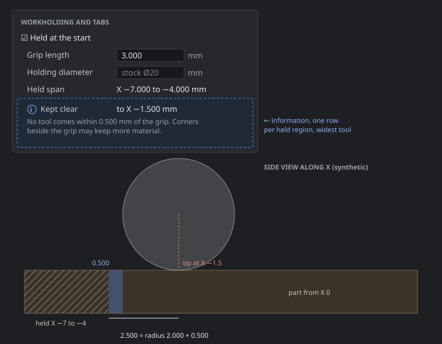

# UI-BUGS-B: A refused Generate shows only its refusal, a deleted project's recovery line can be forgotten, and the held-region note is information shown in the setup too (UI-12, UI-25, PRJ-08, SET-09, NFR-07, NFR-12; issues #766, #681, #774, with #607, #874, #767, #609 and #824; lane UI-BUGS)

- **Status:** Proposed by lane UI-BUGS on 24 Nov 2026, built in the lane's second pull request as the project owner answered the lane's questions on 24 Nov 2026, relayed by the coordinator (decision 0049): Q4 option A (#766), Q5 option A (#681), Q7 option A (#774) as information, not a warning, with the setup row the owner approved with one wording edit. The owner has not yet accepted the record itself (OI-9984).
- **Date:** 24 Nov 2026.
- **Requirements:** UI-12 (results and messages), UI-25 (workholding in the interface), PRJ-08 (recovery), SET-09 (held regions), NFR-07 (clear messages), NFR-12 (generated G-code is the user's to verify), GC-07 (a run's output follows its project).
- **Amends:**
  - [decision 0519](0519-results-in-the-lower-dock.md) (accepted), for a failed run: the Results tab shows the refusal alone;
  - [decision 0460](0460-recovery-offered-only-for-the-opened-project.md) (accepted) item 1 ("Nothing is deleted. The line stays until that project is opened"): the line of a project whose folder is gone can be forgotten;
  - [decision 0536](0536-message-levels-operation-reference-and-setting-links.md) (accepted) build step 2, the owner's row P65 of the message review (`docs/message-review/path.md`, KEEP-WARNING): the held-region note is information;
  - the held-region note's words quoted in [decision 0161](0161-tools-keep-clear-of-the-gripped-length.md) items 3 and 7 and [decision 0551](0551-the-held-regions-own-end-is-not-a-shoulder.md), which stay as history.
- **Open items:** adds OI-9984 (the owner's acceptance of this record).

Numbering: provisional. The coordinator assigns the record number and the OI number at release, in merge order. No project schema number: nothing stored changes. Library family: `openchuck-path` changes the held-region note's level and words, with no public API change and no version bump (its `CHANGELOG.md` says so).

## Context

Issues of milestone 2026.2, each checked on `main` (`aa99eab`) with the synthetic cube test project or the public baluster example, never a private project.

- **#766.** After a refused Generate, Results showed the error, then "The project has changed since this run. Generate again.", then the previous run's summary (operations, moves, time) and all its warnings, as if they belonged to the refused run; the tab's count included the old warnings, and Copy all copied the old summary with the error.
- **#681.** A project deleted after an unexpected close left a Messages warning at every launch ("recovery data was kept for a project last in …, but it is not there now"), with only Locate folder. The recovery data lived in the deleted folder; only this computer's note of it was left, and nothing removed it.
- **#774.** The held-region note, "Nothing within one tool radius of the held region … is cut", understated the zone: every tool keeps its largest radius and 0.5 mm from the grip (`HELD_CLEARANCE`, decision 0161), and an inside corner beside the grip can keep more. It was a warning, so an operation that did what the setup asked was marked amber.
- **#607 and #874.** Hiding a toolpath with its eye stored the choice in the project (decision 0169 item 6), and Results and the output steps compared whole projects, so Results said the run was out of date, and Write G-code was refused with "the project changed after the files were made" (#874, sev2), although the export dialog, which compares with `Project::same_output`, called the files current.
- **#767.** The head and tail zone lines and the tab rows' zone names were worked out from the stored held regions, so a grip typed before Apply left a stale zone.
- **#609.** The Geometry section's indented rows (the Cut short / Warn only / Ignore row, the limits, warnings and notes) started with a space inside a wrapping row, so a wrapped line began left of the label column.
- **#824.** The machine profile comparison called any difference in the rotary reference point "axis height"; a profile whose Y differed was said to differ in its axis height.

## Decision

1. **A refused Generate shows only its refusal (#766, the owner's answer A).** The Results tab shows the refusal and nothing of the previous run: no summary, no lines, no "has changed" line, and the tab's count is the refusal alone; Copy all copies the refusal. The view keeps the previous paths, marked out of date as before.
2. **A deleted project's recovery line can be forgotten (#681, the owner's answer A).** The line's Locate dialog has **Forget this project**: this computer stops looking for that project, and its line goes for good. Only this computer's note is removed; nothing else is deleted (the recovery data was inside the project's folder). A folder that still holds that project's recovery data is not forgotten: that project is opened to recover or discard it.
3. **The held-region note is information, and says what the tool keeps (#774, the owner's answer A).** An operation whose path a held region cut short gets, at the information level: "Held region (operation 'Finish'): no part of the tool comes within 0.500 mm of the held region at the start of the stock, so the surface beside it is not cut there, and corners beside it may keep more. The setup's Workholding section shows where the tools keep clear." It does not make the operation a warning, is not counted as one, and is not acknowledged at export. The note on holes not drilled beside a held region stays a warning.
4. **Each held region says where the tools keep clear (#774, the owner's approved design).** In the setup's Workholding and tabs section, each held region's block has a read-only row after Held span, "Kept clear: to X −1.500 mm" (at the start; "from X …" at the end), from the widest tool of the setup's operations (its cutting profile or its shank) and the 0.500 mm every tool keeps, as the operations do, and under it: "No tool comes within 0.500 mm of the grip. Corners beside the grip may keep more material." It follows the draft as it is typed. With no tool yet it says "Depends on the tools".
5. **Hiding a path changes no output, everywhere (#607, #874).** Results, the G-code preview and the output steps compare a run's project with `Project::same_output`, as the export dialog already did, so hiding or showing a path neither makes the run out of date nor refuses Write G-code.
6. **The zone lines follow the draft (#767).** The head and tail zone lines and the tab rows' zone names use the draft's held regions; the default tabs offered still follow the stored held regions (they are worked out by the part's facts job).
7. **Wrapped rows stay in the value column (#609).** Every indented row of the Geometry section wraps inside the value column.
8. **The comparison names the coordinate (#824).** A difference in the rotary reference point reads "rotary reference X", "rotary reference Y" or "axis height" (its Z), as the machine editor names them.

## Questions for the owner, and the answers

Asked on 23 and 24 Nov 2026 and answered on 24 Nov 2026, relayed by the coordinator.

- **Q4 (#766).** A: show only the refusal. B: keep the previous run's results under "From the previous run". **Answer: A.**
- **Q5 (#681).** A: a Forget action on the line. B: drop the line automatically once the folder is missing. C: dismiss it for this session only. **Answer: A.**
- **Q7 (#774).** A: reword now, after #866. B: later. **Answer: A, as information rather than a warning, and shown in the setup's held region section too;** the owner approved the design with the row's note "No tool comes within 0.500 mm of the grip. Corners beside the grip may keep more material." and without per-tool distances.

## Consequences

- A project whose only warning was the held-region note now shows **Nothing to report** instead of **Needs attention**, and the Results and Messages warning counts drop by one per such operation. The user guide's pages and screenshots that showed the note as a warning, or counted it, are updated and captured again.
- Results never presents a refused run with the previous run's figures.
- The command line prints the held-region note as `note:`, not `warning:`.

## Verification

To be completed before the pull request is marked ready. Tests written first from the issues and the owner's answers, each seen to fail on `main` first, are listed in the pull request and copied here when it is released.
