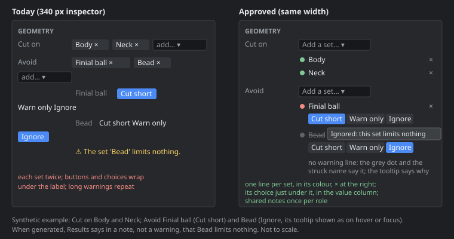

# UI-BUGS-C: The operation's Geometry section shows each selection set once, on its own line, with its choice and its warning under it (UI-07, UI-16, OP-02, OP-21; issue #759; lane UI-BUGS)

- **Status:** Proposed by lane UI-BUGS on 24 Nov 2026 for the project owner's approval of the design, as the owner asked on 24 Nov 2026 (relayed by the coordinator, decision 0049: Q6 option A, "design first"). Nothing is built until the owner approves it (OI-9983); the build follows as the lane's third pull request, after lane FACEFLOW's pull request #854, which changes the same section, has merged.
- **Date:** 24 Nov 2026.
- **Requirements:** UI-07 (the inspector's fields and choices), UI-16 (the reference screens: nothing cut off or overlapping at the inspector's widths), OP-02 (selection sets in an operation's roles), OP-21 (Avoid and Check, and what a set limits).
- **Amends:** the layout of the Geometry section that [decision 0215](0215-selection-sets-in-the-inspector-and-direct-set-editing.md) and the specification's section 11.4 describe; the roles, the choices and every message stay as they are. [Decision 0440](0440-inspector-label-and-entry-widths.md) (the label column) is followed.
- **Open items:** adds OI-9983 (the owner's approval of this design).

Numbering: provisional. The coordinator assigns the record number and the OI number at release, in merge order. No project schema number and no library change: only how the section is drawn changes.

## Context

Issue #759 (user report, Windows, 0.54.0): with several selection sets in an operation's roles, the Geometry section is "very messy". On `main` (`aa99eab`), the section draws, for each role (Cut on, Contain within, Avoid, Check):

1. one wrapped row: the role's name in the label column, then a small button per set ("name ×") and an "add…" list. When the buttons do not fit, they wrap to the next line at the pane's left edge, under the label;
2. for each set in Avoid or Check, a second row: the set's name again, muted, then Cut short, Warn only and Ignore. This row wrapped left of the label column too (#609, fixed in the lane's second pull request);
3. under each set, its own warnings: "The set 'X' limits nothing." for Ignore, and the long note on Warn only's sampling, repeated for every set on Warn only;
4. the role's refusals and each set's reach notes, with their links.

So each set in Avoid or Check is named twice, the buttons wrap under the label, and a note shared by every set on Warn only is repeated. The left half of the diagram shows it with a synthetic example at the inspector's 340 px.

## Proposed design (for the owner's approval)

1. **Each role on one line:** its name in the label column and an "Add a set… ▾" list in the value column, as the list is today.
2. **One line per set, under its role, in the value column:** the set's colour, its name, and × at the right end to take it out of the role (the button's tooltip as today: "Take it out of this role"). A set that is missing or has elements not found keeps its red border and reason, on its line.
3. **A set's choice under its name:** for Avoid and Check, Cut short, Warn only and Ignore, segmented, just under the set's name, in the value column. For Contain within on swarf, Limits the pass and Limits the tip stay on the role's own line, as they concern the role.
4. **A set's own warning once, under it:** "Limits nothing." for Ignore (the set is named by its line), a problem, and its reach notes with their links.
5. **A note shared by the role once per role:** Warn only's sampling note is shown once under the role when any of its sets is on Warn only.
6. **Nothing wraps left of the value column**, at any inspector width (the lane's second pull request already makes wrapped rows stay in the value column, #609).

The roles, the choices, what each does, every message's words and the keyboard order (role, its list, then each set's line from left to right) do not change; only where they are drawn does.

## Questions for the owner

- **D1.** The layout above (A, recommended), or keep today's layout and only stop the buttons wrapping under the label (B)?
- **D2.** Each set's line shows its colour dot (A, recommended: the colour the view draws the set in, decision 0216), or its name only (B)?

## Consequences

- About seven pages of the user guide show this section (the operations reference, the selection-sets, swarf, face flow and limit-to-a-region examples and how-to); their screenshots are captured again in the build, and their text is checked.
- The inspector's layout tests gain a case with several sets per role at 340 px and at the default width.

## Verification

None yet: a design for approval. The build's tests are written first from this record once it is approved.
