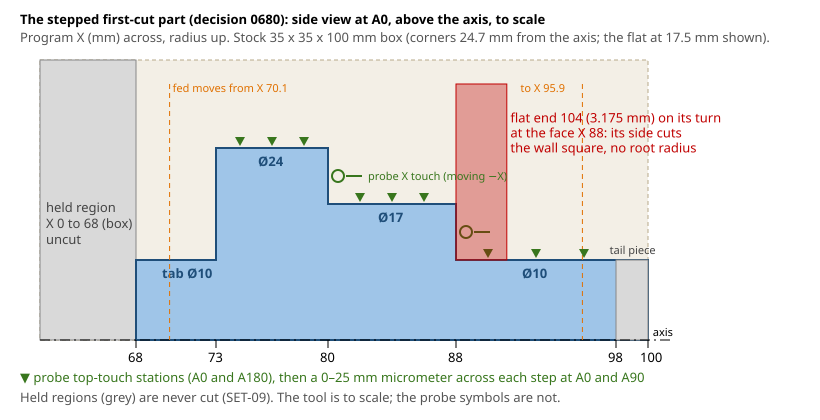

# Makera Z1 gates 4 and 5: step-by-step test instructions

**Status: results integrated; PR #284 merged by the Merge Manager on 26 Oct 2026 (lane GATES).** The results (passes, failures, waivers and missing evidence, recorded separately) were moved on 1 Nov 2026 to the [archive copy](archive/0244-z1-gates-4-5/z1-gates-4-5-results-and-review-record.md); its section 10.11 records complete-record acceptance of 0244 and the final CI disposition. Decisions 0221, 0222, 0232 and 0244 are accepted; remaining physical gaps and waivers are unchanged.

**Generated G-code is the user's to verify before running on a machine (NFR-12).** OpenChuckCAM does not say that a program is safe or correct for any machine, tool or setup, and nothing in this document says otherwise. Passing gates 1 to 3, a clean simulation or a step of these instructions lowers the risk; it does not remove it. You, the operator, decide whether a program runs, and you can stop at any point.

## 1. What this document is for

Gates 4 and 5 are the two hands-on G-code gates of [verification plan section 6](verification-plan.md): gate 4, the **air cut** (the Z1 runs the program with no tool and no material, attended, at reduced feed), and gate 5, the **first cut** (soft, low-cost material, attended, then compared with the model). They are slice 20 item 11 of the [work breakdown](work-breakdown.md), a manual release-checklist step owned by the owner ([decision 0106](decisions/0106-air-cut-is-a-manual-release-step.md)), and the review checklist’s "Gates 1 to 4 have passed for the reference job set and gates 1 to 5 for the first-cut project, with results stored, and the G93 result is recorded" (accepted decision 0221).

This document turns them into steps that someone who is not a machinist can follow, each with what to do, what to expect, what to record and when to stop. It builds on, and does not replace, two documents the owner has already reviewed (14 Oct 2026, OI-133):

- the [safe-practice checklist](z1-safe-practice-checklist.md): complete its section 1 at the start of every session, section 2 before gate 4, section 3 before gate 5 and section 4 after every run;
- the [air-cut procedure](z1-air-cut-procedure.md): its steps 0 to 7 are the run order of gate 4 (section 4.4 below). Its step 3 is corrected to time a whole operation (OI-910, section 4.5).

Gate 4 runs the reference job set of [reference-jobs.md](reference-jobs.md) on the Makera Z1 post, and the first-cut project's program. Gate 5 cuts the first-cut project of section 5.2 (OI-914), not the reference job set (decision 0221).

**Step IDs.** Every step has an ID (P1 to P10, R1 to R12, S1 to S8, G4-0 to G4-8 and B1 to B14 for gate 4; F1 to F6, G0, W1 to W5, T0 to T5, V1 to V6, M1 to M6, C1 to C7, I1 to I5 for gate 5). Results are recorded against these IDs on the forms of section 8 and, once the owner has submitted them, written into a results record built from the [template](templates/z1-gate-results-record.md) step by step (the first run's results are in the [archive copy](archive/0244-z1-gates-4-5/z1-gates-4-5-results-and-review-record.md)), so each instruction can be read beside what happened when it was run.

| Rule ([verification plan section 6](verification-plan.md)) | Applies to |
| --- | --- |
| Attended for the whole run, emergency stop within reach | Gates 4 and 5 |
| No tool, no material, reduced feed | Gate 4 |
| Soft, low-cost material (wax or foam) | Gate 5 |
| Work offsets and stock position checked by hand | Gates 4 and 5 |
| Any unexpected motion stops the trial and is logged as a defect with the G-code attached | Gates 4 and 5 |
| A program moves to the next gate only when it has passed the one before; a change to a post or to the kinematics sends the affected programs back to gate 1 | Gates 4 and 5 |

## 2. Words used here

| Word | Meaning |
| --- | --- |
| A axis | The rotary axis. It turns the part about the machine's X axis. A+ turns the top of the chuck toward the front of the machine (-Y), confirmed on the machine (OI-03). A is continuous: it can turn many times. |
| Work zero, G54 | The point the program's coordinates are measured from. For the Z1 post it must be **Y0 Z0 on the A axis centreline** and X0 at the part's model origin (decision 0007, OI-40). |
| Machine coordinates, G53 | Coordinates measured from the machine's own home, not from the work zero. The program's last moves use them (`G53 G0 Z-3`). |
| Axis height | Where the A axis centreline is in machine Z. The profile holds -48.6, measured on the owner's Z1 with Makera's probing routine for the probe as the reference tool (decision 0317; until 30 Oct 2026 an unconfirmed -55, OI-60); measure your own. A wrong value moves every Z the software checks. |
| Safe Z | The height above the axis that rapid moves travel at. The Z1 profile's default is 50 mm above the axis. |
| Rapid (`G0`) | A move at the machine's fastest rate, not cutting. |
| Fed move (`G1`) | A cutting move at the feed in its `F` word. |
| Feed override | A control on the machine that scales the programmed feed, for example to 10 %. |
| Feed hold | Pauses motion; the program can continue afterwards. |
| Emergency stop | Stops everything at once. Use it whenever you are unsure. |
| DRO | The machine's position readout. |
| Unwind | The last A line of a long program, `G92.4 A0 S0`: the controller drops whole turns from its A reading **without moving** (decision 0007). |
| Held region | The length of stock the chuck grips (SET-09). The software keeps every cutting move clear of it (decision 0161). |
| Tab | A short length of stock left uncut to keep the part joined to the stock (OP-21). |
| Deviation | The simulation's comparison of the cut stock with the part: **material left** (positive) and **overcut** (negative, the tool went into the part). |
| Programmed time | The sum of the move times at their programmed feeds, with no acceleration, tool changes or fixturing (decision 0028 item 3). Each operation's comment line gives it as "about N s". |

## 3. What you need

- The release build of OpenChuckCAM (or the build named for the trial) on the computer you use to make the programs.
- A source checkout at the trial's commit, to write the reference job projects (P2), and the first-cut project (5.2).
- The setup sheet (HTML or PDF) written with each program (decision 0189), printed or on screen beside the machine.
- The Makera Z1 with its rotary module and chuck, and its controller software. Know where its emergency stop, feed hold and feed override are before you start.
- A stopwatch (a phone is fine), a camera (a phone is fine), masking tape and a marker.
- For gate 5: tooling board stock 35 x 35 x 100 mm, the tailstock, the 3.175 mm tools agreed with the owner (5.3), a caliper or micrometer, eye and ear protection, and dust extraction or a mask for tooling board dust.
- The results forms of section 8, printed or copied into a file.

## 4. Gate 4: the air cut

Gate 4 passes when, for each program run, the controller accepts every line, raises no alarm, the motion matches what the simulator showed, and the timed move agrees with the predicted time within the band set at the first run ([verification plan section 6](verification-plan.md)). It also records the `G93` result on the installed firmware.

### 4.1 Preparation

Do these at the computer and at the machine before anything moves. Each step has a pass condition. **If a step does not pass, stop and do not run any program** (section 7).

| Step | Do | Pass when | Record |
| --- | --- | --- | --- |
| P1 Software build | Open OpenChuckCAM, choose **Help > About OpenChuckCAM** and press **Copy build information**. Paste it into the results form (section 8.1). From a terminal, `openchuck-cli --version` gives the same text. | The version is the one named for the trial, the commit is shown, and **Uncommitted changes: no** (NFR-16). The About window also shows the notice that generated G-code must be verified by the user. | The pasted build information |
| P2 Project and programs | From a checkout at the commit in P1, write the reference job projects to an empty folder: `cargo run -p openchuck-cli --example sample_projects -- <folder>` (OI-913, OI-920: the project files are committed in `testdata/projects/`, and the generator writes each generated part beside them). Open each folder in the build of P1 and write its G-code and setup sheet with the Makera Z1 post. Compare each program with its golden file in `testdata/golden/reference/`: only the version and operation comment lines may differ. `drilling` and `swarf` are committed whole, with their STEP files (OI-922); opening them needs the build's STEP kernel. | You have the `.nc` file and setup sheet of each job you will run, from the build or commit in P1. | File names, the build or commit, the comparison |
| P3 Machine profile | In the application, open the project's setup and its machine values (or `openchuck-cli machine <project>`). Each value is marked confirmed, vendor-supplied or unconfirmed (UI-13). | The profile is **Makera Z1**. Travel 200 x 200 x 100 mm, feeds 1200 mm/min X and Y, 600 Z, 1800 deg/min A (decision 0647; `M203.1` on the machine prints `A: 30`), A continuous and right-handed about +X. The axis height is the measured value from P8, not the placeholder (OI-60). | Each value, and which are unconfirmed |
| P4 Post | Check the post chosen for export. | **Makera Z1** (files end `.nc`), not the LinuxCNC verification post (`.ngc`). Feed mode: units per minute; the Z1 post never writes `G93`. | Post name |
| P5 Firmware | On the Z1 controller, find the firmware version. | Noted. If it is not 1.1.2, the SP-12 conventions (decision 0007) must be rechecked first: step 1 of section 4.4. | Firmware version |
| P6 Tool and stock | Take any tool out of the spindle. Empty the chuck, or close the jaws on nothing. Clear the bed. | **No tool, no material.** Nothing loose on the bed or in the enclosure. | Photo of the empty spindle and chuck |
| P7 Spindle and tool change | Every generated program has `M5`, `T1 M6` and `S... M3` near its start. Run them **as generated**: the spindle runs with no tool fitted (OI-911, the owner confirms the Z1 spins an empty collet safely) and `T1 M6` runs with no tool, watched, with a hand on the stop (OI-912). Do not edit the program. | The controller accepts `T1 M6` and `S... M3`; what it does on `M6` matches what the owner expects. | What the controller did on `M6`; the spindle ran: yes / no |
| P8 Axis height | Measure the machine Z of the A axis centreline (OI-60). Use **Makera's own work-zero routine** for Y and Z on the axis (OI-917), done before P6 if it needs a tool or probe fitted; the machine (G53) Z of the resulting G54 Z0 is the axis height. If it differs from the profile's value (-48.6 since decision 0317; -55 before), correct the project's machine profile and regenerate (P2). | A measured value is in the profile. | Measured axis height (mm), how it was measured |
| P9 Work zero | Set G54 with **Makera's own routine** (OI-917): Y0 Z0 on the A axis centreline, X0 at the part's model origin, at least 10 mm clear of the jaws (OI-40), and A0. This document does not copy the routine's steps: follow Makera's documentation for the installed firmware. | The DRO in G54 reads Y0 Z0 at the axis centre and X0 where the setup sheet's "Work offset" line says. | G54 X, Y, Z in machine coordinates; which face X0 was taken from; how A0 was set |
| P10 Clearances | With nothing fitted, jog Z to the program's safe Z (Z40 in G54 for the reference jobs since decision 0317; Z50 before) and jog X over the program's whole X range (read it from the program: the smallest and largest X words). Turn A by hand or by jog a full turn. | The spindle nose clears the chuck, jaws and rotary module everywhere along that X range, and safe Z is below the top of Z travel (with the profile's figures, safe Z 40 is machine Z -8.6 with the probe fitted; a longer tool raises the spindle by the difference, decision 0317). | Lowest clearance seen |

### 4.2 Read the program before you run it

Open the `.nc` file in a text editor. You are checking that the program says what you expect. You do not need to understand every number; you do need to understand every **kind** of line. Here is the start and end of `sphere_makera-z1.nc` with what each line means:

```text
(sphere - Setup 1)                      the project and setup the program is for
(OpenChuckCAM <version>)                the software that wrote it; matches P1
G90 G21 G17                             absolute coordinates, millimetres, XY plane
G54                                     use work zero G54 (P9)
(operation Finish, tool T1 3 mm ball, about 76 s)
                                        operation, tool number and name, programmed time
M5                                      spindle stop (before the tool change)
T1 M6                                   tool change to tool 1 (P7, OI-912)
S12000 M3                               spindle on, clockwise, 12000 rpm (P7, OI-911)
G0 X-10.000 Y0.000 Z40.000 A0.000       rapid to the start, at safe Z 40 above the axis
Z12.000                                 rapid down to 12 mm above the axis (still G0)
G1 Z4.177 F150.0                        fed plunge at 150 mm/min (the plunge feed)
X-9.972 Z4.227 A5.000 F565.6            fed moves: X, Z and A together, new F each time
...
G0 Z40.000                              rapid back up to safe Z
G92.4 A0 S0                             the unwind: A reading reset, no motion
M5                                      spindle stop
G53 G0 Z-3                              rapid to machine Z -3 (near the top of travel)
G28                                     return to home (not yet seen on the machine: OI-41)
M2                                      end of program
```

(In the golden files the version and the operation comment read `<version>` and `(operation <id>)`; the programs the application writes give the real values.)

Check each item and tick it on the form (section 8.1):

| # | Look for | Expect | Stop if |
| --- | --- | --- | --- |
| R1 | The first two comment lines | The project and setup you meant; the version from P1 | A different project, setup or version |
| R2 | `G90 G21 G17` then `G54` | Exactly these, before any motion | Missing, or `G20` (inches) or another work offset |
| R3 | No `G93` anywhere | None: the Z1 ignores it (decision 0007) | Any `G93` |
| R4 | Each `(operation ...)` comment | The operations you expect, in order, each with its tool and "about N s" | An operation you did not expect, or one missing |
| R5 | Tool changes `M5` then `T<n> M6` | One before each change of tool; the number matches the setup sheet's Tools table (GC-14) | A tool number you did not confirm, or `M6` without `M5` before it |
| R6 | Spindle `S<rpm> M3` | After each tool change; the speed matches the setup sheet's **Spindle rpm**, and its **Speed from** column says where it came from: "operation" (set on the operation) or "tool data: <material>" (the tool's cutting data for the stock material) (decision 0196, OI-755). Within the Z1's spindle range (the manufacturer's figure) | A speed of 0 or none, a speed outside the spindle's range, or a source you did not expect |
| R7 | The first rapid `G0 X.. Y.. Z.. A..` | At safe Z (Z40 for the reference jobs since decision 0317), Y0 | A first rapid below safe Z |
| R8 | Every other `G0` | Either at safe Z, or the rapid down from safe Z to just above the stock (for the sphere, Z12: the stock radius is 11 mm) | A rapid at a Z inside the stock radius (setup sheet's Stock line, diameter / 2) |
| R9 | The first `G1` after each rapid down | A plunge with the plunge feed (150 for the reference jobs) | A plunge with a large F |
| R10 | `F` words | Present on the first `G1` and whenever the feed changes. On the Z1 the F of a move that turns A is **not** the cutting feed: the post chooses it so the Z1's feed rule gives the right speed at the contact (decision 0007), so it varies line to line (565.6, 568.6, ...). The reference jobs' largest F is 1190.6 | An F above 1200 (the X and Y limit) on a move with X, Y or Z: see OI-267 for A-only moves |
| R11 | A words | A grows steadily through a helical pass (the groove reaches A5400, 15 turns) and the program ends with `G92.4 A0 S0` after a retract to safe Z | A jump of many turns in one line, or an unwind before the tool is at safe Z |
| R12 | The end block | `M5`, `G53 G0 Z-3`, `G28`, `M2`, in that order | Anything else, or a missing `M5` |

Then read the **setup sheet** for the same run (decision 0189 writes it with the G-code, so they describe the same run):

| # | Look for | Expect |
| --- | --- | --- |
| S1 | Traceability block | Generated time (UTC), project last saved, **Software version** matching P1, the project fingerprint (decision 0207). Copy the fingerprint to the form. |
| S2 | Job: machine | Makera Z1 |
| S3 | Setup: work offset | "G54, work zero at model X ... mm on the rotary axis": this is the X0 for P9 |
| S4 | Setup: stock and material | The stock shape, size and X range; the material name |
| S5 | Tools | Each tool's number, type, diameter, flute and overall length |
| S6 | Operations | Spindle rpm and Speed from (R6); Time per operation matches the "about N s" comments (R4) |
| S7 | Notes | The statement that generated G-code must be verified by the user before it is run |
| S8 | Setup: Held at the start, Held at the end, Tabs, and the table "Tabs: <setup>" | The held regions (length, X range, section or holding diameter) and each tab (X from and to, shape, diameter, layout, placed by hand or automatically) as you expect (OI-918) |

### 4.3 Safeguards for every run

**Reported controller discrepancy (25 Oct 2026):** the owner says the minimum available override was 50%, and used 50% then 100%. The accepted checklist and OI-919 choice below still require 10%. The submitted outcome does not authorize a standing change to that policy. If the controller cannot meet the instruction, stop for the owner’s disposition (OI-471); the actual trial settings remain in section 10.

- Feed override at **10 %** for the first run of each program (air-cut procedure).
- Your hand near the feed hold and the emergency stop for at least the first 20 lines, and in reach for the rest.
- No single block (OI-919, the owner's answer): the first moves run at 10 % with your hand on feed hold.
- The enclosure closed. Watch through it; do not reach in while anything can move.
- A strip of tape on one jaw so you can see A turn.
- Film each run if you can (the first 20 lines and the end block at least).

### 4.4 Run order

Follow the [air-cut procedure](z1-air-cut-procedure.md) steps 0 to 7 in order, with these additions (step G4-n here is the procedure's step n):

| Step | Program | What to watch | Pass when |
| --- | --- | --- | --- |
| G4-0 | Read `sphere_makera-z1.nc` (section 4.2) | | Every R and S item ticked |
| G4-1 | SP-12 conventions program (`spikes/sp12/AIR-CUT.md` on `spike/sp-12-z1-conventions`), only if the firmware is not 1.1.2 | Direction, wrap, feed rule as decision 0007 records | The results match decision 0007 |
| G4-2 | `sphere_makera-z1.nc` at 10 % | The first rapid goes to safe Z before any other motion. X, Z and A move together during the pass. The tape turns the way the A words say (A+ turns the top toward the front). The end block: up to Z near the top, then `G28` (watch where it goes and write it down: not yet seen, OI-41) | No alarm, no line refused, the motion looks like the simulation's playback of the same program, the machine ends where the program says |
| G4-3 | Timed operation on the sphere (section 4.5) | Stopwatch from the start of the plunge to the end of the last fed move | Measured time within the band agreed at this first run of predicted time = "about N s" x 100 / override |
| G4-4 | `cone_makera-z1.nc` at 10 % | Z changes steadily with X | As G4-2 |
| G4-5 | `groove_makera-z1.nc` at 10 % | About 15 turns of A, then the unwind. **At `G92.4 A0 S0` A must not move**; the DRO's A reading changes to the remainder. Note the DRO before and after | As G4-2, and A does not move at the unwind |
| G4-6 | `G93` recheck (SP-12 test T5) only if the firmware is not 1.1.2 | | The result is recorded (verification plan section 6, feed mode) |
| G4-6b | OI-267: an A-only fed move with an F above 1200 | The test program is not written yet; the owner asked for the test on an air cut before the first release (17 Oct 2026). Run it only once it is written and read like any other program | The controller's behaviour (clamps, refuses or runs it) is recorded in OI-267 |
| G4-7 | Raise the override (25 %, 50 %, 100 %) on the sphere only | Only if steps 2 to 5 had no surprise and you agree | As G4-2 |
| G4-8 | The block-rate air cut (section 4.8; decision 0222, accepted; OI-930) | Fourteen sections of 100 mm of X, each started by a 5 mm Z bob | Each section as in 4.8; **run only after K1 to K4 have passed** (decision 0232) |

The other reference programs (`lobed`, `cone_axial`, `cone_indexed`, `cone_axial_lead`, `cone_held_tabs`, `drilling`, `swarf`) and the first-cut project's program (5.2) are run the same way as G4-2 once G4-2 to G4-5 have passed. `lobed` is the one program that moves X, Y, Z and A together; `drilling` turns A to -30 and has no unwind; `swarf` turns to three A positions.

### 4.5 The timed operation (OI-910)

The verification plan asks for a simultaneous XYZA move whose measured time is compared with the predicted time under the Z1's feed rule. No single move in the reference programs is long enough to time by hand: computed from the golden programs with decision 0007's rule, the longest move that turns A while X, Y or Z also move takes about 0.13 s at 100 % feed (`groove`), 1.3 s at 10 %. The program header states no predicted total, and `openchuck-cli gcode-sim` gives no time per Z1 move.

So, as the owner decided (OI-910, option A), **time a whole operation**, which is a long run of such moves:

1. Find the operation's comment line, `(operation <name>, tool T<n> <tool>, about N s)`. N is the programmed time of its fed moves at 100 % feed.
2. Predicted time = N x 100 / override. At 10 % that is ten times N: about 760 s (12.5 minutes) for the sphere's N of about 76.
3. Start the stopwatch when the plunge (the first `G1` after the rapid down) starts, and stop it when the last fed move ends (the `G0` up to safe Z starts).
4. Ratio = measured / predicted. At this first run, agree the band with the owner (the SP-12 run confirmed the rule within about 10 %), write it on the form, and use it for every later run.

Rapids are not in N, and the feed override does not scale them, so they are not timed.

### 4.6 Gate 4 pass and fail

- **Pass** for a program: every preparation step passed; every R and S item ticked; no alarm; no line refused; the motion matched the simulation; A did not move at the unwind; the end position matched the program; the timed operation was within the agreed band (G4-3).
- **Gate 4 passes** when every program of the reference job set chosen for the release, and the first-cut project's program, has passed, the `G93` result on the installed firmware is recorded, and the block-rate air cut (4.8) has been run and recorded.
- **Fail**: any unexpected motion, alarm, refused line, or a step that does not pass. Follow section 7. Do not go on to gate 5 with that program. A change to the profile, the post or the kinematics sends the affected programs back to gate 1.

### 4.7 What to keep from gate 4

- The filled results form (section 8.1), one row per run.
- The build information (P1), the firmware version and the axis height measurement.
- The exact `.nc` files run and their setup sheets.
- Photos: the empty spindle and chuck (P6), the DRO at work zero (P9), the DRO before and after each unwind.
- Videos of the runs, if taken.
- Any defect raised (section 7), by issue number.

Attach them to one GitHub issue for the gate 4 result (section 7.2), so the verification report (slice 20 item 13) can cite it.

### 4.8 The block-rate air cut (decision 0222, OI-930)

The owner added this measurement to gate 4 (22 Oct 2026, relayed by the coordinator). It is lane SHORTMOVE's [decision 0222](https://github.com/OpenChuckCAM/OpenChuckCAM/pull/315) item 7, which is **proposed**: the specification below is copied from it, not invented here. It measures how short a block the Z1 can run at full speed. Its result sets the Z1 profile's `min_block_ms`, with a block window of 32 blocks; **the Z1 profile ships with the minimum-block-time check off until this has been run** (OI-930).

**Check it first, as SP-12 was (OI-925, the owner's option A; [decision 0232](decisions/0232-block-rate-program-checked-as-sp-12-was.md), accepted).** The program is written by a script on the spike branch, not by the application's post, so gates 1 to 3 have not checked it. Verification plan policy 6 excepts only the SP-12 conventions program; decision 0232 extends that exception to this program, on the checks K1 to K4 below. Do not run it on the Z1 until K1 to K4 have passed.

| Step | Do | Pass when |
| --- | --- | --- |
| K1 Fetch | From a checkout: `git fetch origin spike/sp-14-short-moves`, then `git show 69d532f:spikes/sp14-short-moves/air-cut/block_rate_z1.nc > block_rate_z1.nc`. | The file has 27,966 lines (`wc -l`) and its first line is `(SP-14 Z1 block-rate air cut - decision 0222)` |
| K2 Read the header and footer | Lines 1 to 5 and the last 5 lines. | Header: the two comment lines, `G90 G21 G17`, `G54`, `G0 X0.000 Y0.000 Z50.000 A0.000`. Footer: `G0 Z50.000`, `G92.4 A0 S0`, `G53 G0 Z-3`, `G28`, `M2`. No `T`, `M6`, `S`, `M3`, `G93` or `G4` anywhere (`grep -nE 'T[0-9]\|M6\|S[0-9]\|M3\|G93\|G4' block_rate_z1.nc` finds only the `S0` of `G92.4 A0 S0`) |
| K3 Read one section of each part | Section 1 (part A, from the line `(section 1: ...`) and section 8 (part B, `(section 8: ...`): its marker and its first and last ten lines. | Each section starts `G1 Z55.000 F1000.0`, `G1 Z50.000 F1000.0`; every other line is `G1` with X, Y0.000, Z50.000, A and F1000.0. X steps by the block length (0.333 mm in section 1) and stays within 0 to 100; Y stays 0 and Z 50. In part A A stays at its value; in section 8 A grows by about 0.209 degrees a block (0.628 per mm) |
| K4 Gate 3 on a LinuxCNC copy | Make the copy without the Z1 footer: `sed -e '/^G92.4 A0 S0$/,$d' block_rate_z1.nc > block_rate_linuxcnc.ngc` and `printf 'M5\nM30\n' >> block_rate_linuxcnc.ngc`. Build the LinuxCNC image once (`docker build -t openchuck-linuxcnc docker/linuxcnc`), then `cargo xtask replay --docker openchuck-linuxcnc block_rate_linuxcnc.ngc` (about 2 minutes, in real time; see `tools/linuxcnc/README.md`). | The replay reports every move reached and no fault, and the program ends where the replay says, as for the golden programs |

**The program.**
- `spikes/sp14-short-moves/air-cut/block_rate_z1.nc` on the branch `spike/sp-14-short-moves` (commit `69d532f`; a spike branch is never merged), written by `python3 -I gen_block_rate.py > block_rate_z1.nc` beside it. It is 1,170,259 bytes, over the 1 MiB a file of `testdata/` may hold (decision 0004), so it is not copied here.
- 27,966 lines; the longest is 50 characters, under the firmware's 63-character limit (OI-933).
- Header `G90 G21 G17`, `G54`, then `G0 X0 Y0 Z50 A0`. Footer `G0 Z50`, `G92.4 A0 S0`, `G53 G0 Z-3`, `G28`, `M2`, as the Z1 post writes it (decision 0007). No tool change and no spindle.

**The sections.**
- Fourteen sections, each 100 mm of X at F1000 (6.0 s nominal), made of equal collinear `G1` blocks of one block time: 20, 10, 7, 5, 3, 2 and 1 ms (blocks of 0.333, 0.167, 0.117, 0.083, 0.050, 0.033 and 0.017 mm; 300 to 6,000 lines a section).
- **Part A**, sections 1 to 7: X only. **Part B**, sections 8 to 14: the same, with A advancing 0.628 degrees per mm of X in every block (at Z50), so X still sets each block's time.
- Every section is longer than the 224-line receive buffer plus the 32-block queue. Sections alternate direction (X 0 to 100, then back) to stay within 100 mm of X.
- Each section starts after a marker: `G1 Z55 F1000`, then `G1 Z50 F1000`, a visible 5 mm bob of 0.6 s. There is no `G4` dwell (OI-937).

**Predicted section times** (inference from the firmware source, decision 0222): 6.0 s for 20, 10, 7, 5, 3 and 2 ms; **7.9 s for 1 ms** (the 32-block queue limits the speed of very short blocks). Starting and stopping add about 0.1 s.

**Setup and safety.** Gate 4 rules: no tool, no material, attended, emergency stop in reach. The gate 4 work offset (G54, Y0 Z0 on the A axis), with X0 placed so that X 0 to 100 at Z50 is clear travel. About 2 minutes of motion (92 s fed).

| Step | Do | Pass when |
| --- | --- | --- |
| B0 | Record the firmware version, the controller (ESP32) version, and how the file reached the machine (WiFi upload, USB); play it from the machine. Start a phone video with sound. | Recorded |
| B1 to B14 | For each section: start the stopwatch as Z comes back down to 50 after the bob, stop it as the next bob starts. Listen for stutter, watch for a pause. | Within 5 % of the predicted time (6.0 s, or 7.9 s for the 1 ms sections B7 and B14) and no audible stutter or pause |
| B15 | If B1 or B2 (20 ms) or B8 or B9 (10 ms) fails | **Stop the test and log a defect** (section 7): nothing in the analysis predicts it |
| B16 | Work out the result | The shortest block time at which **both parts pass** and every longer block time passes. If every section passes, the result is 1 ms. A 1 ms section near 7.9 s confirms the prediction; one near 6.0 s means the firmware plans differently from its source. Record the result for the Z1 profile's `min_block_ms` (OI-930) |

Section numbers: Part A B1 = 20 ms, B2 = 10, B3 = 7, B4 = 5, B5 = 3, B6 = 2, B7 = 1; Part B B8 = 20 ms, B9 = 10, B10 = 7, B11 = 5, B12 = 3, B13 = 2, B14 = 1.

## 5. Gate 5: the first cut

Gate 5 cuts soft, low-cost material, attended, and compares the result with **the simulated part**. It passes when every measurement of 5.7 is within the first-cut limit of [verification plan 4.1](verification-plan.md) and the findings are recorded.

**The limit:**

| Measured | Limit |
| --- | --- |
| A diameter (micrometer) | ±0.1 mm |
| A radius (probe) | ±0.05 mm |
| A position along X, or a step length | ±0.1 mm |

Each is measured against the simulated part at the same X. The simulation's own deviation from the model is reported beside it.

**Where this comes from:**

- **[Decision 0221](decisions/0221-gate-5-first-cut-project-and-limit.md)** (accepted by the owner, 22 Oct 2026): no 3-axis repeatability part, a ±0.1 mm limit, and a first-cut project in tooling board rather than the reference job set.
- **[Decision 0680](decisions/0680-the-gate-5-reference-part-is-a-stepped-cylinder.md)** (accepted by the owner, 23 Nov 2026):
  - the cone of the rc3 first cut is replaced by stepped cylinders;
  - the part is compared with the simulated part, not the model;
  - the part is measured with the probe in the machine, then with a micrometer;
  - X0 is set from the probed tail end face;
  - the part is finished with the flat end 104, the only tool.

The reasons are in the rc3 test record (issue #586, archived under `docs/archive/0653-release-0-55-verification/`). On the cone, a 1.4 mm error in where the part sat read as 0.56 mm of diameter. The readings could not tell a work-zero error from a size error.

### 5.1 Before gate 5

| Step | Do | Pass when |
| --- | --- | --- |
| F1 | Gate 4 for this program | The first-cut project's own Z1 program (5.2) has passed gate 4 (air cut, no tool, no material, every step of section 4), at the same commit, with the same profile and post. Any change since (the tool, its speeds, the stock): back to gate 1. |
| F2 | Safe-practice checklist section 3 | Every box ticked. Its first-cut limit line reads as above. |
| F3 | Tool change with a real tool | Done: tested attended with a real tool at the rc3 first cut (OI-41, closed; rc3 record E-03). This program has one tool, changed once at the start (`T1 M6`). |
| F4 | First-cut limit | As at the top of this section, on every measurement of 5.7 (decisions 0221 and 0680). |
| F5 | The first-cut project | The project of 5.2 exists and passes gates 1 to 3 like any other program. |
| F6 | The tool and its speeds confirmed with the owner (OI-2197, closed 26 Nov 2026) | The owner has tool 104 to hand and confirmed its "Plastic" preset for finishing as well as roughing (5.3, T0). The project must still hold the tool that is fitted: if another is fitted, change the project and take it through gates 1 to 4 again. |

### 5.2 The first-cut project

**The project.** It is committed in `testdata/projects/first_cut/`, built by `apps/openchuck-cli/tests/e2e.rs` (`build_first_cut`). `cargo run -p openchuck-cli --example sample_projects -- <folder> first_cut` writes it out with its part, `models/part.stl`: open that folder, or cut the model from stock. Its programs are in `testdata/golden/first_cut/`:

- gates 1 and 2 check them in the end-to-end suite;
- gate 3 replays the LinuxCNC program in bounded chunks ([decision 0244](decisions/0244-bounded-first-cut-linuxcnc-replay.md)).

| From X 0 (the head end, the chuck) | What | Source |
| --- | --- | --- |
| X 0 | Work zero X0: the head end of the stock, on the axis. It is set from the probed tail end face (M4) | Owner (decision 0680, Q4, X2) |
| X 0 to 10 | Gripped by the chuck jaws (at most 10 mm) | Owner (OI-914) |
| X 0 to 68 | **One held region at the start, 68 mm, box section** (decision 0160): the 10 mm in the jaws plus 58 mm of free stock left uncut | Owner (OI-914, OI-923) |
| X 68 to 73 | Tab, cylinder 10 mm diameter, 5 mm long, on the axis | Owner (OI-914) |
| X 73 to 80 | **Step 1: cylinder 24 mm diameter**, 7 mm long. Its face at X 73 faces the chuck | Owner (decision 0680, Q1, A) |
| X 80 to 88 | **Step 2: cylinder 17 mm diameter**, 8 mm long. The face at X 80 faces the tailstock | Owner (decision 0680) |
| X 88 to 98 | **Step 3: cylinder 10 mm diameter**, 10 mm long. The face at X 88 faces the tailstock. It meets the tailstock piece flush | Owner (decision 0680) |
| X 98 to 100 | Tailstock piece, 10 mm diameter, 2 mm long: **a held region at the end** (OI-924, option A), so every cutting move keeps clear of it and of the tailstock beyond it (decision 0161). The fed moves stay between X 70.1 and 95.9 | Owner (OI-924) |
| X 100 | End of the stock; the tailstock centre | Owner |



**The rest of the project:**

- **Stock:** box 35 x 35 x 100 mm, X 0 to 100, Y and Z −17.5 to 17.5; material "Plastic".
- **Roughing:** rotary roughing with tool 104.
- **Finishing:** helical, 5 degree steps, with the **same tool 104** (decision 0680, Q5, F2).
- **One tool:** the program numbers it **T1** and changes it once, at the start. There is no second tool.
- **The face turns:** finishing turns A once round, without moving along X, beside each face: X 71.41 (the face at X 73), 81.59 (X 80) and 89.59 (X 88) ([decision 0297](decisions/0297-helix-strategies-turn-at-faces-across-the-axis.md)). The side of the flat end cuts each face square, with no radius at its root.

Read the workholding on the setup sheet (its Setup section's "Held at the start", "Held at the end" and "Tabs" lines and the "Tabs: <setup>" table, OI-918). Check it against the application's **Workholding and tabs** section (specification section 11.7). Write it on the form.

| Step | Check | Pass when |
| --- | --- | --- |
| W1 | Held region at the start: 68 mm, box section | The chuck grips 10 mm or less of it (measure the jaw depth and record it); the rest, X 10 to 68, is free stock left uncut. |
| W2 | The grip warning | No amber warning under **Grip length**. If there is one, it names how much of the part the held region covers (OI-554). With the job at the far end of a 100 mm stock there should be none. |
| W3 | Tab and the tailstock piece | The 10 mm tab at X 68 to 73; "Held at the end" reads "2 mm of the stock, X 98 to 100 mm, at diameter 10 mm" (OI-924). |
| W4 | Setup checks and messages | No error. Read every warning and write it down. The "Tool length" warning (a 30 mm stick-out assumed inside the 45 mm clearance radius) is expected: check the clearance over the chuck and the Z travel by jogging (P10). |
| W5 | Stock and part | Box 35 x 35 x 100 mm from X 0. The setup sheet's Part offset reads "part moved 73 mm", so the steps span X 73 to 98. |

### 5.3 Tool, material and speeds

The Z1 tool library (built-in defaults, `crates/openchuck-project/defaults/z1/`) holds five 3.175 mm tools. Every one has cutting data for **"Plastic"** and **"Softwood"**:

| No. | Tool | Type, flutes | Flute length | "Plastic" preset: rpm, mm per tooth (feed), plunge, stepover, stepdown |
| --- | --- | --- | --- | --- |
| 101 | Z1 O-flute metal 3.175x12 | Flat end, 1 flute | 12 mm | 10000, 0.1 (1000 mm/min), 300 mm/min, 2.2225 mm, 1.0 mm |
| 104 | Z1 O-flute 3.175x25 | Flat end, 1 flute | 25 mm | 10000, 0.1 (1000 mm/min), 300 mm/min, 2.2225 mm, 1.0 mm |
| 105 | Z1 O-flute 3.175x42 | Flat end, 1 flute | 42 mm | 10000, 0.1 (1000 mm/min), 300 mm/min, 2.2225 mm, 1.0 mm |
| 201 | Z1 ball metal 3.175x10 | Ball end, 2 flutes | 10 mm | 12000, 0.0208 (500 mm/min), 200 mm/min, 0.4536 mm, 1.0 mm |
| 204 | Z1 ball 3.175x22 | Ball end, 2 flutes | 22 mm | 12000, 0.0208 (500 mm/min), 200 mm/min, 0.4536 mm, 1.0 mm |

**The project's tool is 104 (Z1 O-flute 3.175x25, single flute, flat end) for both operations** (decision 0680, Q5, F2). This replaces OI-921's finishing tool, 204. Both operations take its "Plastic" preset. The finishing helix's pitch is the preset's stepover, 2.2225 mm.

**Confirmed: the finishing preset (OI-2197, closed 26 Nov 2026).** The owner confirmed 104's "Plastic" preset (10000 rpm, 0.1 mm per tooth, plunge 300 mm/min, stepover 2.2225 mm, stepdown 1.0 mm) for roughing (OI-921) and, on 26 Nov 2026 (relayed by the coordinator), for finishing as well, and said they have tool 104 to hand. If the project is changed to another tool or preset, the owner confirms that one (F6).

**The tool must reach the depth.** The deepest cut, from the box's corners (24.7 mm from the axis) to the tab and step 3 (5 mm), is 19.7 mm. 104 has 25 mm of flute. 101 has 12 mm, which is not enough.

| Step | Check | Pass when |
| --- | --- | --- |
| T0 | **Check the tool with the owner** (OI-2197 is closed: the owner confirmed 104 and its "Plastic" preset on 26 Nov 2026). When the project is generated, show the owner the setup sheet's Tools and Operations tables (number, name, type, diameter, flute length, spindle rpm, Speed from) | The tool fitted is the project's tool (104, or the project has been changed to the tool fitted and has passed gates 1 to 4 again), and the owner's confirmation of its finishing preset (26 Nov 2026, OI-2197) still applies. Record the tool fitted and who checked it, and when. |
| T1 | The tool | One tool, T1, and the tool number matches the program's `T1` (GC-14). |
| T2 | Material | The setup's material is **Plastic**, so both operations take the Plastic preset: the setup sheet's **Speed from** reads "tool data: Plastic" (decision 0196). If an operation sets its own speed, Speed from reads "operation": check the value with the owner. |
| T3 | A tool with no Plastic data | None of the five lacks it. If one is ever used: copy its Softwood data to a new Plastic entry in the tool library; if it has no Softwood data either, **ask the owner before** using settings from a similar tool (OI-915). |
| T4 | Feeds | The program's F words are within the profile's limits (R10); the plunge F matches the preset. |
| T5 | Stick-out | The tool sticks out of the holder at least as far as the deepest cut (19.7 mm) plus a margin, and its flute length covers it. The Z1 measures tool length itself (decision 0007: no `G43`); follow the machine's own procedure. |

### 5.4 Simulate before cutting

| Step | Do | Pass when |
| --- | --- | --- |
| V1 | Run **Simulate** in the application (or `openchuck-cli simulate <project>`), at the default cell (0.1 mm) or finer (0.05 mm runs; 0.025 mm is refused on this stock size) | It completes. No banner saying the result is out of date (decision 0192). |
| V2 | Overcut | No overcut beyond the tolerance, and the command line reports no "OVERCUT" and no rapid move that removes material. An overcut of up to about half the cell on the steps is the simulation's resolution (decision 0680: 0.046 mm at 0.1 mm, 0.023 mm at 0.05 mm). |
| V3 | Material left, and the simulated part at the stations | Write down the largest material left and where it is (the probe and "Go to largest left" show it). Expect about 0.5 mm at the very end of step 3 (X 98, against the held end). With the probe, read the simulated deviation at each station of 5.7 and write it on the form: on the steps it is about 0. The end-to-end test checks a mean within ±0.05 mm. |
| V4 | Held region and tabs | They stay whole in the simulated stock (SET-09, OP-21); the 2 mm tailstock piece is not cut through. |
| V5 | Playback | Play the program through. No fed move goes below X 70.1 or above X 95.9 (decision 0161, OI-924). Finishing turns once round at X 71.41, 81.59 and 89.59. |
| V6 | Keep | A screenshot of the coloured part, the histogram and the worst values, for 5.7. |

The simulation is a check on the program, not a promise about the machine (NFR-12). It does not model the bodies of the chuck, the jaws and the tailstock (the held regions stand for them, SET-09), or the machine's own errors.

### 5.5 On the machine: stock and offsets

| Step | Do | Pass when |
| --- | --- | --- |
| M1 | Measure the stock (35 x 35 x 100 mm), its length to 0.05 mm | It is never larger than the project's stock, and **no more than about 1 mm shorter** than 100 mm (decision 0680, Q4). |
| M2 | Load the stock in the chuck with the gripped length the project says (W1), and bring up the tailstock; tighten both | It does not move when you try to turn or pull it by hand. Turn A by jog a full turn at low feed: it turns true by eye and nothing touches. **Tailstock clearance (OI-924):** jog the tool, in the air, to X 95.9 at the radius of step 3 (5 mm) and up to safe Z, and check that the tailstock's body clears the tool and the holder at both. |
| M3 | Fit the tool (T0, T5) | The tool number in the controller is the program's `T1`. |
| M4 | **Set the work zero.** Y and Z on the A axis by Makera's routine (OI-917) or, as at rc3, from the axis measured with the probe (C2P). **X0 from the stock's tail end face** (decision 0680, Q4, X2; OI-2152), with the Makera 3D Probe: touch the end face moving −X, off the tailstock centre (5.7, probe notes). Then X0 = that machine X − the probe's tip radius (its calibration value) − **100** (the project's stock length). If the probe will not fit between the face and the tailstock centre with the tailstock up, touch the face before bringing the tailstock up (M2), then bring it up. A0 as the routine sets it | G54 Y0 Z0 on the axis centreline and X0 as above. Record on the form: the face touch (machine X), the tip radius used, X0, the measured stock length, how A0 was set, and G54 X, Y, Z in machine coordinates. The machine Z of G54 is the axis height: compare it with the profile. |
| M5 | Check by hand that the first rapid position is clear: jog to the program's first `G0` position in G54 (X, Y0, safe Z, A0) at low feed | The tool is above the stock at the X the program starts at, and clears the jaws and the tailstock body. |
| M6 | Protection | Eye and ear protection on; loose clothing, hair and jewellery secured; dust extraction or a mask for tooling board dust. |

### 5.6 The first cut

- **C1.** Reread the program (section 4.2) one more time. It must be the file you air-cut for F1, unchanged. If the tool, speeds or stock changed, regenerate it, read it again from the start and air-cut it again.
- **C2.** Feed override at 10 %. Hand near feed hold and emergency stop.
- **C3.** Start. Watch the tool change (`M5`, `T1 M6`) and the spindle start (`S10000 M3`). There is no second tool change. The spindle starts again with the same `S10000 M3` at the finishing operation.
- **C4.** Watch the first plunge: the tool comes down at the plunge feed to the first cut, no faster.
- **C5.** Raise the override slowly, only while the cut sounds and looks steady. Record the override steps.
- **C6.** Stop at any unexpected sound, vibration, smell, smoke, or motion (section 7): for tooling board, tearing, the stock moving, or the tailstock piece breaking.
- **C7.** At the end, wait until everything has stopped before opening the enclosure.

### 5.7 Measure against the simulated part

Measure in this order:

1. With the probe, before the stock leaves the machine.
2. With a micrometer, after the stock leaves the chuck, with the part still on it. Do not cut the part off the stock; the tab stays whole.

The measuring points are in program X.

**Stations:**

| Step | Stations (program X) |
| --- | --- |
| Step 1 (24 mm) | 74.5, 76.5, 78.5 |
| Step 2 (17 mm) | 82, 84, 86 |
| Step 3 (10 mm) | 90, 93, 96 |

**Faces for the X touches:**

| Face | Faces | Touch at radius |
| --- | --- | --- |
| X 80 | the tailstock | about 10.25 mm |
| X 88 | the tailstock | about 6.75 mm |
| X 100 (the stock's tail end face) | the tailstock | clear of the tailstock centre |

The face at X 73 faces the chuck, in a groove about 4.5 mm wide, and is not touched.

**Probe notes.** These commands are from the Z1 firmware source and the rc3 C2P notes (rc3 test record part 2). They are **unverified on a Z1**: nothing here says they are safe. Run them attended and stop at anything unexpected.

- Use the Makera 3D Probe, with `M499` and the controller's probe selection.
- Use `G38.2` only, at F 20 to 60. The X, Y and Z words of `G38.2` are relative distances, at most 5 mm, and soft limits are not checked during a probe move.
- Send `M119` before each touch and check it prints `Probe: 0`.
- Read the `[PRB:x,y,z:flag]` reply, in machine coordinates.
- Back off with `G91` and `G0`, then `G90`.
- Turn A only with the probe well above the part, always in the same direction.

| Step | Do | Pass when |
| --- | --- | --- |
| I1 | Look at the part before anything else. Photograph it from four sides (A 0, 90, 180, 270) | The tab and the tailstock piece whole, no marks on the gripped length (decision 0161), no gouges. |
| I2 | **Probe the radii.** At each station, top touches at A0 and A180, three touches each (the mean of the final two slow touches, as C2P). The radius is the mean of the A0 and A180 tops, in G54 Z (G54 Z0 on the axis) | Each radius is within **±0.05 mm** of the simulated radius at that X (the model's radius plus the simulation's deviation read at V3). |
| I3 | **Probe the faces.** Move −X: the face at X 80, the face at X 88, and the stock's tail end face, at the radii above, three touches each. The tip's diameter cancels between touches made in the same direction | The distance from the tail end face to each step face (20 and 12 mm), and the step length between them (8 mm), are each within **±0.1 mm**. Each face's G54 X (the touch less the tip radius) is within ±0.1 mm of 80 and 88. A difference here with the lengths right is a work-zero error (M4), not a size error. |
| I4 | **Micrometer.** With the stock out of the chuck and the part still on it: a 0–25 mm micrometer across each step at the middle station, at A0 and at A90. Record the instrument and its resolution | Each diameter is within **±0.1 mm** of twice the simulated radius. The probe and the micrometer agree within about 0.02 mm on a radius. A larger difference is a finding: the probe's axis Z, or the probe itself. |
| I5 | Lengths and the tabs | The tab is 10 mm in diameter at X 68 to 73 and the tailstock piece 10 mm at X 98 to 100, each within ±0.1 mm. The part is 25 mm long (X 73 to 98). |
| I6 | Compare with the simulation (V3, V6) | Where the simulation showed material left, the part has it too, about as much (about 0.5 mm at the very end of step 3); where it showed none, there is none. A difference larger than 0.1 mm is a finding. |
| I7 | Surface | Write down anything that looks wrong: steps, chatter, a seam where A wraps. Record the finish the single-flute flat end left on the steps and the faces. |

**Reading the results.** If the radii are all off by about the same amount, the cause is the same at every radius: the tool length measurement (about ±0.02 mm alone) or the axis height. If they are off in proportion to the radius, it is a Z scale error. Report beside the results the known contributions the rc3 record lists: Z tilt after re-setting G54 (about 0.004 mm over this length), the tool length measurement (about ±0.02 mm), yaw (second order on a round section).

### 5.8 Gate 5 pass and fail

- **Pass:** every check in 5.1 to 5.5 passed; the cut ran with no unexpected event; I1 to I6 within the limits of 5.7; the findings recorded.
- **Fail:** any step above, or any measurement outside its limit. Follow section 7. A machine-side cause (stock slipped, wrong offset) is recorded and the cut repeated; a cause in the program is a defect.

### 5.9 What to keep from gate 5

- The filled results form (section 8.2).
- The gate 4 issue number for the first-cut program.
- The record of T0: the tool fitted and the finishing preset confirmed, by whom and when (OI-2197).
- The program, setup sheet and simulation screenshots (V6), and the simulated deviation at each station (V3).
- Photos of the setup in the machine (stock in the chuck, tailstock, tool), and the finished part from four sides.
- The probe console logs (the `[PRB:...]` lines), the micrometer readings and the instruments used.

## 6. One-page checklists

### 6.1 Gate 4 (air cut)

- [ ] Safe-practice checklist sections 1 and 2 complete.
- [ ] Owner's answers followed: OI-910 (time a whole operation), OI-911 (spindle runs, no tool), OI-912 (`T1 M6` as generated, watched), OI-913 (project folders, or golden programs until they exist), OI-917 (Makera's work-zero routine), OI-919 (no single block).
- [ ] P1 build information pasted; uncommitted changes: no.
- [ ] P2 programs from that commit.
- [ ] P3 profile is Makera Z1; unconfirmed values noted.
- [ ] P4 Makera Z1 post, `.nc`.
- [ ] P5 firmware noted (1.1.2, or SP-12 rechecked).
- [ ] P6 no tool, no material; photo.
- [ ] P7 program run as generated: spindle on with no tool, `T1 M6` watched.
- [ ] P8 axis height measured (Makera's routine, G53 Z of G54 Z0) and in the profile.
- [ ] P9 G54 by Makera's routine: Y0 Z0 on the axis, X0 as the setup sheet says; X0 face and A0 recorded.
- [ ] P10 safe Z and X range clear by jogging.
- [ ] Program read: R1 to R12 and S1 to S8 ticked.
- [ ] Override 10 %, hand on feed hold and the stop (no single block), enclosure closed, tape on the jaw.
- [ ] Sphere, cone, groove, the other reference programs and the first-cut program run: no alarm, no refused line, motion as simulated.
- [ ] Groove unwind: A did not move.
- [ ] Timed sphere operation: measured against "about N s" x 100 / override; band agreed and recorded.
- [ ] `G93` result recorded; OI-267 test run.
- [ ] Block-rate program checked (K1 to K4: fetched from 69d532f, header, footer and sections 1 and 8 read, gate 3 on its LinuxCNC copy), then the air cut (4.8) run: 14 sections timed, the result recorded for `min_block_ms` (OI-930).
- [ ] Results form filled; issue raised with the attachments.

### 6.2 Gate 5 (first cut)

- [ ] Gate 4 passed for the first-cut program, same commit, profile and post.
- [ ] Safe-practice checklist section 3 complete.
- [ ] The first-cut project is the stepped part of decision 0680 (24, 17 and 10 mm at X 73 to 98); the limits: ±0.1 mm on a diameter, ±0.05 mm on a radius, ±0.1 mm on positions and lengths, against the simulated part.
- [ ] The tool checked with the owner (T0; OI-2197 closed, the finishing preset confirmed on 26 Nov 2026): one tool, the flat end 104 as T1, for roughing and finishing; material Plastic, Speed from "tool data: Plastic".
- [ ] Workholding: grip length matches the chuck and is recorded; no grip warning; the 5 mm tab and the 2 mm, 10 mm tailstock piece as agreed.
- [ ] Stick-out at least 19.7 mm plus a margin; spindle speed and feeds checked against the preset.
- [ ] Simulated: up to date; no overcut beyond the cell; no rapid removes material; held regions and tabs whole; the simulated deviation at each station written down; screenshots kept.
- [ ] Stock measured: no longer than 100 mm, at most about 1 mm shorter; loaded to the grip length, tailstock up, turns true.
- [ ] G54 Y and Z on the axis; X0 from the probed tail end face (touch, tip radius, X0 recorded); A0 recorded; first rapid position jogged and clear of jaws and tailstock.
- [ ] Protection on.
- [ ] Program reread; override 10 %; hand on the stop.
- [ ] Part measured: probe radii (A0 and A180) and face touches in the machine, then micrometer with the part still on the stock; compared with the simulated part.
- [ ] Results form filled; issue raised with the attachments.

## 7. When something surprises you

### 7.1 Stop, then record

1. **Stop.** Feed hold if the machine is moving slowly and nothing is at risk; emergency stop otherwise. When unsure, emergency stop.
2. Do not restart or "just try again". Do not change the program, the offsets or the profile yet.
3. Write down: the line number the controller shows (or the last line you saw), the DRO position, any alarm text, and what you saw and heard.
4. Photograph the DRO, the controller screen and the machine.
5. Keep the exact `.nc` file and its setup sheet.
6. Raise an issue (7.2). The trial does not go on with that program until the issue is understood.

### 7.2 Issue template

Copy this into a new GitHub issue and fill it in. Attach the program, the setup sheet and the photos.

```text
Title: Gate <4 or 5>: <program> - <one line on what happened>

Gate: 4 (air cut) / 5 (first cut)
Date and operator:
Build information (Help > About > Copy build information):

Firmware version:
Machine profile: Makera Z1; axis height used (mm):
Post: Makera Z1
Program file (attached):            Setup sheet (attached):
Project fingerprint (setup sheet):
Feed override at the time (%):
Line number (controller) and the line's text:
DRO position (X Y Z A) in G54:
Alarm or message text:

What I expected:
What happened:
What I did (feed hold / emergency stop / other):
Damage or contact (none / describe):
Photos and video (attached):

Severity (verification report): 1 crash or contact / 2 wrong motion / 3 refused line or alarm / 4 other
```

For a pass, the same issue (or one per gate) holds the results form and the attachments, with the title "Gate <4 or 5> result: <programs>".

## 8. Results forms

### 8.1 Gate 4 results

```text
Gate 4 (air cut)                          Date:            Operator:
Build information:
Firmware:                                 Axis height measured (mm):
G54 in machine coordinates X / Y / Z:
Programs from: project folders (build in P1) / golden files (commit)
What the controller did on T1 M6 with no tool:
X0 taken from:                            A0 set by:
```

| Program | Read (R1-R12, S1-S8) | Override % | Alarms or refused lines (line) | Motion as simulated | Unwind: DRO A before / after, moved? | End position as program | Timed: predicted s x 100/override, measured s, ratio | Pass / fail | Issue |
| --- | --- | --- | --- | --- | --- | --- | --- | --- | --- |
| sphere | | | | | | | | | |
| cone | | | | | | | | | |
| groove | | | | | | | | | |
| lobed | | | | | | | | | |
| cone_axial | | | | | | | | | |
| cone_indexed | | | | | | | | | |
| cone_axial_lead | | | | | | | | | |
| cone_held_tabs | | | | | | | | | |
| drilling | | | | | | | | | |
| swarf | | | | | | | | | |

| Check | Result |
| --- | --- |
| `G93` on this firmware (only if not 1.1.2) | |
| OI-267: A-only move with F above 1200 | |
| `G28` at the end: where the machine went | |
| Agreed band for the timed operation | |

Block-rate air cut (4.8): firmware ________ ; controller (ESP32) ________ ; file sent by ________ ; video: yes / no

Checks before running (decision 0232): K1 fetched from 69d532f, 27,966 lines: yes / no ; K2 header and footer as listed: yes / no ; K3 sections 1 and 8 as listed: yes / no ; K4 gate 3 on the LinuxCNC copy: moves reached ______ , faults ______ , pass / fail

| Section | Part | Block time | Predicted s | Measured s | Within 5 %? | Stutter or pause? | Pass / fail |
| --- | --- | --- | --- | --- | --- | --- | --- |
| B1 | A | 20 ms | 6.0 | | | | |
| B2 | A | 10 ms | 6.0 | | | | |
| B3 | A | 7 ms | 6.0 | | | | |
| B4 | A | 5 ms | 6.0 | | | | |
| B5 | A | 3 ms | 6.0 | | | | |
| B6 | A | 2 ms | 6.0 | | | | |
| B7 | A | 1 ms | 7.9 | | | | |
| B8 | B | 20 ms | 6.0 | | | | |
| B9 | B | 10 ms | 6.0 | | | | |
| B10 | B | 7 ms | 6.0 | | | | |
| B11 | B | 5 ms | 6.0 | | | | |
| B12 | B | 3 ms | 6.0 | | | | |
| B13 | B | 2 ms | 6.0 | | | | |
| B14 | B | 1 ms | 7.9 | | | | |

Result: the shortest block time at which both parts pass ________ ms (for `min_block_ms`, OI-930)

### 8.2 Gate 5 results

```text
Gate 5 (first cut)                        Date:            Operator:
Build information:
Gate 4 issue for this program:
Program:                                  Setup sheet fingerprint:
Material: tooling board, setup material Plastic
Stock measured (35 x 35 x 100 mm; length to 0.05 mm):
Tool confirmed with the owner (T0, OI-2197), by and date:
Tool fitted (one tool, T1; 104 unless the project was changed):     stick-out:
Spindle rpm and Speed from:               Cutting feed / plunge feed:
Grip length at the chuck (measured):      Tabs (5 mm; 2 mm x 10 mm tailstock piece):
X0: tail end face touch (machine X):      tip radius:      X0 (machine X):
G54 X, Y, Z (machine):                    A0 set by:
Limits: ±0.1 mm diameter, ±0.05 mm radius, ±0.1 mm positions and lengths, against the simulated part (decisions 0221, 0680)
Simulation: cell (mm), worst material left (mm, where), overcut:
Override used, and its steps:
Probe and micrometer used, with resolution:
```

| Station X (mm) | Step | Model radius (mm) | Simulated deviation at V3 (mm) | Simulated radius (mm) | Probe radius (mean of A0 and A180 tops, mm) | Difference (mm) | Within ±0.05 mm? |
| --- | --- | --- | --- | --- | --- | --- | --- |
| 74.5 | 1 | 12.0 | | | | | |
| 76.5 | 1 | 12.0 | | | | | |
| 78.5 | 1 | 12.0 | | | | | |
| 82 | 2 | 8.5 | | | | | |
| 84 | 2 | 8.5 | | | | | |
| 86 | 2 | 8.5 | | | | | |
| 90 | 3 | 5.0 | | | | | |
| 93 | 3 | 5.0 | | | | | |
| 96 | 3 | 5.0 | | | | | |

| Micrometer (part on the stock) | Simulated diameter (mm) | At A0 (mm) | At A90 (mm) | Difference (mm) | Within ±0.1 mm? |
| --- | --- | --- | --- | --- | --- |
| Step 1, X 76.5 | | | | | |
| Step 2, X 84 | | | | | |
| Step 3, X 93 | | | | | |

| Face touches (probe moving −X) | Machine X (mean of three) | Distance from the tail end face (mm) | Expected (mm) | Within ±0.1 mm? |
| --- | --- | --- | --- | --- |
| Tail end face (X 100) | | — | — | — |
| Face at X 88 | | | 12 | |
| Face at X 80 | | | 20 | |
| Step 2 length (X 80 to 88) | — | | 8 | |

| Check | Result |
| --- | --- |
| Tab and tailstock piece whole | |
| Gripped length unmarked | |
| Tab and tailstock piece diameters and positions within the limit | |
| Matches the simulation's material left (I6) | |
| Surface notes (single-flute flat end) | |
| Pass / fail, issue | |

## 9. Owner decisions and open items

The owner answered the questions of OI-910 to OI-919 on 22 Oct 2026 (relayed by the coordinator). Each is a row in [open-items.md](open-items.md).

| OI | Question | Owner's answer | Where it is used | Still open |
| --- | --- | --- | --- | --- |
| OI-910 | How the timed XYZA move is measured | A: time a whole operation against "about N s" x 100 / override; band agreed at the first run; the air-cut procedure's step 3 corrected | 4.5, G4-3 | No |
| OI-911 | Whether the spindle runs in the air cut | A: it runs as generated, with no tool; the program is tested exactly as generated | P7 | No |
| OI-912 | How `T1 M6` is handled with no tool | B: run as generated and watch, ready on the stop; the tool change with a real tool is still tested before gate 5 (OI-41) | P7, F3 | No (OI-41 stays open) |
| OI-913 | Where the reference jobs come from | A: committed as project folders (built in lane GATES); OI-920 A: without their generated meshes, which a generator example writes | P2 | No (OI-922: `drilling` and `swarf`) |
| OI-914 | Which job gate 5 cuts | C: a new first-cut project to the owner's specification and geometry (5.2), built in lane GATES; its part changed from a cone to stepped cylinders by [decision 0680](decisions/0680-the-gate-5-reference-part-is-a-stepped-cylinder.md) (23 Nov 2026) | 5.2, F5 | No (OI-923, OI-924) |
| OI-915 | Material and cutting data for gate 5 | Tooling board with the "Plastic" presets; Softwood copied where Plastic is missing; ask the owner before using a similar tool's data | 5.3 | No |
| OI-916 | The 3-axis test part | B: skip it; the first-cut limit stays ±0.1 mm | F4, 5.7 | No ([decision 0221](decisions/0221-gate-5-first-cut-project-and-limit.md) accepted) |
| OI-917 | How the axis height and work zero are found | Makera's own routine for Y and Z on the axis, X0 and A0; the form records the X0 face and A0 | P8, P9, M4 | No |
| OI-920 | The meshes are too large to commit | A: commit the project files, generate the parts (`sample_projects` example) | P2 | No |
| OI-921 | The first-cut project's tools | A: rough with 104, finish with 204, Plastic presets. Finishing changed to 104 by [decision 0680](decisions/0680-the-gate-5-reference-part-is-a-stepped-cylinder.md) (Q5, F2, 23 Nov 2026): one tool | 5.3 | No |
| OI-923 | Free stock to leave uncut | Accepted: the 68 mm held region at the start (G0) | 5.2 | Yes, for OP-22 volumes |
| OI-924 | The tailstock | A: the 2 mm, 10 mm piece is a held region at the end; the tailstock body's clearance is checked by the operator (V5, M2, M5) | 5.2, V5, M2, M5 | No |
| OI-925 | How the block-rate air cut program is checked before it runs, since it is written by a script and has not passed gates 1 to 3 (verification plan policy 6 excepts only the SP-12 program) | A: as SP-12 was, read by hand and replayed by gate 3 as a LinuxCNC copy ([decision 0232](decisions/0232-block-rate-program-checked-as-sp-12-was.md), accepted) | 4.8 K1 to K4, G4-8 | No (accepted); execution gap recorded with OI-930 in section 10 |
| OI-918 | The setup sheet does not show held regions or tabs | Show them, in plain wording (owner, 22 Oct 2026); built in lane GATES: the Setup section's held-region and tab lines and a tab table per setup, HTML and PDF | S8, 5.2 | No |
| OI-919 | Single block on the Z1 | B: no single block; 10 % override with a hand on feed hold | 4.3 | No |
| OI-2197 | Which 3.175 mm flat end is fitted for the stepped first cut, and its finishing preset ([decision 0680](decisions/0680-the-gate-5-reference-part-is-a-stepped-cylinder.md)) | Closed 26 Nov 2026: the owner has tool 104 to hand and confirmed its "Plastic" preset for finishing (relayed) | F6, T0 | No |

### 9.1 Register audit after the submitted results

| Item | State retained | Evidence and next action |
| --- | --- | --- |
| OI-267 | Open | Explicitly not checked; run the A-only F>1200 trial before first release or obtain its individual owner disposition. |
| OI-913 | Closed | Reference project folders are built; waived physical trials do not undo that delivery. |
| OI-914 | Closed | First-cut project built; PH agreed G0 on 24 Oct 2026. |
| OI-915 | Closed | Tooling board/Plastic choice is accepted and was used. |
| OI-916 | Closed | Accepted 0221 removes the 3-axis repeatability part; no reacceptance needed. |
| OI-917 | Closed | Procedure choice is settled; missing coordinates remain with OI-60, not a reopened procedure decision. |
| OI-918 | Closed | Held-region/tab setup-sheet implementation remains delivered. |
| OI-919 | Closed | Original single-block choice remains settled; 50% minimum override differs from its 10% instruction, awaiting release disposition under OI-471. |
| OI-920 | Closed | Generated model delivery policy remains implemented. |
| OI-921 | Closed | Tools 104/204 accepted and recorded in the trial. |
| OI-922 | Closed | STEP project folders and kernel tests delivered; machine trials waived, not passed. |
| OI-923 | Open | OP-22 volumes remain unbuilt. Successful first cut does not meet that acceptance condition. Grip actually reported 5 mm; modeled held start remains 68 mm. |
| OI-924 | Closed | Accepted held-end model remains; tailstock-body clearance evidence is not supplied for M2/M5. |
| OI-925 | Closed | Acceptance of 0232 settled the verification route. K4's execution deviation is tracked with OI-930; the accepted decision is not reopened. |
| OI-930 | Closed 25 Oct 2026 | Measured 7 ms implemented through the approved profile/post fields in Report mode, window 32; requirement tests pass. Eight failed sections remain failures. K4 retained as the owner’s trial-specific release waiver; subsequent replay passed. |
| OI-931 | Closed | Accepted averaging rule: N blocks, Z1 N=32; do not replace with per-block limiting. |
| OI-932 | Open, deferred | Merge tolerance was not measured or resolved; no Merge implementation. |
| OI-933 | Open | No over-63-character trial or output-length enforcement supplied. |
| OI-934 | Open, out of scope | Production LinuxCNC blending is not this verification post or trial. |
| OI-935 | Closed 25 Oct 2026 | Project schema 19 and standalone machine schema 5 claimed before use after checking main and remote allocations. Old-copy/schema-guard tests pass; released main integration must preserve OPSPEED’s actual predecessor migrations. |
| OI-936 | Open, deferred | No arc-fitting/replay evidence supplied. |
| OI-937 | Open | Program has no G4; dwell units remain untested. |
| OI-991 | Closed 25 Oct 2026 | Owner-authorized bounded replay: 13/13 passed, all original lines/moves preserved, actual/source boundaries and all 12 transitions verified; driver/wrapper limits and CI sharding support it. Complete record 0244 accepted directly by the owner on 26 Oct 2026 (“Accept 0244”). |

OI-991 closes after the owner-authorized bounded first-cut replay passes (10.5 and 10.8 of the [archived results](archive/0244-z1-gates-4-5/z1-gates-4-5-results-and-review-record.md)); it was allocated after checking main and every remote unmerged branch (highest OI-990). OI-930, OI-935 and OI-991 close in this follow-through, with their rows moved to the Closed table. Existing closed items retain their accepted resolutions. OI-41, OI-60 and OI-471 retain the other missing machine and measurement evidence. A passing automated check does not close a waived physical check.

## 10. Results and review record

The results of the runs of these gates (the owner's submission of 25 Oct 2026 reproduced verbatim, the per-step classification of gates 4 and 5, the audits and the review records) were moved out of this procedure on 1 Nov 2026 (DOCS-TIDY) to [archive/0244-z1-gates-4-5/z1-gates-4-5-results-and-review-record.md](archive/0244-z1-gates-4-5/z1-gates-4-5-results-and-review-record.md); its sections 10.1 to 10.11 keep their numbers. The summary of what they established is in decisions [0221](decisions/0221-gate-5-first-cut-project-and-limit.md), [0222](decisions/0222-short-moves-minimum-block-time.md), [0232](decisions/0232-block-rate-program-checked-as-sp-12-was.md), [0244](decisions/0244-bounded-first-cut-linuxcnc-replay.md) and [0317](decisions/0317-z1-measured-axis-height-and-safe-z.md). For the next run, record results with the blank [results and review record template](templates/z1-gate-results-record.md) and put the summary in the Verification section of the decision record that takes them; do not add results to this document.
