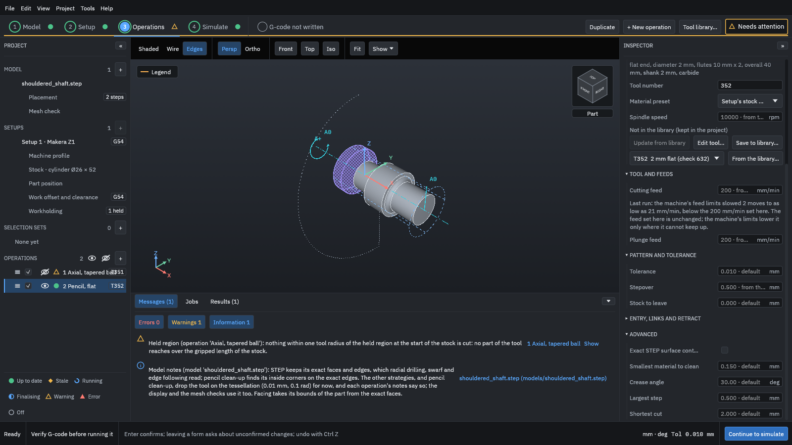
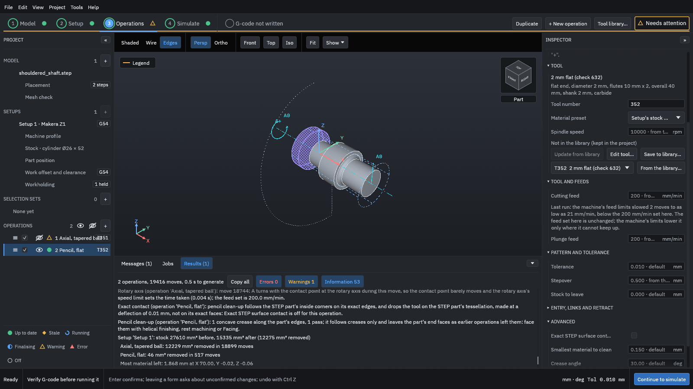
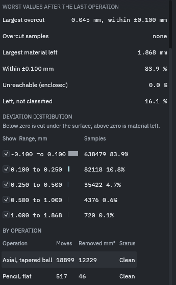

# Owner check for #632: pencil clean-up at a sharp inside corner, Exact STEP surface contact off and on

**For:** the project owner. **Time:** about 10 minutes. **Machine:** none. This is a check in the application only.

> [!WARNING]
> Nothing in this check shows that a program is safe to run. Do not run the G-code of this project on a machine. Generated G-code is yours to verify before it runs on a machine.

## What to check, and why

**Before the fix**, pencil clean-up with a 2 mm flat end at the one sharp inside corner of a public STEP shaft gave:

- **6 passes** with **Exact STEP surface contact** off (it cut only about 7° of the corner, with single-point plunges);
- **31 passes** with it on (many short stretches).

**The fix** is pull request #856 ([decision 0684](../../docs/decisions/0684-pencil-decides-material-left-from-the-tool-not-its-contact.md), accepted 24 Nov 2026). Pencil now judges the material left from the tool as placed and rests clear of the wall it touches. It also gained **Shortest cut** (default: the tool's diameter). **Exact STEP surface contact** moved to the **Advanced** section.

| Check | Expected result |
| --- | --- |
| Pencil with Exact STEP surface contact **off** | **1 concave crease, 1 pass**: one whole turn round the corner at X 11 (the corner at X 12, less the tool's radius) |
| Pencil with it **on** | **1 pass** too, the same turn round the corner |
| Where the setting is | Inspector, **Advanced** section, row **Exact STEP surface contact**: off by default for pencil |
| Simulation | Pencil removes about **46 mm³** either way, **Clean** (no overcut) |

## The example project

[`project/`](project/) uses only public material: the STEP fixture `testdata/step/valid/shouldered_shaft.step`. It is a shaft 40 mm long: radius 8, a **sharp** shoulder out to radius 12 at X 12, then a filleted shoulder at X 24. It is turned to lie along X and sits in Ø26 × 52 mm hardwood stock from setup X 20, with the chuck holding 6 mm. Program X 0 is the part's left end.

It has two operations, both with their defaults:

- **1 Axial, tapered ball**: axial finishing, tapered ball r0.5, 5°, 3.175 mm, stepover 0.5 mm;
- **2 Pencil, flat**: pencil clean-up, 2 mm flat end.

The machine is today's built-in Makera Z1. The project is saved at the current schema (29), so it opens with no migration question.

<details><summary>How the project was made (to regenerate it)</summary>

The starting point is the project of the earlier owner check for #351 and #257, on the branch `owner-checks/2026.1-alpha`. On a build of `main` at `6b039e5` or later:

```sh
git fetch origin owner-checks/2026.1-alpha
git archive FETCH_HEAD owner-checks/351-257-exact-step-contact/project | tar -x
P=owner-checks/351-257-exact-step-contact/project
openchuck-cli resave  $P                       # schema 25 -> current
openchuck-cli machine $P makera-z1             # today's built-in Z1 copy
openchuck-cli setup   $P "Setup 1" --stock cylinder=26,52,20 --part-offset 30 --work-x 30
# text edits only: the project's name and the two tools' names say "check 632"
sed -i 's/^name = "Owner check 351 and 257"/name = "Owner check 632: pencil corner"/' $P/project.toml
sed -i 's/check 351/check 632/' $P/tools/*.toml
```

The setup change moves the stock from X −10 (inside the Z1's headstock) to X 20, with the part and the work zero moved with it. Program X is therefore unchanged.

</details>

## Steps

Use a nightly build of 24 Nov 2026 or later. It must contain the merge of #856 (commit `19de286`); the measurements below are from `main` at `6b039e5` (0.62.0).

1. Download this folder and open [`project/`](project/) with **File > Open project**.
2. Click **3 Operations**, then **Generate stale (2)** (bottom right). It takes about 15 seconds.
3. In the project panel, click **2 Pencil, flat**. To see only the pencil path, click the eye of **1 Axial, tapered ball** to hide its path.
4. In the Inspector, scroll down and open **Advanced**. **Exact STEP surface contact** is **not ticked**, and **Shortest cut** reads **2.000 · default**. (Screenshot 1.)
5. Click the **Results** tab under the view and scroll to its end. Read the two pencil lines (screenshot 2):
   - "Exact contact (operation 'Pencil, flat'): … drops the tool on the STEP part's tessellation … Exact STEP surface contact is off for this operation."
   - "Pencil clean-up (operation 'Pencil, flat'): 1 concave crease along the part's edges, **1 pass** …"
6. Tick **Exact STEP surface contact** and click **Generate stale (1)**. Read the same two lines again (screenshot 3): "… drops the tool on the STEP part's exact faces, to within 0.0001 mm …" and again "**1 pass**".
7. Click **4 Simulate** (and **Run simulation** if it has not run). Under **BY OPERATION**, read the line for **Pencil, flat**: about 517 moves, about 46 mm³ removed, **Clean** (screenshot 4). Look at the corner at X 12 in the 3D view: one even ring round it.
8. Optional: **Post and export** with the Makera Z1 post, and look at the pencil operation in the file. It is one turn of A at X 11.000 (off), or at X 10.999 to 11.000 (on).

## Expected result, as measured here

Command line on `main` at `6b039e5` (0.62.0), Linux, release build with the STEP reader, 4 threads:

```sh
openchuck-cli --threads 4 regenerate project --post makera-z1 --tool-numbers keep --grouping operation --out OUT
openchuck-cli --threads 4 simulate project
```

| | Exact STEP surface contact off (default) | On |
| --- | --- | --- |
| Pencil note | "1 concave crease along the part's edges, 1 pass" | "1 concave crease along the part's edges, 1 pass" |
| Pencil moves in the path (Results, Simulate's BY OPERATION) | 517 | 517 |
| Pencil moves in the written Makera Z1 file | 518 | 378 |
| Pencil in the file | `G0 X11.000`, one turn of A at radius 7.998 to 8.000 | one turn of A at X 10.999 to 11.000, radius 8.000 |
| Removed by pencil (simulation, 0.1 mm cell) | 46.0 mm³ | 45.9 mm³ |
| Overcut, whole project | deepest 0.045 mm at X 63.75 (axial finish, within the 0.1 mm cell); "Clean" | the same |
| Generate time (whole project, CLI) | 13.4 s | 16.4 s |

**Why 517 moves in the application but 378 in the file with the setting on.** On the exact faces the turn is at a constant radius, so the post writes runs of pure A moves as fewer lines. On the tessellation the radius varies by 0.002 mm, so it does not. The application counts the path's moves, the file counts lines. Compare passes, not moves.

**Before the fix** (#632 as reported, `main` 9dae85d3): 6 passes and 40 moves off; 31 passes and 390 moves on.

### Screenshots

These are true captures from the release build of `main` at `6b039e5`, taken on Xvfb with Mesa lavapipe at 1600 × 900.

1. Pencil selected, **Advanced** open: Exact STEP surface contact unticked, Shortest cut 2.000 default.
   
2. Results, setting off: tessellation note, "1 concave crease … 1 pass", Pencil 46 mm³ in 517 moves.
   
3. Results, setting on: exact-faces note, "1 pass".
   
4. Simulate, BY OPERATION: Pencil, flat, 517 moves, 46 mm³, Clean.
   

## Pass and fail

- **Pass:** steps 5 and 6 both say **1 pass**, and the pencil's Simulate line says **Clean**.
- **Fail:** more than one pass in either case, a pencil line that is not Clean, or the setting not under **Advanced**.

## What to report back

Reply on #632 with:

```text
#632 pencil corner check
Build (version / commit):
Off: pencil note passes = ___ ; Simulate Pencil moves = ___ , removed = ___ mm3, status = ___
On:  pencil note passes = ___ ; Simulate Pencil moves = ___ , removed = ___ mm3, status = ___
Exact STEP surface contact is under Advanced: yes / no
Result: PASS / FAIL (what you saw)
```

Attach a screenshot of the Results tab for each case if anything differs from the above. If it passes, #632 can be closed.
