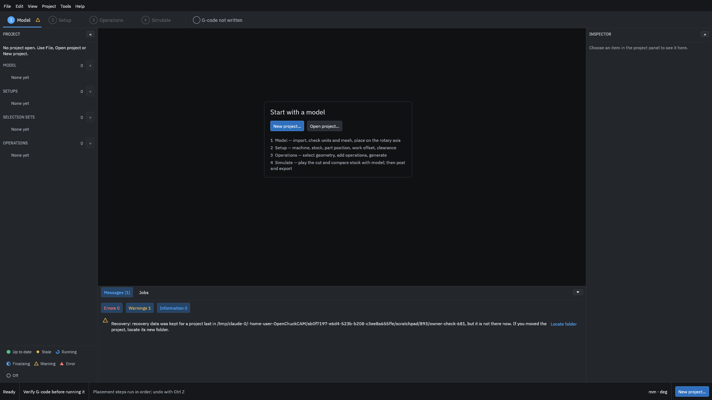
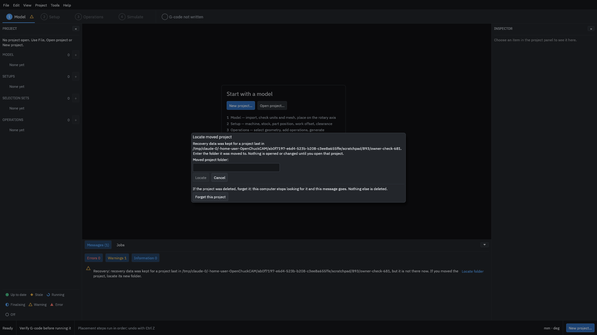
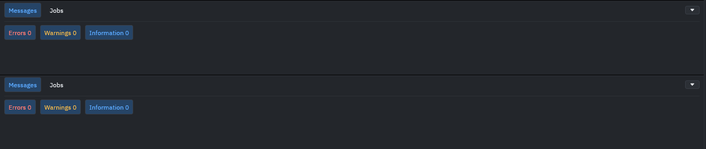

# Owner check for #681: forget a deleted project's recovery line

**For:** the project owner (say your operating system in the report). **Time:** about 5 minutes. **Machine:** none.

## What changed, and what to check

The fix is pull request #893, merged as `e126459`; the rule is [decision 0689](../../docs/decisions/0689-results-recovery-and-held-region-notes.md), accepted. When a project folder with recovery data kept for it is deleted, the program warns at each start that the data "is not there now". The **Locate folder** dialog now has **Forget this project**, which removes only this computer's note of that project. A folder that still holds that project's recovery data is refused, with the reason.

| Check | Expected result |
| --- | --- |
| Start after deleting the folder | Messages, Warnings 1: "Recovery: recovery data was kept for a project last in …owner-check-681, but it is not there now. If you moved the project, locate its new folder." with **Locate folder** |
| Locate folder | "Locate moved project", with a line "If the project was deleted, forget it: this computer stops looking for it and this message goes. Nothing else is deleted." and **Forget this project** |
| Forget this project | The line goes (Warnings 0) |
| Quit and start again | The line does not come back |

## The example project

[`project/`](project/) is a copy of the public tutorial project. Copy it to a folder named `owner-check-681` (any name will do); the check deletes that copy.

## Steps

Use a nightly with `e126459` (25 Nov 2026 or later).

1. Copy [`project/`](project/) to a new folder `owner-check-681`. Open it (**File > Open project**), then **File > Quit**.
2. Delete the folder `owner-check-681`. Start OpenChuckCAM. **Expect** the recovery warning with **Locate folder** (screenshot 1).
3. Click **Locate folder**. **Expect** the dialog with **Forget this project** (screenshot 2). Click it. **Expect:** the line goes.
4. **File > Quit**, then start OpenChuckCAM again. **Expect:** no recovery line (screenshot 3, top: after Forget; bottom: after the restart).

## Pass and fail

- **Pass:** steps 2 to 4 as written.
- **Fail:** no Forget button, the line staying after Forget, or coming back after a restart. Report the step, your operating system and a screenshot.

## What to report back

```text
#681 forget recovery
Build (Help > About version / commit):        Operating system:
2 recovery line with Locate folder after deleting:  PASS / ...
3 Forget this project removes the line:            PASS / ...
4 not back after restart:                          PASS / ...
Result: PASS / FAIL
```

## As captured here

True captures from the release build of `main` at `e126459`, Linux, Xvfb with Mesa lavapipe, 1920 × 1080; a real quit, folder deletion and restart with the same settings folder.

1. 
2. 
3. 
