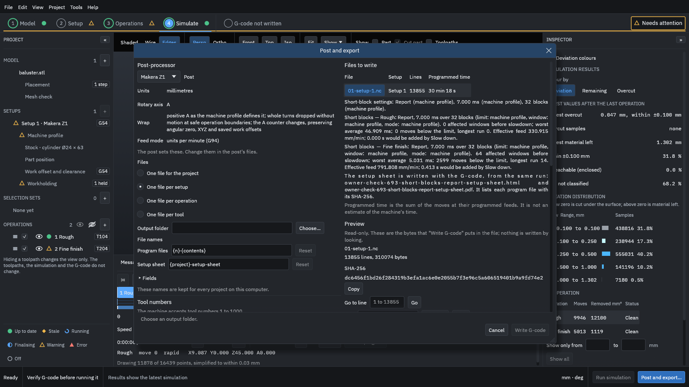

# Owner check for #693 (OI-992): short-block slowdown on the Z1

**For:** the project owner, on the Makera Z1. **Time:**
- stage 1, simulator comparison in the application: about 15 minutes;
- stage 2, attended air cut: about 1 hour;
- stage 3, a cut in tooling board: **optional, later**.

> [!WARNING]
> Nothing in this check shows that a program is safe to run. Generated G-code is yours to verify before it runs on a machine: read each program, simulate it, and air-cut it attended before any cut. "Slow down" changes only feed words. It does not make a program safe, and a program that runs smoothly here says nothing about other programs, firmware or delivery methods.

## What to check, and why

The Z1 profile has a **minimum block time** of 7 ms, averaged over a window of 32 blocks. On firmware 1.1.2 and 1.1.3, 7 ms ran smoothly and 5 ms stuttered (the block-rate air cut). The profile's **mode** decides what happens to a program whose moves are shorter than that:

- **Report** (the default): the program is unchanged, and a warning says how many windows are below the limit.
- **Slow down:** the feed of the shortest moves is lowered until every window reaches 7 ms. Coordinates and move kinds are unchanged; only F words change. See [decision 0245](../../docs/decisions/0245-short-block-report-and-slowdown.md).

Slow down has passed the software checks. It has **never been run on the Z1**. OI-992 asks for three things on the machine:

1. compare the original and the slowed paths in the simulator;
2. air-cut both, attended, and compare smoothness and time;
3. later, cut both in material and compare cutting behaviour and finish.

| Check | Expected result |
| --- | --- |
| 1. The two programs in the simulator | Same path and same simulated part; the only differences are F words (and the header) |
| 2. Air cut, Report program, 100 % override | May stutter or pause in the finishing operation: its worst window is 5.0 ms, below 7 ms |
| 2. Air cut, Slow down program, 100 % override | Runs smoothly: no stutter, no pauses |
| 2. Time of the finishing operation | Each within the 10 % band of its "about N s" comment. They differ by only 0.4 s, so time cannot tell them apart: listen and watch |
| 3. Cut (optional, later) | Same shape. Finish compared by eye and touch; the slowed program cuts 626 moves a little slower |

## The example project

The project is synthetic, built from the public baluster (`testdata/examples/baluster/`). One finishing operation was chosen so that it demands short blocks: axial finishing with the ball 204 at **1200 mm/min**, **tolerance 0.002 mm** and **stepover 6 mm**, with adaptive spacing off. The fine tolerance gives moves of about 0.06 mm along the baluster's curves, about 3 ms each at that feed.

- [`project-report/`](project-report/): the built-in Makera Z1 profile, mode **Report**.
- [`project-slowdown/`](project-slowdown/): the same project, with only the machine copy's mode set to **Slow down**, marked unconfirmed ("set by hand for this check").

Both have two operations: **Rough** (rotary roughing, flat end 104) and **Fine finish** (the one above).

### The programs, as generated here

`main` at `6b039e5` (0.62.0), Linux, `openchuck-cli --threads 4 regenerate <project> --post makera-z1 --tool-numbers keep --grouping operation --out <dir> --acknowledge-collision-warnings`. The one acknowledged warning is **Tool length** on tool 104, used by Rough only; see stage 3.

| File | Size | SHA-256 |
| --- | --- | --- |
| [`programs/report/01-setup-1-rough.nc`](programs/report/01-setup-1-rough.nc) | 207,521 | `7c121e460ee923449d68a3f1e464db699074e6d309758225e0e7bdf1d4a2eefe` |
| [`programs/report/02-setup-1-fine-finish.nc`](programs/report/02-setup-1-fine-finish.nc) | 102,860 | `f6eecf263928b10741a8770cfd215fc67eb9c87aee161adf9da4d0e4254551d9` |
| [`programs/slowdown/01-setup-1-rough.nc`](programs/slowdown/01-setup-1-rough.nc) | 207,524 | `5db419efbcacf8bfba497f26f5b3da90a34bcdc8d50690ba5c74fc64ea86b921` |
| [`programs/slowdown/02-setup-1-fine-finish.nc`](programs/slowdown/02-setup-1-fine-finish.nc) | 102,639 | `6c04ceb50b60083fe45cca9a93b0abdd634d2ec4620e9fb9aed0ce99854fd48c` |

The two Rough files differ only in the project name in their first line.

What the application reports for **Fine finish**, with the settings it used (7 ms, 32 blocks, all from the machine profile):

| | Report | Slow down |
| --- | --- | --- |
| Command line, when posting | warning: "Short blocks (operation 'Fine finish'): 64 windows below 7.000 ms averaged over 32 blocks …; 2599 moves below the limit, longest run 14, worst window before slowdown 5.031 ms, original effective feed 791.808 mm/min. Report leaves the program unchanged; slowdown would add 0.413 s." | note: the same counts, then "Slow down lengthened 626 moves and added 0.413 s." |
| Moves in the file | 4,659 | 4,659 |
| Lines that differ | — | 612, every one only in its F word, plus the header and the time comment |
| Cut time (replay) | 136.5 s | 136.9 s |
| Operation comment | "about 287 s" | "about 288 s" |
| Program extent | X 9.125 to 62.588, Z 0 to 45 (tip to the axis at the free end), A 0 to 2160° (6 turns), then the unwind `G92.4 A0 S0` | the same |
| Simulation (0.1 mm cell) | Fine finish 5013 moves, 1118.7 mm³; most left 1.3016 mm; deepest overcut 0.0475 mm | identical |

The slowed moves are spread along the whole length (X 9 to 62), in runs on every pass, wherever the profile curves.

<details><summary>How the projects were made (to regenerate them)</summary>

From a checkout of `main` at `6b039e5` or later:

```sh
B=owner-checks/693-short-block-slowdown
cp -r testdata/examples/baluster/baluster-project $B/project-report
rm $B/project-report/operations/34e3aa5e-36cc-4614-be6d-ec39cf22f5f8.toml   # the example's helical Finish
# add operations/0c0c0693-0000-4000-8000-000000000302.toml as committed here:
#   axial_finishing, tool c0de0001-...-000000000204, order W,
#   adaptive_spacing = false, feed = 1200.0, stepover = 6.0, tolerance = 0.002
# and set the project's name (line 2 of project.toml)
openchuck-cli resave $B/project-report
cp -r $B/project-report $B/project-slowdown
# project-slowdown/machine.toml, text edits only:
#   short_block_mode = "slow_down"
#   [machine.provenance.short_block_mode]: state = "unconfirmed", source = "Slow down, set by hand ..."
# and its project name
openchuck-cli resave $B/project-slowdown
```

In the application, the same change is made in the project panel: **Machine profile** (under the setup), field **Short moves**, set to **Slow down**.

</details>

### Screenshots

True captures from the release build of `main` at `6b039e5`, taken on Xvfb with Mesa lavapipe at 1600 × 900. Both show the **Post and export** dialog after Generate and Simulate, with the default "One file per setup". The short-block lines are the same per operation.

1. Report: "Short blocks — Fine finish: Report, 7.000 ms over 32 blocks … 64 affected windows before slowdown; worst average 5.031 ms; 2599 moves below the limit, longest run 14 … 0.413 s would be added by Slow down."
   
2. Slow down: the same counts, "… 0.413 s added".
   

## Before anything runs on the machine

- [ ] The [safe-practice checklist](../../docs/z1-safe-practice-checklist.md), sections 1 and 2, is complete.
- [ ] Gate 4 rules from the [air-cut procedure](../../docs/z1-air-cut-procedure.md): attended, emergency stop in reach, **no tool, no material**, chuck empty or jaws closed with nothing held, enclosure closed.
- [ ] Each file has been read before it is run (procedure step 0):
  - header and footer as the Z1 post writes them;
  - safe Z is `Z45.000`;
  - `T204 M6` and `S12000 M3`, run with no tool as in the procedure;
  - the unwind `G92.4 A0 S0` at the end.
- [ ] G54 is read with `$#` and recorded. X0 must put program X 9 to 63 in clear travel, at least 10 mm clear of the jaws. The tip goes down to Z 0 (on the axis) near X 62.6, beside the free end. As for any gate 4 air cut, first jog at low feed to that point (G54 X 62.6, Z 0, no tool fitted). Check that nothing on the spindle touches the chuck, the jaws or the tailstock. Move the tailstock back.
- [ ] Each program file's SHA-256 matches the table above, or the file you generated yourself has been compared with it (see stage 1, step 5).

## Steps

### Stage 1: simulator comparison (in the application; no machine)

1. Use a nightly build of 24 Nov 2026 or later. Open [`project-report/`](project-report/).
2. **Operations**, then **Generate** (about a minute). Then **Continue to simulate**. Under **BY OPERATION**, write down Fine finish's moves and removed mm³. Then write down the worst values: largest overcut and largest material left.
3. Click **Post and export...** and choose the **Makera Z1** post and **One file per operation**. The short-block analysis runs when the program is posted, so its result is in this dialog, under **Files to write**, and not in Messages after Generate (screenshot 1). Write down the **Short blocks — Fine finish** numbers: affected windows, worst average in ms, moves below the limit, longest run, and the seconds Slow down would add. Choose an output folder and click **Write G-code**.
4. Open [`project-slowdown/`](project-slowdown/) and repeat steps 2 and 3, writing to another folder. The dialog now reads "Short-block settings: Slow down …" and, for Fine finish, "… 0.413 s added" (screenshot 2). The simulation numbers must be **identical** to Report's.
5. Compare the two Fine finish files with the F words taken out. Only the header (the name and the time comment) may differ:
   - PowerShell:
     ```powershell
     Compare-Object ((Get-Content report\02-setup-1-fine-finish.nc) -replace ' ?F[0-9.]+','') ((Get-Content slowdown\02-setup-1-fine-finish.nc) -replace ' ?F[0-9.]+','')
     ```
   - bash:
     ```sh
     diff <(sed 's/ *F[0-9.]*//' report/02-setup-1-fine-finish.nc) <(sed 's/ *F[0-9.]*//' slowdown/02-setup-1-fine-finish.nc)
     ```

### Stage 2: attended air cut (no tool, no material)

Run only the **Fine finish** file of each project: `02-setup-1-fine-finish.nc`. Roughing has no short blocks.

6. Record the firmware (controller and ESP32), the **delivery method** (WiFi upload, USB, or played from the controller's storage) and how it is played. Start a phone video with sound for every run.
7. **Report file, 10 %** override: watch the first 20 lines with a hand near the stop, then let it run. Expect no alarm and every line accepted; motion as simulated (passes along X, with A stepping between passes, six turns of A in all); the unwind at the end. Stop on anything unexpected.
8. **Slow down file, 10 %:** the same.
9. Only if steps 7 and 8 had no unexpected motion: **Report file at 100 %.** Time the whole operation (from the plunge after `S12000 M3` to the last fed move) against its comment, "about 287 s". Listen and watch for stutter, hesitation or pauses between passes and on the curves.
10. **Slow down file at 100 %:** the same, against "about 288 s".
11. **Report file at 100 % again.** This A-B-A order shows whether a stutter follows the program or comes and goes with the transfer.

### Stage 3 (optional, later): cut in tooling board

Only after stage 2 passes, and only when you choose to:

- Cut both programs in the same material with the real tools. Rough with 104, then Fine finish with 204.
- Rough first lifts the **Tool length** warning on 104: its library stick-out of 29.3 mm keeps the tip inside the 45 mm clearance radius at the top of the Z travel. Check clearance by jogging, as for the first cut, or use a shorter stick-out.
- Compare by eye and touch, and with a profile gauge or calipers at the same X: any difference in finish or size on the curves, and how the cut sounded.
- The 6 mm stepover leaves visible ridges (up to about 1.3 mm in the simulation). Compare the two parts with each other, not with the model.

## Pass and fail

- **Stage 1 passes:** both projects simulate identically, and the files differ only in F words, the header and the time comment.
- **Stage 2 passes:**
  - every line is accepted, with no alarm and no unexpected motion;
  - each timed run is within the 10 % band;
  - the **Slow down** file runs with no audible stutter and no visible pause in the cut.
- **What the Report file does at 100 % is a result, not a pass or fail.** If it stutters and Slow down does not, that is the evidence OI-992 asks for. If neither stutters, record that too: the 5.0 ms worst window was then within what this transfer could feed.
- **Fail:** any alarm, rejected line or unexpected motion; or the **Slow down** file stutters. Stop, keep the video and the file, and report it as a defect.

## What to report back

Paste this into #693, filled in, and attach or link the videos of steps 9 to 11.

```text
#693 / OI-992 short-block slowdown check
Build (version / commit):
Firmware controller / ESP32:          Delivery method (WiFi upload / USB / storage):
G54 from $# (X / Y / Z):               X0 face and offset:
Settings: min block 7 ms, window 32, mode Report / Slow down (as in the two projects)

Stage 1 (application):
  Report:    windows ___ , moves below ___ , longest run ___ , worst window ___ ms, would add ___ s
  Slow down: lengthened ___ moves, added ___ s
  Simulation identical (moves / removed / overcut / material left): yes / no
  Files differ only in F words and header: yes / no

Stage 2 (air cut, no tool, no material):
  Report 10 %:     result ___ , alarms ___
  Slow down 10 %:  result ___ , alarms ___
  Report 100 %:    predicted 287 s, measured ___ s, ratio ___ ; stutter / pauses: none / where (line or X)
  Slow down 100 %: predicted 288 s, measured ___ s, ratio ___ ; stutter / pauses: none / where
  Report 100 % again: measured ___ s ; stutter / pauses:
Stage 3 (if done): material ___ ; differences seen ___
Result: PASS / FAIL (what)
```
