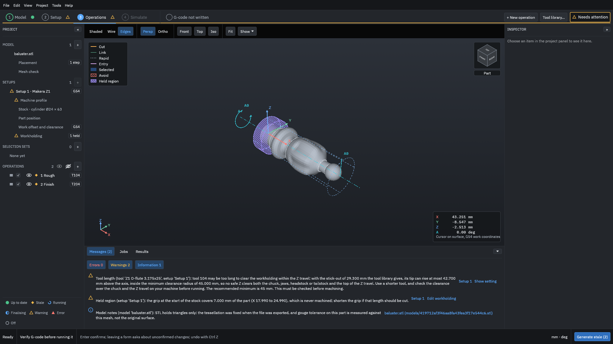
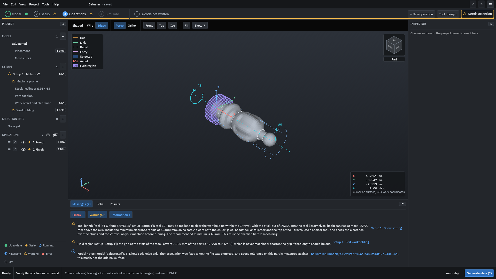
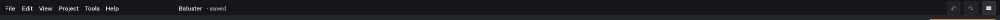
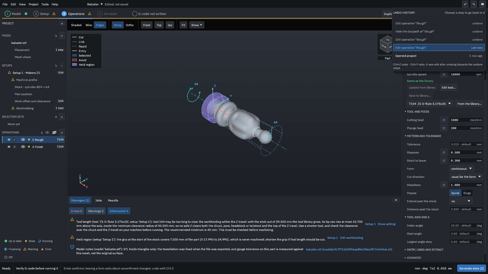
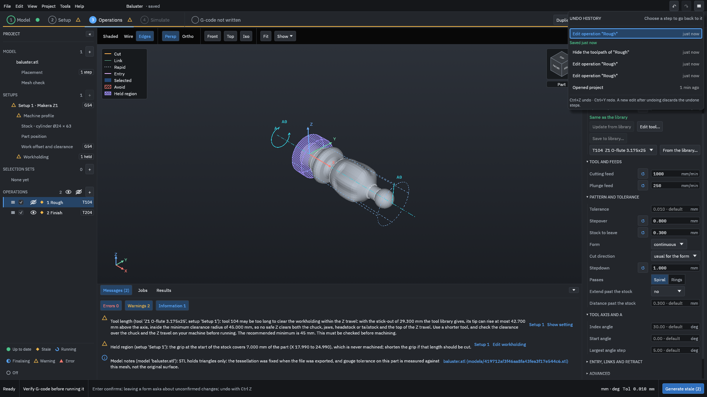
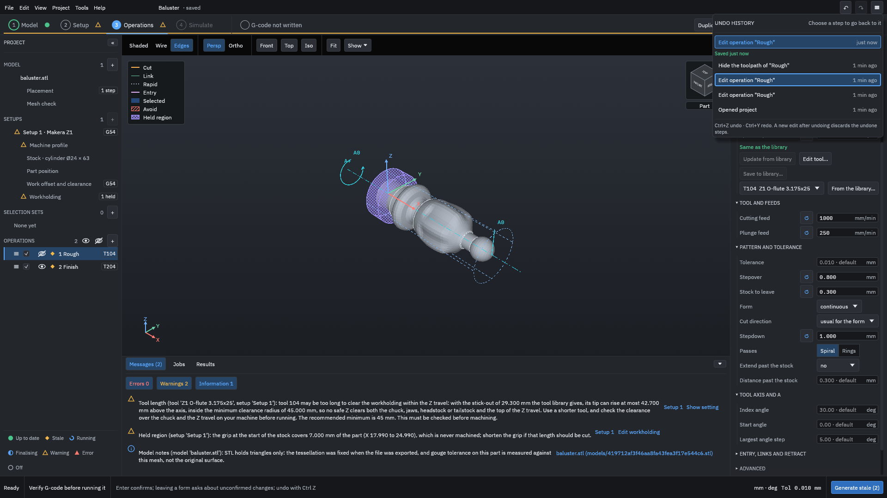
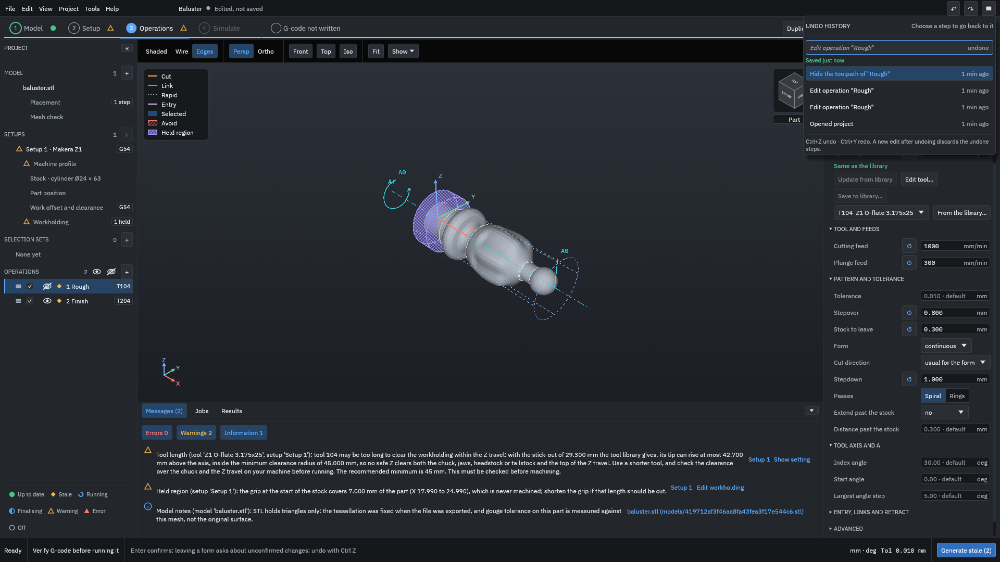
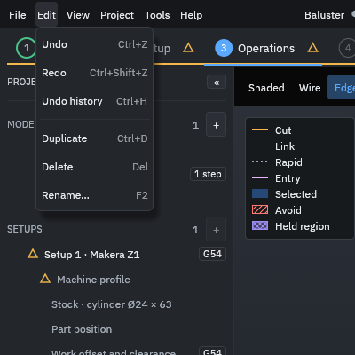

# Owner check for #705: the undo history list

**For:** the project owner, on Windows. **Time:** about 10 minutes. **Machine:** none.

## What changed, and what to check

The change is pull request #904 (lane PROJECT-UX-B, PR B1, record PROJUX-B-1, proposed; draft, head `5d377f54`).

**The list.** The title bar has an **Undo history** button at the right of Undo and Redo. The button, **Edit > Undo history** and **Ctrl H** open a list of every step since the project was opened:
- newest first, with the current step highlighted;
- undone steps in italics, marked "undone";
- how long ago each step was made;
- a green "Saved … ago" line under the step that was last saved.

Choosing a row returns the project to that step.

**The title bar.** The lane also found that on `main` the title bar's project name, its save state, and Undo and Redo were not drawn at all: the menus took the whole width. They are now inside the window.

| Check | Expected result |
| --- | --- |
| 1. Title bar | The project name, its save state ("· saved" or "Edited, not saved"), Undo, Redo and the history button, all inside the window. On `main` only the menus show |
| 2. Ctrl H | The list, newest first, the current step highlighted, "Opened project" at the bottom, and the foot "Ctrl+Z undo · Ctrl+Y redo. A new edit after undoing discards the undone steps." |
| 3. Names with values | A form edit reads with its setting and value, for example "Set stepover 0.8 mm (Rough)". **See the finding below: on `5d377f54` it reads "Edit operation "Rough"".** |
| 4. Choose a row | The project goes back to that step; newer rows turn italic with "undone"; choosing the top row brings everything back |
| 5. Saved mark | After Ctrl S, "Saved just now" (later "Saved 3 min ago") under the step that was saved |
| 6. Keyboard | Ctrl H puts the keyboard on the current row; Tab and Shift Tab move between rows; Enter chooses; Esc closes |
| 7. Keep as one row (**after #891**) | Several values applied together with **Keep** are one row, "Edit <item>". This needs #891 (UI-BUGS-A) merged as well; skip it until then |

> [!IMPORTANT]
> **Finding on `5d377f54` (reported to the coordinator for the lane).**
> - Record item 1 and its own check step 4 expect "Set stepover 0.5 mm (…)" and "Set stepover 0.8 mm (…)". On this build, changing **Stepover** in the operation's form (typing a value, then Enter) gives a row "Edit operation "Rough"". Typing a **Plunge feed** and pressing Tab does the same.
> - The name, the value and the unit are not in the row. Every other part of the list behaves as the record says (screenshot 3).
> - If a later build of #904 shows the values, check 3 passes. If it still reads "Edit operation", report check 3 as failed.

## The example project

This is the public `testdata/examples/baluster/baluster-project` from the repository, as PROJUX-B-1 names it. Nothing is added: work on a copy of that folder, because the check saves it.

## Steps

Use a build of PR #904: the branch `claude/lane-projux-b-1-undo-history` at `5d377f54` or later, or a nightly after it merges. Use Windows, with the window maximised or at 1920 × 1080.

1. Copy `testdata/examples/baluster/baluster-project` to a folder of your own and open the copy with **File > Open project…**.
2. **Check 1:** look at the title bar. You should see **Baluster · saved** after the menus, and Undo, Redo and the history button at the right (screenshot 2). Compare with `main`, where only the menus show (screenshot 1).
3. In the project panel click **1 Rough**. In the Inspector, under **Pattern and tolerance**, set **Stepover** to `0.5` and press Enter, then `0.8` and press Enter. Click the eye of **1 Rough** in the project panel to hide its toolpath. The title now reads "Edited, not saved".
4. **Check 2 and 3:** press **Ctrl H**. Expect, newest first:
   - "Hide the toolpath of "Rough"";
   - then the two stepover steps, expected "Set stepover 0.8 mm (Rough)" and "Set stepover 0.5 mm (Rough)" (on `5d377f54`: "Edit operation "Rough"" twice);
   - then "Opened project";
   - each with "just now", the top row highlighted (screenshot 3).
5. **Check 4:** click the 0.5 step (the second row from the bottom). The Stepover field reads **0.500**, the eye is shown again, and the newer rows are in italics marked "undone" (screenshot 4). Click the top row: Stepover 0.800 and the path hidden again.
6. **Check 5:** press Esc, then **Ctrl S**, then **Ctrl H**. Expect "Saved just now" in green under the top row, and the title "Baluster · saved" (screenshot 5).
7. **Check 6, keyboard only:** press Esc. Press **Ctrl H**. Then:
   - press **Tab** twice: the focus ring moves down the rows (screenshot 6);
   - press **Shift Tab** once and **Enter**: the project goes to that step, and the top row turns "undone" while "Saved just now" stays under it (screenshot 7);
   - press **Esc**: the list closes.
   Also try the history button in the title bar, and **Edit > Undo history** (screenshot 8). A click outside the list closes it.
8. Press **Ctrl Y** (or Ctrl Shift Z): the step is redone, and the title reads "saved" again.
9. **Check 7 (after #891 merges):** on a build with both #904 and #891, change two values of one setup or operation, apply them together with **Keep**, and open the list. It should show one row, "Edit <item>".

## Pass and fail

- **Pass:** checks 1, 2 and 4 to 6 as described, and check 3 with the values in the rows on the build you test. Check 7 is skipped until #891 is in.
- **Fail:**
  - anything in the title bar cut off or missing;
  - rows in the wrong order;
  - a row that does not return to its step;
  - the saved mark missing or under the wrong row;
  - a keyboard step that does nothing;
  - a crash or an error dialog.

## What to report back

```text
#705 undo history (PR #904)
Build (Help > About version / commit):     Windows version:      Window size:
1 title bar shows name, save state, Undo, Redo, history:  yes / no (what is missing)
2 Ctrl H list newest first, current highlighted:           yes / no
3 rows name the setting and value ("Set stepover 0.8 mm (Rough)"): yes / no (what they say)
4 clicking a row goes to that step, newer rows "undone":    yes / no
5 "Saved ... ago" under the saved step:                     yes / no
6 keyboard: Ctrl H, Tab, Shift Tab, Enter, Esc:              yes / no (which key failed)
7 Keep as one row (only with #891):                          not tested / yes / no
Result: PASS / FAIL
```

## As captured here

These are true captures from release builds on Linux, on Xvfb with Mesa lavapipe, at 1920 × 1080:
- screenshot 1 is `main` at `361613e` (0.63.0, before the change);
- screenshots 2 to 8 are PR #904 at `5d377f54`, taken by doing the steps above in order in one session.

Not checked here: Windows drawing, Windows keys and a screen reader (that is the owner's check, OI-9942 of the record). Ctrl Y and Ctrl Shift Z both redid the step. The Edit menu lists Ctrl+Shift+Z for Redo, while the list's foot names Ctrl+Y: both work.

1. Before (`main`, 0.63.0): the title row has only the menus.
   
   
2. After: "Baluster · saved", and Undo, Redo and the history button at the right.
   
   
3. Ctrl H after the three edits: the rows read "Edit operation "Rough"" (the finding above).
   
4. Back to the 0.5 step: newer rows undone and in italics, Stepover 0.500, the eye shown.
   
5. After Ctrl S: "Saved just now" under the top row.
   
6. Keyboard: the focus ring on a row after Tab.
   
7. Keyboard: Enter chose the row; the top row undone, the saved mark kept.
   
8. Edit > Undo history (Ctrl+H).
   
