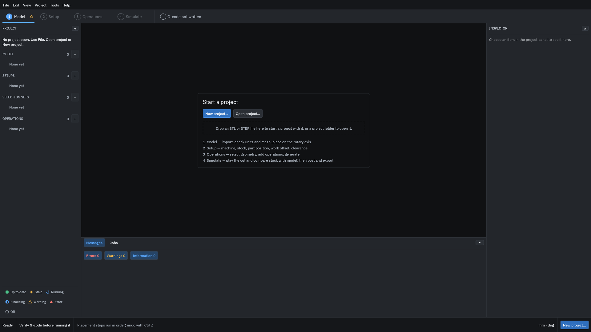
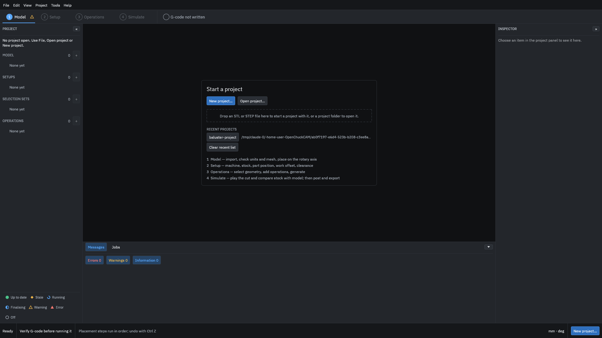
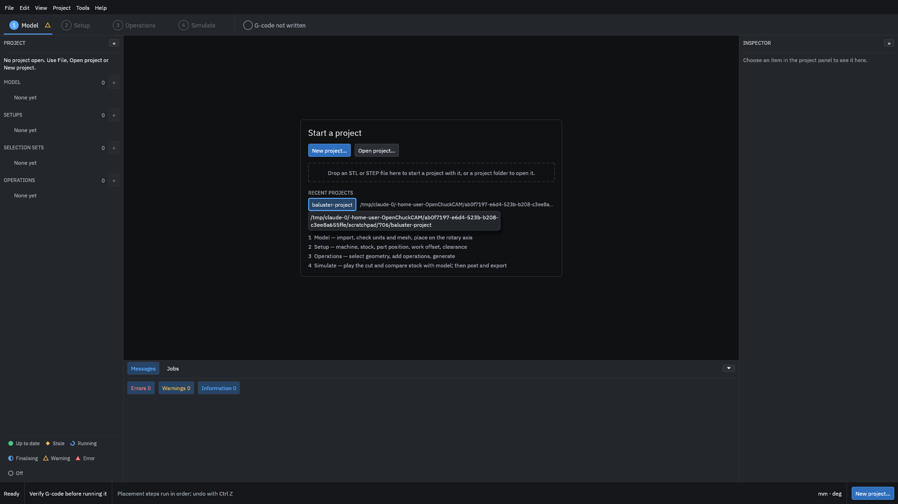
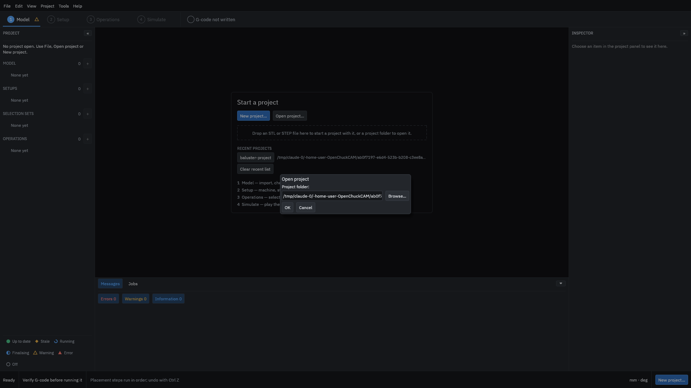

# Owner check for #706: the start page and dropped files

**For:** the project owner, on Windows (or macOS, or Linux on X11). **Time:** about 10 minutes. **Machine:** none.

> [!NOTE]
> Dropping a file only starts, opens or imports. Nothing is generated or written until you ask. Generated G-code is yours to verify before it runs on a machine.

## What changed, and what to check

The change is pull request #942 (lane PROJECT-UX-A, PR A-3, draft, head `041cf6b`), record PROJUX-A-1 (accepted 26 Nov 2026, relayed). With no project open, the card in the middle of the window is now a start page. It reads **Start a project**, with **New project…** and **Open project…**, a dashed drop zone, up to 10 **RECENT PROJECTS** (each a button and a Tab stop, its path beside it, muted), **Clear recent list**, and the four steps. You can now drop files and folders on the window.

| Check | Expected result |
| --- | --- |
| Start after opening a project once | **baluster-project** under RECENT PROJECTS, its path muted beside it |
| Tab to the recent row, Enter | The Open dialog with that folder filled in |
| Drag a model, no project open | Window tinted: "Drop to start a new project with baluster.stl"; the drop opens **New project** named **baluster**; OK creates it and opens the import window on the file |
| Drag a model, a project open | "Drop to import cube_ascii.stl"; the drop opens the import window on it |
| Drag a project folder | "Drop to open the project baluster-project"; the drop opens the Open dialog with that folder |
| Drag two models at once | "Drop to import … (1 of 2; the rest are not imported)"; Messages: "Not imported: … Drop or import one file at a time." |
| Drag a text file | "OpenChuckCAM imports STL and STEP files and opens project folders"; the drop does nothing; Messages: "Dropped file: 'notes.txt' is neither a model nor a project. …" |
| Wayland (if you have it) | Nothing is shown or done when dropping (known: OI-9961, #901); the buttons and the recent list still work |
| 1366 × 768 with several recents (best effort) | The list scrolls inside the card; the buttons and the drop zone stay in view |

## The example files

Everything is in [`files/`](files/), all public test data:

| File | What it is | From |
| --- | --- | --- |
| [`files/baluster-project/`](files/baluster-project/) | A project folder | `testdata/examples/baluster/baluster-project` |
| [`files/baluster.stl`](files/baluster.stl) | A model | `testdata/examples/baluster/baluster.stl` |
| [`files/cube_ascii.stl`](files/cube_ascii.stl) | A second model | `testdata/stl/cube_ascii.stl` |
| [`files/notes.txt`](files/notes.txt) | A text file, neither a model nor a project | written for this check (#942's own steps use the baluster `README.md`; either will do) |

Copy the whole `files/` folder somewhere of your own first, and work on the copy.

## Steps

Use a build of PR #942 (`041cf6b` or later), or a nightly after it merges. Use a desktop where you can drag from the file manager: Windows, macOS or Linux on X11. Use a 1920 × 1080 window for steps 1 to 8.

1. Open your copy of `baluster-project` once (**File > Open project…**), then **File > Quit**.
2. Start the program. **Expect** **Start a project**, the drop zone, and **baluster-project** under RECENT PROJECTS with its path, muted (screenshot 2; screenshot 1 is the same card with nothing recent yet).
3. Press **Tab** until **baluster-project** has the focus ring (its tooltip shows the full path), and press **Enter** (screenshot 3). **Expect** the Open dialog with that folder filled in (screenshot 4). Press **Cancel**.
4. Drag `baluster.stl` over the window. **Expect** a tint and "Drop to start a new project with baluster.stl". Drop it. **Expect** **New project** named **baluster**. Choose a parent folder and press **OK**. **Expect** the project created and the import window open on `baluster.stl`. Press **Cancel** in the import window: nothing is added.
5. With that project open, drag `cube_ascii.stl` over the window. **Expect** "Drop to import cube_ascii.stl". Drop it: the import window opens on it. Press **Cancel**.
6. Drag the `baluster-project` folder over the window. **Expect** "Drop to open the project baluster-project". Drop it: the Open dialog shows that folder. Press **Cancel**.
7. Select `baluster.stl` and `cube_ascii.stl` together and drag them. **Expect** "Drop to import <one of them> (1 of 2; the rest are not imported)". Your system decides which comes first. Drop them: that one opens in the import window, and Messages says "Not imported: <the other>. Drop or import one file at a time." Press **Cancel**.
8. Drag `notes.txt` over the window. **Expect** "OpenChuckCAM imports STL and STEP files and opens project folders". Drop it. **Expect** nothing to happen, and Messages to say "Dropped file: 'notes.txt' is neither a model nor a project. OpenChuckCAM imports STL and STEP files and opens project folders."
9. Optional, only if you have a Linux Wayland desktop: a drop shows and does nothing. This is the known limit (OI-9961, #901), and the guide says so. The buttons and the recent list still work.
10. Optional, best effort: open a few more projects so several are recent, close the project, and make the window 1366 × 768. **Expect** the list to scroll inside the card, with the buttons and the drop zone still in view.

## Pass and fail

- **Pass:** every "Expect" holds on your system.
- **Fail:** any of these is a fail:
  - no tint or line while dragging;
  - a drop that is refused, or that does something other than what is written;
  - a folder taken as a model;
  - a second file dropped without a word in Messages;
  - the recent row not opening through the Open dialog;
  - the card cut off at 1920 × 1080.

  Report the step, the system (Windows, macOS, Linux X11 or Wayland), what happened instead and a screenshot.

## What to report back

```text
#706 start page and dropped files (PR #942)
Build (Help > About version / commit):        System (Windows / macOS / Linux X11 / Wayland):
2 start card with the recent project, path muted:            PASS / ...
3 Tab to the row, Enter opens the Open dialog with the folder: PASS / ...
4 model, no project: tint and line, New project "baluster", import window: PASS / ...
5 model, project open: "Drop to import", import window:     PASS / ...
6 project folder: "Drop to open the project", Open dialog:  PASS / ...
7 two files: "(1 of 2 ...)", "Not imported: ..." in Messages: PASS / ...
8 notes.txt: nothing happens, "Dropped file: ..." in Messages: PASS / ...
9 Wayland (optional): nothing on drop, buttons still work:  PASS / not tried
10 1366x768 (optional): list scrolls, buttons and drop zone in view: PASS / ...
Result: PASS / FAIL
```

## As captured here, and what could not be checked

True captures from the release build of PR #942 at `041cf6b`, Linux, Xvfb with Mesa lavapipe, 1920 × 1080, in one session with a real quit and restart using the same settings folder.

**Checked here:** steps 1 to 3 (screenshots 1 to 4). Tab reached **New project…** first, then the recent row, then **Clear recent list**.

**Not checked here:**

- **Steps 4 to 9.** A real drag and drop could not be done: Xvfb has no file manager or other drag source, so no drag ever reaches the window. These behaviours are covered only by #942's tests, which feed egui's dropped and hovered files directly. They do not exercise your system's drag and drop, which differs by platform (Windows, X11, macOS; Wayland gives none, OI-9961). That is why this check is needed before #706 is closed.
- **Step 10.** 1366 × 768 with several recents was not captured here. #942's test `req_ui_23_req_ui_16_the_start_card_fits_the_view_with_ten_recent_projects` covers it.
- **The "Start with a model" card.** This is the card shown for a project open with no model. It is not part of #942's owner check and was not captured.

1. Start with nothing recent.
   
2. After opening baluster-project once and restarting.
   
3. Tab focus on the recent row, with its full-path tooltip.
   
4. Enter: the Open dialog with the folder filled in.
   
