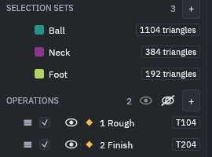
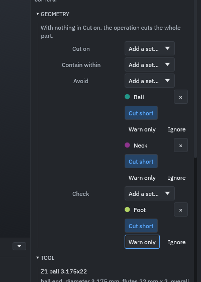
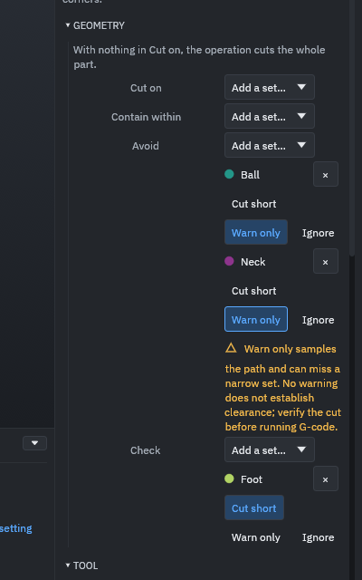
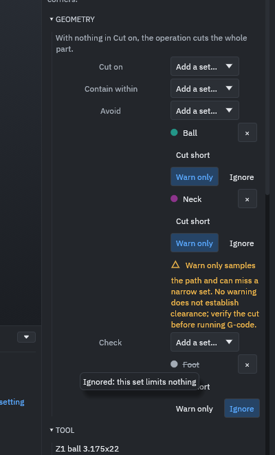
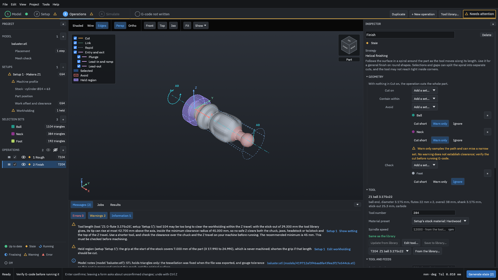
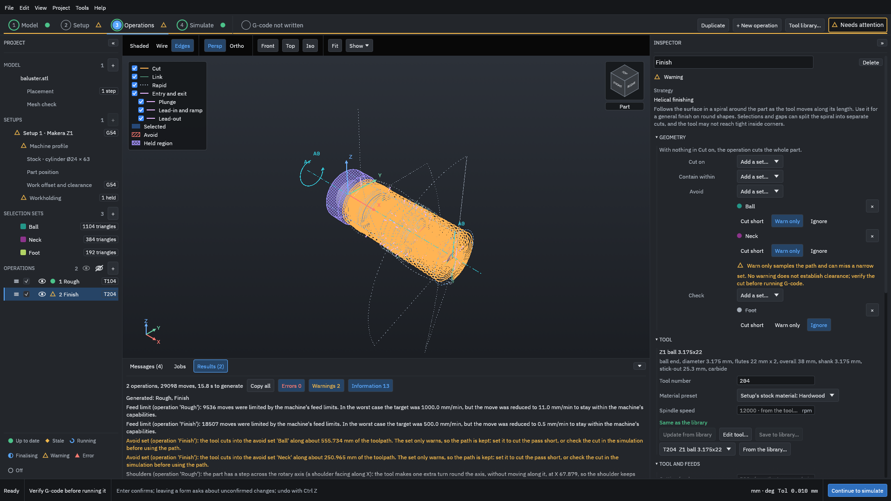
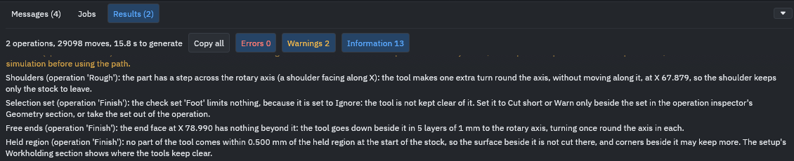
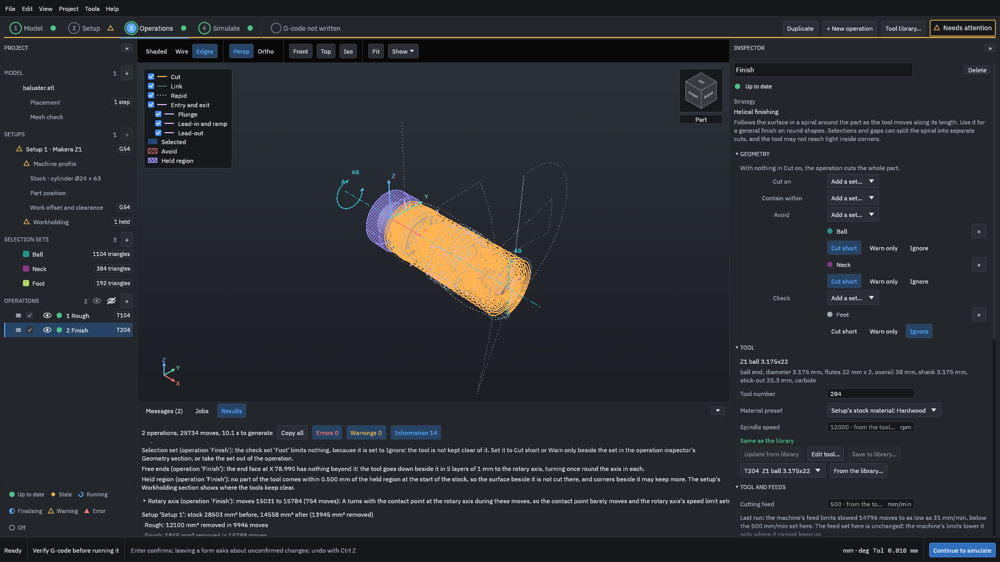
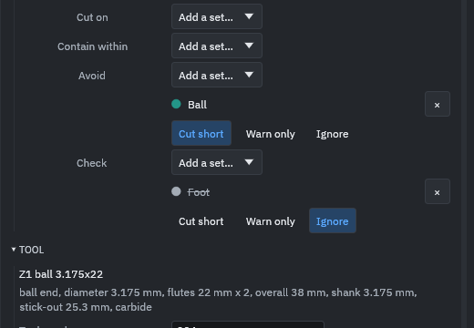

# Owner check for #759: several selection sets in the Geometry section

**For:** the project owner, on Windows. **Time:** about 10 minutes. **Machine:** none.

> [!NOTE]
> A set on **Ignore** still limits nothing; the path is made as if the set were not there. Only how that is reported changes. Generated G-code is yours to verify before it runs on a machine.

## What changed, and what to check

The change is pull request #936 (lane UI-BUGS, PR 3), merged as `255765e6` on 26 Nov 2026, with decision 0696 (`docs/decisions/0696-geometry-sets-layout.md` on `main`) (accepted, from #890: D1 A, D2 A with the Ignore change, D3 A).

- Each role (Cut on, Contain within, Avoid, Check) is one line, with **Add a set…** in the value column.
- **Each set is on its own line** under its role: colour dot, name, **×** at the right end.
- **Cut short / Warn only / Ignore** sit under the set's name, inside the value column. At the default 340 px inspector they wrap onto two short lines; wider, they fit on one.
- Warn only's sampling note is said **once per role**, not once per set.
- A set on **Ignore**: grey dot, name muted and **struck through**, no "limits nothing" line under it, tooltip "Ignored: this set limits nothing". Its message after Generate is **information** (no amber mark, not counted).

| Check | Expected result |
| --- | --- |
| Avoid with Ball and Neck, Check with Foot | Each set named once on its own line, with × at the right end, choices under it; nothing left of the value column |
| Warn only on Ball and Neck | One amber "Warn only samples the path and can miss a narrow set. …" under Avoid |
| Ignore on Foot | Foot greyed and struck through; tooltip "Ignored: this set limits nothing" |
| Narrow and wide inspector | Each set still named once, × at the right end |
| Generate | Warnings name Ball and Neck only; Results has, as information, "Selection set (operation 'Finish'): the check set 'Foot' limits nothing, because it is set to Ignore: …", once |
| Ball and Neck back to Cut short, Generate | 2 Finish green, Foot still on Ignore |
| × on Neck | Neck leaves Avoid; Ball stays with its choice |
| Tab along a set's line | The set's name (with its tooltip) comes before its × (decision 0696 item 7) |

## The example project

[`project/`](project/) is the public tutorial baluster with **three selection sets already made**, so you need not pick surfaces: **Ball** (the ball end, X 52 to 61), **Neck** (the neck, X 46 to 51) and **Foot** (the band at X 8 to 12.5), each a set of the mesh's triangles. Work on a copy.

<details><summary>How the sets were made (to regenerate them)</summary>

`cp -r testdata/examples/baluster/baluster-project project`, then three files `selections/0c0c0759-…-201/202/203.toml`, each listing the triangles of `models/419712af….stl` whose centroid lies in the X range above (1104, 384 and 192 triangles), and `openchuck-cli resave project`. #936's own check makes them by hand instead (click a surface, **Save as new set**); either gives sets of triangles.

</details>

## Steps

Use a nightly with `255765e6` (26 Nov 2026 or later), on Windows, at your usual window size and the default inspector width. The check is how the section looks at **your** window size: if it is not 1920 × 1080, say what it is.

1. Copy [`project/`](project/) and open the copy. Click **3 Operations**. The project panel lists **Ball**, **Neck** and **Foot** under SELECTION SETS (screenshot 1).
2. Click **2 Finish**. In the Inspector under **Geometry**: beside **Avoid**, **Add a set…** > **Ball**, then again > **Neck**; beside **Check**, **Add a set…** > **Foot** (screenshot 2).
3. Under **Ball** and under **Neck**, click **Warn only**. **Expect** one amber note under Avoid (screenshot 3).
4. Under **Foot**, click **Ignore**. Hold the pointer over **Foot**. **Expect** grey, struck through, and the tooltip (screenshot 4). Also press **Tab** to reach **Foot**'s name: the same tooltip opens on keyboard focus, and the next Tab goes to Foot's **×** (name before ×; not checked here).
5. Drag the Inspector's left edge to make it wider, then back. **Expect** each set named once and × at the right end at every width (screenshot 5, wide).
6. Click **Generate stale (2)** and wait for **Ready**. **Expect:** Messages and Results warn about Ball and Neck only (screenshot 6); with **Information** on, the Foot line appears once (screenshot 7).
7. Set **Ball** and **Neck** back to **Cut short**, and **Generate stale (1)**. **Expect:** 2 Finish green (screenshot 8).
8. Click **×** at the end of **Neck**'s line. **Expect:** Neck leaves Avoid, Ball stays on Cut short (screenshot 9).

## Pass and fail

- **Pass:** every "Expect" holds.
- **Fail:** a set named twice, a choice drawn left of the value column, × not at the right end, the Warn only note once per set, Foot counted as a warning or with an amber mark. Report the step, the window size and a screenshot.

## What to report back

```text
#759 geometry sets (PR #936)
Build (Help > About version / commit):        Windows version:        Window size / inspector width:
2 each set on its own line, choices under, x at the right:   PASS / ...
3 one Warn only note under Avoid:                             PASS / ...
4 Foot on Ignore greyed, struck through, tooltip (hover and Tab), Tab name then x: PASS / ...
5 narrow and wide: still one line per set:                    PASS / ...
6 Foot only as information, once:                             PASS / ...
7 Finish green with Foot on Ignore:                           PASS / ...
8 x removes Neck only:                                        PASS / ...
Result: PASS / FAIL
```

## As captured here

True captures from the release build of `main` at `255765e6` (#936 merged), Linux, Xvfb with Mesa lavapipe, 1920 × 1080, the steps in order in one session, 26 Nov 2026. They replace the earlier captures from #936's draft head `7b7873c`; the look did not change. Screenshots 2 to 4 are the inspector at its default 340 px; 5 to 9 after widening it. Not checked here: the tooltip and the name-before-× order on keyboard focus (step 4), and any window size but 1920 × 1080.

1. 
2. 
3. 
4. 
5. 
6. 
7. 
8. 
9. 
