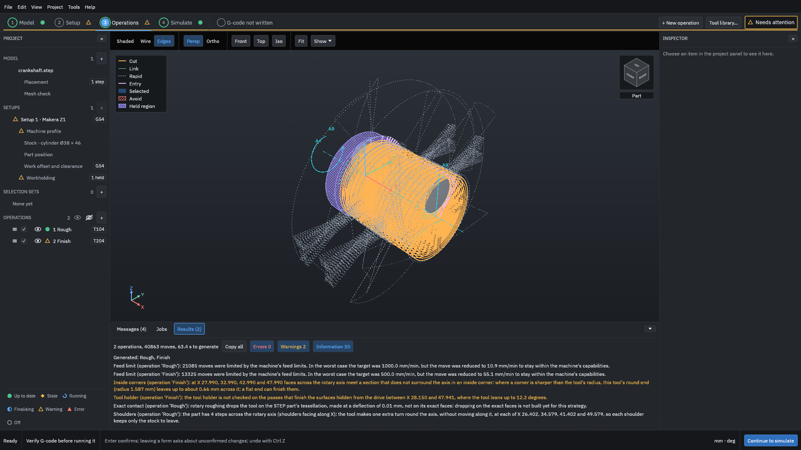
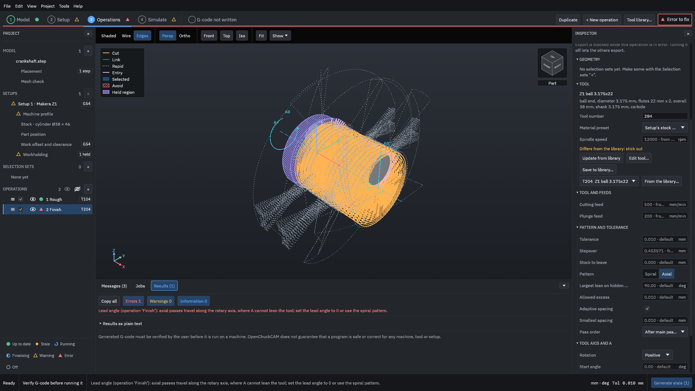

# Owner check for #766: a refused Generate shows only its refusal

**For:** the project owner, on Windows. **Time:** about 5 minutes (one Generate of about a minute). **Machine:** none.

## What changed, and what to check

The fix is pull request #893, merged as `e126459`; the rule is [decision 0689](../../docs/decisions/0689-results-recovery-and-held-region-notes.md), accepted. After a Generate that is refused, **Results** shows the refusal and nothing of the earlier run: no summary, no earlier lines, no "has changed" line. The tab reads **Results (1)** and Copy all copies the refusal. The view keeps the earlier paths, marked out of date.

| Check | Expected result |
| --- | --- |
| Generate (spiral, Lead angle 10) | Both operations generated; Results "2 operations, … moves", Warnings 2 |
| Pattern **Axial**, Generate | Results (1): **Errors 1**, Warnings 0, Information 0, and only "Lead angle (operation 'Finish'): axial passes travel along the rotary axis, where A cannot lean the tool; set the lead angle to 0 or use the spiral pattern." No earlier summary or lines |

## The example project

[`project/`](project/) is the public `testdata/examples/crankshaft-simultaneous/crankshaft-project` (STEP part `crankshaft.step`; the program's STEP reader is needed) with the two operations of the user guide's *Simultaneous finishing* sections 2 and 4 **already added**: **Rough** (rotary roughing, flat end 104, Stepdown 1) and **Finish** (Simultaneous 4-axis finishing, ball 204, **Lead angle 10**). This saves the guide's sections 1 to 4; the check starts at its section 5. Made by copying the example and adding the two operation files (`operations/0c0c0766-…-301.toml` and `-302.toml`), then `openchuck-cli resave`.

## Steps

Use a nightly with `e126459` (25 Nov 2026 or later), on Windows.

1. Copy [`project/`](project/) and open the copy. Click **3 Operations**, then **Generate stale (2)**; wait about a minute for **Ready**. Open **Results**: "2 operations, … moves", Warnings 2 (screenshot 1).
2. Click **2 Finish**. In the Inspector under **Pattern and tolerance**, next to **Pattern**, click **Axial** (leave Lead angle at 10). Click **Generate stale (1)**.
3. **Expect** Results as in the table: the refusal alone, **Results (1)** (screenshot 2). Optional: **Copy all** and paste: only the refusal.

## Pass and fail

- **Pass:** step 3 as written.
- **Fail:** any line, summary or count of the earlier run shown after the refusal. Report with a screenshot.

## What to report back

```text
#766 refused Generate
Build (Help > About version / commit):        Windows version:
1 first Generate ok, Warnings 2:                     PASS / ...
3 after Axial: Results (1), Errors 1, refusal only:  PASS / what else was shown
Result: PASS / FAIL
```

## As captured here

True captures from the release build of `main` at `e126459` (with the STEP reader), Linux, Xvfb with Mesa lavapipe, 1920 × 1080, one session. The pattern button reads **Axial** (the guide's text says "axial").

1. 
2. 
