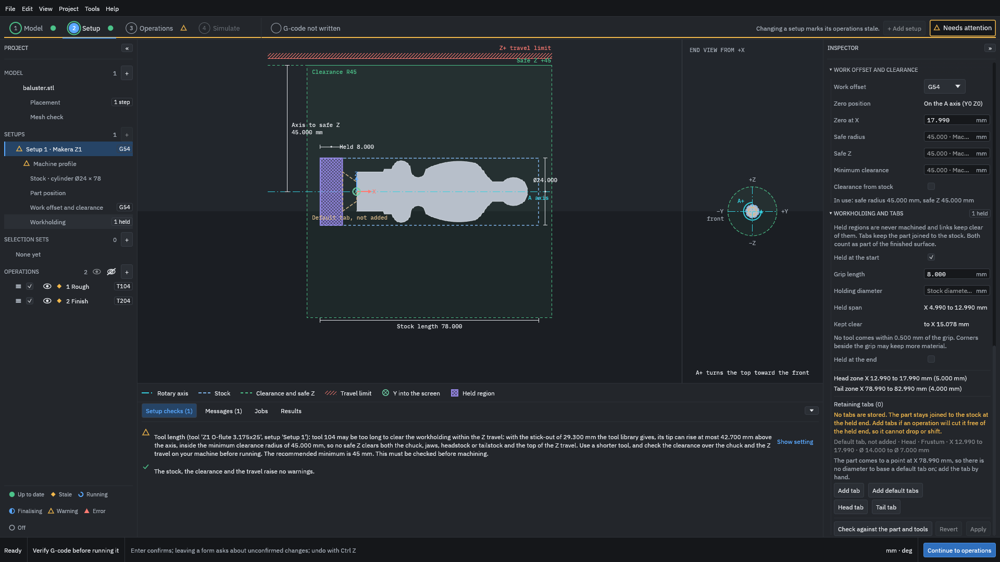
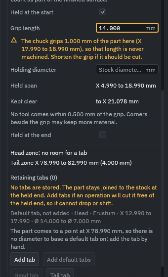

# Owner check for #767: the tab zone lines follow the grip before Apply

**For:** the project owner, on Windows. **Time:** about 3 minutes. **Machine:** none.

## What changed, and what to check

The fix is pull request #893, merged as `e126459`. In **Workholding and tabs**, the head and tail zone lines and the tab rows' zone names now follow the draft's held regions as you type, before **Apply**.

| Check | Expected result |
| --- | --- |
| Workholding opened | Grip length 8.000; **Head zone X 12.990 to 17.990 mm (5.000 mm)**; Kept clear to X 15.078 mm |
| Grip length 14 + Enter, no Apply | At once: **Head zone: no room for a tab**, and Kept clear **to X 21.078 mm** |

## The example project

[`project/`](project/) is the public tutorial project with its stock changed by #893's command: `openchuck-cli setup project "Setup 1" --stock cylinder=24,78,4.99` (78 mm from X 4.99, grip 8 mm), and renamed.

## Steps

Use a nightly with `e126459` (25 Nov 2026 or later), on Windows.

1. Copy [`project/`](project/) and open the copy. Click **2 Setup**, then **Workholding** under **Setup 1**. **Expect** the Head zone line above (screenshot 1).
2. In **Grip length** type `14` and press **Enter**. Do **not** press Apply. **Expect** at once "Head zone: no room for a tab" and Kept clear "to X 21.078 mm" (screenshot 2).

## Pass and fail

- **Pass:** step 2 shows the new lines before Apply.
- **Fail:** the Head zone line still reads X 12.990 to 17.990 until Apply. Report with a screenshot.

## What to report back

```text
#767 zone lines
Build (Help > About version / commit):        Windows version:
1 Head zone X 12.990 to 17.990 mm (5.000 mm):                 PASS / ...
2 grip 14: "no room for a tab", Kept clear to X 21.078 mm:    PASS / ...
Result: PASS / FAIL
```

## As captured here

True captures from the release build of `main` at `e126459`, Linux, Xvfb with Mesa lavapipe, 1920 × 1080.

1. 
2. 
