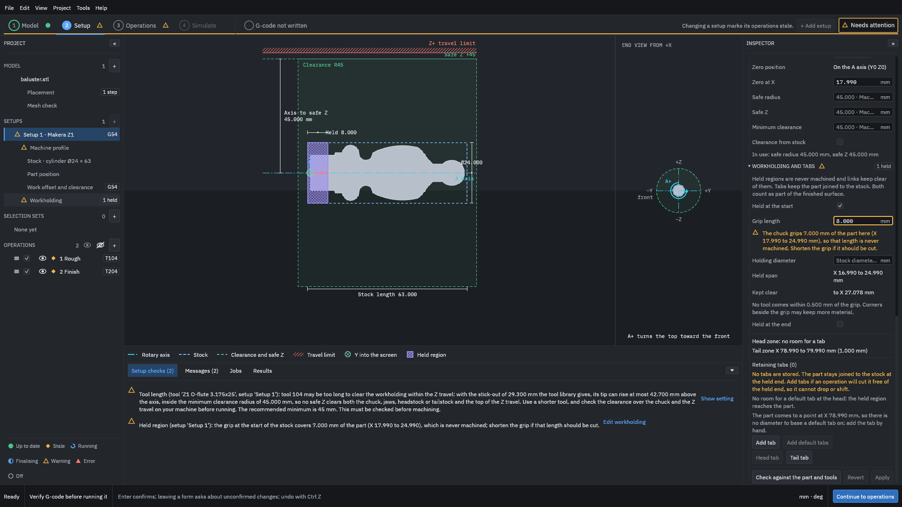
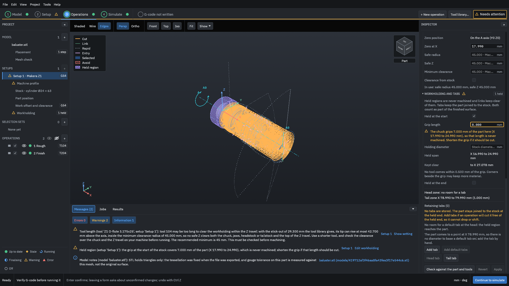
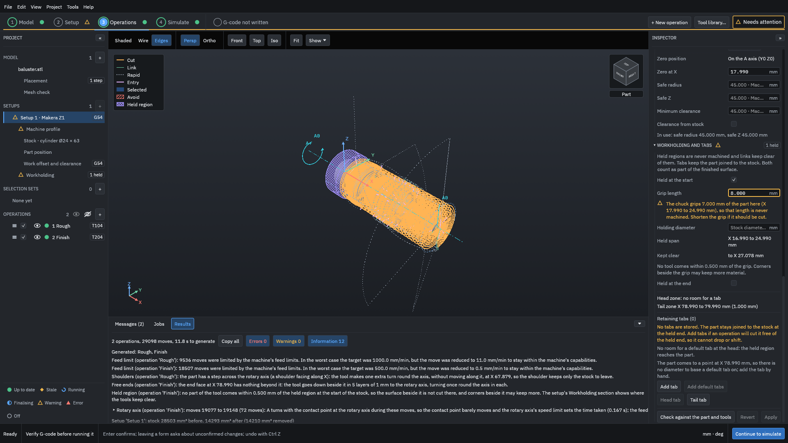
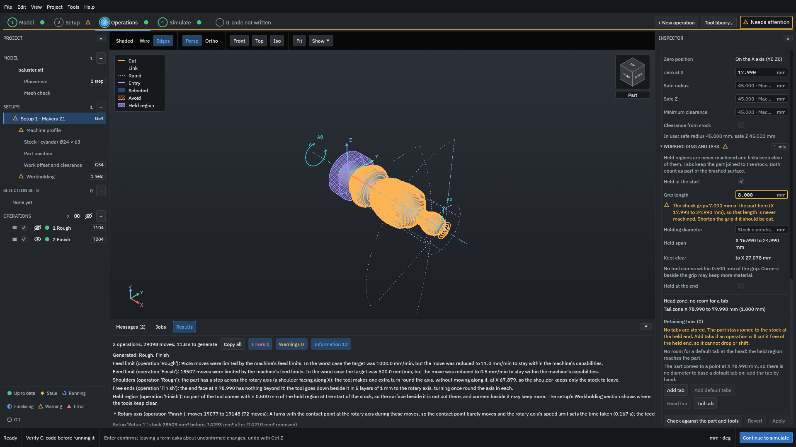
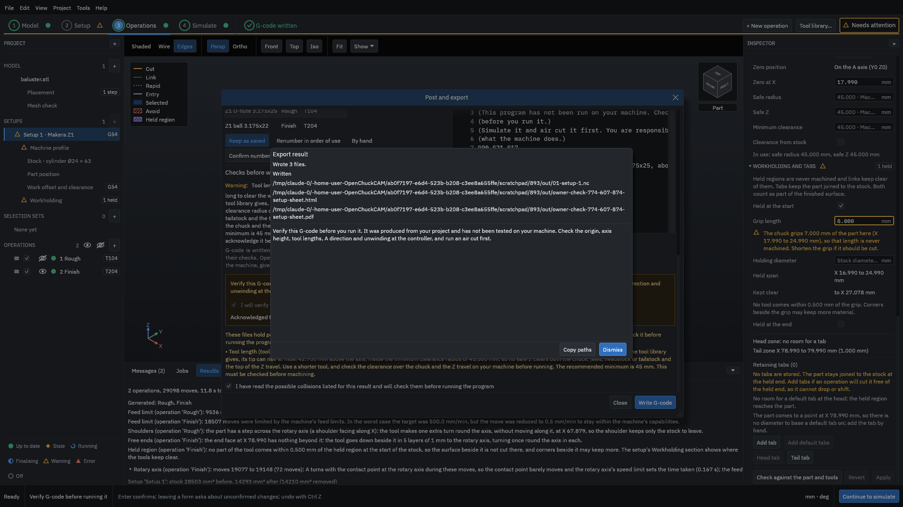

# Owner check for #774, #607 and #874: the held-region note is information; hiding a path changes nothing written

**For:** the project owner, on Windows. **Time:** about 10 minutes. **Machine:** none.

> [!WARNING]
> Nothing in this check shows that a program is safe to run. Generated G-code is yours to verify before it runs on a machine.

## What changed, and what to check

The fix is pull request #893, merged as `e126459`; the rule is [decision 0689](../../docs/decisions/0689-results-recovery-and-held-region-notes.md), accepted.

- **#774:** the note that no tool comes near the grip is **information**, not a warning (no amber mark, no count, nothing to acknowledge). The setup's Workholding gains a **Kept clear** row with the approved sentence.
- **#607 and #874:** hiding or showing a path no longer marks Results out of date, and no longer refuses **Write G-code** with "the project changed after the files were made".

| Check | Expected result |
| --- | --- |
| Setup > Workholding | Under Held span: **Kept clear: to X 27.078 mm**, then "No tool comes within 0.500 mm of the grip. Corners beside the grip may keep more material." |
| Generate stale (2) | **1 Rough** and **2 Finish** both green. Messages: 2 warnings (Tool length and the setup's grip), neither about an operation's held region |
| Results, Information | "Held region (operation 'Finish'): no part of the tool comes within 0.500 mm of the held region at the start of the stock, so the surface beside it is not cut there, and corners beside it may keep more. The setup's Workholding section shows where the tools keep clear." Results shows **Warnings 0** |
| Hide 1 Rough's path | Results does **not** say "The project has changed since this run" |
| Post and export > Write G-code | The files are written ("Wrote 3 files") |

## The example project

[`project/`](project/) is a copy of the public tutorial project `testdata/examples/baluster/baluster-project`, renamed, as #893's check uses it. Work on a copy.

## Steps

Use a nightly with `e126459` (25 Nov 2026 or later), on Windows.

1. Open the copy (**File > Open project**). Click **2 Setup**, then **Workholding** under **Setup 1**. **Expect** the Kept clear row and sentence (screenshot 1).
2. Click **3 Operations**, then **Generate stale (2)**, and wait for **Ready**. **Expect** both operations green and Messages with 2 warnings (screenshot 2).
3. Open **Results**. **Expect** the held-region line among the information lines, and **Warnings 0** (screenshot 3).
4. **#607:** click the eye of **1 Rough** to hide its path. **Expect:** Results unchanged, with no "has changed" line (screenshot 4).
5. **#874:** **Post and export…** (Ctrl E). Choose an empty output folder, tick **I will verify this G-code…** and **I have read the possible collisions…**, and press **Write G-code**. **Expect:** "Export result — Wrote 3 files" (screenshot 5).

## Pass and fail

- **Pass:** each step as written.
- **Fail:** an amber mark or a warning count for the held-region note; "The project has changed since this run" after hiding a path; Write G-code refused with "the project changed after the files were made". Report the step and a screenshot.

## What to report back

```text
#774 / #607 / #874
Build (Help > About version / commit):        Windows version:
1 Kept clear: to X 27.078 mm and the sentence:      PASS / ...
2-3 held-region line is information, Warnings 0:    PASS / ...
4 hiding Rough's path: no "has changed":            PASS / ...
5 Write G-code wrote the files:                     PASS / ...
Result: PASS / FAIL
```

## As captured here

True captures from the release build of `main` at `e126459`, Linux, Xvfb with Mesa lavapipe, 1920 × 1080, the steps in order in one session.

1. 
2. 
3. 
4. 
5. 
