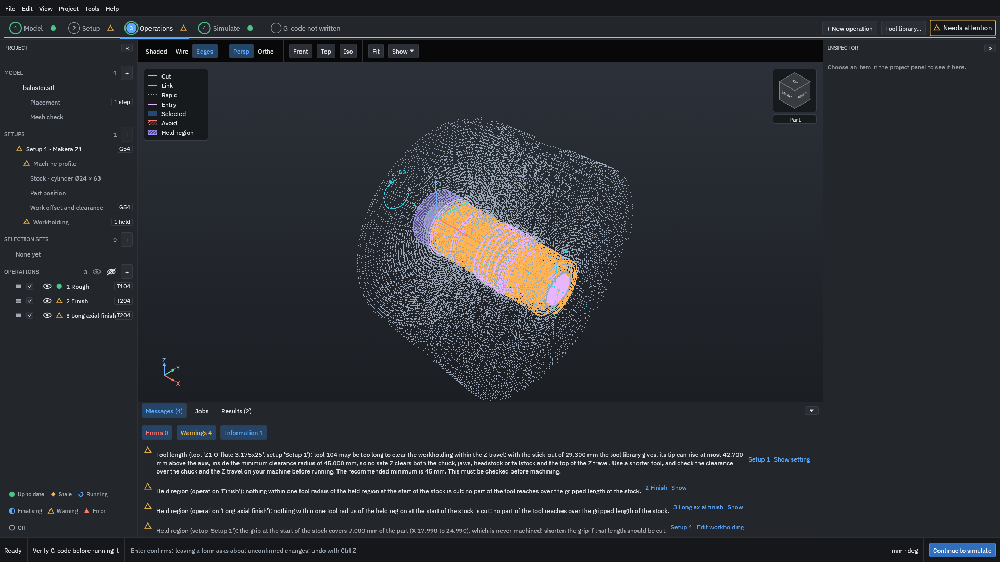
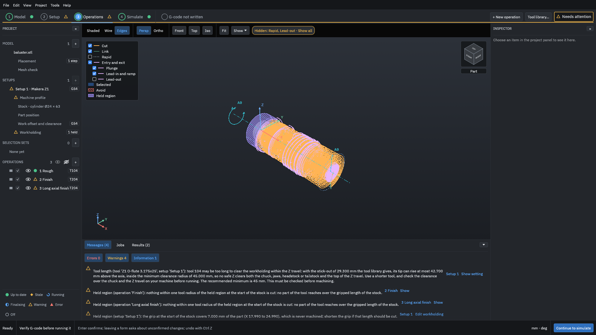
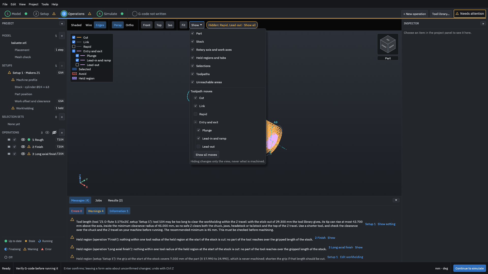
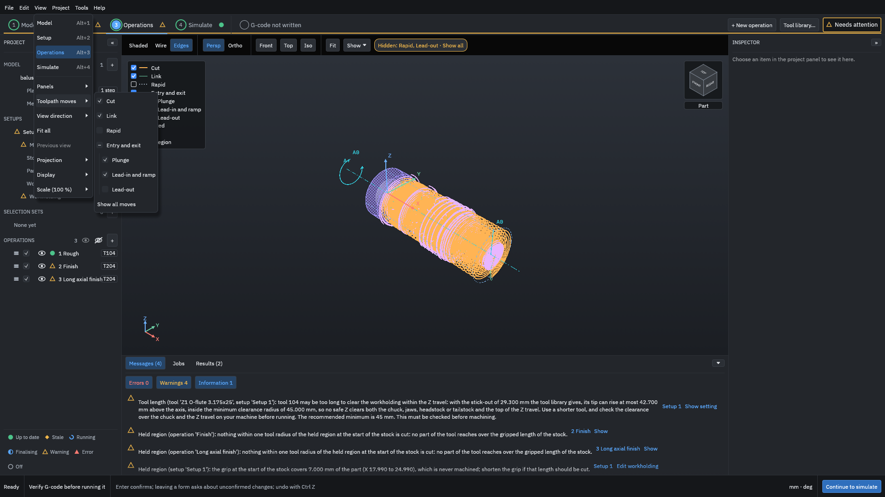
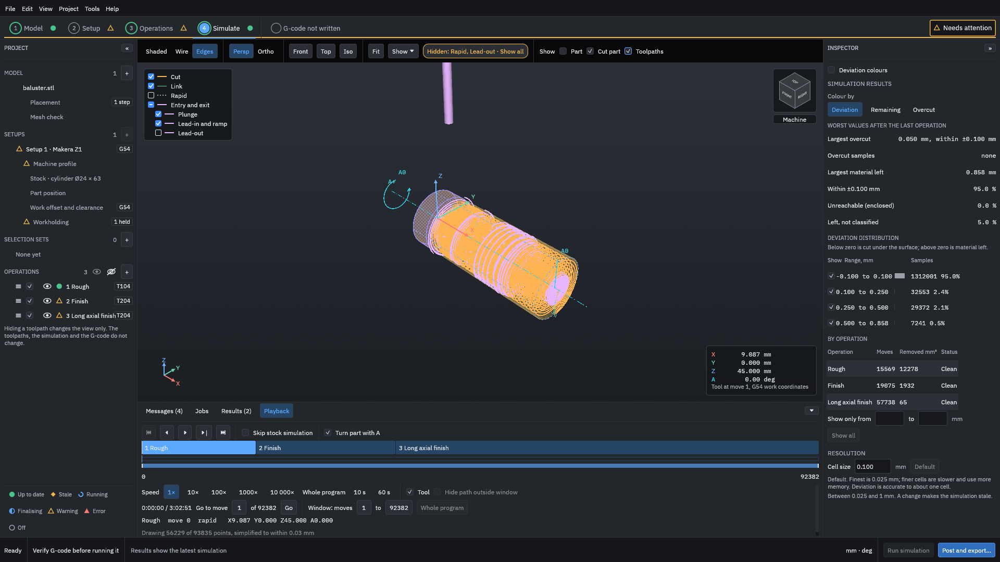
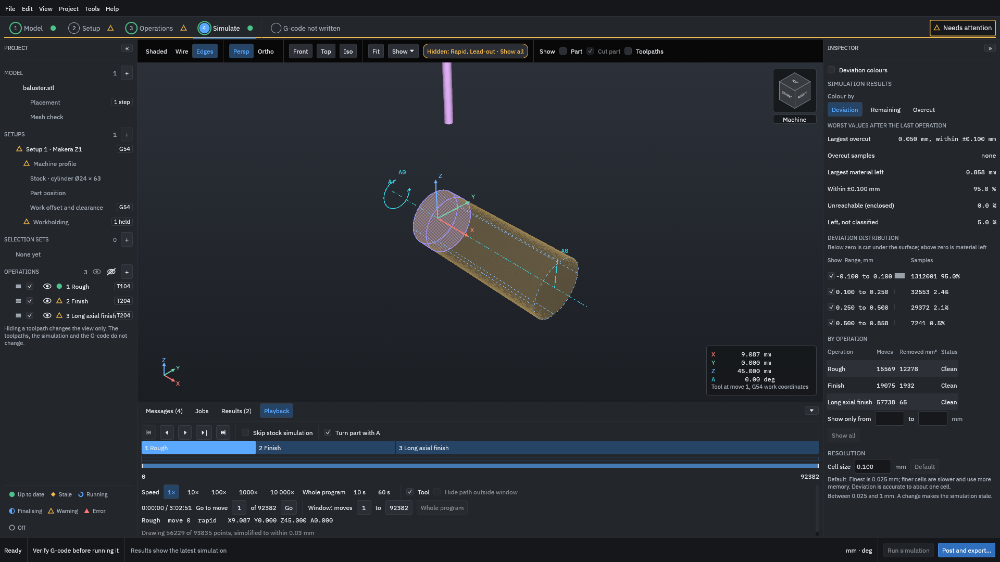
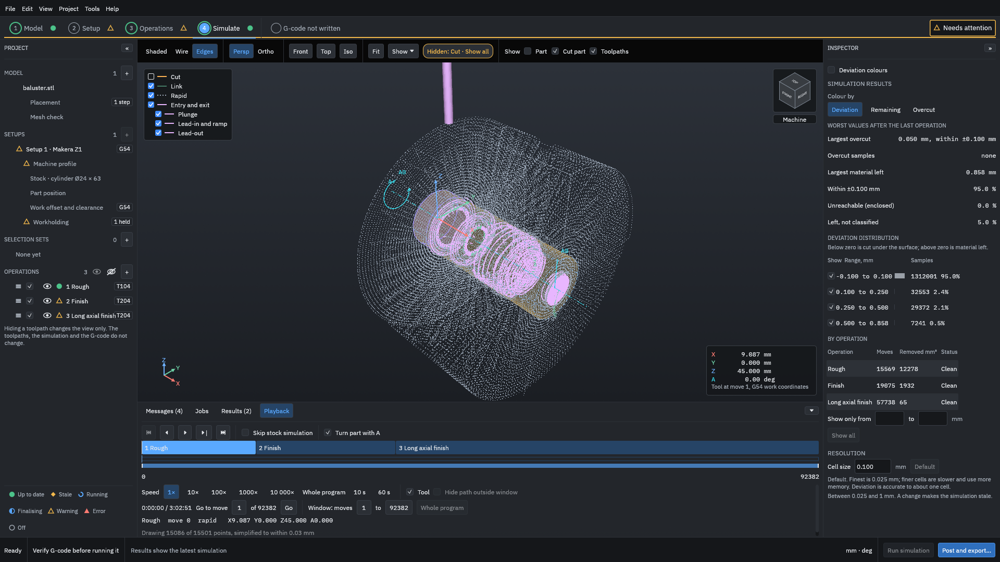
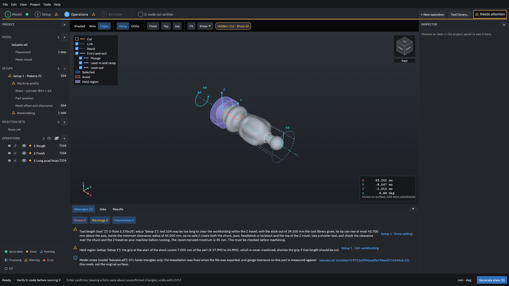
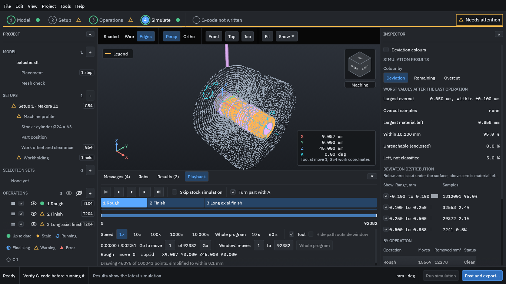
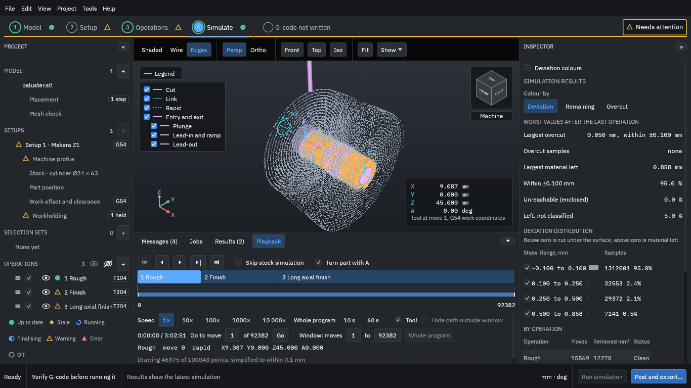

# Owner check for #789: show or hide each kind of toolpath move

**For:** the project owner. **Time:** about 20 minutes, including two Generates of about a minute each. **Machine:** none. Display only.

> [!NOTE]
> Hiding a kind of move changes only what the view draws. The G-code, the simulation, the checks and playback do not change. Generated G-code is yours to verify before it runs on a machine.

## What changed, and what to check

Pull request #898 (lane PROJECT-UX-A, record PROJUX-A-2; draft, head `4664c82`). Each kind of toolpath move can now be shown or hidden. The kinds are **Cut**, **Link**, **Rapid**, and **Entry and exit**, which has **Plunge**, **Lead-in and ramp** and **Lead-out** under it. The choice is the same in three places, and it is kept for you across projects and restarts.

| Check | Expected result |
| --- | --- |
| Operations legend (top left of the view) | Each row of moves is a tick box. Unticking one removes those lines at once. Entry and exit shows a bar when only some of its three are shown |
| The chip beside **Show** | While anything is hidden it reads, for example, "Hidden: Rapid, Lead-out · Show all". Pressing it shows every kind again |
| **Show** menu (V) | A **Toolpath moves** group with the same six boxes and **Show all moves**, and the line "Hiding changes only the view, never what is machined." |
| **View > Toolpath moves** | The same boxes again |
| Simulate | The legend of moves is at the top left **only while Toolpaths is ticked**. With Toolpaths off there is no legend, and the chip stays |
| 1366 × 768 (best effort) | On Simulate the legend shows as a **Legend** button and opens on a click |
| Keyboard | Tab reaches each legend row (focus ring); Space turns it on or off |
| Restart | The choice is still there |
| A long path (about 92,000 moves) | Orbiting stays smooth with kinds hidden; hiding Rapid gives the rest finer detail |

## The example project

[`project/`](project/) is the public baluster (`testdata/examples/baluster/`), set up so that **every kind of move** is in the path and the path is long:

| Operation | Strategy | Entry | Moves in the Makera Z1 file |
| --- | --- | --- | --- |
| 1 Rough | rotary roughing, flat end 104 | **Ramp**, with **Allow single-point plunge** and **Steeper ramp near the axis** | 14,790 |
| 2 Finish | helical finishing, ball 204 | **Lead** (arcs in and out) | 18,863 |
| 3 Long axial finish | axial finishing, ball 204, defaults | **Plunge** | 57,668 |

The whole path is 92,382 moves on Simulate's timeline. It takes about 60 s to generate on 4 threads.

> [!IMPORTANT]
> **A step in PR #898's own check fails as written.** Its step 2 sets Rough's **Entry** to **Ramp** on the baluster. That alone is refused: "Ramp entry (operation 'Rough'): pass 33 is a single point, so there is no path for the ramp to follow…". With **Allow single-point plunge** on, it is refused again: "pass 85 turns round the part … a ramp round it would take 17.6 turns, more than the 10 allowed". This project turns both on, so the ramp entry generates. Ramps are then entered steeper near the axis, up to 5.26°, and 23 single-point passes are plunged.

<details><summary>How the project was made (to regenerate it)</summary>

From a checkout of `main` at `361613e`:

```sh
P=owner-checks/789-path-move-kinds/project
cp -r testdata/examples/baluster/baluster-project $P
# text edits only:
#   project.toml: the name
#   operations/1a280b59-…toml (Rough): add  allow_single_point_plunge = true, entry = "ramp", ramp_steeper_near_axis = true
#   operations/34e3aa5e-…toml (Finish): add  entry = "lead"
#   add operations/0c0c0789-0000-4000-8000-000000000303.toml: axial_finishing, tool c0de0001-…-000000000204, order X, entry = "plunge"
openchuck-cli resave $P
```

</details>

## Steps

Use a build of PR #898: the branch `claude/lane-project-ux-a-path-kinds`, at `4664c82` or later, or a nightly after it merges. The screenshots below are from `4664c82`. Use a 1920 × 1080 window for steps 1 to 9.

1. Copy [`project/`](project/) somewhere and open it with **File > Open project**. Click **3 Operations**, then **Generate stale (3)**, and wait for **Ready** (about a minute).
2. The legend at the top left lists **Cut, Link, Rapid, Entry and exit** (with **Plunge, Lead-in and ramp, Lead-out**), each ticked (screenshot 2). Before this change the rows were labels only (screenshot 1).
3. Untick **Rapid**. The dotted grey rapids go at once, and the chip "Hidden: Rapid · Show all" appears beside **Show**.
4. Untick **Lead-out**. **Entry and exit** shows a bar, and the chip reads "Hidden: Rapid, Lead-out · Show all" (screenshot 3).
5. Click in the view, then press **Tab** until a legend row has the focus ring, and press **Space**: that row turns off or on. Put it back.
6. Press **V** (or click **Show**). The **Toolpath moves** group shows the same ticks and **Show all moves** (screenshot 4). Press Esc. Open **View > Toolpath moves**: the same again (screenshot 5).
7. Orbit and zoom the view with a long drag, with Rapid hidden, then with everything shown. It should stay smooth. Note any stutter.
8. Click **Continue to simulate** and wait for it (about a minute). In **Show**, tick **Toolpaths**: the legend of moves appears at the top left with the same ticks (screenshot 6). Untick **Toolpaths**: the legend goes and the chip stays (screenshot 7). Press play: the tool still moves along the hidden moves, and the part is cut as before.
9. Press the chip: every kind is shown again. Untick **Cut** (screenshot 8). Quit the program and start it again: **Cut** is still unticked and the chip says "Hidden: Cut · Show all" (screenshot 9). Press the chip.
10. Optional, best effort: in a 1366 × 768 window, do steps 1 and 8. On Simulate the legend is a **Legend** button at the top left (screenshot 10). A click opens it, and it does not overlap another box (screenshot 11).

## Pass and fail

- **Pass:** each step reads as described, and the view stays smooth while orbiting with kinds hidden.
- **Fail:**
  - a kind still drawn after it is unticked, or a kind missing while ticked;
  - the chip missing while something is hidden;
  - the three controls disagreeing;
  - the choice lost on restart;
  - any change to the simulation or G-code;
  - boxes overlapping at 1920 × 1080.
  Report the step, the step tab (Operations or Simulate), the window size and a screenshot.

## What to report back

```text
#789 show or hide kinds of move
Build (version / commit):          Window size:
Steps 2-6 (legend, chip, Show menu, View menu, keyboard): PASS / what differed
Step 7 smoothness, Rapid hidden / all shown: smooth / stutter (describe)
Step 8 Simulate legend only with Toolpaths: PASS / what differed
Step 9 restart keeps the choice: yes / no
Step 10 at 1366x768 (optional): Legend button / overlap seen
Result: PASS / FAIL
```

## As captured here

True captures from release builds on Xvfb with Mesa lavapipe. Screenshot 1 is `main` at `361613e` (0.63.0, before the change). Screenshots 2 to 11 are PR #898 at `4664c82`. Screenshots 1 to 9 are at 1920 × 1080 and 10 and 11 at 1366 × 768. Each "after" was taken by doing the step above, in order, in one session; screenshot 9 is after a real restart with the same settings folder. Smoothness was not judged here: software rendering says nothing about a real GPU. The `generate` output is in [`run/regenerate.txt`](run/regenerate.txt).

1. Before (0.63.0): the legend's rows are labels only.
   
2. After: the legend with every kind ticked.
   
3. Rapid and Lead-out hidden: the chip, and Entry and exit partly ticked.
   
4. Show (V): the Toolpath moves group.
   
5. View > Toolpath moves.
   
6. Simulate with Toolpaths ticked: the legend of moves at the top left.
   
7. Simulate with Toolpaths unticked: no legend, the chip stays.
   
8. Cut hidden.
   
9. After a restart: Cut still hidden.
   
10. 1366 × 768, Simulate: the legend collapsed to its button.
    
11. 1366 × 768, the legend opened.
    
