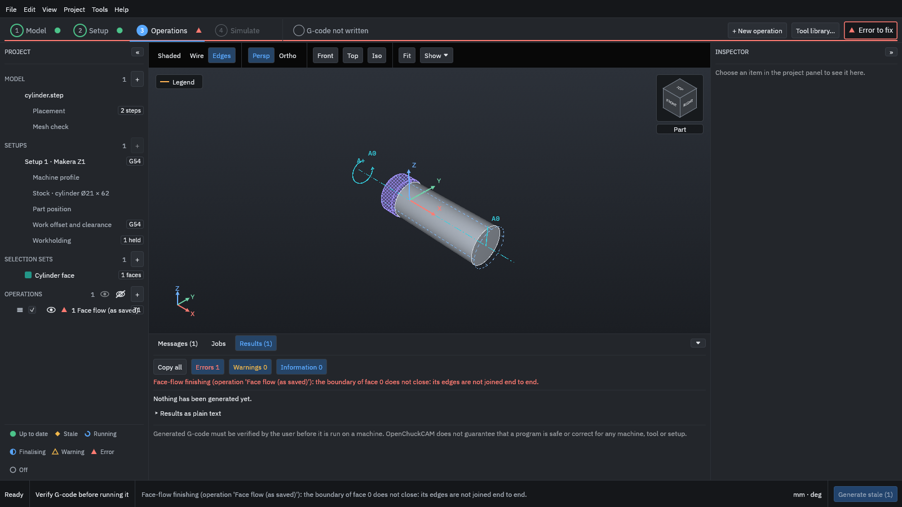
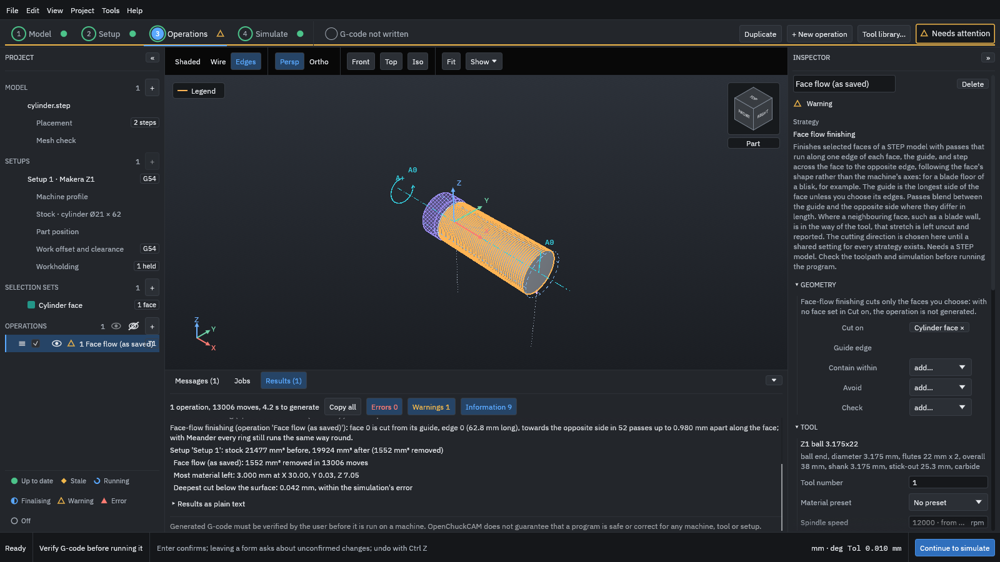
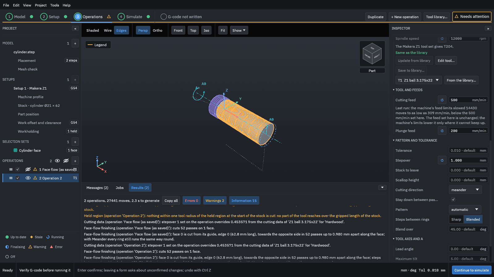

# Owner check for #791: face flow on a face that closes round on itself (a cylinder, the blisk's outside face)

**For:** the project owner. **Time:** about 15 minutes, plus a few minutes for your own project. **Machine:** none. This is a check in the application only.

> [!WARNING]
> Nothing in this check shows that a program is safe to run. Do not run these programs on a machine. Generated G-code is yours to verify before it runs on a machine.

## What changed, and what to check

**Before:** face-flow finishing refused a face that closes round on itself, such as a full cylinder or the blisk's outside face, with "the boundary of face N does not close: its edges are not joined end to end". STEP lists such a face's seam edge once, although the face's boundary runs along it twice, so the boundary never closed (#791, 0.55.0).

**The fix** is pull request #854, merged as `361613e` (library 0.63.0); the rule is [decision 0675](../../docs/decisions/0675-face-flow-on-a-face-closed-round-its-axis.md), option A.

- The seam is not a boundary.
- The face's two ends are the guide and the opposite side. The guide is the longer end, unless you choose a Guide edge set.
- The face is cut in **rings** round it, from one end to the other.

The same pull request also changed how a **new** face-flow operation starts ([decision 0686](../../docs/decisions/0686-face-flow-stays-down-follows-outlines-and-drops-short-cuts.md)): **Stay down between passes** ticked, **Pattern: Automatic**, **Steps between rings: Blended** (45°), **Shortest cut: Tool diameter**. An operation saved before keeps its old settings and its old kind of program.

| Check | Expected result |
| --- | --- |
| The cylinder's side face, the operation as saved | No refusal. Note "face 0 is cut from its guide, edge 0 (62.8 mm long), towards the opposite side in **52 passes**"; rings round the cylinder, lifting between them |
| The same face, a **new** operation (stepover 1 mm) | 52 passes, joined by blended steps; the note adds "steps between rings blended over 45°". **2 rapids** in the program, against 52 |
| The blisk's outside face (face 1), the operation as saved | No refusal: 35 passes along the guide |
| The blisk's outside face, a **new** operation (stepover 1 mm) | "face 1 **follows its outline** … inwards in 487 passes"; 11 rapids in the program |
| Simulation of the cylinder | No overcut beyond the cell (deepest 0.042 mm at the 0.1 mm cell) |
| Your own project from #791 | No refusal; the face is cut (see "Try your own project") |

## The example projects

Both are public or synthetic.

- [`project-cylinder/`](project-cylinder/) is synthetic, made with the command-line tool from the public fixture `testdata/step/valid/cylinder.step` (Ø20 × 50 mm, one side face 0 and two end faces). It is turned to lie along X, in Ø21 × 62 mm stock from setup X 20 with 8 mm held, so the part sits at setup X 30 to 80 (program X 0 to 50). It has:
  - one selection set, **Cylinder face** (face 0);
  - one operation, **Face flow (as saved)**: face-flow finishing with the Z1 ball 204 and stepover 1 mm, written with no other settings, as an operation saved before #854.
- [`project-blisk-face1/`](project-blisk-face1/) is the public `testdata/projects/face_flow` (blisk.step, 3 mm ball). Its set is changed to **face 1**, the outside face of the rim between the blades: the same kind of face as #791's. It has one operation, **Outside face (as saved)** (stepover 1.5 mm, saved settings).

Both are saved at schema 29 and open in 0.62.0 as well as in 0.63.0. On 0.62.0 both are refused, which reproduces #791.

<details><summary>How the cylinder project was made (to regenerate it)</summary>

From a checkout of `main` (`openchuck-cli` with the STEP reader). The model's stored name and the setup's ID are generated, so they will differ.

```sh
P=project-cylinder
openchuck-cli new $P --create --name "Owner check 791: face flow on a closed cylinder"
openchuck-cli import $P testdata/step/valid/cylinder.step
M=models/d6c36647a154b1b5b05017988f6dbeb7.step          # the path 'import' printed
openchuck-cli transform $P $M orient=+z
openchuck-cli machine $P makera-z1
openchuck-cli setup $P --new "Setup 1" --part $M --stock cylinder=21,62,20 --material Hardwood --part-offset 30 --work-x 30 --held-start 8
openchuck-cli tool $P c0de0001-0000-4000-8000-000000000204 --add --library crates/openchuck-project/defaults/z1
```

The command line has no command that makes a selection set or an operation. These two files are committed as written:

- `selections/0c0c0791-…-201.toml`: `faces = [0]` on the model;
- `operations/0c0c0791-…-301.toml`: strategy `face_flow`, tool 204, that set, `stepover = 1.0`.

The blisk project is `testdata/projects/face_flow` with `faces = [8]` changed to `faces = [1]` and the names changed. Both were then saved with `openchuck-cli resave`.

</details>

## Steps

Use a nightly build of 25 Nov 2026 or later (it must contain `361613e`; the figures here are from 0.63.0, `main` at `361613e`).

### A. The cylinder (about 10 minutes)

1. Open [`project-cylinder/`](project-cylinder/) with **File > Open project**.
2. Click **3 Operations**, then **Generate stale (1)**. It takes a few seconds.
3. Click **1 Face flow (as saved)**. The view shows rings round the cylinder. Click **Results** and read the two face-flow lines (screenshot 2):
   - "Face-flow finishing (operation 'Face flow (as saved)'): cuts 52 passes on 1 face."
   - "… face 0 is cut from its guide, edge 0 (62.8 mm long), towards the opposite side in 52 passes up to 0.980 mm apart along the face; with Meander every ring still runs the same way round."
4. Click **+ New operation**. Choose **Strategy: Face flow finishing**, keep the tool **Z1 ball 3.175x22**, and click **Add**.
5. In the Inspector, set **Cut on** to **Cylinder face** and **Stepover** to **1**. Check the defaults under **Pattern and tolerance**: **Stay down between passes** ticked, **Pattern: automatic**, **Steps between rings: Blended**, **Blend over 45.00**. Click **Generate stale (1)** (screenshot 3).
6. Read the new operation's note: "… in 52 passes …; steps between rings blended over 45°, 7° off the ring at a radius of 10.0 mm (steeper nearer the axis) …".
7. Optional: **Continue to simulate**. Under **BY OPERATION** each operation should be **Clean**.
8. Optional: **Post and export** with the Makera Z1 post, one file per operation. Count the `G0` lines in each file: 52 for the operation as saved, 2 for the new one.

### B. The blisk's outside face (about 5 minutes)

9. Open [`project-blisk-face1/`](project-blisk-face1/), **Operations**, **Generate**. Expect "cuts 35 passes on 1 face" and "face 1 is cut from its guide, edges 2, 3, … 23 (626.3 mm long), towards the opposite side in 35 passes". It is not refused.
10. Optional: add a new face-flow operation on the same set with **Stepover 1**, as in steps 4 and 5. Expect "face 1 follows its outline … inwards in 487 passes up to 1.000 mm apart along the face", and 11 `G0` lines in its Makera Z1 file. This is #854's own check, so it is not needed to close #791.

### Before the fix (optional, if you still have 0.62.0 or earlier installed)

Open either project with it and click **Generate**: it is refused with "the boundary of face 0 [face 1] does not close: its edges are not joined end to end" (screenshot 1).

## Try your own project

The project attached to #791 is yours, and it is not used here. Open it with the new build, select its face-flow operation, and **Generate**. Then read off:

- whether it is still refused, and if so the refusal's text;
- the operation's two face-flow notes: "cuts N passes on N faces" and "face N is cut from its guide … in N passes" (or "follows its outline … in N passes");
- any warning on the operation, for example a stretch left uncut because a neighbouring face is in the way;
- optionally, after **Post and export**, the number of `G0` lines in its file. Then add a new face-flow operation on the same set and compare the two.

## Pass and fail

- **Pass:**
  - no refusal on the cylinder, the blisk's outside face or your own project;
  - each face is cut in rings (or, for a new operation, along its outline where Automatic chooses that);
  - nothing cuts into a neighbouring face in the simulation.
- **Fail:** a refusal still naming "does not close"; a refusal naming the seam or the guide when you did not choose one; a cut into another face. Report the face, the operation's settings and a screenshot.

## What to report back

```text
#791 face flow on a closed face
Build (version / commit):
Cylinder, as saved:     refused? ___ ; passes ___ ; note says "cut from its guide, edge 0" yes/no
Cylinder, new op:       passes ___ ; "blended over 45" yes/no ; G0 lines (optional) ___
Blisk face 1, as saved: refused? ___ ; passes ___
My own project:         refused? ___ (text if so) ; passes ___ on ___ faces ; warnings ___ ; G0 lines (optional) ___
Result: PASS / FAIL (what)
```

If it passes, #791 can be closed.

## As measured here

`main` at `361613e` (0.63.0), Linux, release build with the STEP reader, 4 threads. The "before" runs used a build of `main` at `6b039e5` (0.62.0). Command: `openchuck-cli --threads 4 regenerate <project> --post makera-z1 --tool-numbers keep --grouping operation --out OUT`. The outputs are in [`run/`](run/).

| Project, operation | 0.62.0 | 0.63.0 |
| --- | --- | --- |
| Cylinder, as saved (stepover 1) | refused: "the boundary of face 0 does not close" | 52 passes, 11,223 moves, **52** `G0`, cut 658 s |
| Cylinder, new defaults (stepover 1) | (settings unknown to 0.62.0) | 52 passes, 12,651 moves, **2** `G0`, cut 690 s |
| Blisk face 1, as saved (stepover 1.5) | refused: "the boundary of face 1 does not close" | 35 passes, 58,681 moves, 198 `G0` |
| Blisk face 1, new defaults (stepover 1) | — | follows its outline, 487 passes, 17,531 moves, **11** `G0` |
| Simulation, cylinder (0.1 mm cell) | — | as saved: 1552.4 mm³ removed, deepest overcut 0.0420 mm; new defaults: 1559.2 mm³, 0.0421 mm |

The simulation's "most material left 3.000 mm at X 30" is the end face next to the held region. Only the side face is in the set, so the end faces are left as they are.

### Screenshots

True captures from release builds on Xvfb with Mesa lavapipe, at 1600 × 900.

1. 0.62.0 (`main` at `6b039e5`): the refusal.
   
2. 0.63.0 (`main` at `361613e`): the operation as saved, cut in 52 rings.
   
3. 0.63.0: a new face-flow operation with its defaults, stepover 1, generated.
   
