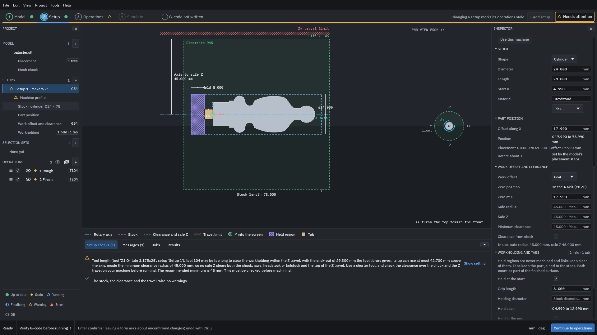
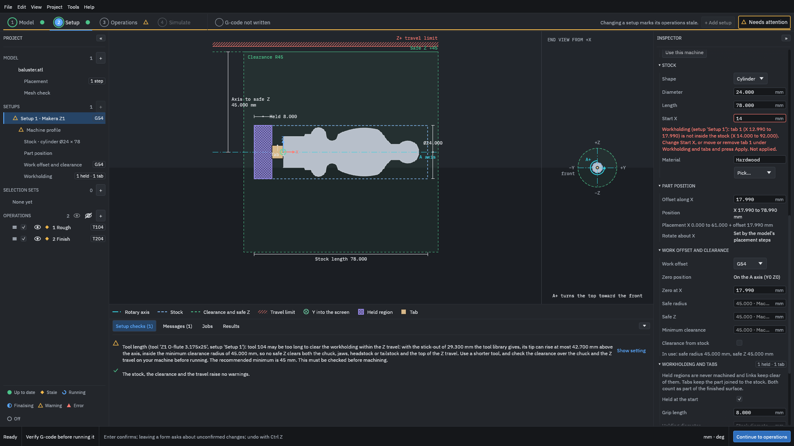
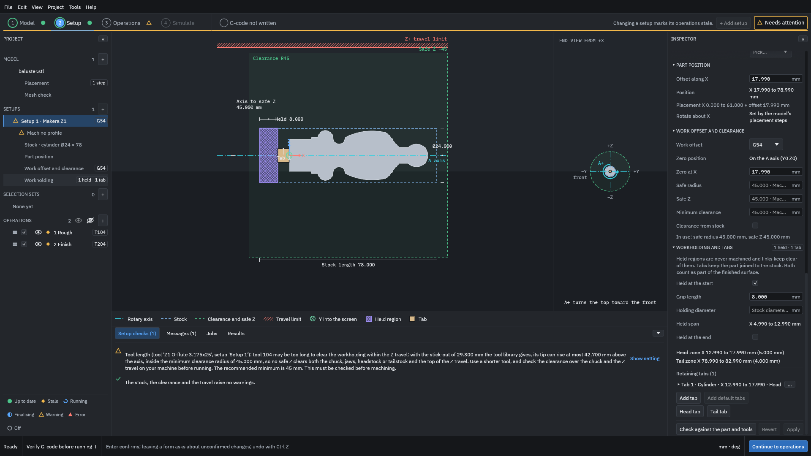
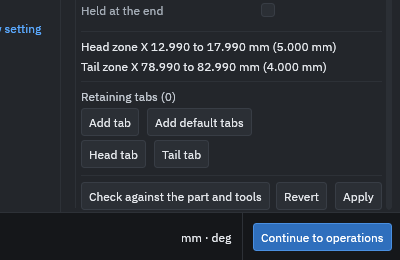
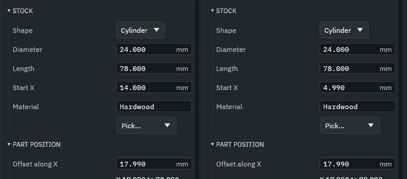

# Owner check for #870: a setup value that conflicts with the tabs no longer locks the setup

**For:** the project owner, on Windows. **Time:** about 5 minutes. **Machine:** none.

## What changed, and what to check

The fix is pull request #891, merged as `c8400189`; the rule is [decision 0688](../../docs/decisions/0688-dialogs-and-refused-setup-values.md) items 3 and 4, accepted.

**Before:** a Start X that left a hand-placed tab outside the stock was refused, and the setup then locked. Workholding's Apply asked "Unconfirmed changes" about Start X, Keep refused it again, and only Discard, which threw the typed value away, let you out.

**Now:**
- the refusal names the tab and both ways out;
- the refused value waits in its box without blocking anything;
- once the tab allows it, Enter applies it;
- values kept together are one undoable step.

| Check | Expected result |
| --- | --- |
| Start X 14 + Enter | Refused, in red under the field: "Workholding (setup 'Setup 1'): tab 1 (X 12.990 to 17.990) is not inside the stock (X 14.000 to 92.000). Change Start X, or move or remove tab 1 under Workholding and tabs and press Apply. Not applied." The box keeps 14 |
| Click Workholding | Opens; **no** Keep/Discard question |
| Remove tab 1, Apply | Applies |
| Back in Stock | "The tabs and held regions now allow this value. Press Enter to apply it." |
| Enter | Start X 14.000 |
| Ctrl Z once | Start X 4.990 again, tab still removed |

## The example project

[`project/`](project/) is the public tutorial project with its setup changed by one command:
- a 78 mm stock from X 4.99, with the 8 mm grip;
- **tab 1, placed by hand at X 12.99 to 17.99**.

Any Start X above 12.99 leaves that tab outside the stock, which is #870's state. Work on a copy.

<details><summary>How it was made (to regenerate it)</summary>

From a checkout of `main` at `c8400189` or later:

```sh
cp -r testdata/examples/baluster/baluster-project project
openchuck-cli setup project "Setup 1" --stock cylinder=24,78,4.99 --tab cylinder=12.99,5,6
# and the project's name, line 2 of project.toml: "Owner check 870"
```

</details>

## Steps

Use a nightly with `c8400189` (25 Nov 2026 or later), on Windows.

1. Copy [`project/`](project/) and open the copy (**File > Open project**).
2. Click **2 Setup**. In the project panel, under **Setup 1**, click **Stock · cylinder Ø24 × 78**. Start X reads 4.990 (screenshot 1).
3. Click **Start X**, type `14`, press **Enter**. **Expect** the red message above, under the field, and the box still reads `14` (screenshot 2).
4. In the project panel, click **Workholding**. **Expect:** the inspector moves to **Workholding and tabs**, with no question asked (screenshot 3).
5. On the row **Tab 1 · Cylinder · X 12.990 to 17.990 · Head**, click **…**, then **Remove**. **Retaining tabs (0)** (screenshot 4). Click **Apply** at the foot of the section.
6. Click **Stock** again. **Expect** under Start X: "The tabs and held regions now allow this value. Press Enter to apply it." (screenshot 5). Click in Start X and press **Enter**. **Expect:** 14.000.
7. Click the 3D view and press **Ctrl Z** once. **Expect:** Start X 4.990, and Workholding still reads "1 held" (no tab) (screenshot 6).

## Pass and fail

- **Pass:** each step as written; nothing locks; the message names tab 1 and no internal name.
- **Fail:** a field or button that will not respond; a Keep/Discard question at step 4; a message with an internal ID or field path; Undo needing more than one step at step 7. Report the step, and a screenshot.

## What to report back

```text
#870 refused setup value
Build (Help > About version / commit):        Windows version:
3 refused with the tab-1 message, box keeps 14:      PASS / ...
4 Workholding opens, no question:                    PASS / ...
6 "now allow this value", Enter applies 14.000:      PASS / ...
7 one Ctrl Z gives 4.990, tab still removed:         PASS / ...
Result: PASS / FAIL
```

## As captured here

True captures from the release build of `main` at `c8400189`, Linux, Xvfb with Mesa lavapipe, 1920 × 1080, doing the steps in order in one session. Not checked here: a real Windows mouse and keyboard.

1. 
2. 
3. 
4. 
5. 
6. Left after Enter (14.000), right after one Ctrl Z (4.990).
   
