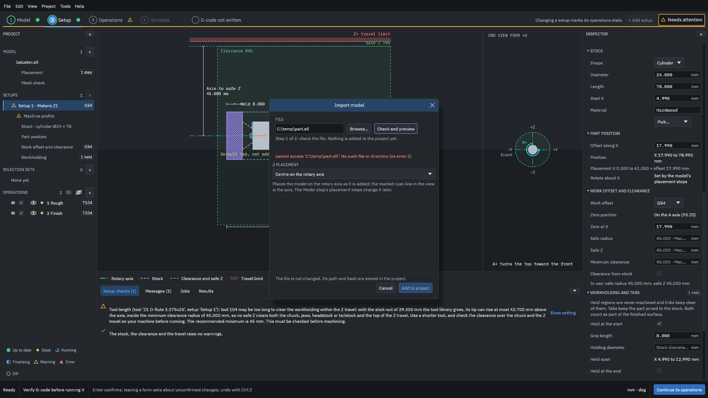
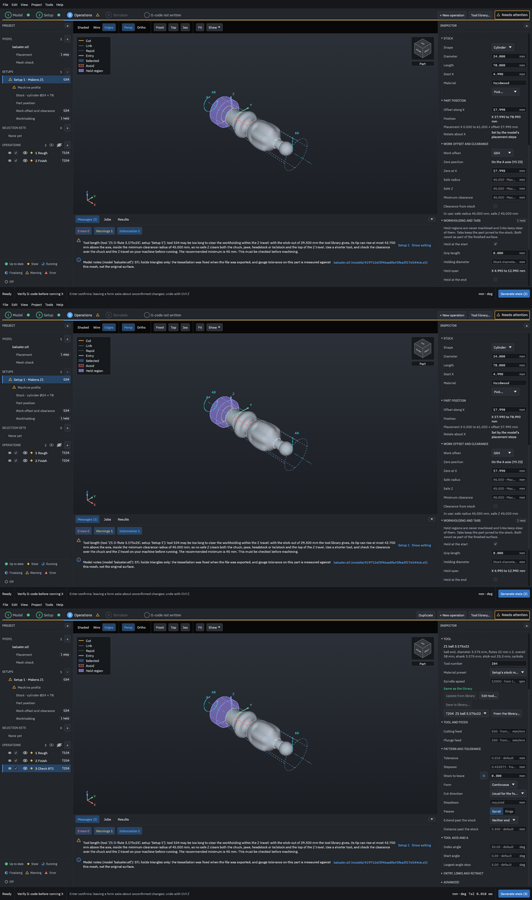
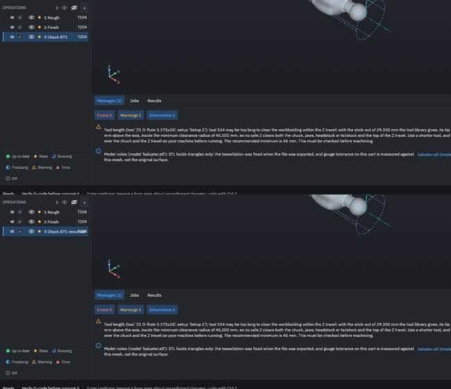
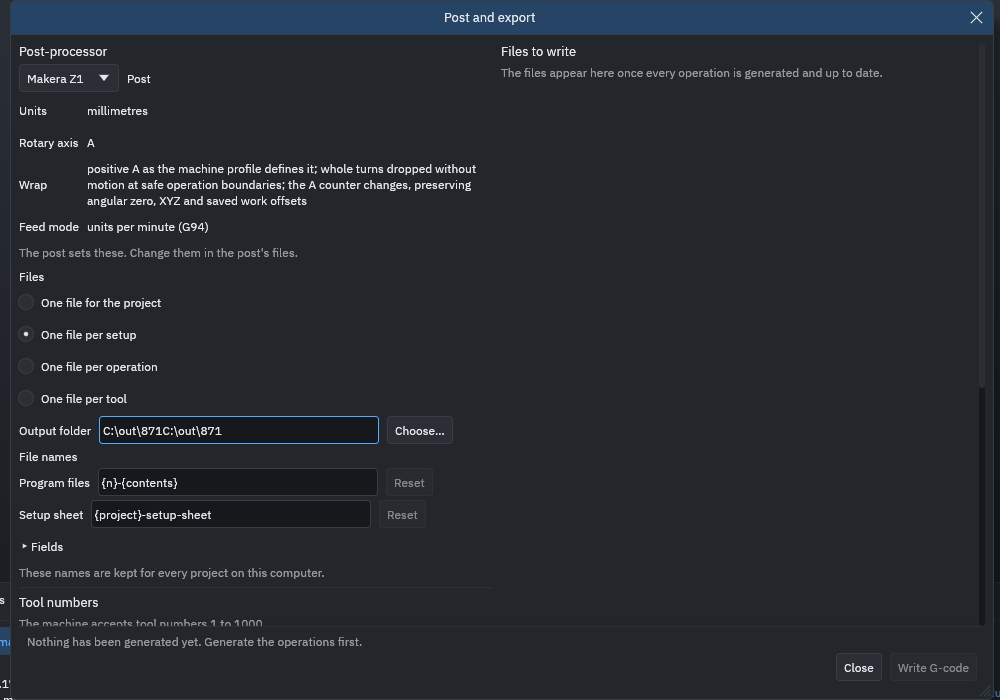
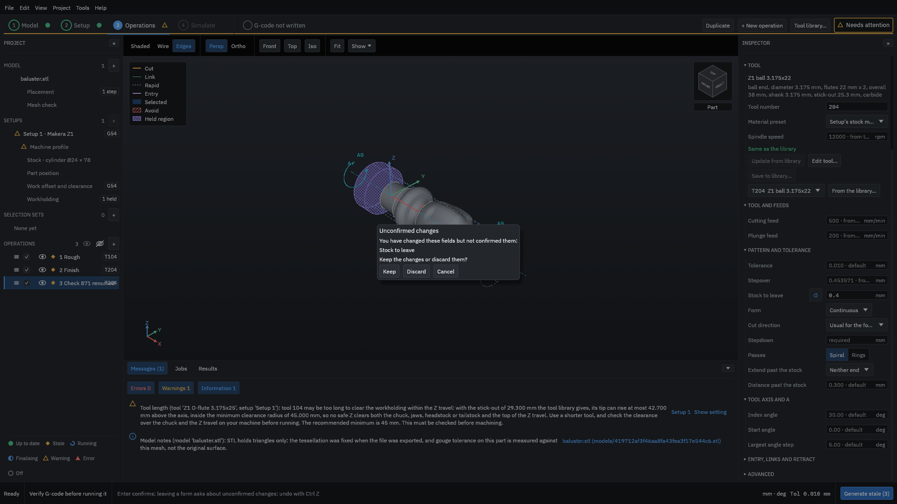

# Owner check for #871: a dialog's own buttons never ask about an unconfirmed field

**For:** the project owner, on Windows. **Time:** about 10 minutes. **Machine:** none.

## What changed, and what to check

The fix is pull request #891, merged as `c8400189`; the rule is [decision 0688](../../docs/decisions/0688-dialogs-and-refused-setup-values.md) item 5, accepted.

**Before:** typing in a dialog's field and then pressing the dialog's own Cancel, close box or other buttons raised "Unconfirmed changes … Keep / Discard". On `main` before the fix this happened on nine ways out of four dialogs (Import model, New operation, Rename, Post and export).

**Now:** inside a dialog, its own controls take the typed text, as moving to another field does; Cancel, the close box and Esc close it without a question. The question stays where it belongs: leaving the **inspector** with a typed value not yet confirmed.

| Check | Expected result |
| --- | --- |
| Each dialog's own button, close box or Esc, after typing without Enter | **No** "Unconfirmed changes" question. Cancel / close box / Esc close the dialog; the accept button (Add, Rename, Check and preview) uses what you typed |
| Esc while the text field is still being edited | The first Esc ends the edit; the second closes (decision 0677) |
| Inspector: type without Enter, then click another step | "Unconfirmed changes … Keep / Discard / Cancel" **is** asked |

## The example project

Any project. The [#870 pack's project](../870-refused-setup-value/project/) is the one used here; work on a copy.

## Steps

Use a nightly with `c8400189` (25 Nov 2026 or later), on Windows. In each dialog type something in its text field and **do not press Enter**; then press one way out. Reopen the dialog for the next way out.

1. **File > Import model…** — type a path in **File**. Ways out: **Cancel**, the close box (×), **Check and preview**, **Browse…**. **Expect:** no question; Check and preview checks what you typed (a path that does not exist says "cannot access …") (screenshot 1).
2. On **Operations**, **+ New operation** — type a name. Ways out: **Cancel**, the close box, **Add**. **Expect:** no question; Add makes the operation with that name (screenshot 2).
3. Select that operation in the project panel and press **F2** — type a new name. Ways out: **Cancel** (the old name stays), **Rename** (the new name) (screenshot 3).
4. **Post and export…** (Ctrl E) — type in **Output folder**. Ways out: **Close**, the close box, **Esc**. **Expect:** no question. With Esc, the first Esc ends the typing and the second closes (screenshot 4). The folder you typed is kept for the next opening.
5. **File > Open project…** — if the project has unsaved changes you are first asked "The project has unsaved changes" (that is expected; choose **Cancel** and save first, or Discard on a copy). Then type a folder; ways out **Cancel**, **Browse…**: no question.
6. **Inspector (not a dialog):** select an operation, type a value in **Stock to leave** without Enter, and click **2 Setup** at the top. **Expect:** "Unconfirmed changes — You have changed these fields but not confirmed them: Stock to leave — Keep / Discard / Cancel" (screenshot 5).

## Pass and fail

- **Pass:** no question in steps 1 to 5; the question in step 6.
- **Fail:** report the dialog and the button that asked, with a screenshot.

## What to report back

```text
#871 dialog buttons
Build (Help > About version / commit):        Windows version:
1 Import model: Cancel / close / Check and preview / Browse:  no question? ___
2 New operation: Cancel / close / Add:                         no question? ___
3 Rename: Cancel / Rename:                                     no question? ___
4 Post and export: Close / close box / Esc:                    no question? ___
5 Open project: Cancel / Browse:                               no question? ___
6 inspector asks "Unconfirmed changes":                        yes / no
Result: PASS / FAIL (which dialog and button asked)
```

## As captured here

True captures from the release build of `main` at `c8400189`, Linux, Xvfb with Mesa lavapipe, 1920 × 1080, one session. Steps 1 to 4 and 6 were run (every way out listed, Browse… excepted: it opens the system's file chooser, which Xvfb has not); step 5 stopped at the expected unsaved-changes question. Not checked here: a real Windows mouse, keyboard and file chooser.

1. Import model after **Check and preview** with a typed path: no question; the path is checked.
   
2. New operation: after Cancel (top), the close box (middle), Add (bottom: "3 Check 871" added). No question in any.
   
3. Rename: Cancel kept "Check 871" (top); Rename applied "Check 871 renamed" (bottom).
   
4. Post and export: the first Esc ended the typing in Output folder (dialog still open, footer Close / Write G-code); the second Esc closed it.
   
5. Inspector: the question is still asked.
   
