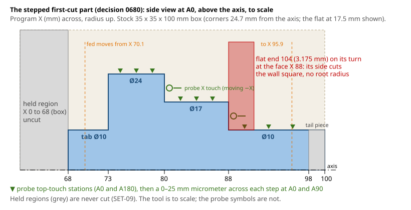

# Owner check: repeat the gate 5 first cut on the stepped cylinder (OI-2152)

**For:** the project owner, on the Makera Z1. **Time:** about half a day, spread over the steps below: an air cut, then the cut, then about an hour of measuring.

> [!WARNING]
> Nothing in this check shows that a program is safe to run. Generated G-code is yours to verify before it runs on a machine: read the program, simulate it, and air-cut it attended before any cut. The probe commands below come from the Z1 firmware source and the rc3 notes. They are not verified on a Z1. Run them attended and stop at anything unexpected.

## Where this stands (24 Nov 2026, `main` at `6b039e5`)

**Already done:**

- The part changed from the cone to stepped cylinders: [decision 0680](../../docs/decisions/0680-the-gate-5-reference-part-is-a-stepped-cylinder.md), which you accepted on 23 Nov 2026. It has three steps: Ø24 × 7, Ø17 × 8 and Ø10 × 10 at program X 73 to 98. The tool is the flat end 104, used for both roughing and finishing, so the program has no tool change. X0 is set from the probed tail end face (method X2). The part is measured against the **simulated** part.
- The project `testdata/projects/first_cut/` and its two programs `testdata/golden/first_cut/` were rebuilt for that part in pull request #845, merged 24 Nov 2026 (commit `2377d56a`).
- **Gates 1 and 2** (the end-to-end tests at 1, 2 and N threads) pass on that commit.
- **Gate 3**, the LinuxCNC replay in five chunks, passed in #845's CI.
- The simulation test passes on that commit: no overcut, and the steps within ±0.05 mm of the model at the stations.

**Must happen before the cut, in this order:**

1. **OI-2197: confirm the tool (still open).** Which 3.175 mm flat end will you fit? The project holds **104, "Z1 O-flute 3.175x25"** (single flute, 25 mm of flute). The cut is 19.7 mm deep, so a tool with 12 mm of flute (101) cannot reach it. Also confirm or replace 104's finishing preset: Plastic, 10000 rpm, 1000 mm/min, plunge 300 mm/min, stepover 2.2225 mm. You confirmed that preset for roughing only (OI-921). If you fit a different tool, the project must be changed first, and gates 1 to 4 run again.
2. **Gate 4: air-cut this program (not yet done).** The stepped program is a new program. I found no record of its air cut. The rc3 air cuts were of the cone. Do step B below before step D.

Not in the way, but note **OI-2154**: the step-by-step gate 4 and 5 instructions still carry some pre-rc3 values (travel, safe Z 40). Where they differ from the [air-cut procedure](../../docs/z1-air-cut-procedure.md), follow the procedure. Their section 5 (gate 5) was rewritten for this part on 23 Nov and is current.

## What to check, and the expected result

| Check | Why | Expected (the limit, against the simulated part at the same X) |
| --- | --- | --- |
| Radius of each step, by probe | Size of the part about the machine's own axis | Within **±0.05 mm** of the simulated radius |
| Diameter of each step, by micrometer | Size with no axis involved; cross-checks the probe | Within **±0.1 mm** of twice the simulated radius |
| Wall positions and step length, by probe | Where the part sits along X; separates a work-zero error from a size error | Within **±0.1 mm** (20 and 12 mm from the tail end face; 8 mm between the walls) |
| The cut itself | No unexpected event | Ran to the end with no alarm, no unexpected motion and no stock movement |



## The example project

[`project/`](project/) is the committed first-cut project with its model, ready to open. It is the same project as `testdata/projects/first_cut/` plus `models/part.stl`. Regenerate it from a checkout with:

```sh
cargo run --release -p openchuck-cli --example sample_projects -- OUT first_cut
# the project is OUT/first_cut/
```

The committed programs you can compare against (`testdata/golden/first_cut/`, commit `2377d56a`):

| File | Size | SHA-256 |
| --- | --- | --- |
| `first_cut_makera-z1.nc` | 218,486 bytes | `70a6a6e5a094f5c38a59911f3680403c4587c9a14cc101587d4122d77d845409` |
| `first_cut_linuxcnc.ngc` | 273,251 bytes | `061bc701c5dc01b245101bb622fc4b9f49ac783285109862a200fad5b0f6a5f7` |

The model `project/models/part.stl` is 1,011,405 bytes, SHA-256 `1d586d4bd2a9fbf15562445dd65dc325b93820705fe971382815d7ed513ef806`.

Generated here from [`project/`](project/) with the Makera Z1 post, one file for the project (`main` at `6b039e5`, 0.62.0; output in [`run/regenerate.txt`](run/regenerate.txt)). The program is **12,133 moves, cut time 2,921.8 s**. It is the committed `first_cut_makera-z1.nc` line for line, except line 2: the version, `(OpenChuckCAM 0.62.0)` in place of `(OpenChuckCAM <version>)`. A file you generate with another build should differ from it in that line only. Any other difference means the program changed, and it goes back through gates 1 to 4.

The run raises one warning to acknowledge before writing: **Tool length** on tool 104 (a 30 mm stick-out assumed inside the 45 mm clearance radius). This is the W4 warning; check it on the machine by jogging. The two **Held region** warnings say that no tool reaches over the gripped length, as intended.

## Steps

Section numbers (W1, V3, M4, I2 and so on) are those of the [gate 4 and 5 instructions](../../docs/z1-gates-4-5-test-instructions.md), section 5. Every step is written out there in full. This list is the order to do them in, and what to write down.

### A. In the application (about 20 minutes)

1. Use a nightly build of 24 Nov 2026 or later (it must contain commit `2377d56a`). Open the folder [`project/`](project/) with **File > Open project**.
2. **Setup** step: check the **Workholding and tabs** section. Held at the start is 68 mm, box section. The tab is Ø10 at X 68 to 73. Held at the end is "2 mm of the stock, X 98 to 100 mm, at diameter 10 mm" (W1 to W3). The one expected warning is **Tool length** (a 30 mm stick-out assumed inside the 45 mm clearance radius, W4).
3. **Operations** step: click **Generate**. There are two operations, **Rough** and **Finish**, both with tool 104 (T1).
4. **Simulate** step: run the simulation at a 0.1 mm cell (V1). Expect:
   - no overcut beyond about 0.05 mm on the steps (V2);
   - about 0.5 mm of material left at the very end of the Ø10 step, against the held end (V3);
   - the held region, the tab and the tailstock piece whole (V4).
5. With the simulation probe, read the **simulated radius** at each station: X 74.5, 76.5, 78.5 / 82, 84, 86 / 90, 93, 96. Write the nine values on the form (V3). Save a screenshot of the coloured part and the histogram (V6).
6. **Export** with the **Makera Z1** post. Keep the file. Its lines below the header should match `first_cut_makera-z1.nc` above.

### B. Gate 4: air cut of this program (about 1.5 hours; no tool, no material)

7. Follow the [air-cut procedure](../../docs/z1-air-cut-procedure.md) with **this** program: attended, emergency stop in reach, no tool, no material, feed override 10 %.
   - Read the program first (step 0).
   - Time one whole operation and compare it with its "about N s" comment (step 3).
   - Fill one record sheet.
8. Before step D, with the real tool fitted and measured (still no material, 10 % override): at the first safe-Z rapid, read machine Z. It should be −73.000 + L + 45, where L is the tool's length out of the collet face. That must stay below −1.0 ("After the air cut" in the procedure).

### C. Stock and work zero (M1 to M6)

9. Measure the stock: 35 × 35 × **100** mm. It must be no longer than 100 mm and **no more than about 1 mm shorter** (M1). Record the length to 0.05 mm.
10. Grip it with **10 mm or less** in the jaws. Measure the grip depth and record it (**W1**). Bring up the tailstock. Check that the tailstock body clears the tool and holder at X 95.9, radius 5 mm, and at safe Z (M2).
11. Set Y and Z on the A axis (Makera's routine, or the axis probed as at rc3). Then **X0 by method X2** (M4):
    - Touch the stock's **tail end face** with the probe moving −X, off the tailstock centre. If the probe will not fit with the tailstock up, touch the face first and then bring the tailstock up.
    - **X0 = that machine X − the probe's tip radius − 100.**
    - Example: a touch at machine X −15.340 with a tip radius of 1.000 gives X0 = −116.340.
    - Record: the touch, the tip radius, X0, and G54 X, Y and Z from `$#`. Check `$#` again after any `G10 L2` (rc3 finding: it can clear `TL0`).
12. Jog to the program's first `G0` position at low feed. It must clear the jaws and the tailstock body (M5).

### D. The cut (C1 to C7)

13. Run the **same file you air-cut**, unchanged.
14. Start at 10 % override. Watch the one `T1 M6` and the `S10000 M3`. There is no second tool change. The spindle restarts with `S10000 M3` at Finish.
15. Raise the override slowly while the cut is steady. Stop at anything unexpected. Record the override steps.

### E. Measure (I1 to I7): probe first, then micrometer

16. **I1:** photograph the part from four sides (A 0, 90, 180, 270) before touching it.
17. **I2:** probe the radius at each of the nine stations: top touches at A0 and at A180, three each, keeping the mean of the final two slow touches. The radius is the mean of the two tops in G54 Z.
18. **I3:** touch three faces moving −X, three touches each: the wall at X 80 (at radius about 10.25), the wall at X 88 (at radius about 6.75), and the tail end face.
19. **I4:** take the stock out of the chuck, with the part still on it; do not cut it off. Micrometer across each step at its middle station (76.5, 84, 93), at A0 and at A90. Record the instrument and its resolution.
20. **I5 to I7:** tab and tailstock piece diameters, part length 25 mm, material left against the simulation, surface finish.

## Pass and fail

- **Pass:** steps A to D ran with no unexpected event, and every reading in E is within its limit in the table above.
- **Fail:** any reading outside its limit, or any unexpected event. If the cause is on the machine (stock slipped, wrong offset), record it and repeat the cut. A cause in the program is a defect: follow section 7 of the instructions.
- **How to read a fail:** see 5.7.
  - All radii off by about the same amount: tool length or axis height.
  - Radii off in proportion to the radius: a Z scale error.
  - Wall positions off but the lengths between them right: a work-zero error, not a size error.

## What to report back

Paste this block into the issue, filled in, and attach the photos (I1), the simulation screenshot (V6) and the probe console log (the `[PRB:...]` lines).

```text
OI-2152 repeat first cut
Build (version, commit):                 Firmware (controller / ESP32):
OI-2197: tool fitted:                    finishing preset confirmed (yes / values):
Gate 4 air cut of this program: date / result / timed op predicted s / measured s
Program SHA-256 (the file cut, = the file air-cut):
Stock measured length (mm):              Grip depth W1 (mm):
X0: face touch machine X / tip radius / X0 / G54 X Y Z:
Override steps during the cut:           Unexpected events (none / what):

Station X | simulated r | probe r (A0, A180, mean) | probe - sim
74.5 |  |  |
76.5 |  |  |
78.5 |  |  |
82   |  |  |
84   |  |  |
86   |  |  |
90   |  |  |
93   |  |  |
96   |  |  |

Faces (G54 X): wall 80 = ___  wall 88 = ___  tail end = ___
Distances from tail end face: to wall 80 = ___ (20)  to wall 88 = ___ (12)  step 80-88 = ___ (8)

Micrometer (instrument, resolution):
Step | station | A0 dia | A90 dia | 2 x simulated r | difference
24 | 76.5 | | | |
17 | 84   | | | |
10 | 93   | | | |

Tab dia / tailstock piece dia / part length:
Material left vs simulation, surface notes:
Result: PASS / FAIL (which reading)
```
