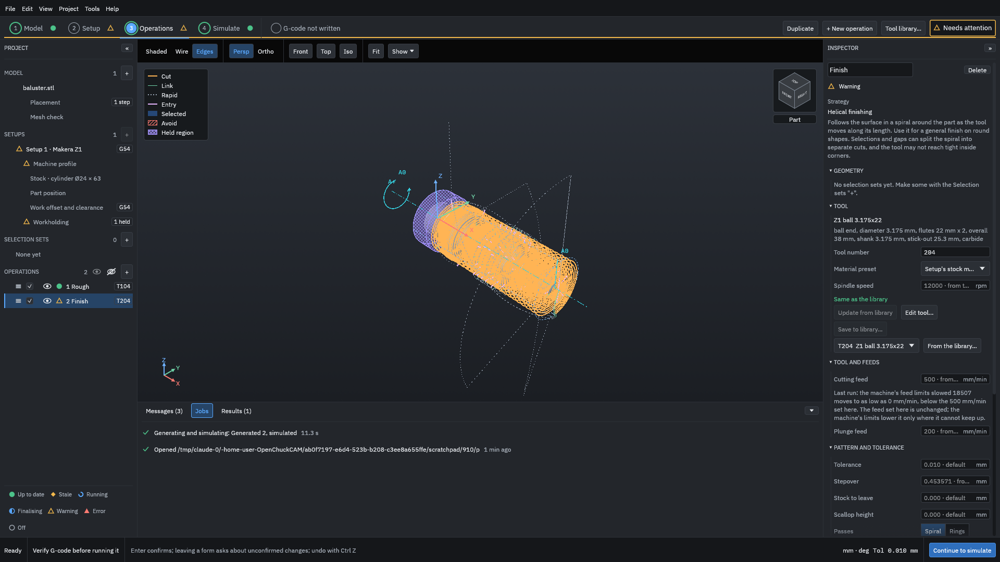
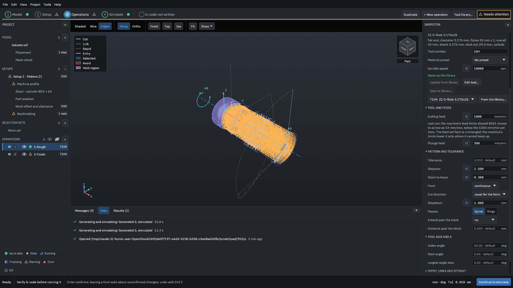
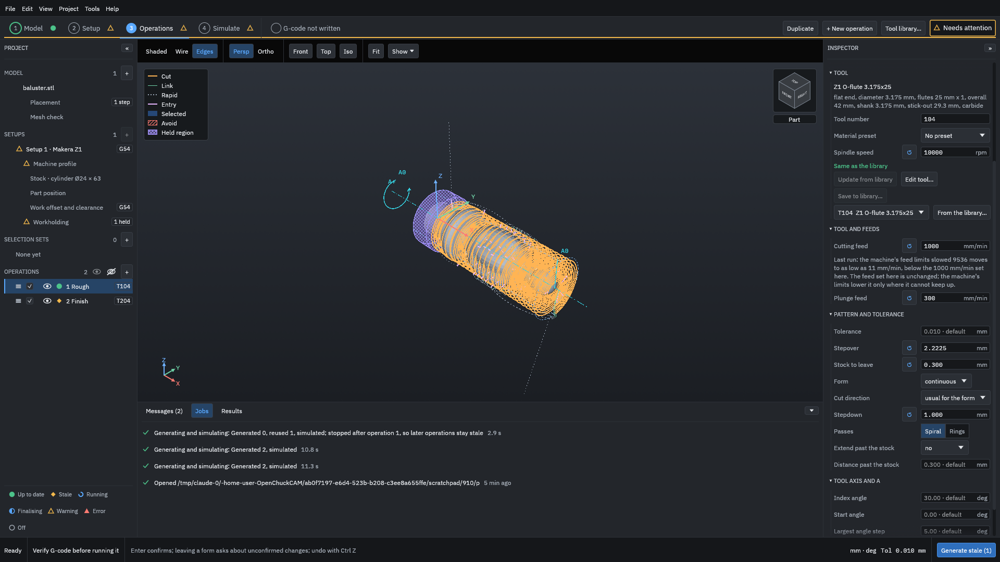
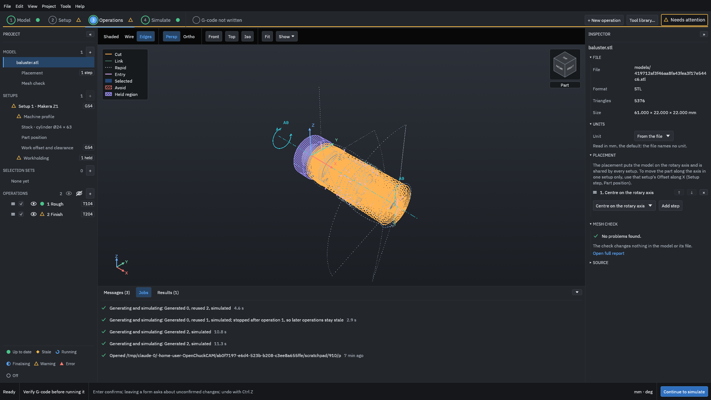
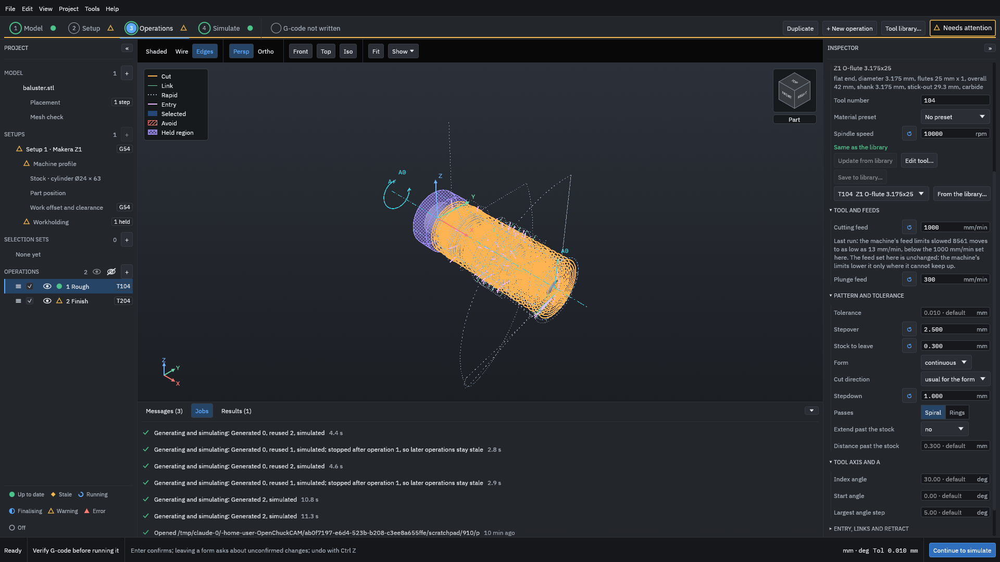
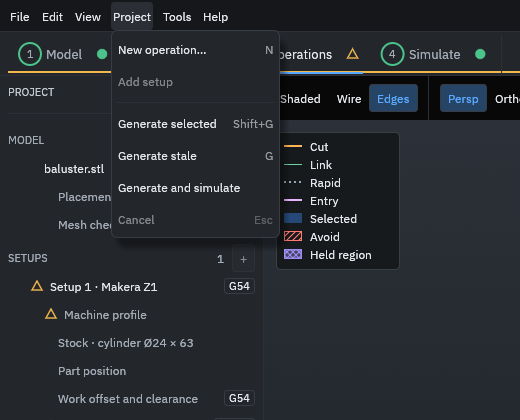
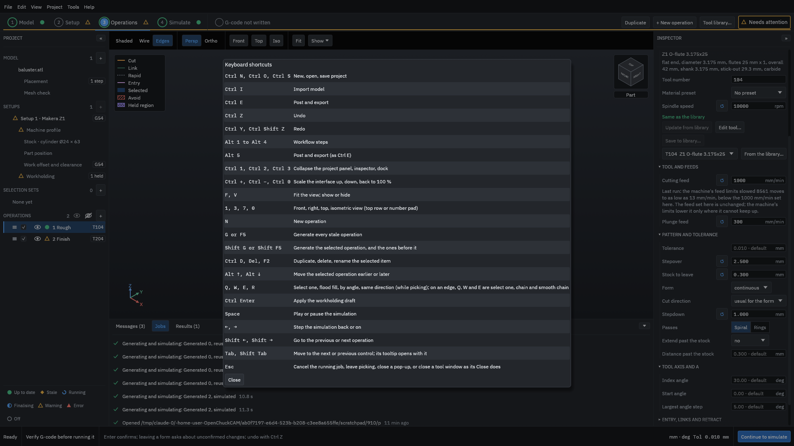

# Owner check for PR #910: G and F5 generate every stale operation; Shift G and Shift F5 the selected one

**For:** the project owner, on Windows. **Time:** about 10 minutes, mostly waiting for Generate. **Machine:** none.

This change has no GitHub issue. It is pull request #910 (lane SIM-UX, record SIM-UX-G, branch `claude/lane-sim-ux-g`, head `85188a60`). The owner check comes from the record's own "Owner check" section, with the corrections found when it was run here (see "Findings").

## What changed, and what to check

The keys are swapped. The plain key now does what the **Generate stale** button does; Shift with the key generates the selected operation, and the operations before it that it needs.

| Key | Before | Now | Expected result |
| --- | --- | --- | --- |
| **G** or **F5** | the selected operation | **every stale operation** | Jobs reads "Generated N, …" for all that were stale |
| **Shift G** or **Shift F5** | every stale operation | **the selected operation** (and those before it) | With **2 Finish** selected: "Generated 2". With **1 Rough** selected: "…; stopped after operation 1, so later operations stay stale" |
| Shift G or Shift F5 with **no operation selected** | — | every stale operation | As G |
| **Project** menu | — | "Generate selected Shift+G" and "Generate stale G" | — |
| **Help > Keyboard shortcuts** | — | "G or F5: Generate every stale operation" and "Shift G or Shift F5: Generate the selected operation, and the ones before it" | — |

**Keyboard focus, on Windows as everywhere.** The keys work only while no text field has the keyboard. After typing a value and pressing Enter, click the 3D view (or press Esc) before pressing G. Otherwise the field takes the letter. A button or a tree row with the focus ring does not take these keys.

## The example project

The public tutorial project `testdata/examples/baluster/baluster-project`, as the record names it: **1 Rough** (rotary roughing) and **2 Finish** (helical finishing), both stale when opened. Work on a copy, because the check changes it.

## Steps

Use a build of PR #910 (`85188a60` or later), or a nightly after it merges, on Windows. Keep the **Jobs** tab open under the view, where each run is listed with what it generated.

1. Copy `testdata/examples/baluster/baluster-project` to a folder of your own and open the copy (**File > Open project**). Click **3 Operations**, then **Jobs** under the view.
2. Click **2 Finish** in the project panel. Press **Shift G**. **Expect:** 1 Rough and 2 Finish both generate: "Generating and simulating: Generated 2, simulated" (screenshot 1).
3. Click **1 Rough**. In the Inspector change **Stepover** (for example to `2.5`) and press Enter: both operations are stale. **Click the 3D view.** Press **G**. **Expect:** both generate, "Generated 2", as **Generate stale** does (screenshot 2).
4. With **1 Rough** still selected, press **Ctrl Z** (both stale again). Click the view and press **Shift G**. **Expect:** only Rough: "…; stopped after operation 1, so later operations stay stale", and the footer button reads **Generate stale (1)** (screenshot 3).
5. Repeat steps 3 and 4 with **F5** and **Shift F5**. **Expect** the same results (screenshot 5: the two newest lines are Shift F5, then F5).
6. **No operation selected.** To deselect, **click the model, baluster.stl, in the project panel**: no operation is then selected. Until #925 lands, clicking an empty part of the project panel does not clear the selection (see "Findings"), so use the model. Make an operation stale (Ctrl Z or a change) and press **Shift G**. **Expect:** every stale operation generates, as with G (screenshot 4).
7. Open the **Project** menu: "Generate selected Shift+G" and "Generate stale G" (screenshot 6). Open **Help > Keyboard shortcuts**: "G or F5 Generate every stale operation" and "Shift G or Shift F5 Generate the selected operation, and the ones before it" (screenshot 7).

## Pass and fail

- **Pass:** each step does as written.
- **Fail:** a key does nothing, does the other action, or gives an error. Say which step, which key, and what happened. If the key typed into a field, say so, because that is a focus problem and not a key problem.

## What to report back

```text
PR #910 generate keys
Build (Help > About version / commit):        Windows version:
2 Shift G with Finish selected -> Generated 2:                 PASS / what happened
3 G with both stale -> every stale generated:                  PASS / ...
4 Shift G with Rough selected -> stops after operation 1:      PASS / ...
5 F5 and Shift F5 as G and Shift G:                            PASS / ...
6 Shift G with no operation selected -> every stale:           PASS / ...  (how you cleared the selection)
7 Project menu and Help > Keyboard shortcuts show the new keys: PASS / ...
Result: PASS / FAIL
```

## Findings when this was run here (for the lane)

1. **The record's step 5, "Click an empty part of the tree so nothing is selected", does not clear the selection** on `85188a60`: 1 Rough stays selected after clicks below the operations list, below the panel's key, on the view background, with Esc and with Ctrl+click. This pack uses "click the model" instead (step 6) until #925 lands.
2. **The record's step 6 names an "Operations" menu.** The commands are in the **Project** menu (screenshot 6).
3. Step 3 needs a click on the view after typing a value, so the field gives up the keyboard. The record does not say so.

## As captured here

True captures from the release build of PR #910 at `85188a60`, on Linux, Xvfb with Mesa lavapipe, at 1920 × 1080. They were taken doing the steps above in order, in one session. The Jobs lines are newest first. Not checked here: a real Windows keyboard and window manager, which is this check's purpose.

1. Shift G with 2 Finish selected: "Generated 2, simulated".
   
2. G with both stale: "Generated 2, simulated".
   
3. Shift G with 1 Rough selected: "stopped after operation 1, so later operations stay stale"; the footer reads Generate stale (1).
   
4. The model selected (no operation), Shift G: every stale operation ("reused 2": both had been generated before at these values).
   
5. After Shift F5 with Rough selected, then F5: the two newest Jobs lines.
   
6. The Project menu.
   
7. Help > Keyboard shortcuts.
   
