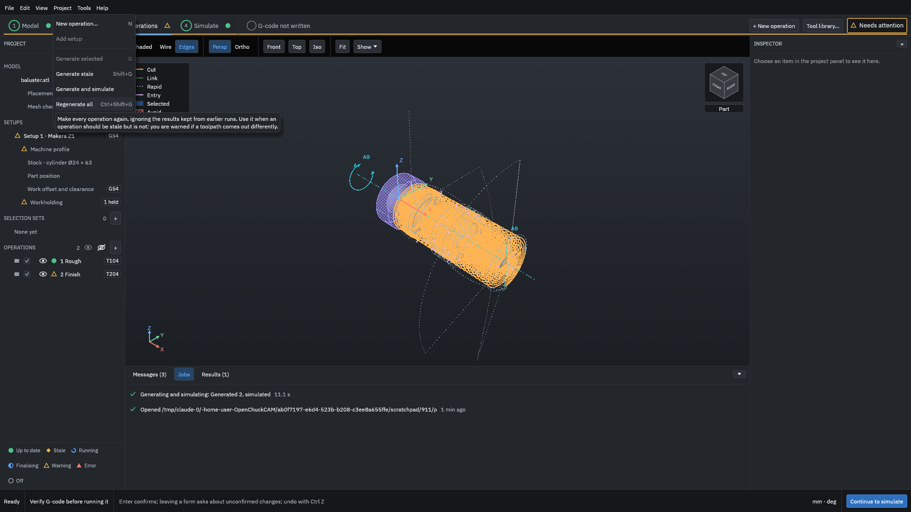
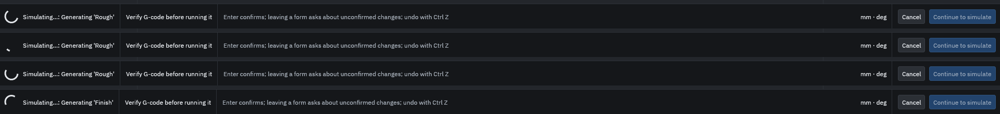
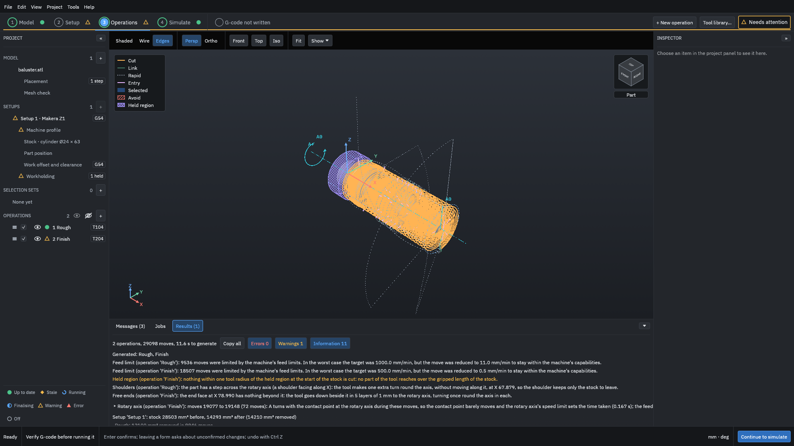
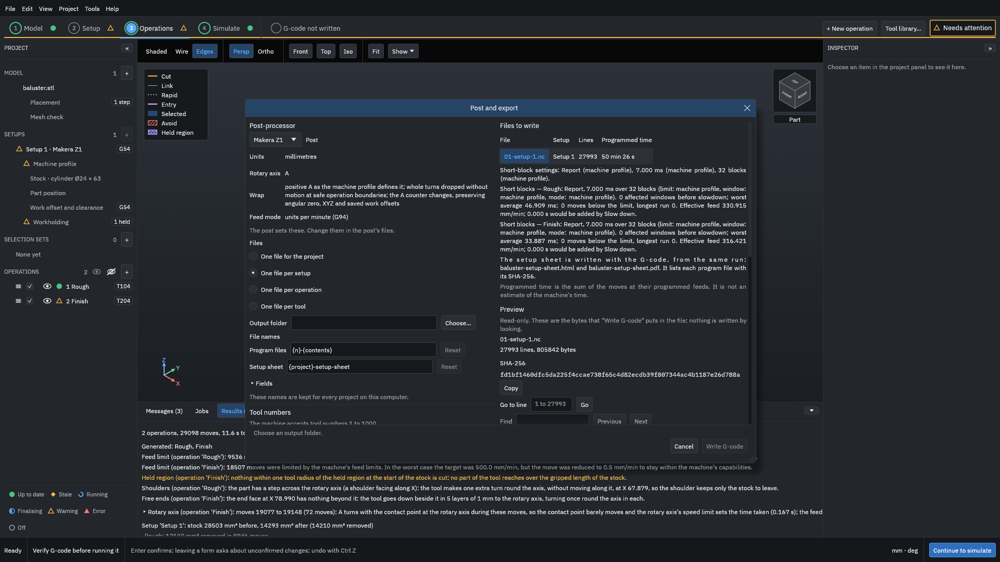
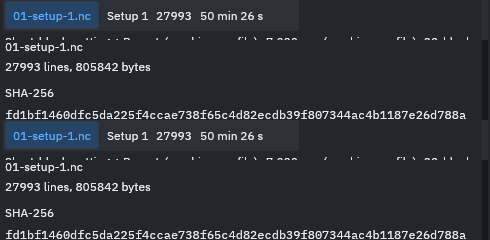
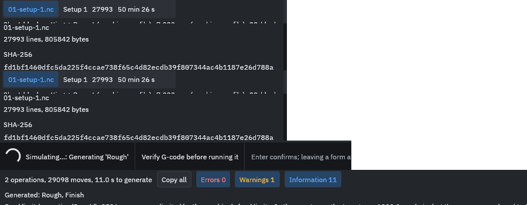

# Owner check for PR #911 (#559): Project > Regenerate all

**For:** the project owner, on Windows. **Time:** about 10 minutes, mostly waiting for Generate. **Machine:** none.

> [!NOTE]
> Regenerate all makes the same G-code when nothing was missed. It does not make a program safe. Generated G-code is yours to verify before it runs on a machine.

## What changed, and what to check

The change is pull request #911 (lane SIM-UX, record SIM-UX-F, head `936c9b52`), for issue #559. **Project > Regenerate all** (Ctrl Shift G) makes every enabled operation again, whatever results are kept from earlier runs. If an operation's toolpath comes out differently from the kept one, a change was missed, and the run gives a warning saying so.

**#559's warning is verified by test, not by you.** Its test, `operation::req_ui_09_req_gc_07_regenerate_all_makes_every_operation_again_and_says_when_one_differs`, uses a test strategy that stands in for a missed change. A real project cannot show the warning unless a missed change exists. Your check is that the command is there, works, and changes nothing when nothing was missed.

| Check | Expected result |
| --- | --- |
| **Project** menu | **Regenerate all** with "Ctrl+Shift+G", after "Generate and simulate". Its tooltip: "Make every operation again, ignoring the results kept from earlier runs. Use it when an operation should be stale but is not: you are warned if a toolpath comes out differently." |
| Ctrl Shift G with nothing stale | Both operations are made again: the footer shows "Generating 'Rough'", then "Generating 'Finish'", then **Ready**. **Results** reads "Generated: Rough, Finish" with a new time. No new warning |
| The program | **Post and export** shows the same file, line count, programmed time and SHA-256 before and after |
| Help > Keyboard shortcuts | "Ctrl Shift G: Regenerate all: make every operation again, ignoring the kept results" |

## The example project

The public tutorial project `testdata/examples/baluster/baluster-project`, as the record names it: **1 Rough** and **2 Finish**. Work on a copy.

## Steps

Use a build of PR #911 (`936c9b52` or later), or a nightly after it merges, on Windows.

1. Copy `testdata/examples/baluster/baluster-project` and open the copy (**File > Open project**). On **Operations**, press **Generate stale (2)** at the bottom right. Wait for **Ready**. **Jobs** reads "Generating and simulating: Generated 2, simulated" (screenshot 1).
2. Open the **Project** menu and hold the pointer on **Regenerate all**: "Ctrl+Shift+G", after "Generate and simulate", with the tooltip above (screenshot 2). Press Esc.
3. Press **Ctrl E** (Post and export). Note the file's **Lines**, **Programmed time** and the **SHA-256** under Preview (screenshot 6). Press **Cancel**.
4. Click the 3D view, so no text field has the keyboard, and press **Ctrl Shift G**. **Expect:** the footer shows "Generating 'Rough'", then "Generating 'Finish'" (screenshot 3), then **Ready**. Open **Results**: "Generated: Rough, Finish", with a generate time different from step 1's, and no warning beginning "Regenerate all" (screenshot 5).
5. Press **Ctrl E** again. **Expect:** the same lines, programmed time and SHA-256 as in step 3 (screenshot 7). Press **Cancel**.
6. Do steps 4 and 5 once more from the menu: **Project > Regenerate all**.

## Pass and fail

- **Pass:**
  - Regenerate all is in the Project menu with its key and tooltip;
  - Ctrl Shift G and the menu item both make both operations again (footer and Results);
  - no "Regenerate all" warning;
  - the same lines, time and SHA-256 before and after.
- **Fail:**
  - the key or the item does nothing;
  - a "Regenerate all … came out differently" warning on this unchanged project (report its whole text: it names the build and the key, nothing private);
  - a different SHA-256.

## What to report back

```text
PR #911 Regenerate all
Build (Help > About version / commit):        Windows version:
2 Project menu: Regenerate all, Ctrl+Shift+G, tooltip:   PASS / what differed
4 Ctrl Shift G remade both (footer, Results "Generated: Rough, Finish"), no warning: PASS / ...
5 same lines / time / SHA-256 before and after: PASS / ...  (SHA-256: ______)
6 the menu item does the same:                  PASS / ...
Result: PASS / FAIL
```

## Finding when this was run here (for the lane)

**The Jobs tab gets no line for Regenerate all.** The record's step 3 says "Expect both operations to generate again (Jobs: "Generated 2")". On `39a71c7e` the run happens:
- the footer shows "Generating 'Rough'", then "Generating 'Finish'";
- Results reads "Generated: Rough, Finish" with a new time;
- the program is the same.

But the Jobs tab adds no line, before or after it finishes (screenshot 4). `936c9b52` changes only the warning text, so this is unchanged there. This pack checks the footer and Results instead. Either the Jobs tab should list the run, or the record's step should change.

The menu on this build lists "Generate selected G" and "Generate stale Shift+G", the keys from before #910. Once #910 merges they swap, and Regenerate all keeps Ctrl+Shift+G.

## As captured here

Screenshots 1 to 7 are true captures from the release build of PR #911 at `39a71c7e`, the head when the pack was made. The head then moved to `936c9b52`, which changes only the wording of the missed-change warning ("1 move" or "N moves"); that warning does not appear in this check. Steps 1, 3, 4 and 5 were run again on a release build of `936c9b52` with the same results (screenshot 8). The captures were made on Linux, Xvfb with Mesa lavapipe, at 1920 × 1080, doing the steps above in one session. The footer strip (screenshot 3) is four frames one second apart. Not checked here: a real Windows keyboard. The warning path is covered by the test named above, not here.

1. Generate stale: Jobs "Generated 2".
   
2. Project menu: Regenerate all, Ctrl+Shift+G, and its tooltip.
   
3. The footer while Ctrl Shift G runs: Generating 'Rough', then 'Finish'.
   
4. Jobs after it finished: no new line (the finding).
   
5. Results: "Generated: Rough, Finish", 11.6 s to generate, against 11.1 s for the first run, and no Regenerate-all warning.
   
6. Post and export before: 27,993 lines, 50 min 26 s, SHA-256 fd1bf146…788a.
   
7. The file row and SHA-256 before (top) and after (bottom) a second Ctrl Shift G: identical.
   
8. Re-check on `936c9b52`. Top: the export row and SHA-256 before and after Ctrl Shift G, identical. Bottom: the footer while it runs, and Results "Generated: Rough, Finish".
   
