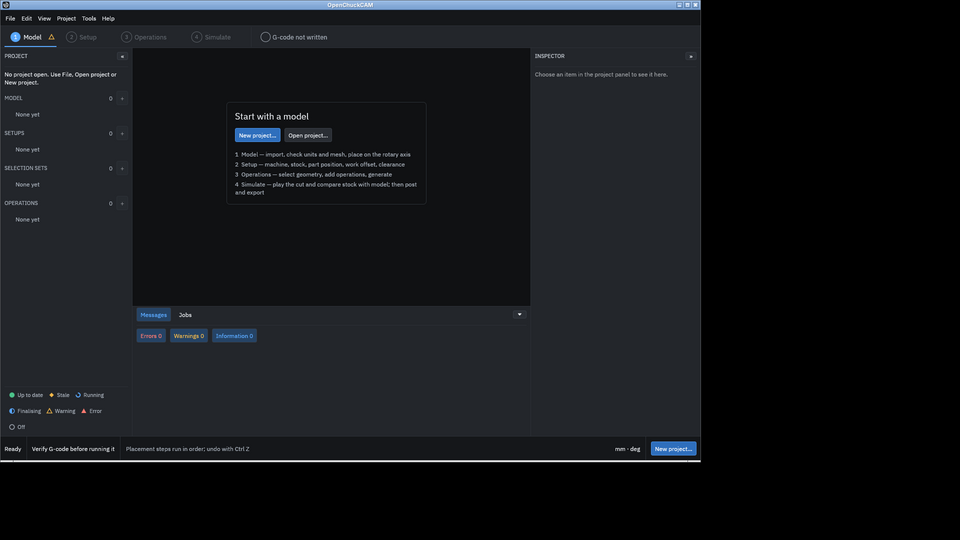
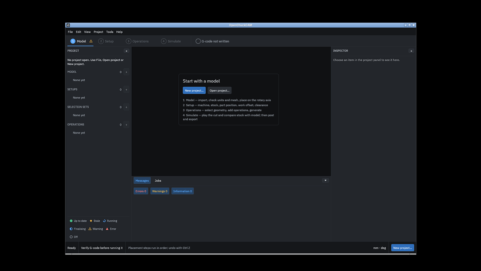
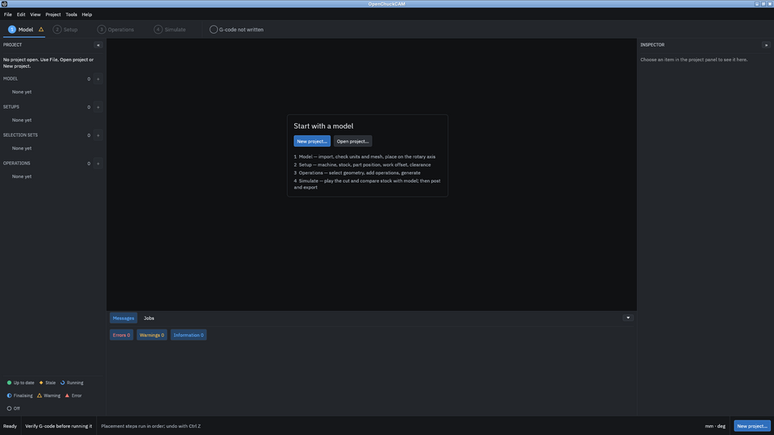
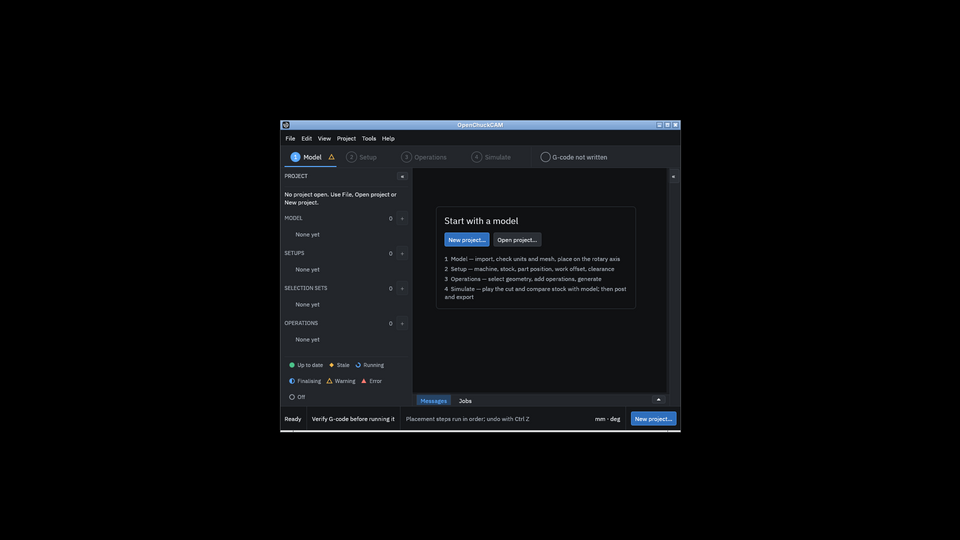

# Owner check: how the window opens on Windows (OI-9932; PR #906)

**For:** the project owner, on Windows. **Time:** about 10 minutes. **Machine:** none.

> [!IMPORTANT]
> **You run this on Windows.** A maximised start (steps 1 and 3) could not be shown here: the Linux test setup (openbox on Xvfb) does not honour a request to open maximised, with or without this change. Only Windows shows whether the window opens maximised; see "What could and could not be shown here" at the end.

This one has no GitHub issue: the owner reported it in conversation. The fix is pull request #906 (lane DISPLAY-TARGET, branch `claude/lane-display-target-a`, head `19643a8b`). Its record is DISPLAY-TARGET-A, item 6, on #905. It adds the specification's section 3 bullet "Opening the window".

## What was wrong, and what to check

**Before:** after a session in a maximised window, the program saved the maximised size as the window's size. The next start opened a screen-sized window, not maximised, off to one side and running past the edge of the screen.

**Now:** the settings keep the window's **normal** size and whether it was **maximised**, never its position.

| # | Do | Expected result |
| --- | --- | --- |
| 1 | Start with fresh settings | Opens **maximised** |
| 2 | Un-maximise, close, start | Opens **centred**, at the size it had when you closed it |
| 3 | Maximise, close, start | Opens **maximised**; un-maximising goes back to the normal size, centred |
| 4 | Make the window small, drag it into a corner, close, start | Opens **centred** at that small size, not in the corner |
| 5 | (Optional, two monitors) Close it on the second monitor, start | Opens on the **primary** monitor |

## The settings file

Everything here is kept in one file:

```text
%APPDATA%\OpenChuckCAM\settings.toml
```

That is usually `C:\Users\<you>\AppData\Roaming\OpenChuckCAM\settings.toml`. To look at it while the program is closed, paste this into the Run box (Win R) or a Command Prompt:

```text
notepad %APPDATA%\OpenChuckCAM\settings.toml
```

The two lines this check is about are in the `[interface]` table at the top:

```toml
[interface]
maximised = true          # was the window maximised when last seen
window = [
    1400.0,               # the window's normal width, logical pixels
    900.0,                # its normal height
]
```

There is no position line, and there should not be. The program saves about a second after a change and again on close. Close it with the window's close button or **File > Quit**, not from Task Manager.

**Fresh settings, for step 1:**
1. Close the program.
2. Rename `settings.toml` to `settings.toml.keep`, for example with `ren "%APPDATA%\OpenChuckCAM\settings.toml" settings.toml.keep`.
3. The next start uses the defaults.

The file also holds your recent projects, scale, theme and panel sizes. To get them back after the check, close the program, delete the new `settings.toml`, and rename `settings.toml.keep` back.

## Steps

Use a build of PR #906 (`19643a8b` or later), or a nightly after it merges. **Help > About** gives the version and commit.

1. **Fresh start.** Do the "Fresh settings" steps above, then start OpenChuckCAM. **Expect:** the window is maximised (it fills the screen above the taskbar, and the title bar's middle button shows "Restore Down"). Close it. **Expect** in `settings.toml`: `maximised = true`.
2. **Un-maximised.** Start it (maximised), and click **Restore Down**. Resize the window to roughly two thirds of the screen. Close it. **Expect** in `settings.toml`: `maximised = false` and `window = [...]` with about that size. Start it. **Expect:** the same size, centred on the screen, not maximised.
3. **Maximised.** Maximise it (double-click the title bar) and close it. **Expect** in `settings.toml`: `maximised = true`, with `window` still the size from step 2. Start it. **Expect:** maximised. Click **Restore Down**. **Expect:** back to the step 2 size, centred.
4. **Small, in a corner.** With the window not maximised, make it small (about 1000 × 700) and drag it into the bottom right corner, partly off the screen if you like. Close it, then start it. **Expect:** it opens at that small size, **centred**, wholly on the screen.
5. **Two monitors (optional).** Drag the window, not maximised, to your second monitor and close it. Start it. **Expect:** it opens on the **primary** monitor, centred. Then maximise it on the second monitor, close it, and start it. **Expect:** maximised on the primary monitor.

When you are done, put your own `settings.toml` back as described above.

## Pass and fail

- **Pass:** each step opens as its "Expect" line says, the window is never partly off the screen at start, and `settings.toml` reads as described.
- **Fail:**
  - a start that is not maximised when it should be, or maximised when it should not be;
  - a window that opens off-centre or runs past an edge;
  - un-maximising that goes to a screen-sized window;
  - a `settings.toml` with the maximised size saved as `window`.

## What to report back

For each step, PASS or what you saw. For any FAIL, also send the two lines of `settings.toml` and a screenshot of the whole screen (Win Shift S, then paste it into the comment).

```text
Window opening check (PR #906)
Build (Help > About version / commit):        Windows version:
Screen(s): resolution and scale of each, which is primary:
1 fresh start maximised:                  PASS / what you saw ;  settings: maximised = ___
2 un-maximised, restart centred at size:  PASS / ... ;  settings: maximised = ___ window = [___, ___]
3 maximised, restart maximised; restore to step-2 size: PASS / ... ;  settings: maximised = ___ window = [___, ___]
4 small in a corner, restart centred:     PASS / ...
5 two monitors (optional):                PASS / not tried / ...
Result: PASS / FAIL
```

## What could and could not be shown here

The check is about Windows: its window manager places and maximises the window. It was not run on Windows here. What was run is the same five steps on Linux, release builds on Xvfb at 1920 × 1080 with the openbox window manager, driven by `wmctrl`. The full table is in [`run/README.md`](run/README.md); the screenshots are half size.

- **Not shown: a start maximised (steps 1 and 3).** Openbox on Xvfb does not honour a request to open maximised. `main`, which also asks for it on a first start, opens unmaximised there too, so this is the test setup, not the change. On Windows this is the part to look at most closely.
- **Shown, steps 2 and 4: centred at the kept size.** A window set to 1400 × 900 in the top left corner and closed opened at (262, 130) on the next start: centred on the 1920 × 1080 screen.
- **Shown, step 3's settings.** After closing it maximised, `settings.toml` read `maximised = true` and kept `window = [1400.0, 900.0]`, the normal size.
- **Shown, the old bug on `main`.** The same maximised close saved `window = [1920.0, 1061.0]`. The next start opened a screen-sized, unmaximised window at (2, 40), running past the bottom of the screen.
- **Not shown: step 5.** There was no second monitor.

| | |
| --- | --- |
| PR #906, after the window was set to 1400 × 900 in the top left corner |  |
| PR #906, next start: centred at 1400 × 900 |  |
| PR #906, maximised before closing |  |
| PR #906, next start on openbox: centred at the kept 1400 × 900 (openbox did not maximise it; see above) |  |
| `main` (before), next start after closing maximised: a screen-sized window off to one side |  |
| PR #906, fresh start on openbox: 800 × 600, centred, not maximised (openbox; on Windows it should be maximised) |  |
