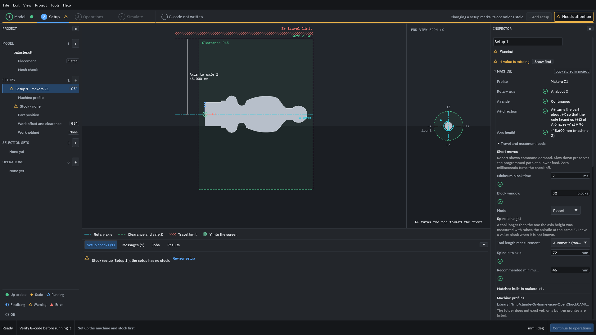

# 3. Choose the machine

The Setup step describes the machine, the stock and how the work is held.

1. Press **Add setup**.
2. In the Inspector (the panel on the right), under **Machine**, choose **Makera Z1 (built-in makera-z1)** in the list of machine profiles.
3. Press **Use this machine**.

<figure>
  
  <figcaption><b>Figure 1.</b> The Setup step with the Makera Z1 chosen. Each of the machine's values has a tick: it was confirmed on a Z1.</figcaption>
</figure>

The view now shows the part on the A axis with the safe height (45 mm above the axis) and the travel limit; the end view shows which way positive A turns. The Inspector shows the [machine profile](../glossary.md#machine-profile)'s rotary axis (A, about X), its range and direction, and its axis height. The profile is copied into the project, so a later change to the library does not change this project.

> [!WARNING]
> The ticks mean the values were confirmed on the project owner's Z1, with its supplied chuck, not on *your* machine. They include the height of the axis above the bed and the travel, which the program uses to check that moves stay in range, so **measure them on your machine and correct the profile** before you trust a check that depends on them. A value you change is marked unconfirmed, and the status bar at the bottom right then names it, for example "Clearance unconfirmed".
