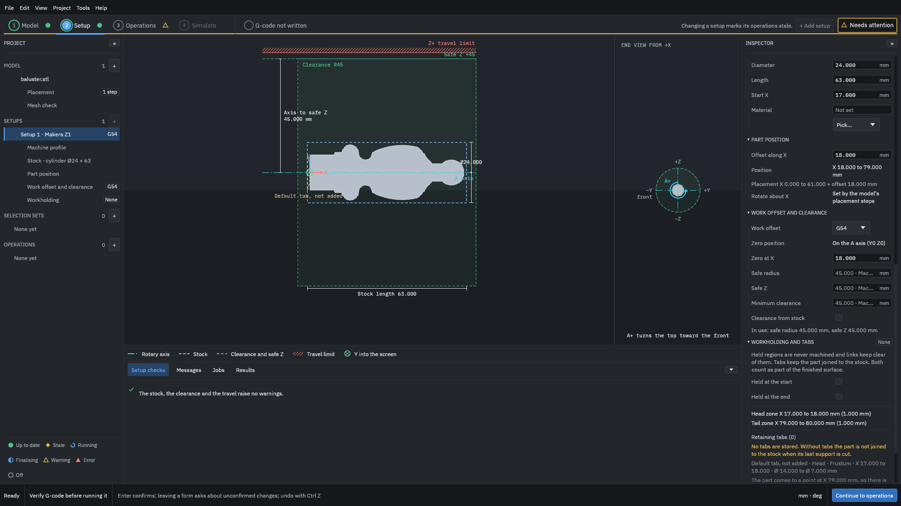

# 4. Set up the stock

On the Makera Z1, X 0 is the face of the headstock, where the chuck is mounted. The part must start beyond the chuck, so move it along X first, together with the [work offset](../glossary.md#work-offset)'s zero, before you choose the stock. This tutorial uses 18 mm.

> [!WARNING]
> The 18 mm in this example is the length of the project owner's supplied chuck, with its jaws as they were used, not a value for your machine. Measure, on your machine, the distance from the face of the headstock body to the face of your chuck where the stock starts, with your jaws fitted and gripping as you will grip, and use that number for **Offset along X** and **Zero at X**. A value that is too small puts the stock, and the tool's path, inside the chuck; the program does not check this. The program's X0 is set on the machine with the controller's work offset (G54), so set it there at the same place, and check the program before you cut.

1. In the project tree on the left, choose **Stock** under **Setup 1** (or scroll the Inspector to **Stock**).
2. Under **Part position**, set **Offset along X** to **18** (millimetres) and press <kbd>Enter</kbd>. **Position** now reads X 18.000 to 79.000 mm.
3. Under **Work offset and clearance**, set **Zero at X** to **18** and press <kbd>Enter</kbd>, so that the program's zero is at the start of the part.
4. Under **Stock**, choose the **Cylinder** shape. The program fills in a diameter and length that surround the part with a small allowance: a 24 mm diameter, 63 mm long bar starting at X 17, 1 mm before the part. Leave them.
5. Under **Material**, pick **Hardwood**.

<figure>
  
  <figcaption><b>Figure 1.</b> A cylinder of stock, 24 mm across and 63 mm long, starting at X 17, drawn as a dashed outline around the part. The part position and the work offset are both at 18 mm.</figcaption>
</figure>

The stock appears as the dashed outline around the part. The program does not check that the stock is clear of the headstock and the chuck: with the part left at X 0, the stock would start inside the headstock. On your own parts, place the part so that the stock starts about the chuck's length from X 0. The [material](../glossary.md#material) choice matters because the tool library has cutting data for each material, which the operations use later. [Stock and the held region](../concepts/stock-and-held-region.md) says more about the stock.
